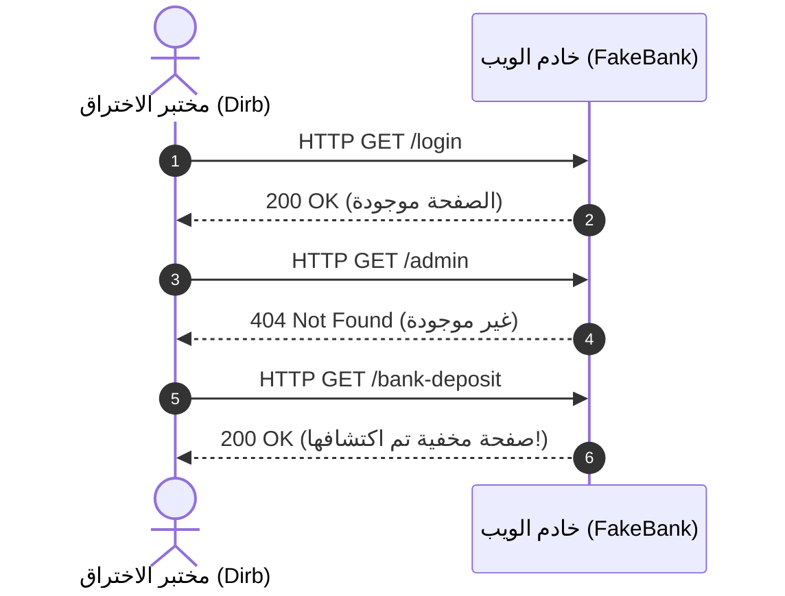
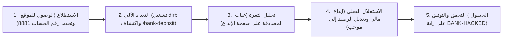

# التوثيق التخصصي الشامل: مدخل إلى الأمن الهجومي (Offensive Security Intro)

---

## 01. نظرة عامة على الغرفة (Room Overview)
* **عنوان الغرفة الأصلي:** Offensive Security Intro
* **رابط الغرفة الرسمي:** [https://tryhackme.com/room/offensivesecurityintro](https://tryhackme.com/room/offensivesecurityintro)
* **الوحدة التابعة:** الوحدة 01 — ابدأ رحلتك في الأمن السيبراني (Start Your Cyber Security Journey)
* **مستوى الصعوبة:** مبتدئ (Beginner)
* **الوقت التقديري للإنجاز:** 30 دقيقة
* **المتطلبات المسبقة:** لا توجد متطلبات مسبقة؛ مصممة كأول تفاعل عملي مباشر للمتعلم مع الهجوم على تطبيقات الويب.
* **الأهمية الميدانية:** تقدم هذه الغرفة التجربة العملية الأولى في تقييم تطبيقات الويب من منظور المهاجم الخارجي، حيث يتعلم المختبر كيف أن إخفاء الروابط الإدارية دون حمايتها بنظام مصادقة (Security through Obscurity) هو خطأ تصميمي فادح يؤدي إلى اختراق مالي كامل للأنظمة.

---

## 02. الأهداف التعليمية (Learning Objectives)

### أهداف نظرية ومفاهيمية (Theoretical Objectives)
* استيعاب المفهوم الجوهري للأمن الهجومي (Offensive Security) والفرق بينه وبين العمل الدفاعي (Defensive Security).
* فهم فلسفة "التفكير كالمخترق" (Attacker Mindset) لاكتشاف المسارات غير المعتادة داخل الأنظمة.
* التعرف على مبدأ "الأمان عبر الإخفاء" (Security through Obscurity) وأسباب فشله الحتمي أمام الأدوات الهجومية.

### أهداف عملية وتطبيقية (Practical Objectives)
* تشغيل واستخدام أدوات تعداد وتخمين مسارات الويب (Web Directory Brute-Forcing) باستخدام أداة `dirb`.
* قراءة وتحليل أكواد الاستجابة لبروتوكول HTTP (مثل `200 OK` و `404 Not Found`).
* استغلال صفحات إدارة المعاملات المالية غير المحمية لتنفيذ عمليات إيداع وتعديل الأرصدة المصرفية بدون تصريح.

### أهداف تحليلية ومهنية (Analytical & Professional Skills)
* تتبع تدفق البيانات في طلبات الويب وفهم أثر غياب التحقق من صلاحيات المستخدم (Broken Access Control).
* صياغة وتوثيق خطوات الاختراق كإثبات مفهوم (Proof of Concept - PoC) يمكن للمطورين فهمه وترقيعه.

---

## 03. الأسس المفاهيمية (Conceptual Foundations)

### الأمن الهجومي vs الأمن الدفاعي
* **الأمن الهجومي (Offensive Security / Red Teaming):** 
  ممارسة استباقية تحاكي أساليب وتكتيكات الخصوم الحقيقيين (Adversary Emulation). يبحث المختبر الهجومي عن "نقطة ضعف واحدة" تكفي لاختراق النظام، مما يساعد المؤسسات على اختبار متانة دفاعاتها عملياً.
* **الأمن الدفاعي (Defensive Security / Blue Teaming):** 
  ممارسة مستمرة وميدانية تهدف إلى تأمين كافة المنافذ والأنظمة على مدار الساعة (24/7)، ومراقبة الأحداث الأمنية في غرف الـ SOC، والتحقيق في الحوادث السيبرانية (DFIR)، وتطبيق التحديثات وسد الثغرات.

### وهم الأمان عبر الإخفاء (Security through Obscurity)
يعتقد بعض المطورين المبتدئين أن إنشاء صفحة حساسة مثل `/bank-deposit` أو `/admin_secret` وعدم وضع رابط لها في الصفحة الرئيسية للعملاء كافٍ لحمايتها! في عالم اختبار الاختراق، هذا الاعتقاد وهم تام؛ لأن أدوات التعداد الآلية تعتمد على قواميس كلمات (Wordlists) تحتوي على ملايين الكلمات الشائعة، وتقوم بتجربتها على الخادم في دقائق معدودة، مما يكشف تلك الصفحات فوراً.

---

## 04. الغوص التقني والتشريحي (Technical Deep Dive)

### آليات عمل تعداد مسارات الويب (Directory Brute-Forcing)
عندما تقوم بتشغيل أداة تعداد مثل `dirb` أو `gobuster`، فإن العملية تمر بالخطوات المعمارية التالية:



1. قراءة القاموس المرجعي (`common.txt`) سطر بعد سطر.
2. إنشاء طلب `HTTP GET` إلى المسار المكون: `http://fakebank.thm/word`.
3. فحص استجابة الخادم:
   * إذا رد الخادم بـ `404 Not Found`: تتجاهل الأداة النتيجة.
   * إذا رد الخادم بـ `200 OK` أو `301/302 Redirect`: تسجل الأداة المسار كهدف نشط للاستكشاف البشري.

---

## 05. الأدوات والتقنيات (Tools and Technologies)

### أداة Dirb
أداة فحص ومسح لمحتوى خوادم الويب مكتوبة بلغة C، وتعمل عبر سطر الأوامر:
* **الغرض:** البحث عن الملفات والمجلدات المخفية عبر هجمات القاموس (Dictionary-based attack).
* **طريقة الاستخدام الشائعة:**
  ```bash
  dirb http://target.thm /path/to/wordlist.txt
  ```
* **الأدوات البديلة الأحدث في السوق:**
  * **Gobuster:** أسرع بكثير ومكتوبة بلغة Go وتدعم فحص الـ Virtual Hosts والنطاقات الفرعية.
  * **ffuf (Fast Web Fuzzer):** المعيار الذهبي الحالي لمرونتها وسرعتها الفائقة.

---

## 06. منهجية اختبار الاختراق المطبقة (Methodology)



---

## 07. إعادة البناء العملي (Practical Walkthrough)

1. **الخطوة 1: فحص الهدف:**
   * فتح تطبيق البنك واكتشاف رقم الحساب المصرفي للمستخدم: `8881`.
   * الرصيد الحالي يظهر سالباً: `-$100.00`.
2. **الخطوة 2: الفحص واكتشاف المسارات:**
   * تشغيل أمر `dirb` في الطرفية:
     ```bash
     dirb http://fakebank.thm
     ```
   * اكتشاف الرابط المخفي غير المعلن: `http://fakebank.thm/bank-deposit`.
3. **الخطوة 3: الاستغلال المالي:**
   * فتح الرابط المكتشف في المتصفح.
   * إدخال رقم الحساب: `8881` وإيداع مبلغ `200`.
   * الضغط على زر الإيداع بنجاح.
4. **الخطوة 4: التقاط الراية:**
   * تحول الرصيد إلى `+$100.00`، وظهور رسالة النجاح الخضراء: `BANK-HACKED`.

---

## 08. المهام والحلول (Tasks and Solutions)
تم توثيق المهام الخمس بشكل مستقل وفق منهجية المراحل السبع (A إلى G) في مجلد `TASKS/`:
* [المهمة 01: التفكير كالمخترق (TASK-01.md)](../../01-OFFENSIVE-SECURITY-INTRO/TASKS/TASK-01.md)
* [المهمة 02: بدء المعمل ورقم الحساب (TASK-02.md)](../../01-OFFENSIVE-SECURITY-INTRO/TASKS/TASK-02.md)
* [المهمة 03: اكتشاف الصفحات المخفية (TASK-03.md)](../../01-OFFENSIVE-SECURITY-INTRO/TASKS/TASK-03.md)
* [المهمة 04: مهاجمة لوحة الإدارة وتعديل الرصيد (TASK-04.md)](../../01-OFFENSIVE-SECURITY-INTRO/TASKS/TASK-04.md)
* [المهمة 05: المسارات المهنية وخاتمة الغرفة (TASK-05.md)](../../01-OFFENSIVE-SECURITY-INTRO/TASKS/TASK-05.md)

---

## 09. استكشاف الأخطاء والأخطاء الشائعة (Troubleshooting)
1. **الخطأ الشائع: إدخال الرابط بدون `http://` في أداة dirb:**
   * *المشكلة:* يفشل الأمر برسالة خطأ في الـ URL.
   * *الحل:* يجب كتابة البرتوكول كاملاً: `dirb http://fakebank.thm`.
2. **الخطأ الشائع: كتابة الراية بأحرف صغيرة:**
   * *المشكلة:* المنصة ترفض الإجابة.
   * *الحل:* السؤال ينص صراحة على الأحرف الكبيرة: `BANK-HACKED`.

---

## 10. التبعات والآثار الأمنية (Security Implications)
* **الأثر التجاري (Business Impact):** استغلال ثغرة كهذه في بنك حقيقي يسمح بتوليد وتبييض أموال وهمية وانهيار مالي ومساءلة تنظيمية وقانونية حتمية.
* **الترقيع الأمني (Remediation):**
  1. تطبيق آليات مصادقة صارمة عبر الـ Session أو JWT على كافة الوظائف الإدارية.
  2. فرض مبدأ التحقق من أدوار المستخدمين (Role-Based Access Control - RBAC) في الواجهة الخلفية قبل تنفيذ أي كود مالي.

---

## 11. التطبيقات المهنية الميدانية (Professional Applications)
* في عقود اختبار اختراق الويب التجارية (Web App VAPT)، يقوم المختبر دائماً بتشغيل أدوات فحص المحتوى للبحث عن:
  * لوحات الإدارة غير المعلنة (`/admin`, `/manager`, `/portal`).
  * النسخ الاحتياطية المنسية (`/backup.zip`, `/database.sql`, `config.php.bak`).
  * واجهات الـ API غير الموثقة (`/api/v1/debug`, `/swagger-ui.html`).

---

## 12. النقاط الجوهرية المستفادة (Key Takeaways)
* الإخفاء ليس حماية. أي مسار موجود على السيرفر يمكن اكتشافه بالتخمين الآلي.
* ثغرات التحكم بالوصول (Broken Access Control) تمثل الخطر الأكبر على تطبيقات الأعمال.
* الأمن الهجومي يثبت الأثر الحقيقي للثغرات ويحفز الإدارة على سدها سريعاً.

---

## 13. المرجع السريع (Quick Reference)
* **الأمر الأساسي:** `dirb http://fakebank.thm`
* **المسار المكتشف:** `http://fakebank.thm/bank-deposit`
* **رقم الحساب:** `8881`
* **الراية النهائية:** `BANK-HACKED`

---

## 14. التقييم الذاتي والاختبار المعرفي (Knowledge Assessment)

### الأسئلة (Review Questions):
1. لماذا يفشل مبدأ "الأمان عبر الإخفاء" (Security through Obscurity) في حماية صفحات الويب؟
2. كيف تفرّق أداة `dirb` بين الصفحة الموجودة والصفحة غير الموجودة على السيرفر؟
3. ما هو الفرق بين عمل فريق الـ Red Team وفريق الـ Blue Team داخل المؤسسة؟
4. لو كنت المطور لتطبيق FakeBank، ما هو السطر البرمجي المفقود الذي كان يجب عليك إضافته في بداية صفحة `bank-deposit.php`؟

---

### مفتاح الإجابات التخصصي (Answer Key):
1. **فشل الإخفاء:** لأن المهاجمين يستخدمون أدوات تخمين آلية وقواميس تحتوي على مئات الآلاف من الكلمات والمسارات الشائعة وتفحص الخادم بسرعة فائقة، وبالتالي فإن أي مسار موجود سيتم الوصول إليه حتماً.
2. **آلية الفرز:** عبر فحص رمز استجابة بروتوكول HTTP؛ فإذا رد الخادم بـ `404 Not Found` فالمسار غير موجود، أما إذا رد بـ `200 OK` أو `301/302 Redirect` فالمسار موجود.
3. **الفرق:** الـ Red Team يحاكي تصرفات الخصم ويهاجم الأنظمة استباقياً لاكتشاف الثغرات، بينما الـ Blue Team يراقب الأنظمة ويكتشف الهجمات ويدافع عن البنية التحتية ويغلق الثغرات (SOC & Incident Response).
4. **السطر المفقود:** التحقق من جلسة ودور المستخدم (RBAC)، مثلاً:
   `if (!isset($_SESSION['role']) || $_SESSION['role'] !== 'ADMIN') { http_response_code(403); exit(); }`
