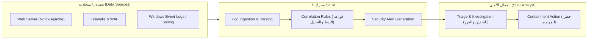

# Additional Technical Notes: Defensive Security Intro
## ملاحظات تقنية ميدانية وتعمق هندسي في العمليات الدفاعية

---

### 1. معمارية أنظمة الـ SIEM وكيف يكتشف المدافعون الهجمات
تعتمد مراكز العمليات الأمنية (SOC) على منصات إدارة معلومات وأحداث الأمان (**SIEM - Security Information and Event Management**) مثل Splunk, Microsoft Sentinel, و Elastic SIEM.

#### كيف يكتشف الـ SIEM هجوم أداة مثل `dirb` أو `gobuster`؟
يتم بناء قاعدة ربط (Correlation Rule) تبحث عن النمط التالي:
$$\text{Count}(Status=404) > 50 \quad \text{within} \quad 10 \text{ seconds} \quad \text{grouped by} \quad \text{Source IP}$$
عندما يرسل المهاجم 50 طلباً لصفحات غير موجودة في 10 ثوانٍ، يطلق الـ SIEM تنبيهاً أمنياً عالي الخطورة (High Severity Alert) باسم:
`Potential Web Directory Brute-Force Activity Detected`.

---

### 2. ترتيب تطاير البيانات في التحقيق الجنائي الرقمي (RFC 3227 - Order of Volatility)
عند استدعاء فريق الأدلة الجنائية والاستجابة للحوادث (DFIR) لفحص جهاز مخترق، لا يجوز إيقاف تشغيل الجهاز أو فصل الكهرباء مباشرة؛ لأن ذلك يمحو أدلة حرجة مخزنة في الذاكرة المتطايرة. ينص معيار **RFC 3227** على الترتيب التالي لجمع الأدلة حسب سرعة تطايرها:

1. **سجلات المعالج والذاكرة المخبأة (Registers & Cache).**
2. **الذاكرة العشوائية الرئيسية (RAM - Process memory, network sockets, injected payloads).**
3. **حالة الشبكة المؤقتة (Routing tables, ARP cache, active TCP/UDP connections).**
4. **أنظمة الملفات المؤقتة ومساحة الذاكرة الظاهرية (Swap / Temp files).**
5. **القرص الصلب والوسائط التخزينية الدائمة (Hard disks, SSDs, system event logs).**
6. **النسخ الاحتياطية والأشرطة المؤرشفة (Archival & backup media).**

---

### 3. هرم الألم للمهاجمين (David Bianco's Pyramid of Pain)
يوضح هذا المفهوم الدفاعي الشهير مدى صعوبة وتكلفة تأثير الإجراءات الدفاعية على المهاجم:
* **عناوين الـ IP (Trivial):** حظر الـ IP سهل جداً على المدافع، ولكن المهاجم يستطيع تغييره في ثانية واحدة باستخدام VPN أو بروكسي جديد.
* **أسماء النطاقات (Easy):** حظر الـ Domain يضطر المهاجم لشراء نطاق جديد وتغيير إعدادات DNS.
* **تجزئة الملفات Hashes (Trivial):** تغيير بايت واحد في ملف الاختراق يغير الـ Hash بالكامل.
* **أدوات الهجوم Network/Host Artifacts (Annoying):** كشف وكيل المستخدم (User-Agent) الخاص بأداة `dirb` أو `sqlmap` يجبر المهاجم على تعديل إعدادات أداة الهجوم.
* **أدوات الهجوم Tools (Challenging):** كشف وتعطيل أداة برمجية كاملة مثل Mimikatz أو Cobalt Strike يجبر المهاجم على كتابة أو العثور على أداة بديلة.
* **التكتيكات والتقنيات TTPs (Tough):** كشف ومنع طريقة التفكير والأسلوب المنهجي للمهاجم (مثل استغلال ثغرات الـ LFI أو هجمات Pass-the-Hash)، وهو أعلى مستويات الألم؛ لأنه يجبر الخصم على إعادة تدريب فريقه وتغيير استراتيجيته بالكامل.
