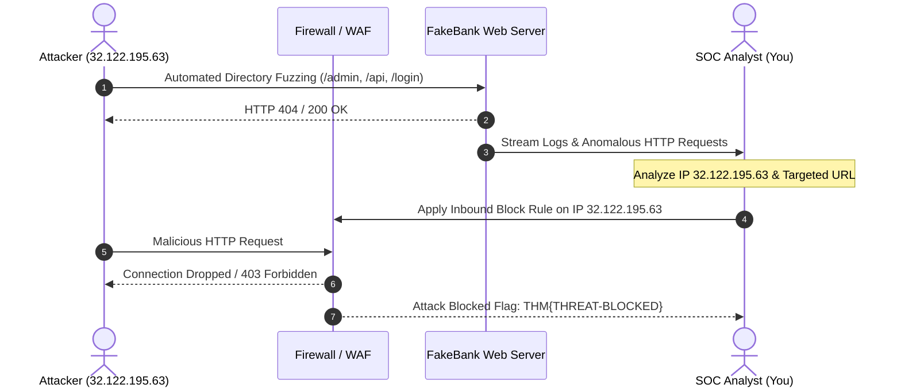

# Room 02: Defensive Security Intro
## الغرفة 02: مدخل إلى الأمن الدفاعي

* **Parent Module:** Module 01: Start Your Cyber Security Journey
* **Room URL:** [https://tryhackme.com/room/defensivesecurityintro](https://tryhackme.com/room/defensivesecurityintro)
* **Estimated Duration:** 25 Minutes
* **Total Tasks:** 4 Tasks

---

## 01. Room Overview | نظرة عامة على الغرفة
في هذه الغرفة التفاعلية الحديثة، ينتقل الدارس إلى الطرف الآخر من المعادلة الأمنية: **الأمن الدفاعي (Defensive Security)**. بدلاً من استغلال الثغرات، يتولى الدارس دور أخصائي الدفاع السيبراني ومحلل مركز العمليات الأمنية (SOC Analyst) لحماية تطبيق `FakeBank` من هجوم سيبراني نشط، وتحليل السجلات لرصد عنوان IP المهاجم، وتتبع المسارات المستهدفة، وعزل التهديد عبر الجدار الناري لإيقاف الهجوم واقتناص راية الإنجاز.

---

## 02. Learning Objectives | الأهداف التعليمية
1. فهم دور الأمن الدفاعي والفريق الأزرق (Blue Team) في استمرار الأعمال وحماية الأصول.
2. قراءة سجلات الوصول للويب (Web Access Logs) وتحليل حركة المرور المشبوهة.
3. استخراج مؤشرات الاختراق (Indicators of Compromise - IoCs) كعنوان IP الخاص بالمهاجم والمسار المستهدف.
4. اتخاذ الإجراء الدفاعي الحاسم وتكوين قواعد الحظر على الجدار الناري (Firewall Rule Configuration) لاحتواء التهديد.

---

## 03. Technical Deep Dive | التعمق التقني

---

## 04. Verified Tasks Summary | ملخص المهام المعتمدة
* **Task 1: You're the First Line of Defence** ⟶ `No answer needed`
* **Task 2: Something Looks Wrong...** ⟶ `32.122.195.63`
* **Task 3: What are Hackers Looking For?** ⟶ `https://fakebank.thm/admin`
* **Task 4: Stop The Hack** ⟶ `THM{THREAT-BLOCKED}`
