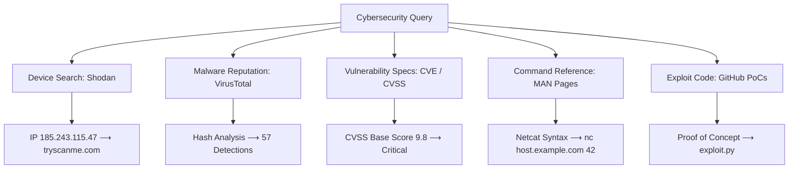

# Room 03: Search Skills
## الغرفة 03: مهارات البحث والتقصي السيبراني

* **Parent Module:** Module 01: Start Your Cyber Security Journey
* **Room URL:** [https://tryhackme.com/room/searchskills](https://tryhackme.com/room/searchskills)
* **Estimated Duration:** 35 Minutes
* **Total Tasks:** 6 Tasks

---

## 01. Room Overview | نظرة عامة على الغرفة
في هذه الغرفة، يكتسب الدارس مهارات التقصي والبحث المتقدم التي يحتاجها كل مختبر اختراق وباحث أمني. يغطي المعمل كيفية البحث عن الأجهزة المفتوحة عبر Shodan، تحليل سمعة البرمجيات الخبيثة وتوافق محركات الفحص عبر VirusTotal، البحث في سجلات الثغرات الدولية (NVD / CVE) وقراءة مؤشرات الـ CVSS، استخدام التوثيق الداخلي في لينكس عبر صفحات الـ MAN، وأخيراً استكشاف وتدقيق سكريبتات إثبات المفهوم (PoCs) على منصة GitHub.

---

## 02. Learning Objectives | الأهداف التعليمية
1. إتقان استعلامات محرك Shodan للربط بين عناوين الـ IP وأسماء النطاقات المستضافة.
2. تفسير تقارير منصة VirusTotal ومؤشرات إجماع موردي الحماية (Detection Consensus).
3. تقييم خطورة الثغرات الأمنية باستخدام تصنيفات نظام CVSS.
4. استخراج الأوامر والأمثلة التطبيقية بسرعة من صفحات الأدلة الرسمية (`man`).
5. البحث المنهجي في منصة GitHub للوصول إلى الشيفرات البرمجية الخاصة باستغلال الثغرات.

---

## 03. Technical Search Ecosystem

---

## 04. Verified Tasks Summary | ملخص المهام المعتمدة
* **Task 1: Introduction** ⟶ `No answer needed`
* **Task 2: Shodan (TryScanMe)** ⟶ `tryscanme.com`
* **Task 3: VirusTotal (TryDetectMe)** ⟶ `57`
* **Task 4: Vulnerability Databases (CVE)** ⟶ `Critical`
* **Task 5: Technical Documentation (MAN)** ⟶ `nc host.example.com 42`
* **Task 6: GitHub** ⟶ `exploit.py`
