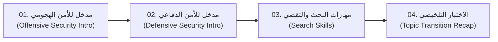

# موديول 01: ابدأ رحلتك في الأمن السيبراني (Start Your Cyber Security Journey)

---

## 📌 1. الغرض الأساسي من الموديول (Module Purpose)

مرحباً بك في أول محطة في مسار **Junior Penetration Tester (PT1)** على منصة TryHackMe!

الهدف الجوهري من هذا الموديول هو **كسر حاجز الخوف والغموض** لدى المبتدئ. صُمم هذا الموديول ليجيب عن أهم 3 أسئلة تدور في عقل أي شخص يبدأ في هذا المجال:
1. **ما هو الأمن الهجومي (Offensive Security)؟** وكيف يفكر المخترق الأخلاقي عندما ينظر إلى موقع ويب أو نظام بنكي؟
2. **ما هو الأمن الدفاعي (Defensive Security)؟** وكيف يكتشف المدافعون في غرف العمليات (SOC) محاولات الاختراق ويتعاملون معها؟
3. **كيف أبحث مثل المحترفين (Search Skills)؟** إذا واجهتك مشكلة أو ثغرة مجهولة، كيف تستخدم الإنترنت ومحركات البحث المتخصصة لجمع المعلومات والأدلة والحلول بسرعة؟

---

## 🗺️ 2. خارطة غرف الموديول بالترتيب (Rooms Roadmap)

تم ترتيب غرف هذا الموديول بتسلسل بيداغوجي ذكي، يبدأ بالجانب الهجومي، ثم المقابل الدفاعي، ثم الأداة المشتركة (البحث):

| الترتيب | الغرفة | المفهوم الأساسي | ماذا ستتعلم عملياً؟ |
|:---:|---|---|---|
| **01** | [01-OFFENSIVE-SECURITY-INTRO](./01-OFFENSIVE-SECURITY-INTRO/README.md) | الأمن الهجومي وعقلية المخترق | اختراق موقع بنكي تفاعلي (`FakeBank`)، اكتشاف الصفحات المخفية بواسطة أداة `dirb`، وتحويل رصيد مالي. |
| **02** | [02-DEFENSIVE-SECURITY-INTRO](./02-DEFENSIVE-SECURITY-INTRO/README.md) | الأمن الدفاعي ومراكز SOC | فحص سجلات الهجمات على الـ SIEM، وتتبع عنوان الـ IP المهاجم وحظره على جدار الحماية. |
| **03** | [03-SEARCH-SKILLS](./03-SEARCH-SKILLS/README.md) | مهارات التقصي المتقدمة | أسرار Google Dorks، محرك Shodan للبحث في أجهزة العالم، ومواقع فحص الفيروسات والثغرات (VirusTotal, Exploit-DB). |
| **04** | [04-TOPIC-TRANSITION-RECAP](./04-TOPIC-TRANSITION-RECAP/README.md) | التقييم التلخيصي الشامل | مراجعة متكاملة وأسئلة تقيس استيعابك للمفاهيم قبل الانتقال للموديول الثاني. |

---

## 💡 3. نصائح ذهبية للمبتدئ قبل البدء (Beginner Guidelines)

1. **لا تحفظ، بل افهم المنطق:**
   الأمن السيبراني لا يعتمد على حفظ الأوامر، بل على فهم **"لماذا يعمل الأمر بهذا الشكل؟"** وماذا يحدث خلف الكواليس بين حاسوبك والخادم.
2. **اقرأ ملفات المهام بالترتيب:**
   داخل كل غرفة ستجد مجلد `TASKS/`، وفيه ملفات تبدأ من `TASK-01.md` وتشرح كل خطوة بلغة مبسطة وأمثلة واقعية.
3. **جرب بنفسك:**
   افتح آلة الـ AttackBox على منصة TryHackMe وطبق الأوامر بنفسك. الأخطاء التي تقع فيها وتصلحها هي التي تبني خبرتك الحقيقية.

---

## 📂 4. روابط سريعة للغرف
- 🚪 [الغرفة الأولى: Offensive Security Intro](./01-OFFENSIVE-SECURITY-INTRO)
- 🚪 [الغرفة الثانية: Defensive Security Intro](./02-DEFENSIVE-SECURITY-INTRO)
- 🚪 [الغرفة الثالثة: Search Skills](./03-SEARCH-SKILLS)
- 🚪 [الغرفة الرابعة: Topic Transition Recap](./04-TOPIC-TRANSITION-RECAP)
