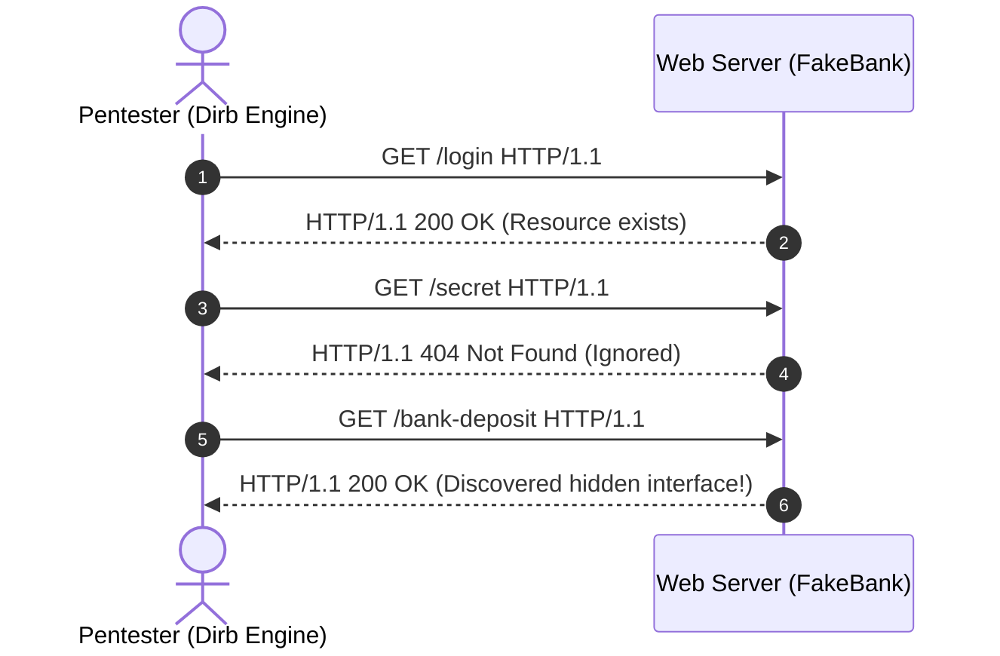
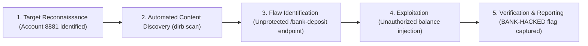

# Expert Room Documentation: Offensive Security Intro
## Comprehensive Academic and Practical Reference

---

## 01. Room Overview
* **Original Room Title:** Offensive Security Intro
* **Official Room URL:** [https://tryhackme.com/room/offensivesecurityintro](https://tryhackme.com/room/offensivesecurityintro)
* **Parent Module:** Module 01: Start Your Cyber Security Journey
* **Difficulty Level:** Beginner / Foundational
* **Estimated Completion Time:** 30 Minutes
* **Prerequisites:** None; designed as the initial hands-on orientation to web security assessments.
* **Practical Relevance:** This room demonstrates the failure of "Security through Obscurity" in real web applications. Practitioners learn how unlinked administrative endpoints can be rapidly surfaced using dictionary-based brute-forcing and how missing authorization controls lead to catastrophic business logic compromise.

---

## 02. Learning Objectives

### Theoretical & Conceptual Objectives
* Define Offensive Security and understand how adversary simulation differs from defensive monitoring.
* Deconstruct the adversarial mindset ("Thinking like a Hacker") to anticipate unexpected attack vectors.
* Understand the technical fallacy of relying on unlinked URLs for access security.

### Practical & Analytical Objectives
* Execute automated web content discovery using `dirb` against a target web server.
* Analyze HTTP response codes (`200 OK`, `301/302 Redirect`, `404 Not Found`) to filter active resources.
* Exploit an unauthenticated administrative deposit endpoint to execute an unauthorized financial transaction and retrieve the target flag.

---

## 03. Conceptual Foundations

### Offensive Security vs. Defensive Security
* **Offensive Security (Red Teaming / Penetration Testing):**
  An adversarial, proactive discipline that adopts the mindset, techniques, and tooling of malicious hackers. The objective is to discover exploitable vulnerabilities, validate business risk, and demonstrate proof-of-concept impact before adversaries exploit them in the wild.
* **Defensive Security (Blue Teaming / SOC / DFIR):**
  A continuous operational discipline focused on safeguarding digital assets, analyzing network telemetry, responding to security incidents, performing digital forensics, and applying patches across enterprise infrastructure.

### The Fallacy of Security through Obscurity
Hiding an administrative interface by simply omitting links from the main navigation menu does not protect it. Automated fuzzers and directory brute-forcers systematically probe target servers with standardized wordlists, discovering unprotected endpoints within seconds. True security demands robust authentication, cryptographic session tokens, and strict Role-Based Access Control (RBAC).

---

## 04. Technical Deep Dive

### Mechanics of HTTP Directory Brute-Forcing
Directory brute-forcing relies on sequential or concurrent HTTP GET/HEAD requests matched against a dictionary of known directory and file names.



1. **Wordlist Loading:** The tool reads each entry from `common.txt`.
2. **Request Dispatch:** A formatted request is sent: `http://fakebank.thm/<word>`.
3. **Response Parsing:**
   * `404 Not Found`: Discarded.
   * `200 OK` or `301/302 Redirect`: Flagged and reported as a discovered endpoint.

---

## 05. Tools and Technologies

### Dirb Web Scanner
* **Purpose:** Command-line web content scanner based on dictionary attacks against HTTP servers.
* **Key Command Syntax:**
  ```bash
  dirb http://fakebank.thm
  ```
* **Modern Industry Equivalents:**
  * **Gobuster (Go):** High-speed concurrent engine supporting directories (`dir`), DNS subdomains (`dns`), and Virtual Hosts (`vhost`).
  * **ffuf (Fast Web Fuzzer):** Highly customizable and industry-standard for parameterized fuzzing and header injection.

---

## 06. Penetration Testing Methodology



---

## 07. Practical Walkthrough

1. **Phase 1: Initial Reconnaissance:**
   * Accessed `http://fakebank.thm`.
   * Identified target account number: `8881` with an overdrawn balance: `-$100.00`.
2. **Phase 2: Directory Enumeration:**
   * Executed `dirb http://fakebank.thm` in the lab terminal.
   * Discovered hidden administrative interface: `http://fakebank.thm/bank-deposit`.
3. **Phase 3: Exploitation:**
   * Navigated to `http://fakebank.thm/bank-deposit`.
   * Submitted an unauthorized deposit of `200` into account `8881`.
4. **Phase 4: Flag Acquisition:**
   * Account balance updated to `+$100.00`, triggering the green success dialog with the verified flag: `BANK-HACKED`.

---

## 08. Tasks and Solutions
Every task is documented independently in the `TASKS/` directory according to the Stage A–G standard:
* [Task 01: Think like a Hacker! (TASK-01.md)](../../01-OFFENSIVE-SECURITY-INTRO/TASKS/TASK-01.md)
* [Task 02: Starting the Lab (TASK-02.md)](../../01-OFFENSIVE-SECURITY-INTRO/TASKS/TASK-02.md)
* [Task 03: Find Hidden Pages (TASK-03.md)](../../01-OFFENSIVE-SECURITY-INTRO/TASKS/TASK-03.md)
* [Task 04: Attack the Admin Page (TASK-04.md)](../../01-OFFENSIVE-SECURITY-INTRO/TASKS/TASK-04.md)
* [Task 05: Careers in Cyber Security (TASK-05.md)](../../01-OFFENSIVE-SECURITY-INTRO/TASKS/TASK-05.md)

---

## 09. Troubleshooting and Common Mistakes
1. **Omission of Protocol Prefix:** Running `dirb fakebank.thm` fails because `dirb` requires a fully qualified URI scheme (`http://` or `https://`).
2. **Case-Sensitivity Mismatch:** Submitting `bank-hacked` fails verification because the scoring engine requires uppercase text: `BANK-HACKED`.

---

## 10. Security Implications
* **Root Cause:** Broken Access Control (OWASP Top 10 A01:2021) and CWE-285 (Improper Authorization).
* **Remediation Strategy:**
  1. Enforce session authentication middleware on all administrative endpoints.
  2. Implement backend role validation ensuring that only authorized bank personnel (`BANK_TELLER`) can execute credit adjustments.

---

## 11. Professional Applications
During commercial web application assessments (VAPT), pentesters routinely discover:
* Forgotten administrative consoles (`/admin_v2`, `/internal-dashboard`).
* Exposed database backups (`/db_backup.sql.gz`).
* Unauthenticated development endpoints (`/swagger-ui/`, `/actuator/env`).

---

## 12. Key Takeaways
* Obscurity is not security. Unlinked paths are trivial to uncover using automated wordlists.
* Administrative endpoints must enforce session authentication and role validation at the server layer.
* Proactive offensive simulation demonstrates tangible business impact (unauthorized balance manipulation) to secure executive remediation buy-in.

---

## 13. Quick Reference
* **Target Domain:** `http://fakebank.thm`
* **Account Number:** `8881`
* **Discovered URL:** `http://fakebank.thm/bank-deposit`
* **Execution Command:** `dirb http://fakebank.thm`
* **Engagement Flag:** `BANK-HACKED`

---

## 14. Knowledge Assessment

### Review Questions:
1. Explain why "Security through Obscurity" fails when defending against automated content discovery tools.
2. How does `dirb` determine whether a directory exists on the remote web server?
3. Contrast the primary objectives of an offensive penetration test with defensive SOC monitoring.
4. What backend authorization logic must be implemented to prevent unauthorized access to `bank-deposit.php`?

---

### Answer Key:
1. **Failure of Obscurity:** Attackers leverage automated fuzzers equipped with dictionaries containing thousands of standard paths. The absence of public hyperlinks does not prevent direct HTTP requests to hidden endpoints.
2. **Status Code Parsing:** `dirb` inspects the HTTP response status code. A `200 OK` or `301/302 Redirect` indicates that the resource exists, whereas a `404 Not Found` indicates non-existence.
3. **Offensive vs. Defensive:** Penetration testing proactively uncovers and exploits vulnerabilities to validate risk, whereas SOC monitoring continuously detects anomalies, triages alerts, and contains active threats.
4. **Backend Authorization:** Validating active session tokens and verifying that the user belongs to an authorized administrative role (e.g., `role === 'BANK_TELLER'`) before processing any transaction parameters.
