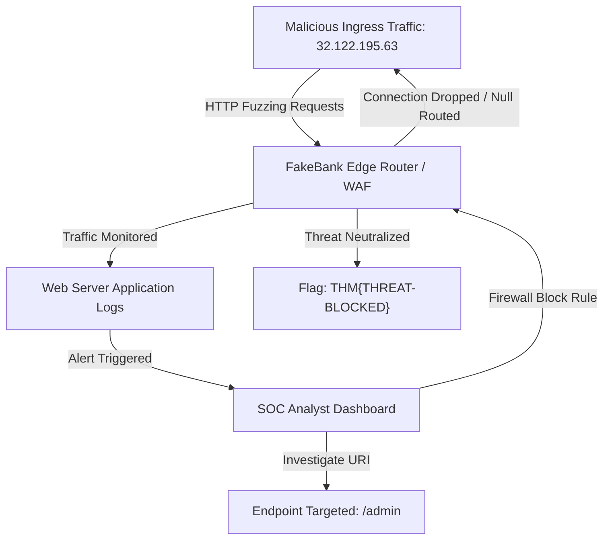

# Room 02: Defensive Security Intro
## Comprehensive Technical Documentation (English Version)

* **Parent Module:** Module 01: Start Your Cyber Security Journey
* **Room URL:** [https://tryhackme.com/room/defensivesecurityintro](https://tryhackme.com/room/defensivesecurityintro)
* **Estimated Duration:** 25 Minutes
* **Total Tasks:** 4 Tasks

---

## 01. Room Overview
In this modern interactive lab, learners step into the role of a defensive security practitioner and SOC analyst. Protecting the simulated `FakeBank` web application against an active intruder, learners inspect incoming web server logs, isolate Indicators of Compromise (IoCs) including the adversary's IP address and targeted endpoints, and execute firewall blocking actions to neutralize the threat and capture the completion flag.

---

## 02. Learning Objectives
1. Understand the core responsibilities of Defensive Security and Blue Team operations.
2. Analyze live web server access logs to detect abnormal reconnaissance traffic and directory brute forcing.
3. Identify crucial Indicators of Compromise (adversary IP: `32.122.195.63` and accessed URI: `https://fakebank.thm/admin`).
4. Implement proactive network firewall containment rules to sever active cyber attacks.

---

## 03. Technical Architecture & Log Analysis

---

## 04. Verified Tasks Breakdown
* **Task 1: You're the First Line of Defence** ⟶ `No answer needed`
* **Task 2: Something Looks Wrong...** ⟶ `32.122.195.63`
* **Task 3: What are Hackers Looking For?** ⟶ `https://fakebank.thm/admin`
* **Task 4: Stop The Hack** ⟶ `THM{THREAT-BLOCKED}`
