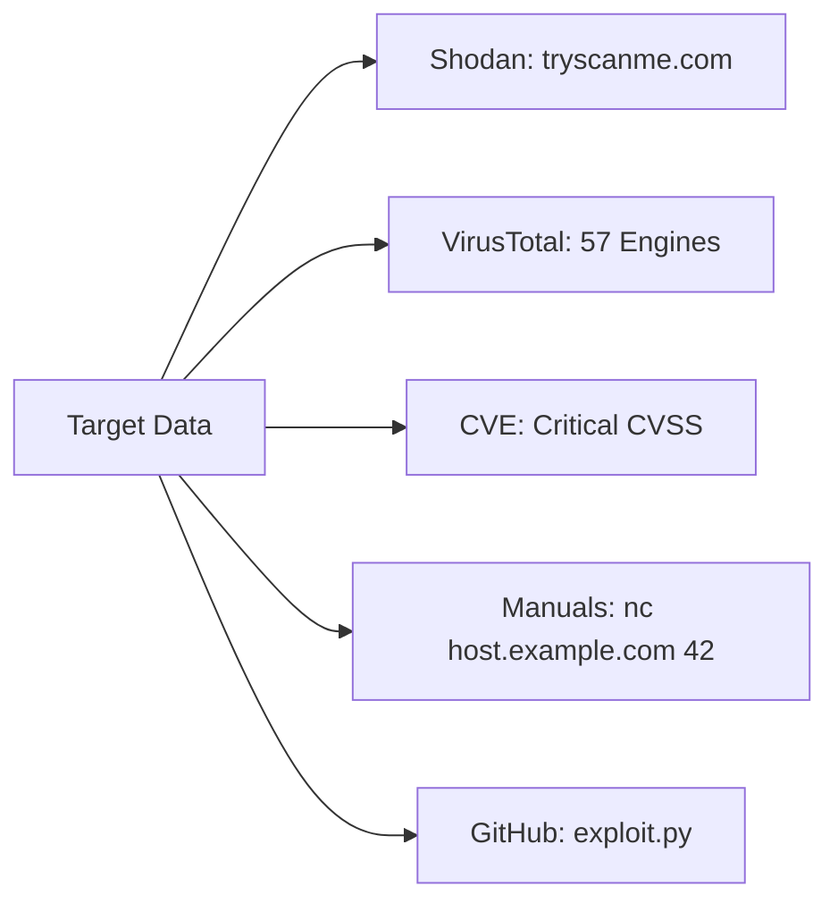

# Room 03: Search Skills
## Comprehensive Technical Documentation (English Version)

* **Parent Module:** Module 01: Start Your Cyber Security Journey
* **Room URL:** [https://tryhackme.com/room/searchskills](https://tryhackme.com/room/searchskills)
* **Estimated Duration:** 35 Minutes
* **Total Tasks:** 6 Tasks

---

## 01. Room Overview
In this room, learners develop advanced research, OSINT, and documentation navigation capabilities required for modern offensive security engagements. The practical lab explores query formulation on Shodan for device intelligence, hash reputation analysis on VirusTotal, vulnerability metrics interpretation via CVE and CVSS ratings, local documentation retrieval using Unix MAN pages, and open-source exploit auditing on GitHub.

---

## 02. Learning Objectives
1. Formulate targeted queries on Shodan to resolve IP addresses (`185.243.115.47`) to hostnames (`tryscanme.com`).
2. Assess multi-engine antivirus consensus reports on VirusTotal (`57` detections).
3. Evaluate vulnerability risk profiles utilizing the qualitative Common Vulnerability Scoring System (CVSS `Critical`).
4. Rapidly extract syntactically correct commands and flags from system manual pages (`nc host.example.com 42`).
5. Locate and audit weaponized Proof-of-Concept exploit scripts on GitHub (`exploit.py`).

---

## 03. Technical Workflow

---

## 04. Verified Tasks Summary
* **Task 1: Introduction** ⟶ `No answer needed`
* **Task 2: Shodan (TryScanMe)** ⟶ `tryscanme.com`
* **Task 3: VirusTotal (TryDetectMe)** ⟶ `57`
* **Task 4: Vulnerability Databases (CVE)** ⟶ `Critical`
* **Task 5: Technical Documentation (MAN)** ⟶ `nc host.example.com 42`
* **Task 6: GitHub** ⟶ `exploit.py`
