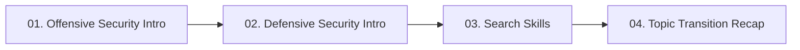

# Module 01: Start Your Cyber Security Journey

---

## 📌 1. Module Purpose & Core Scope

Welcome to the foundational module of the **Junior Penetration Tester (PT1)** learning path on TryHackMe!

The primary mission of this module is to **demystify cyber security for beginners** and establish the foundational mindset required for offensive and defensive operations:
1. **What is Offensive Security?** Understanding the adversary mindset, security through obscurity, and how ethical hackers identify system weaknesses.
2. **What is Defensive Security?** Discovering how Blue Teams, Security Operations Centers (SOCs), and Incident Responders monitor, detect, and mitigate cyber attacks.
3. **Professional Search Skills:** Mastering the art of information gathering using search engine dorks, specialized engines (Shodan), threat intelligence repositories (VirusTotal), and offline manuals.

---

## 🗺️ 2. Rooms Roadmap

The rooms in this module are sequenced to build balanced foundational competency across the offensive/defensive divide, followed by critical investigative tooling:

| Order | Room Directory | Core Focus | Hands-on Takeaway |
|:---:|---|---|---|
| **01** | [01-OFFENSIVE-SECURITY-INTRO](file:///e:/THM-JR-PENETRATION-TESTER/01-START-YOUR-CYBER-SECURITY-JOURNEY/EN/01-OFFENSIVE-SECURITY-INTRO/README.md) | Offensive Mindset & Web Recon | Exploiting an unauthenticated web banking portal (`FakeBank`), discovering hidden routes with `dirb`, and unauthorized funds transfer. |
| **02** | [02-DEFENSIVE-SECURITY-INTRO](file:///e:/THM-JR-PENETRATION-TESTER/01-START-YOUR-CYBER-SECURITY-JOURNEY/EN/02-DEFENSIVE-SECURITY-INTRO/README.md) | Defensive Ops & SOC Architecture | Triaging SIEM event alerts, tracing an attacker IP, and implementing perimeter firewall blocks. |
| **03** | [03-SEARCH-SKILLS](file:///e:/THM-JR-PENETRATION-TESTER/01-START-YOUR-CYBER-SECURITY-JOURNEY/EN/03-SEARCH-SKILLS/README.md) | Advanced Information Gathering | Google Dorking operators, Shodan IoT scanning, VirusTotal malware hashing, and CVE vulnerability databases. |
| **04** | [04-TOPIC-TRANSITION-RECAP](file:///e:/THM-JR-PENETRATION-TESTER/01-START-YOUR-CYBER-SECURITY-JOURNEY/EN/04-TOPIC-TRANSITION-RECAP/README.md) | Capstone Synthesis & Review | Comprehensive evaluation questions assessing readiness for Module 02. |

---

## 💡 3. Beginner Guidelines

1. **Focus on Understanding Concepts:**
   Memorizing commands is unnecessary. Focus on understanding *why* commands work and what protocol interactions happen under the hood.
2. **Follow the Structured Task Files:**
   Each room contains a `TASKS/` directory with detailed `TASK-XX.md` guides breaking down objectives, background concepts, execution commands, and verified answers.
3. **Practice Hands-On:**
   Launch the TryHackMe AttackBox or OpenVPN connection to execute every command and observe actual network behaviors.

---

## 📂 4. Quick Room Navigation
- 🚪 [Room 01: Offensive Security Intro](file:///e:/THM-JR-PENETRATION-TESTER/01-START-YOUR-CYBER-SECURITY-JOURNEY/EN/01-OFFENSIVE-SECURITY-INTRO/)
- 🚪 [Room 02: Defensive Security Intro](file:///e:/THM-JR-PENETRATION-TESTER/01-START-YOUR-CYBER-SECURITY-JOURNEY/EN/02-DEFENSIVE-SECURITY-INTRO/)
- 🚪 [Room 03: Search Skills](file:///e:/THM-JR-PENETRATION-TESTER/01-START-YOUR-CYBER-SECURITY-JOURNEY/EN/03-SEARCH-SKILLS/)
- 🚪 [Room 04: Topic Transition Recap](file:///e:/THM-JR-PENETRATION-TESTER/01-START-YOUR-CYBER-SECURITY-JOURNEY/EN/04-TOPIC-TRANSITION-RECAP/)
