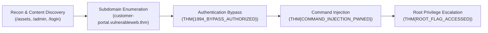

# Room 01: Guided Pentest: Web
## الغرفة 01: اختبار اختراق موجه - تطبيقات الويب

* **Parent Module:** Module 02: Penetration Testing Foundations
* **Room URL:** [https://tryhackme.com/room/guidedpentestweb](https://tryhackme.com/room/guidedpentestweb)
* **Estimated Duration:** 45 Minutes
* **Total Tasks:** 8 Tasks

---

## 01. Room Overview | نظرة عامة على الغرفة
في هذا المعمل الموجه، يخوض الدارس تجربة اختبار اختراق واقعية متكاملة لتطبيق ويب. تبدأ المهمة باستكشاف محتوى الخادم واكتشاف المسارات الحساسة، ثم الانتقال لتعداد النطاقات الفرعية (Virtual Hosts) للوصول إلى بوابة العملاء `customer-portal.vulnerableweb.thm`، ثم كسر قيود المصادقة (Authentication Bypass)، واستغلال حقن الأوامر (Command Injection) للحصول على موطئ قدم (RCE)، وصولاً إلى تصعيد الصلاحيات الكامل (Privilege Escalation) إلى المستخدم الجذر `root`.

---

## 02. Learning Objectives | الأهداف التعليمية
1. فهم منهجية استكشاف مسارات الويب وتعداد المجلدات المخفية.
2. استخدام تقنيات استكشاف النطاقات الفرعية والـ Virtual Hosts عبر ترويسة Host.
3. استغلال ثغرات تجاوز المصادقة للحصول على جلسة إدارية مصرح بها.
4. حقن وتمرير أوامر نظام التشغيل عبر معلمات التطبيق غير المحمية.
5. استغلال امتيازات النظام وتصعيد الصلاحيات إلى المستخدم الجذر (`root`).

---

## 03. Complete Attack Chain Architecture

---

## 04. Verified Tasks Summary | ملخص المهام المعتمدة
* **Task 1: Introduction** ⟶ `No answer needed`
* **Task 2: Setting up Burp Suite** ⟶ `No answer needed`
* **Task 3: Content Discovery** ⟶ `/assets, /admin, /login, /contact, /pricing, /about, /customers`
* **Task 4: Subdomain Enumeration** ⟶ `customer-portal.vulnerableweb.thm`
* **Task 5: Authentication Bypass** ⟶ `THM{1994_BYPASS_AUTHORIZED}`
* **Task 6: Command Injection** ⟶ `THM{COMMAND_INJECTION_PWNED}`
* **Task 7: Privilege Escalation** ⟶ `THM{ROOT_FLAG_ACCESSED}`
* **Task 8: Conclusion** ⟶ `No answer needed`
