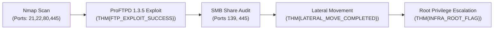

# Room 02: Guided Pentest: Infrastructure
## الغرفة 02: اختبار اختراق موجه - البنية التحتية

* **Parent Module:** Module 02: Penetration Testing Foundations
* **Room URL:** [https://tryhackme.com/room/guidedpentestinfrastructure](https://tryhackme.com/room/guidedpentestinfrastructure)
* **Estimated Duration:** 45 Minutes
* **Total Tasks:** 7 Tasks

---

## 01. Room Overview | نظرة عامة على الغرفة
في هذا المعمل العملي الموجه، ينفذ الدارس اختبار اختراق واقعي لبنية تحتية وشبكة خوادم داخلية. تبدأ العملية بفحص الشبكة والمنافذ عبر Nmap وكشف الخدمات `21,22,80,445` وإصدار خادم FTP وهو `ProFTPD 1.3.5`. يتم استغلال ثغرة `mod_copy` الشهيرة لتحقيق موطئ قدم، ثم استكشاف خدمات الشبكة الداخلية ومشاركات SMB على المنفذين `139,445`، وتنفيذ التحرك الجانبي (Lateral Movement) لاقتناص راية المستخدم، وصولاً إلى تصعيد الصلاحيات الكامل (Privilege Escalation) واقتناص راية الروت.

---

## 02. Learning Objectives | الأهداف التعليمية
1. فحص البنية التحتية وتحديد المنافذ النشطة وإصدارات الخدمات بدقة.
2. استغلال ثغرات خدمات الشبكة المفتوحة (`ProFTPD 1.3.5 mod_copy`).
3. تعداد مشاركات الملفات الداخلية عبر بروتوكول SMB على المنفذ 445.
4. تنفيذ التحرك الجانبي داخل الشبكة باستخدام بيانات الاعتماد المستخرجة.
5. تصعيد الصلاحيات محلياً إلى المستخدم الجذر (`root`).

---

## 03. Infrastructure Attack Chain

---

## 04. Verified Tasks Summary | ملخص المهام المعتمدة
* **Task 1: Introduction** ⟶ `No answer needed`
* **Task 2: Network Scanning** ⟶ `21,22,80,445` | `ProFTPD 1.3.5`
* **Task 3: Exploiting FTP** ⟶ `THM{FTP_EXPLOIT_SUCCESS}`
* **Task 4: Enumerating Internal Services** ⟶ `smb` | `139,445`
* **Task 5: Lateral Movement** ⟶ `THM{LATERAL_MOVE_COMPLETED}`
* **Task 6: Privilege Escalation** ⟶ `THM{INFRA_ROOT_FLAG}`
* **Task 7: Conclusion** ⟶ `No answer needed`
