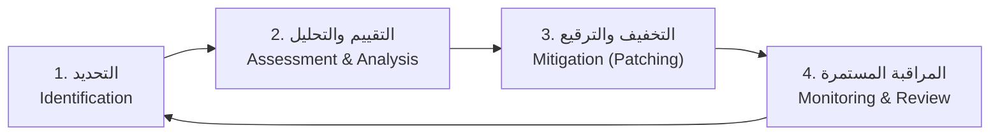

# التوثيق التخصصي الشامل: الغوص في أعماق اختبار الاختراق (Dive Into Pentesting)

---

## 01. نظرة عامة على الغرفة (Room Overview)
* **عنوان الغرفة الأصلي:** Dive Into Pentesting
* **رابط الغرفة الرسمي:** [https://tryhackme.com/room/diveintopentesting](https://tryhackme.com/room/diveintopentesting)
* **الوحدة التابعة:** الوحدة 02 — أسس وقواعد اختبار الاختراق (Penetration Testing Foundations)
* **مستوى الصعوبة:** نظري ومفاهيمي تأسيسي (Foundational / Concepts)
* **الوقت التقديري للإنجاز:** 45 دقيقة
* **المتطلبات المسبقة:** لا توجد متطلبات تقنية مسبقة؛ مصممة لترسيخ المفاهيم المهنية، القانونية، والأخلاقية التي تحكم ممارسة اختبار الاختراق الاحترافي.
* **الأهمية الميدانية والمهنية:** تمثل هذه الغرفة "البوصلة الأخلاقية والمهنية" لمختبر الاختراق. المهارة التقنية في تشغيل الثغرات والأدوات عديمة القيمة وخطيرة قانونياً إذا لم تُمارس داخل إطار منظم من التفويض القانوني (Authorization)، واحترام النطاق (Scope)، وتطبيق معادلة المخاطر (Risk Management)، وترجمة النتائج التقنية إلى أثر تجاري ملموس (Business Impact).

---

## 02. الأهداف التعليمية (Learning Objectives)

### أهداف نظرية ومفاهيمية (Theoretical Objectives)
* التمييز الجوهري بين مختبر الاختراق الأخلاقي (Penetration Tester) والقرصان المعادي (Malicious Attacker) من حيث التفويض، النطاق، والمسؤولية.
* فهم شمولية التغطية (Broad Coverage) مقابل البحث عن المسار الأسهل (Easiest Path).
* استيعاب ثلاثية الأمن السيبراني: الثغرة (Vulnerability)، التهديد (Threat)، والخطر (Risk).
* إدراك سياقية الخطر (Contextual Risk) وكيف تختلف خطورة نفس الثغرة البرمجية بين الأنظمة الخارجية والداخلية.
* فهم الأسباب الجذرية لنشوء الثغرات (افتراضات المطورين، التعقيد المعماري، وضغوط التسليم).

### أهداف عملية وتطبيقية (Practical Objectives)
* تصنيف مجالات الاختبار العملية (الشبكات الخارجية، الشبكات الداخلية، وتطبيقات الويب).
* التمييز الدقيق بين أمن المصادقة (Authentication) وأمن إدارة الجلسات (Session Management).
* التعرف على مرحلة التخفيف والمعالجة (Mitigation) في دورة حياة إدارة المخاطر.
* تطبيق قواعد حجب البيانات الحساسة (Data Redaction) في مسودات التقرير.
* حل سيناريوهات القرارات الأخلاقية والمهنية في المحاكاة التفاعلية واستخراج راية الغرفة الرسمية.

### أهداف تحليلية ومهنية (Analytical & Professional Skills)
* اكتساب العقلية التحليلية الاحترافية: التفكير قبل التنفيذ، التوثيق المنظم، والتواصل الاستباقي.
* صياغة تقارير توضح الأثر التجاري والمالي والقانوني للثغرات لإقناع القيادات التنفيذية.

---

## 03. الأسس المفاهيمية (Conceptual Foundations)

### 1. المقارنة الجوهرية: الأخلاقي vs المعادي
* **مختبر الاختراق (Penetration Tester):**
  هدفه الأساسي هو **التغطية الواسعة والشاملة (Broad Coverage)** لجميع الأصول المصرح بها لكشف أكبر عدد ممكن من نقاط الضعف وتقديم حلول لمعالجتها قبل أن يستغلها الأعداء.
* **المهاجم الخبيث (Malicious Attacker):**
  هدفه الأساسي هو الوصول إلى غايته (سرقة بيانات، تعطيل خادم) عبر **المسار الأسهل والأسرع (Single Easiest Path)**، ولا يهتم ببقية الأنظمة طالما حقق هدفه.

### 2. معادلة الخطر وسياق التهديد
$$\mathbf{\text{Risk}} = \mathbf{\text{Threat}} \times \mathbf{\text{Vulnerability}} \times \mathbf{\text{Impact}}$$
* **الثغرة (Vulnerability):** الضعف الموجود في الكود أو الإعداد.
* **التهديد (Threat):** المهاجم أو البرمجية الخبيثة القادرة على استغلال الضعف.
* **الأثر (Impact):** حجم الضرر المالي، التشغيلي، أو القانوني الواقع على المؤسسة.

**حقيقة هندسية:** لا تحمل الثغرة نفس الخطر دائماً! وجود ثغرة SQL Injection في خادم ويب خارجي مكشوف للعالم يمثل خطراً فادحاً (Critical Risk)؛ لأن احتمالية التهديد مرتفعة جداً ($Threat \to \text{High}$). بينما نفس الثغرة في خادم معزول داخلياً في مختبر مغلق تمثل خطراً أقل بكثير؛ لأن الوصول إليه يتطلب اختراق الشبكة الداخلية أولاً.

---

## 04. الغوص التقني والتشريحي (Technical Deep Dive)

### مقارنة تدفق العمل بين المختبر الأخلاقي والمهاجم الخارجي

```mermaid
flowchart TD
    subgraph MaliciousAttacker["المهاجم المعادي (Attacker)"]
        A1["استطلاع خارجي غير مصرح"] --> A2["البحث عن أضعف نقطة دخول"]
        A2 --> A3["استغلال الثغرة الأسهل (Easiest Path)"]
        A3 --> A4["سرقة البيانات أو طلب فدية (Exfiltration/Ransom)"]
        A4 --> A5["التخريب ومسح الآثار للهروب"]
    end

    subgraph PenetrationTester["مختبر الاختراق الأخلاقي (Penetration Tester)"]
        P1["توقيع العقد وتحديد النطاق (RoE & Scope)"] --> P2["تعداد شامل لكافة الأصول (Broad Coverage)"]
        P2 --> P3["تحليل الثغرات وسياق الخطر (Risk Context)"]
        P3 --> P4["استغلال محكوم وموثق بالأدلة (PoC)"]
        P4 --> P5["حجب البيانات الحساسة (Data Redaction)"]
        P5 --> P6["كتابة التقرير وخطة المعالجة (Mitigation Roadmap)"]
    end
```



### دورة حياة إدارة المخاطر (Risk Management Lifecycle)



---

## 05. الأدوات والتقنيات (Tools and Technologies)

على الرغم من أن هذه الغرفة تركز على المفاهيم والعقلية، إلا أن الممارس المحترف يستخدم تقنيات متخصصة لتنظيم العمل:

| الأداة / التقنية | الدور الميداني | الاستخدام في بيئة العمل |
|---|---|---|
| **برامج التدوين المنظم (Obsidian / CherryTree)** | توثيق الملاحظات وسجلات الأوامر والأدلة خطوة بخطوة | يضمن قابلية إعادة إنتاج النتائج (Reproducibility) في أي وقت أثناء كتابة التقرير. |
| **أدوات حجب البيانات (Redaction Tools / GIMP)** | تظليل البيانات الحساسة (PII, Passwords, Card Numbers) | منع تسريب أسرار العميل داخل التقرير النهائي وضمان الامتثال لـ GDPR. |
| **قوالب قواعد الاشتباك (RoE Templates)** | التوثيق القانوني والاتفاقي للنطاق والأوقات المسموحة | حماية المختبر من المساءلة الجنائية وترسيم حدود الفحص المصرح به. |

---

## 06. منهجية اختبار الاختراق (Penetration Testing Methodology)

ترتكز منهجية التفكير الاحترافية على ثلاثة محاور رئيسية:
1. **الانضباط قبل الهجوم (Preparation & Scope Adherence):**
   * الامتناع التام عن فحص أي هدف خارج النطاق (Out-of-Scope).
2. **التفكير المنهجي وتجنب التسرع (Avoiding Rushing to Exploitation):**
   * دراسة بنية التطبيق، قراءة ملفات الجافاسكريبت، وفهم منطق الأعمال قبل تشغيل أي أداة استغلال.
3. **التواصل الاستباقي المستمر (Proactive Communication):**
   * إبلاغ العميل فوراً في حال حدوث أي حظر شبكي، أو تعطل لخدمة، أو اكتشاف ثغرة حرجة جداً تتطلب ترقيعاً طارئاً (Critical Flaw Escalation).

---

## 07. السير العملي المفصل (Practical Walkthrough)

### المهام 01 إلى 05: بناء الأساس المفاهيمي
* **مفهوم التغطية:** مختبر الاختراق ملزم بالتغطية الشاملة (`Penetration Tester`)، بينما المهاجم يكتفي بالمسار الأسهل (`Attacker`).
* **مجالات الاختبار:** فحص الأنظمة الموجهة للإنترنت يسمى `External Network Penetration Testing`. والخلل في بقاء الكوكيز صالحة بعد تسجيل الخروج يقع تحت `Session management`.
* **معادلة الخطر:** الترقيع وسد الثغرات يتم في مرحلة `Mitigation`. ونفس الثغرة لا تحمل نفس الخطر في الأنظمة الداخلية والخارجية (`Nay`).
* **أسباب الثغرات:** افتراضات المطورين، التعقيد، وضغوط الوقت.

### المهام 06 و 07: العقلية والأخلاقيات وقواعد الاشتباك
* **عادات المختبر غير الفعالة:** التسرع في الهجوم دون فهم (`Rushing to exploitation`).
* **عادات المختبر الناجحة:** التدوين المستمر للملاحظات والأدلة (`Maintaining good notes`)، والتواصل الاستباقي لحل المعوقات (`Proactive communication`).
* **الضوابط القانونية:** النطاق (`Scope`) هو الذي يحدد الحدود. ويجب إبراز الأثر التجاري (`Business impact`)، وتعتيم البيانات الحساسة (`Sensitive data`).

### المهمة 08: النشاط التفاعلي واستخراج الراية
في واجهة المحاكاة التفاعلية:
1. اختيار المسار الأخلاقي عند اكتشاف هدف خارج النطاق (طلب الإذن وعدم لمس الهدف).
2. حجب بيانات بطاقات الائتمان قبل إدراجها بالتقرير.
3. إبلاغ مسؤول الشبكة فوراً عند التعرض لحظر الـ WAF.
4. بمجرد استكمال السيناريو بنجاح، تظهر الراية الرسمية:
   `THM{L3t$_d1v3_1nt0_Pen7es71ng!}`

---

## 08. ملخص المهام والحلول (Tasks and Solutions Summary)

| رقم المهمة | السؤال الأصلي | الإجابة النموذجية المعتمدة |
|---|---|---|
| **Task 01** | *Read the above.* | `No answer needed` |
| **Task 02** | *Which actor aims for broad coverage of a target?* | `Penetration Tester` |
| **Task 02** | *Which actor focuses on the single easiest path to achieve their goal?* | `Attacker` |
| **Task 03** | *What type of testing evaluates internet-facing systems from an external perspective?* | `External Network Penetration Testing` |
| **Task 03** | *Which focus area includes testing session cookies that remain valid after logout?* | `Session management` |
| **Task 04** | *Which stage of the risk management cycle involves patching or fixing a reported vulnerability?* | `Mitigation` |
| **Task 04** | *Does the exact same vulnerability carry the same risk regardless of whether the system is internal or external? (Yea/Nay)* | `Nay` |
| **Task 05** | *Read the above.* | `No answer needed` |
| **Task 06** | *What ineffective habit involves attacking a system without first understanding how it works?* | `Rushing to exploitation` |
| **Task 06** | *What practice makes findings reproducible without repeating the entire discovery process?* | `Maintaining good notes` |
| **Task 06** | *What habit prevents blockers from consuming the testing window?* | `Proactive communication` |
| **Task 07** | *What defines the boundaries of a penetration test?* | `Scope` |
| **Task 07** | *What type of impact should a finding demonstrate beyond technical severity?* | `Business impact` |
| **Task 07** | *What type of data must be redacted from reports to prevent unintended disclosure?* | `Sensitive data` |
| **Task 08** | *What is the flag from the completion activity?* | `THM{L3t$_d1v3_1nt0_Pen7es71ng!}` |

---

## 09. الأخطاء الشائعة واستكشاف الأخطاء (Common Errors & Troubleshooting)

* **الخطأ 1: الخلط بين المصادقة (Authentication) وإدارة الجلسات (Session Management):**
  * *التوضيح:* المصادقة تجيب على: "من أنت؟" (تسجيل الدخول). إدارة الجلسات تجيب على: "كيف يتذكرك الخادم وينهي اتصالك بأمان؟" (الكوكيز، التوكين، تسجيل الخروج).
* **الخطأ 2: التعامل مع درجات CVSS كرقم مطلق بمعزل عن بيئة النظام:**
  * *التوضيح:* درجة CVSS الفنية تقيس الخصائص التقنية للثغرة، لكن الخطر الفعلي على المؤسسة يتطلب النظر في موقع الخادم (خارجي vs داخلي) والبيانات المعرضة للخطر.
* **الخطأ 3: كتابة تقرير يحتوي على كلمات مرور أو بيانات بطاقات ائتمان حقيقية:**
  * *التوضيح:* هذا خرق جسيم لقوانين الخصوصية؛ يجب تظليل أي بيانات حقيقية للعملاء قبل تسليم التقرير.

---

## 10. التداعيات الأمنية وإجراءات التحصين (Security Implications & Defensive Hardening)

1. **التحصين ضد أخطاء الجلسات:**
   * برمجة الخادم لإبطال جلسة المستخدم في قاعدة البيانات ومسح الكوكي فور النقر على "تسجيل الخروج".
   * تعيين سمات الأمان لكوكيز الجلسة: `HttpOnly` لمنع سرقتها عبر XSS، و `Secure` لضمان إرسالها عبر HTTPS فقط، و `SameSite=Strict` لمنع CSRF.
2. **الحوكمة وإدارة المخاطر:**
   * تطبيق خطط معالجة (Mitigation Plans) تفرض ترقيع الثغرات الحرجة خلال 24-48 ساعة من تسليم التقرير.
3. **التدريب والوعي الأمني للمطورين (Secure Coding Training):**
   * توعية المطورين بمخاطر الاعتماد على الافتراضات وحسن النية، وتعليمهم مبدأ التحقق الإجباري من كافة المدخلات على جهة الخادم.

---

## 11. التطبيقات الواقعية والربط المهني (Real-World Applications)

* **الاستشارات الأمنية والامتثال الدولي:**
  كل شركة استشارات أمنية معتمدة عالمياً تبني نموذج عملها على هذه المبادئ: صياغة وثائق RoE محكمة، حماية بيانات العملاء باتفاقيات عدم إفصاح (NDA)، والالتزام بنطاق العمل بدقة لتجنب القضايا الجنائية والتجارية.
* **التواصل مع مجالس الإدارة (Board Communication):**
  المختبر الناجح هو من ينجح في ترجمة ثغرة معقدة إلى لغة يفهمها المدير المالي (CFO): "هذه الثغرة ستكلفنا 5 ملايين دولار غرامات في حال تسريب قاعدة بيانات المشتركين".

---

## 12. الدروس المستفادة والخلاصة (Key Takeaways and Summary)

1. **الشمولية هي معيار التميز:** عمل المختبر لا ينتهي باكتشاف ثغرة واحدة، بل يستمر لفحص وتغطية كافة مساحة الهجوم المصرح بها.
2. **الخطر متغير وسياقي:** لا تقيّم الثغرات بعيداً عن بيئتها وموقعها والبيانات التي تحميها.
3. **الأخلاق والتوثيق هما جوهر المهنة:** سطر الأوامر أداة تنفيذية، لكن الوثائق الرسمية، تدوين الملاحظات، وحماية الخصوصية هي التي تصنع الخبير السيبراني الحقيقي.

---

## 13. المرجع السريع وبطاقة الأوامر (Quick Reference and Cheat Sheet)

```text
[Risk Management Core Triad]
Vulnerability = Software/Config Flaw
Threat        = Actor/Malware Capable of Exploiting Flaw
Risk          = Threat × Vulnerability × Impact

[Key Responsibilities]
Penetration Tester -> Broad Coverage, Legal Scope, Detailed Findings
Malicious Attacker -> Single Easiest Path, Unauthorized, Destructive

[Critical Habits]
Do: Understand Architecture -> Take Notes -> Communicate Early -> Redact Data
Don't: Rush to Exploitation -> Attack Out-of-Scope -> Retain Raw Client PII
```

---

## 14. التقييم الذاتي وبنك الأسئلة التفاعلي ومفتاح الإجابات (Self-Assessment & Knowledge Check)

### أسئلة الاختبار الذاتي (Self-Assessment Questions)
1. ما هو الفرق بين التقييم الكمي للمخاطر (Quantitative) والتقييم النوعي (Qualitative)؟
2. لماذا يعتبر خروج مختبر الاختراق عن النطاق (Scope) حتى عن طريق الخطأ عملاً غير قانوني؟
3. ما هي السمات الثلاث الأساسية لملفات تعريف الارتباط الخاصة بالجلسات التي تحميها من الهجمات الشائعة؟
4. كيف يؤدي التواصل الاستباقي (Proactive Communication) إلى حماية وقت الاختبار؟

---

### مفتاح الإجابات النموذجي (Answer Key)
* **إجابة السؤال 1:** التقييم الكمي يعتمد على أرقام وحسابات مالية دقيقة (مثل حساب الخسارة السنوية المتوقعة ALE بالدولار)، بينما التقييم النوعي يعتمد على مصفوفات تصنيفية ورتب وصفية (مثل High, Medium, Low) وفق معايير CVSS.
* **إجابة السؤال 2:** لأن التفويض القانوني (Authorization) الممنوح من العميل يغطي بدقة عناوين وأصول محددة في العقد؛ وأي استهداف لنظام غير مشمول يعتبر هجوماً غير مصرح به يخضع لقوانين مكافحة جرائم تقنية المعلومات (مثل CFAA في أمريكا أو القوانين المشابهة دولياً).
* **إجابة السؤال 3:** سمة `HttpOnly` (تمنع وصول كود جافاسكريبت للكوكي لحمايته من XSS)، وسمة `Secure` (تمنع إرسال الكوكي إلا عبر قناة مشفرة HTTPS)، وسمة `SameSite` (تنظم إرسال الكوكي عبر النطاقات المختلفة للحماية من CSRF).
* **إجابة السؤال 4:** عندما يتعرض المختبر لعائق فني (مثل حظر الجدار الناري لعنوانه)، فإن إبلاغ العميل فوراً يسمح بإلغاء الحظر خلال دقائق، بدلاً من إضاعة ساعات أو أيام من وقت الاختبار الثمين في محاولات فردية دون جدوى.
