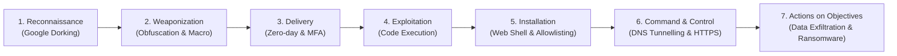

# Room 04: Cyber Kill Chain
## الغرفة 04: سلسلة القتل السيبراني

* **Parent Module:** Module 02: Penetration Testing Foundations
* **Room URL:** [https://tryhackme.com/room/cyberkillchain](https://tryhackme.com/room/cyberkillchain)
* **Estimated Duration:** 35 Minutes
* **Total Tasks:** 9 Tasks

---

## 01. Room Overview | نظرة عامة على الغرفة
في هذه الغرفة المنهجية، يدرس مختبر الاختراق إطار **Cyber Kill Chain** الذي طورته شركة Lockheed Martin لتفكيك وتحليل مراحل الهجمات السيبرانية المتقدمة (APTs). يتعلم الدارس المراحل السبع للهجوم من الاستطلاع المبدئي والتسليح، مروراً بالتوصيل والاستغلال، وحتى تثبيت برمجيات البقاء وقنوات القيادة والتحكم وتحقيق الأهداف النهائية، مع استيعاب كيفية كسر السلسلة في كل مرحلة دفاعياً واقتناص راية التحدي التفاعلي.

---

## 02. Learning Objectives | الأهداف التعليمية
1. استيعاب المراحل السبع المعيارية لسلسلة القتل السيبراني.
2. التمييز بين تقنيات التسليح (Obfuscation, Macros) والتوصيل (Phishing, Zero-day).
3. دراسة آليات التثبيت المستمر وتأثير الـ Web Shells وقوائم السماح (Allowlisting).
4. تحليل قنوات القيادة والتحكم الخفية (DNS tunnelling, HTTPS).
5. فهم أهداف المهاجمين (Data Exfiltration, Ransomware) وتطبيق راية كسر السلسلة (`THM{CKC_NJHERDX327}`).

---

## 03. The 7 Phases of the Cyber Kill Chain

---

## 04. Verified Tasks Summary | ملخص المهام المعتمدة
* **Task 1: Introduction** ⟶ `7`
* **Task 2: Reconnaissance** ⟶ `Google Dorking` | `passive reconnaissance`
* **Task 3: Weaponisation** ⟶ `Obfuscation` | `Macro`
* **Task 4: Delivery** ⟶ `Zero-day exploit` | `MFA`
* **Task 5: Exploitation** ⟶ `No answer needed`
* **Task 6: Installation** ⟶ `web shell` | `allowlisting`
* **Task 7: Command and Control (C2)** ⟶ `DNS tunnelling` | `HTTPS`
* **Task 8: Actions on Objectives** ⟶ `Data Exfiltration` | `principle of least privilege` | `Ransomware`
* **Task 9: Conclusion** ⟶ `THM{CKC_NJHERDX327}`
