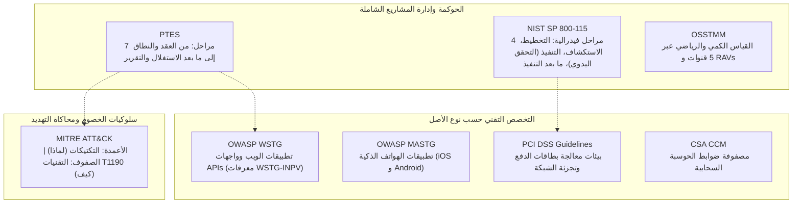

# التوثيق التخصصي الشامل: أطر ومنهجيات اختبار الاختراق (Penetration Testing Frameworks)

---

## 01. نظرة عامة على الغرفة (Room Overview)
* **عنوان الغرفة الأصلي:** Penetration Testing Frameworks
* **رابط الغرفة الرسمي:** [https://tryhackme.com/room/penetrationtestingframeworks](https://tryhackme.com/room/penetrationtestingframeworks)
* **الوحدة التابعة:** الوحدة 02 — أسس وقواعد اختبار الاختراق (Penetration Testing Foundations)
* **مستوى الصعوبة:** متوسط (مفاهيمي ومعماري متقدم)
* **الوقت التقديري للإنجاز:** 60 دقيقة
* **المتطلبات المسبقة:** فهم دورة حياة اختبار الاختراق، مبادئ أمان الشبكات والويب، ونموذج سلسلة القتل السيبراني.
* **الأهمية الميدانية والمهنية:** تُعد هذه الغرفة المرجع المعماري الأهم لمختبر الاختراق في بيئات الأعمال الاحترافية. المهارات الهجومية المعزولة لا تكفي لإدارة مشروع أمني ناجح؛ فالشركات الكبرى والمؤسسات الحكومية تطلب اختبارات مبنية على أطر معترف بها دولياً تضمن الشمولية (Thoroughness)، التوافق مع القوانين (Compliance)، وتوفير معايير موحدة قابلة للتكرار والقياس (Repeatability).

---

## 02. الأهداف التعليمية (Learning Objectives)

### أهداف نظرية ومفاهيمية (Theoretical Objectives)
* استيعاب الفوائد الجوهرية لاعتماد الأطر المنهجية بدلاً من الفحص العشوائي (الشمولية، الامتثال، الموثوقية).
* دراسة ومقارنة الفلسفات المعمارية للأطر العالمية: OSSTMM (القياس الكمي)، PTES (دورة الحياة الكاملة)، NIST SP 800-115 (المعايير الفيدرالية)، OWASP WSTG (تطبيقات الويب)، و MITRE ATT&CK (سلوكيات الخصوم).
* إدراك العلاقة بين تكتيكات MITRE ATT&CK (الأعمدة - "لماذا") وتقنياتها (الصفوف - "كيف").
* فهم كيفية دمج أطر متعددة لتغطية مشاريع متكاملة ومتشعبة (الهجين: WSTG + MASTG + PCI DSS).

### أهداف عملية وتطبيقية (Practical Objectives)
* تحديد واستخدام معرّفات اختبارات OWASP WSTG (مثل فئة فحص المدخلات `WSTG-INPV`).
* تطبيق مرحلة التحقق من صحة الثغرات (`Target vulnerability validation`) في معيار NIST قبل الاستغلال الفعلي.
* تصنيف ثغرات استغلال خوادم الويب المكشوفة وفق معرف ميتري (`T1190`).
* تحديد الإطار المناسب لسيناريوهات محددة: بطاقات الدفع (`PCI DSS`)، الهواتف الذكية (`OWASP MASTG`)، وضوابط السحابة (`CSA Cloud Control Matrix`).
* حل التحدي العملي التفاعلي واستخراج راية الغرفة الرسمية (`THM{pen-test-fr4m3work5}`).

### أهداف تحليلية ومهنية (Analytical & Professional Skills)
* اختيار وهندسة الإطار الأمني المناسب بناءً على القطاع التجاري وطبيعة الأصول واللوائح التنظيمية.
* صياغة تقارير امتثال مدعومة بمعايير دولية معتمدة تصمد أمام لجان التدقيق المالي والقانوني.

---

## 03. الأسس المفاهيمية (Conceptual Foundations)

### 1. لماذا نستخدم أطر اختبار الاختراق؟
1. **الشمولية والدقة (Thoroughness):** تضمن عدم تفويت أي خطوة أو خدمة حيوية قد يتجاهلها المختبر عن طريق السهو.
2. **الامتثال للوائح القانونية (Compliance):** اشتراط هيئات الرقابة الدولية (مثل HIPAA, PCI-DSS, ISO 27001) بأن يكون التقييم الأمني مبنياً على إطار معترف به.
3. **التكرارية والمقارنة العادلة (Repeatability):** تمكين الشركة من إعادة الاختبار بعد سنة مع فريق مختلف ومقارنة النتائج على نفس الأساس.

### 2. استعراض الأطر الخمسة الكبرى:
* **OSSTMM:** ركز على الأرقام والقياس الرياضي الدقيق لمساحة الهجوم عبر 5 قنوات تشغيلية باستخدام مقياس `Risk Assessment Values (RAV)`.
* **PTES:** ركز على إدارة المشروع والتعاقد المهني وقسم الاختبار إلى 7 مراحل تبدأ بالتفاعل المسبق وتحديد النطاق (المرحلة 1) وحتى كتابة التقرير.
* **NIST SP 800-115:** الدليل الفيدرالي الأمريكي الصارم الذي يفرض التحقق اليدوي من الثغرات قبل الهجوم.
* **OWASP WSTG:** الدليل الشامل المخصص لطبقة تطبيقات الويب (Layer 7)، المنظم بمعرفات معيارية تغطي كافة جوانب الكود والمدخلات.
* **MITRE ATT&CK:** مصفوفة التكتيكات والتقنيات التي تصف سلوك المهاجمين الحقيقيين في الميدان.

---

## 04. الغوص التقني والتشريحي (Technical Deep Dive)

### مقارنة معمارية أطر اختبار الاختراق



### بنية مصفوفة MITRE ATT&CK Enterprise:
* **الأعمدة (Columns) = التكتيكات (Tactics):**
  تمثل الهدف التكتيكي العام للمهاجم (مثل `Initial Access`, `Execution`, `Persistence`, `Privilege Escalation`).
* **الصفوف والبنود (Rows) = التقنيات (Techniques):**
  تمثل الكيفية الإجرائية لتحقيق هذا التكتيك (مثل تقنية `T1190: Exploit Public-Facing Application`).

---

## 05. الأدوات والتقنيات (Tools and Technologies)

| الإطار / الأداة | الغرض الأساسي | السيناريو الميداني الموصى به |
|---|---|---|
| **OWASP WSTG** | فحص واجهات الويب والـ APIs | تدقيق مواقع التجارة الإلكترونية، واجهات الدخول، وحالات فحص المدخلات (`WSTG-INPV`). |
| **OWASP MASTG** | تقييم تطبيقات الهواتف الذكية | تدقيق التطبيقات المصرفية على هواتف iOS و Android وفحص تشفير التخزين المحلي. |
| **PCI DSS Guidelines** | اختبار بيئة بطاقات الائتمان (CDE) | تدقيق بوابات الدفع الإلكتروني ومتاجر التجزئة ومحطات الـ POS وفق متطلبات البند 11.4. |
| **CSA CCM** | تدقيق ضوابط الأمان السحابية | مراجعة تكوينات بيئات AWS, Azure, GCP وضمان التوافق المعماري بدون الحاجة لاختراق عنيف. |
| **NIST SP 800-115** | التقييم الفني للمؤسسات الفيدرالية | تنفيذ مراجعات الوثائق، الفحص الشبكي، والتحقق من صحة الثغرات (`Target vulnerability validation`). |
| **MITRE ATT&CK** | محاكاة الخصوم وتصنيف التهديدات | تصنيف نتائج التقرير وربطها بسلوكيات مجموعات الـ APT الميدانية (مثل ربط استغلال الخادم بـ `T1190`). |

---

## 06. منهجية اختبار الاختراق وتنسيق الأطر (Multi-Framework Orchestration)

في المشاريع المؤسسية المتكاملة، لا يقتصر المختبر على إطار واحد، بل ينسق بينها:
1. **استخدام PTES** لحوكمة المشروع، كتابة وثيقة النطاق (المرحلة 1)، وتحديد بروتوكول الطوارئ.
2. **استخدام OWASP WSTG** كقائمة تحقق تقنية لفحص متجر الويب الموجه للجمهور.
3. **استخدام OWASP MASTG** لفحص تطبيق الهاتف المرتبط بالمتجر ومراقبة اتصالات الـ API.
4. **استخدام PCI DSS Penetration Testing Guidance** للتحقق من عزل شبكة بطاقات الائتمان وتشفير بيانات حاملي البطاقات.
5. **استخدام MITRE ATT&CK** في التقرير النهائي لتصنيف الثغرات وتقديم توصيات دفاعية يفهمها مهندسو الـ Blue Team والـ SOC.

---

## 07. السير العملي المفصل (Practical Walkthrough)

### المهام 01 إلى 05: الأطر العامة والتنظيمية
* **المهمة 01 (Introduction):** استخدام الأطر يضمن الشمولية (`Thoroughness`) ويحقق الامتثال للوائح القانونية مثل HIPAA (`Compliance`).
* **المهمة 02 (OSSTMM):** المقياس الكمي لمساحة الهجوم هو `Risk Assessment Values`، والمرحلة التي تلي التفاعل وتستجوب الخدمات هي مرحلة الاستعلام `Inquiry`.
* **المهمة 03 (OWASP WSTG):** معرف اختبارات التحقق من المدخلات هو `WSTG-INPV`، والمرحلة المقابلة في دورة حياة البرمجيات SDLC لاختبار الميزة بعد كتابتها وقبل نشرها هي المرحلة `3`.
* **المهمة 04 (NIST SP 800-115):** فئة التقنيات الواجب تطبيقها للتحقق من صحة نتائج الفاحص الآلي وتصفية الإنذارات الكاذبة هي `Target vulnerability validation`.
* **المهمة 05 (PTES):** المرحلة المخصصة لتحديد النطاق، القواعد، والتفويض القانوني هي المرحلة رقم `1`.

### المهام 06 إلى 09: مصفوفة ميتري والأطر المتخصصة
* **المهمة 06 (ISSAF):** الإطار المعاصر الذي سد الفجوة بفهرسة تكتيكات المهاجمين الحقيقيين في الميدان هو `MITRE ATT&CK`.
* **المهمة 07 (MITRE ATT&CK):** الأعمدة تمثل التكتيكات (`tactics`)، والصفوف تمثل التقنيات (`techniques`). ومعرف تقنية استغلال تطبيق خارجي هو `T1190`.
* **المهمة 08 (Notable Frameworks):** متجر معالجة بطاقات الدفع يتبع `PCI DSS Penetration Testing Guidelines`، وتطبيق الهاتف المصرفي يتبع `OWASP Mobile Application Security Testing Guide`، وتقييم ضوابط AWS السحابية يتبع `CSA Cloud Control Matrix`.
* **المهمة 09 (Choosing Framework):** الوكالات الفيدرالية الأمريكية تعتمد `NIST SP 800–115`. والمزيج المعياري لشركة تجارة إلكترونية متعددة المنصات هو `WSTG,MASTG,PCI DSS`.

### المهمة 10: التحدي التفاعلي النهائي واستخراج الراية
في واجهة التطبيق التفاعلي الملحقة:
1. مطابقة السيناريوهات المؤسسية المتنوعة بالأطر المناسبة بدقة.
2. بمجرد اكتمال الفرز بنجاح، تظهر الراية الرسمية:
   `THM{pen-test-fr4m3work5}`

---

## 08. ملخص المهام والحلول (Tasks and Solutions Summary)

| رقم المهمة | السؤال الأصلي | الإجابة النموذجية المعتمدة |
|---|---|---|
| **Task 01** | *Which benefit of using a framework would have most directly prevented this situation?* | `Thoroughness` |
| **Task 01** | *Which benefit of using a recognized framework would matter most to this client?* | `Compliance` |
| **Task 02** | *What OSSTMM metric quantifies the balance between an organization's attack surface and its controls?* | `Risk Assessment Values` |
| **Task 02** | *Which phase do you enter next, and what is the primary objective?* | `Inquiry` |
| **Task 03** | *What identifier would you look for to find test cases related to input validation?* | `WSTG-INPV` |
| **Task 03** | *Which SDLC-aligned phase number are they in?* | `3` |
| **Task 04** | *Which NIST SP 800-115 technique category should you apply to these findings?* | `Target vulnerability validation` |
| **Task 05** | *Which PTES phase number specifically addresses defining the scope, rules of engagement, and legal authorization?* | `1` |
| **Task 06** | *Which framework fills the gap by cataloging specific tactics and techniques used by real-world adversaries in the wild?* | `MITRE ATT&CK` |
| **Task 07** | *In the ATT&CK matrix, what do the columns represent?* | `tactics` |
| **Task 07** | *In the ATT&CK matrix, what do the rows within each column represent?* | `techniques` |
| **Task 07** | *What ATT&CK technique ID would you use to classify this finding?* | `T1190` |
| **Task 08** | *Which framework from this task would most directly govern credit card testing?* | `PCI DSS Penetration Testing Guidelines` |
| **Task 08** | *Which framework is the most appropriate testing reference for an iOS banking app?* | `OWASP Mobile Application Security Testing Guide` |
| **Task 08** | *Which framework is most relevant for AWS cloud configuration controls assessment?* | `CSA Cloud Control Matrix` |
| **Task 09** | *Which framework is the most natural primary choice for a U.S. federal agency internal network?* | `NIST SP 800–115` |
| **Task 09** | *Which combination of frameworks would you recommend to cover all three components?* | `WSTG,MASTG,PCI DSS` |
| **Task 10** | *What is the flag?* | `THM{pen-test-fr4m3work5}` |

---

## 09. الأخطاء الشائعة واستكشاف الأخطاء (Common Errors & Troubleshooting)

* **الخطأ 1: محاولة استغلال مخرجات فاحص الثغرات الآلي دون تدقيق يدوي:**
  * *التوضيح:* يخالف معيار NIST SP 800-115 الذي يوجب تطبيق خطوة `Target vulnerability validation` أولاً لتصفية الإنذارات الكاذبة وتجنب إحداث ضرر بأنظمة العميل.
* **الخطأ 2: الخلط بين التكتيكات (Tactics) والتقنيات (Techniques) في MITRE ATT&CK:**
  * *التوضيح:* التكتيك يمثل العمود الرأسي والهدف العام (مثل الدخول الأولي Initial Access)، بينما التقنية تمثل الصف والوسيلة المحددة (مثل T1190).
* **الخطأ 3: كتابة أسماء الأطر المتعددة في Task 09 مع مسافات بعد الفواصل:**
  * *التوضيح:* يجب إدخال السلسلة بدون مسافات زائدة: `WSTG,MASTG,PCI DSS`.

---

## 10. التداعيات الأمنية وإجراءات التحصين (Security Implications & Defensive Hardening)

1. **التحصين المؤسسي القائم على الأطر:**
   * اعتماد مصفوفة متكاملة من الأطر يضمن للمؤسسة سد الثغرات عبر كافة الطبقات (الشبكة، التطبيق، الهاتف، السحابة، والعنصر البشري).
2. **التكامل مع فرق الدفاع (Blue Team Hardening):**
   * ربط الثغرات المكتشفة بمعرفات MITRE ATT&CK يمكن المدافعين في الـ SOC من إنشاء قواعد رصد مخصصة في أنظمة SIEM/EDR لمراقبة التكتيكات المستغلة في بيئة العمل.

---

## 11. التطبيقات الواقعية والربط المهني (Real-World Applications)

* **التعاقدات المؤسسية الكبرى (Enterprise Scoping):**
  عند تقديم عروض الأسعار (RFP/RFI) للشركات الكبرى والبنوك، تشترط كراسة الشروط تسمية الأطر المعيارية التي سيلتزم بها فريق التقييم.
* **إثبات الامتثال القانوني والمالي:**
  تقارير اختبار الاختراق المبنية على PCI DSS و NIST SP 800-115 تُستخدم كوثائق رسمية تقدم لجهات الرقابة المالية ومراجعي الحسابات القانونيين لإثبات سلامة العمليات التجارية.

---

## 12. الدروس المستفادة والخلاصة (Key Takeaways and Summary)

1. **الأطر تحمي الجميع:** توفر المنهجيات حماية قانونية للمختبر وتضمن للعميل اختباراً آمناً وشاملاً.
2. **التخصص حسب الأصل:** لكل بيئة تقنية إطارها الذهبي (WSTG للويب، MASTG للهواتف، CCM للسحابة).
3. **لغة التهديد الموحدة:** مصفوفة MITRE ATT&CK هي المترجم العالمي المشترك بين الهجوم والدفاع.

---

## 13. المرجع السريع وبطاقة الأوامر (Quick Reference and Cheat Sheet)

```text
[Framework Decision Matrix]
General Pentest Lifecycle   ⟶ PTES (7 Phases: Pre-engagement -> Reporting)
US Federal / Government Audit⟶ NIST SP 800-115 (Validation Before Exploitation)
Quantitative Risk Balance   ⟶ OSSTMM (RAVs Metric / 5 Channels)
Web Applications & APIs     ⟶ OWASP WSTG (e.g., WSTG-INPV for Input Validation)
Mobile Apps (iOS/Android)   ⟶ OWASP MASTG (Storage, Network, Reverse Engineering)
Credit Card & Payment (CDE) ⟶ PCI DSS Penetration Testing Guidelines
Cloud Governance & Controls ⟶ CSA Cloud Controls Matrix (CCM)
Adversary Behavioral Mapping⟶ MITRE ATT&CK (Columns: Tactics | Rows: Techniques like T1190)
```

---

## 14. التقييم الذاتي وبنك الأسئلة التفاعلي ومفتاح الإجابات (Self-Assessment & Knowledge Check)

### أسئلة الاختبار الذاتي (Self-Assessment Questions)
1. ما الفرق الأساسي بين فلسفة إطار OSSTMM وفلسفة إطار PTES؟
2. لماذا يعتبر التحقق من صحة الثغرات (Target Vulnerability Validation) خطوة إلزامية في NIST SP 800-115 قبل إطلاق الاستغلال؟
3. إذا طلب بنك فحص بوابته الإلكترونية وتطبيقه على هواتف آيفون وشبكة أجهزة الصراف الآلي (ATM)، فما هي الأطر الثلاثة المناسبة لدمجها في هذا المشروع؟
4. كيف يساعد معرف تقنية MITRE ATT&CK (مثل T1190) فريق الدفاع (Blue Team) مقارنة بالوصف النصي التقليدي للثغرة؟

---

### مفتاح الإجابات النموذجي (Answer Key)
* **إجابة السؤال 1:** إطار OSSTMM يركز على القياس الكمي الرياضي للأمان وحساب قيم المخاطر (RAVs) عبر أرقام مجردة، بينما إطار PTES يركز على إدارة المشروع ودورة حياة اختبار الاختراق الميدانية وعلاقات التعاقد وما بعد الاستغلال.
* **إجابة السؤال 2:** لأن الماسحات الآلية تصدر العديد من الإنذارات الكاذبة (False Positives)، والاستغلال المباشر دون فحص يدوي مسبق قد يؤدي إلى تعطل الخدمة أو انهيار الخادم دون جدوى.
* **إجابة السؤال 3:** دليل OWASP WSTG للبوابة الإلكترونية، ودليل OWASP MASTG لتطبيق الآيفون، ودليل PCI DSS Penetration Testing Guidelines لشبكة أجهزة الصراف الآلي ومعالجة البطاقات.
* **إجابة السؤال 4:** المعرف الرقمي `T1190` يربط النتيجة فوراً بقواعد بيانات ميتري العالمية، مما يوضح للمدافعين كافة مجموعات التهديد التي تستخدم هذا الأسلوب، وتكتيكات الرصد المقابلة في أنظمة SIEM، والضوابط التخفيفية المعتمدة هندسياً.
