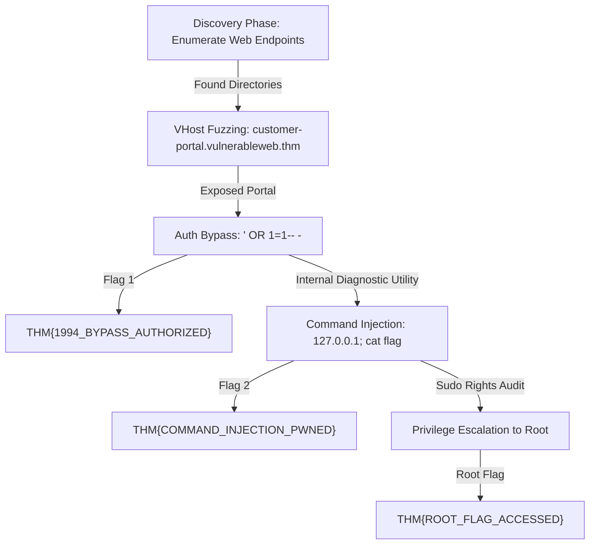

# Room 01: Guided Pentest: Web
## Comprehensive Technical Documentation (English Version)

* **Parent Module:** Module 02: Penetration Testing Foundations
* **Room URL:** [https://tryhackme.com/room/guidedpentestweb](https://tryhackme.com/room/guidedpentestweb)
* **Estimated Duration:** 45 Minutes
* **Total Tasks:** 8 Tasks

---

## 01. Room Overview
In this guided engagement lab, learners experience an authentic web application penetration testing workflow from reconnaissance to root server compromise. The assessment begins with automated content discovery, progresses to virtual host fuzzing (`customer-portal.vulnerableweb.thm`), bypasses portal authentication, exploits an unsanitized command execution parameter, and escalates privileges to `root` on the underlying Linux host.

---

## 02. Learning Objectives
1. Perform structured directory enumeration to uncover hidden web directories.
2. Fuzz HTTP Host headers to discover internal virtual hosts and subdomains.
3. Exploit login logic flaws to execute authentication bypass and capture session tokens.
4. Exploit command injection vulnerabilities to achieve remote code execution (RCE).
5. Audit local system configurations and elevate privileges to `root`.

---

## 03. Engagement Attack Chain

---

## 04. Verified Tasks Summary
* **Task 1: Introduction** ⟶ `No answer needed`
* **Task 2: Setting up Burp Suite** ⟶ `No answer needed`
* **Task 3: Content Discovery** ⟶ `/assets, /admin, /login, /contact, /pricing, /about, /customers`
* **Task 4: Subdomain Enumeration** ⟶ `customer-portal.vulnerableweb.thm`
* **Task 5: Authentication Bypass** ⟶ `THM{1994_BYPASS_AUTHORIZED}`
* **Task 6: Command Injection** ⟶ `THM{COMMAND_INJECTION_PWNED}`
* **Task 7: Privilege Escalation** ⟶ `THM{ROOT_FLAG_ACCESSED}`
* **Task 8: Conclusion** ⟶ `No answer needed`
