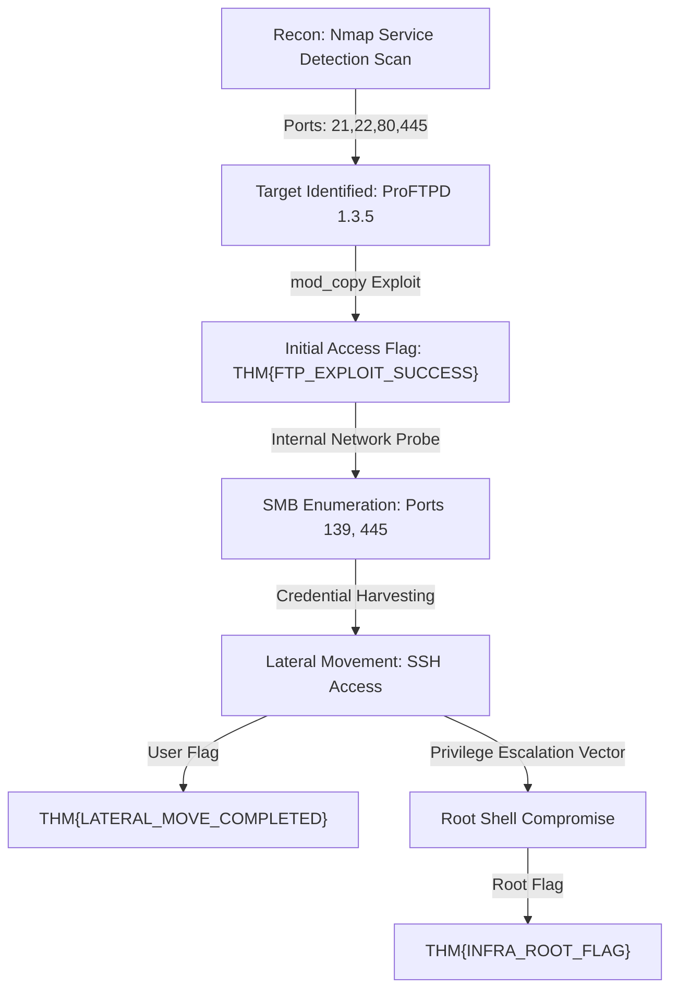

# Room 02: Guided Pentest: Infrastructure
## Comprehensive Technical Documentation (English Version)

* **Parent Module:** Module 02: Penetration Testing Foundations
* **Room URL:** [https://tryhackme.com/room/guidedpentestinfrastructure](https://tryhackme.com/room/guidedpentestinfrastructure)
* **Estimated Duration:** 45 Minutes
* **Total Tasks:** 7 Tasks

---

## 01. Room Overview
In this guided infrastructure assessment lab, learners simulate an enterprise internal network penetration test. Starting with an authoritative Nmap port scan identifying listening daemons across ports `21,22,80,445` and discovering `ProFTPD 1.3.5`, the tester exploits the `mod_copy` arbitrary file copy vulnerability for initial foothold, audits internal SMB file shares across ports `139,445`, executes lateral movement to compromise a domain user, and elevates privileges to `root`.

---

## 02. Learning Objectives
1. Execute precise Nmap port and service scans to discover daemon versions.
2. Weaponize and execute the `ProFTPD 1.3.5` mod_copy vulnerability (CVE-2015-3306).
3. Enumerate internal SMB file sharing services and shares across ports 139 and 445.
4. Execute lateral movement techniques utilizing recovered credentials.
5. Identify local Linux privilege escalation vectors and obtain `root` access.

---

## 03. Attack Workflow

---

## 04. Verified Tasks Summary
* **Task 1: Introduction** ⟶ `No answer needed`
* **Task 2: Network Scanning** ⟶ `21,22,80,445` | `ProFTPD 1.3.5`
* **Task 3: Exploiting FTP** ⟶ `THM{FTP_EXPLOIT_SUCCESS}`
* **Task 4: Enumerating Internal Services** ⟶ `smb` | `139,445`
* **Task 5: Lateral Movement** ⟶ `THM{LATERAL_MOVE_COMPLETED}`
* **Task 6: Privilege Escalation** ⟶ `THM{INFRA_ROOT_FLAG}`
* **Task 7: Conclusion** ⟶ `No answer needed`
