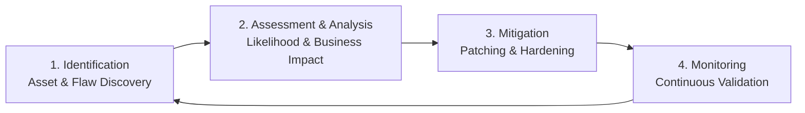

# Comprehensive Technical Documentation: Dive Into Pentesting

---

## 01. Room Overview
* **Original Room Title:** Dive Into Pentesting
* **Official Room URL:** [https://tryhackme.com/room/diveintopentesting](https://tryhackme.com/room/diveintopentesting)
* **Parent Module:** Module 02 — Penetration Testing Foundations
* **Difficulty Level:** Foundational / Conceptual
* **Estimated Completion Time:** 45 minutes
* **Prerequisites:** No technical prerequisites; designed to instill the professional, legal, and methodological discipline that governs real-world penetration testing engagements.
* **Field Relevance & Operational Context:** This room serves as the "professional and ethical compass" for aspiring penetration testers. Technical skill in executing exploits or running automated scanners is liabilities without an overarching framework of legal authorization, scoping rigor, contextual risk evaluation, and the ability to articulate technical vulnerabilities as tangible business impact.

---

## 02. Learning Objectives

### Theoretical & Conceptual Objectives
* Differentiate between ethical penetration testers and malicious threat actors across authorization, legal liability, scope, and coverage breadth.
* Understand the core concept of **Broad Coverage** vs. the attacker's search for the **Single Easiest Path**.
* Master the cybersecurity risk triad: Vulnerability, Threat, and Risk.
* Appreciate the concept of **Contextual Risk** and understand why identical vulnerabilities carry radically different risk scores based on internal vs. external exposure.
* Analyze the root causes of systemic security flaws (human assumptions, technical debt, and system complexity).

### Practical & Hands-On Objectives
* Map core assessment domains: External Network Pentesting, Internal Assessments, and Web Application Testing.
* Distinguish between Authentication mechanisms and Session Management controls (specifically cookie invalidation upon logout).
* Identify the **Mitigation** phase within the standard risk management lifecycle.
* Apply mandatory data redaction principles to protect Personally Identifiable Information (PII) within assessment deliverables.
* Navigate the interactive scenario-based decision lab and retrieve the official room flag (`THM{L3t$_d1v3_1nt0_Pen7es71ng!}`).

### Analytical & Professional Objectives
* Cultivate the professional penetration tester mindset: hypothesis-driven testing, comprehensive note-taking, and proactive stakeholder communication.
* Translate technical findings into business-aligned risk statements that resonate with executive leadership.

---

## 03. Conceptual Foundations

### 1. Ethical Tester vs. Malicious Threat Actor
* **Penetration Tester:**
  A professional operating under signed contracts and explicit Rules of Engagement (RoE). The objective is **Broad Coverage**—evaluating all reachable components within scope to identify as many flaws as possible, providing clients with an exhaustive blueprint for security hardening.
* **Malicious Threat Actor:**
  An unauthorized adversary operating outside the law. Their objective is achieving their motive (data exfiltration, extortion, sabotage) via the **Single Easiest Path**, bypassing comprehensive analysis once an initial entry point is secured.

### 2. The Contextual Risk Equation
$$\mathbf{\text{Risk}} = \mathbf{\text{Threat}} \times \mathbf{\text{Vulnerability}} \times \mathbf{\text{Impact}}$$
* **Vulnerability:** An inherent flaw in software design, configuration, or implementation.
* **Threat:** The actor, capability, or scenario seeking to exploit that flaw.
* **Impact:** The business, financial, operational, or legal damage incurred upon successful exploitation.

**Architectural Reality:** Risk is never intrinsic to a software bug alone; it is fundamentally shaped by **environmental exposure**. A Remote Code Execution (RCE) flaw exposed on an internet-facing production portal carries a **Critical** risk rating. The exact same flaw inside a non-routable, isolated sandbox with zero sensitive data carries a substantially lower risk rating due to minimal threat accessibility and mitigated impact.

---

## 04. Technical Deep Dive

### Operational Workflow Comparison: Attacker vs. Ethical Tester

```mermaid
flowchart TD
    subgraph MaliciousAttacker["Malicious Threat Actor"]
        A1["Unauthorized External Recon"] --> A2["Probe for Weakest Entry Point"]
        A2 --> A3["Exploit Single Easiest Path"]
        A3 --> A4["Exfiltrate Data / Deploy Ransomware"]
        A4 --> A5["Cover Tracks / Evade Detection"]
    end

    subgraph PenetrationTester["Ethical Penetration Tester"]
        P1["Define Contract & Scope (RoE)"] --> P2["Systematic Asset Enumeration (Broad Coverage)"]
        P2 --> P3["Vulnerability Analysis & Risk Context"]
        P3 --> P4["Controlled Proof-of-Concept (PoC)"]
        P4 --> P5["Redact Sensitive Data & PII"]
        P5 --> P6["Deliver Report & Remediation Roadmap (Mitigation)"]
    end
```



### The Four-Stage Risk Management Lifecycle



---

## 05. Tools and Technologies

While this room centers on foundational concepts, professional penetration testers employ specialized organizational tooling:

| Tool / Technology | Engagement Role | Operational Function |
|---|---|---|
| **Structured Note-Taking Platforms (Obsidian / CherryTree)** | Chronological evidence capture and terminal log archival | Guarantees full reproducibility for Proof-of-Concepts (PoCs) during report compilation. |
| **Data Masking & Redaction Utilities** | Sensitive data sanitization | Obscures credit card numbers, passwords, and PII from evidence screenshots to maintain compliance (GDPR/PCI-DSS). |
| **Rules of Engagement (RoE) Frameworks** | Legal boundary contract documentation | Establishes authorized IP ranges, emergency contact protocols, and excluded techniques (e.g., DoS). |

---

## 06. Penetration Testing Methodology

Professional testing methodology is anchored in three operational pillars:
1. **Pre-Engagement Rigor & Scope Integrity:**
   * Operating strictly within authorized boundary limits. Unlisted targets are never scanned without explicit, written amendment.
2. **Methodical Analysis over Impulsive Exploitation:**
   * Resisting the urge to immediately throw exploits at target banners ("Rushing to exploitation"). Thoroughly analyzing application architecture, routing logic, and client-side code first.
3. **Proactive Stakeholder Communication:**
   * Promptly alerting client point-of-contacts regarding technical roadblocks (e.g., automated WAF blacklisting) or immediate critical systemic vulnerabilities requiring emergency triage.

---

## 07. Practical Walkthrough

### Tasks 01 through 05: Core Concepts & Risk Architecture
* **Coverage Mandate:** Penetration testers pursue broad coverage across the authorized scope (`Penetration Tester`), whereas attackers focus on the easiest single path (`Attacker`).
* **Scoping Domains:** Assessments targeting internet-facing infrastructure are categorized as `External Network Penetration Testing`. Cookie persistence issues after logout fall under `Session management`.
* **Risk Mechanics:** Vulnerability remediation occurs within the `Mitigation` stage. Identical vulnerabilities do NOT carry identical risk across internal vs. external environments (`Nay`).
* **Root Causes:** Flaws stem from human assumptions, architectural complexity, and time-to-market constraints.

### Tasks 06 & 07: Mindset, Ethics, and Governance
* **Ineffective Behaviors:** Attacking a target without understanding its inner workings (`Rushing to exploitation`).
* **Effective Behaviors:** Maintaining rigorous, organized documentation (`Maintaining good notes`) and escalating roadblocks early (`Proactive communication`).
* **Ethical Boundaries:** The boundaries of any engagement are defined by its `Scope`. Findings must demonstrate tangible `Business impact`, and client deliverables must redact `Sensitive data`.

### Task 08: Scenario-Based Lab & Flag Capture
Within the interactive simulation:
1. Select lawful compliance when encountering unlisted network ranges (halt and request scope expansion).
2. Apply masking to exposed credit card databases prior to documentation.
3. Initiate immediate client notification upon triggering security blocks.
4. Completing the decision matrix unlocks the official room flag:
   `THM{L3t$_d1v3_1nt0_Pen7es71ng!}`

---

## 08. Tasks and Solutions Summary

| Task Index | Original Question | Verified Answer |
|---|---|---|
| **Task 01** | *Read the above.* | `No answer needed` |
| **Task 02** | *Which actor aims for broad coverage of a target?* | `Penetration Tester` |
| **Task 02** | *Which actor focuses on the single easiest path to achieve their goal?* | `Attacker` |
| **Task 03** | *What type of testing evaluates internet-facing systems from an external perspective?* | `External Network Penetration Testing` |
| **Task 03** | *Which focus area includes testing session cookies that remain valid after logout?* | `Session management` |
| **Task 04** | *Which stage of the risk management cycle involves patching or fixing a reported vulnerability?* | `Mitigation` |
| **Task 04** | *Does the exact same vulnerability carry the same risk regardless of whether the system is internal or external? (Yea/Nay)* | `Nay` |
| **Task 05** | *Read the above.* | `No answer needed` |
| **Task 06** | *What ineffective habit involves attacking a system without first understanding how it works?* | `Rushing to exploitation` |
| **Task 06** | *What practice makes findings reproducible without repeating the entire discovery process?* | `Maintaining good notes` |
| **Task 06** | *What habit prevents blockers from consuming the testing window?* | `Proactive communication` |
| **Task 07** | *What defines the boundaries of a penetration test?* | `Scope` |
| **Task 07** | *What type of impact should a finding demonstrate beyond technical severity?* | `Business impact` |
| **Task 07** | *What type of data must be redacted from reports to prevent unintended disclosure?* | `Sensitive data` |
| **Task 08** | *What is the flag from the completion activity?* | `THM{L3t$_d1v3_1nt0_Pen7es71ng!}` |

---

## 09. Common Errors, Pitfalls & Troubleshooting

* **Pitfall 1: Confusing Authentication with Session Management:**
  * *Correction:* Authentication governs identity verification during login; Session Management governs state tracking and cookie invalidation post-authentication.
* **Pitfall 2: Treating CVSS Scores as Absolute Risk Metrics:**
  * *Correction:* CVSS measures technical characteristics; true organizational risk requires evaluating asset exposure, network placement, and business impact.
* **Pitfall 3: Including Raw Client PII in Assessment Reports:**
  * *Correction:* Violates data protection regulations (GDPR/PCI-DSS); always redact or hash production data before attaching evidence artifacts.

---

## 10. Security Implications and Defensive Hardening

1. **Session Lifecycle Hardening:**
   * Invalidate session tokens server-side upon logout, terminating the corresponding database or cache entry.
   * Enforce modern cookie security flags: `HttpOnly` to neutralize XSS theft, `Secure` to mandate TLS transit, and `SameSite=Strict` to mitigate CSRF.
2. **Context-Driven Vulnerability Triage:**
   * Prioritize patching based on asset exposure and business criticality, resolving internet-facing critical flaws within 24-48 hours.
3. **Developer Threat Modeling Training:**
   * Train software engineering teams to abandon benign input assumptions and implement server-side validation by default.

---

## 11. Real-World Applications and Mapping

* **Enterprise Consultative Engagements:**
  Accredited cybersecurity consulting firms align operations with international frameworks (e.g., PTES, NIST SP 800-115), ensuring all activity is backed by enforceable legal agreements and clear scoping boundaries.
* **Executive Risk Translation:**
  High-performing penetration testers excel by articulating findings in financial and regulatory terms, empowering Chief Information Security Officers (CISOs) to justify security engineering budgets.

---

## 12. Key Takeaways and Summary

1. **Coverage Defines Professional Value:** A tester's objective is systematic, multi-vector coverage, contrasting with an attacker's opportunistic approach.
2. **Risk is Contextual:** Environmental exposure and asset criticality dictate actual organizational risk.
3. **Ethics and Scoping Protect All Parties:** Technical proficiency without ethical discipline creates severe legal liabilities.

---

## 13. Quick Reference and Cheat Sheet

```text
[Risk Management Triad]
Vulnerability = Inherent System Weakness
Threat        = Threat Actor / Attack Vector
Risk          = Threat × Vulnerability × Impact

[Role Differentiation]
Penetration Tester -> Broad Target Coverage | Legally Scoped | Detailed Reporting
Malicious Attacker -> Single Easiest Path   | Unauthorized   | Destructive Action

[Core Habits]
Positive: System Architecture Analysis -> Structured Note-Taking -> Proactive Communication
Negative: Rushing to Exploitation -> Out-of-Scope Targeting -> Exposing Sensitive Client PII
```

---

## 14. Comprehensive Self-Assessment & Knowledge Check

### Self-Assessment Questions
1. How does quantitative risk assessment differ from qualitative risk assessment in an enterprise context?
2. Why is scanning an IP address outside the agreed-upon scope considered a criminal act even if done accidentally?
3. What are the three essential HTTP cookie attributes required to secure session identifiers against unauthorized interception?
4. In what ways does proactive communication directly safeguard an assessment's coverage window?

---

### Answer Key
* **Answer 1:** Quantitative assessment calculates financial loss using mathematical formulas (e.g., Annualized Loss Expectancy, $ALE = SLE \times ARO$), whereas qualitative assessment categorizes risk into descriptive severity tiers (High, Medium, Low) based on CVSS metrics.
* **Answer 2:** Legal authorization is strictly bounded by the formal Rules of Engagement contract; targeting any IP outside that agreement lacks authorization, violating computer fraud and abuse legislation (e.g., CFAA).
* **Answer 3:** `HttpOnly` (blocks client-side JavaScript access), `Secure` (mandates HTTPS transmission), and `SameSite=Strict` (prevents cross-site request forgery).
* **Answer 4:** When unexpected blockers occur (such as IP blacklisting by a client WAF), immediately notifying client technical contacts allows for rapid unblocking within minutes, preventing wasted project hours.
