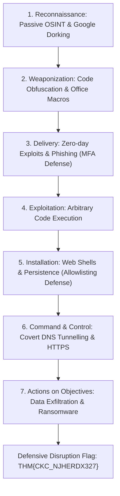

# Room 04: Cyber Kill Chain
## Comprehensive Technical Documentation (English Version)

* **Parent Module:** Module 02: Penetration Testing Foundations
* **Room URL:** [https://tryhackme.com/room/cyberkillchain](https://tryhackme.com/room/cyberkillchain)
* **Estimated Duration:** 35 Minutes
* **Total Tasks:** 9 Tasks

---

## 01. Room Overview
In this foundational methodology room, penetration testers and security analysts dissect the **Cyber Kill Chain** framework designed by Lockheed Martin. The curriculum systematically deconstructs the 7 distinct phases of targeted cyber intrusions: from external OSINT reconnaissance and payload weaponization, to delivery vectors, zero-day exploitation, web shell installation, covert C2 channels (DNS tunneling), and ultimate actions on objectives (data exfiltration and ransomware).

---

## 02. Learning Objectives
1. Master the sequential 7-phase architecture of advanced persistent threats (APTs).
2. Differentiate between weaponization techniques (obfuscation, macros) and delivery vectors.
3. Understand persistence mechanics via web shells and mitigations via application allowlisting.
4. Analyze covert command and control beaconing using DNS tunneling and HTTPS.
5. Formulate actionable defense-in-depth strategies to disrupt the chain and extract the verification flag (`THM{CKC_NJHERDX327}`).

---

## 03. Adversary Progression Flowchart

---

## 04. Verified Tasks Summary
* **Task 1: Introduction** ⟶ `7`
* **Task 2: Reconnaissance** ⟶ `Google Dorking` | `passive reconnaissance`
* **Task 3: Weaponisation** ⟶ `Obfuscation` | `Macro`
* **Task 4: Delivery** ⟶ `Zero-day exploit` | `MFA`
* **Task 5: Exploitation** ⟶ `No answer needed`
* **Task 6: Installation** ⟶ `web shell` | `allowlisting`
* **Task 7: Command and Control (C2)** ⟶ `DNS tunnelling` | `HTTPS`
* **Task 8: Actions on Objectives** ⟶ `Data Exfiltration` | `principle of least privilege` | `Ransomware`
* **Task 9: Conclusion** ⟶ `THM{CKC_NJHERDX327}`
