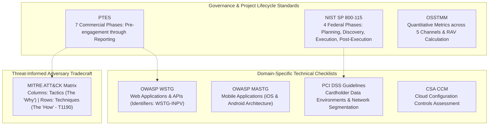

# Comprehensive Technical Documentation: Penetration Testing Frameworks

---

## 01. Room Overview
* **Original Room Title:** Penetration Testing Frameworks
* **Official Room URL:** [https://tryhackme.com/room/penetrationtestingframeworks](https://tryhackme.com/room/penetrationtestingframeworks)
* **Parent Module:** Module 02 — Penetration Testing Foundations
* **Difficulty Level:** Medium (Conceptual, Methodological, and Architectural)
* **Estimated Completion Time:** 60 minutes
* **Prerequisites:** Understanding of the core penetration testing lifecycle, foundational web and network security concepts, and the Cyber Kill Chain framework.
* **Field Relevance & Operational Context:** This room establishes the architectural governance model for professional penetration testing. Isolated exploitation skills are insufficient to execute enterprise-grade security assessments. Modern organizations and regulatory authorities require engagements to be governed by internationally recognized frameworks to guarantee thoroughness, regulatory compliance, and repeatable, audit-defensible reporting.

---

## 02. Learning Objectives

### Theoretical & Conceptual Objectives
* Evaluate the core business benefits of framework-driven testing over ad-hoc approaches: thoroughness, compliance, consistency, and repeatability.
* Compare the foundational philosophies of premier frameworks: OSSTMM (quantitative metrics), PTES (engagement lifecycle), NIST SP 800-115 (federal rigor), OWASP WSTG (web application focus), and MITRE ATT&CK (threat-informed tradecraft).
* Understand the structural relationship between ATT&CK Tactics (columns - "Why") and Techniques (rows/cells - "How").
* Analyze how enterprise engagements orchestrate multi-tiered framework combinations (e.g., WSTG + MASTG + PCI DSS).

### Practical & Hands-On Objectives
* Locate and navigate OWASP WSTG test cases utilizing standardized category identifiers (`WSTG-INPV`).
* Execute the `Target vulnerability validation` technique category within NIST SP 800-115 to eliminate false positives prior to exploitation.
* Classify real-world web exploitation findings using official MITRE ATT&CK technique identifiers (`T1190`).
* Map regulatory mandates to specific frameworks: payment card environments (`PCI DSS`), mobile operating systems (`OWASP MASTG`), and cloud controls (`CSA Cloud Control Matrix`).
* Complete the interactive static simulation challenge to retrieve the official proof-of-completion flag (`THM{pen-test-fr4m3work5}`).

### Analytical & Professional Objectives
* Architect tailored assessment scopes based on client industry vertical, multi-platform infrastructure, and regulatory audit exposure.
* Defend penetration testing deliverables in corporate compliance and external audit reviews.

---

## 03. Conceptual Foundations

### 1. The Value Proposition of Frameworks
1. **Thoroughness:** Ensures complete visibility across all systems and potential attack surfaces, eliminating blind spots caused by tester bias or omission.
2. **Compliance:** Satisfies mandatory regulatory requirements (HIPAA, PCI-DSS, ISO/IEC 27001) that reject unstructured or ad-hoc assessment reports.
3. **Repeatability:** Enables another practitioner to reproduce the assessment methodology months later, providing objective baseline metrics to measure defensive improvement.

### 2. Architectural Survey of Core Frameworks:
* **OSSTMM:** Developed by ISECOM; champions quantitative, mathematically provable metrics over subjective opinions, utilizing `Risk Assessment Values (RAVs)` across 5 operational channels.
* **PTES:** The industry standard for end-to-end commercial project management; structures testing across 7 comprehensive phases, beginning with pre-engagement scoping and authorization (Phase 1).
* **NIST SP 800-115:** The U.S. federal gold standard; mandates rigorous manual validation of discovered vulnerabilities before initiating active exploitation.
* **OWASP WSTG:** The definitive global standard for application-layer security testing; categorizes test cases by standardized alphanumeric identifiers (`WSTG-INPV`).
* **MITRE ATT&CK:** A behavioral knowledge base cataloging observed adversary tactics, techniques, and procedures (TTPs).

---

## 04. Technical Deep Dive

### Architectural Framework Taxonomy & Cross-Domain Mapping



### Deconstructing the MITRE ATT&CK Enterprise Matrix:
* **Columns (Tactics):** Represent the adversary's intermediate tactical goals during an intrusion (e.g., `Initial Access`, `Execution`, `Persistence`, `Lateral Movement`).
* **Rows / Cells (Techniques):** Represent the specific technical means executed to accomplish that tactical objective (e.g., `T1190: Exploit Public-Facing Application`).

---

## 05. Tools and Technologies

| Framework / Standard | Primary Domain | Optimal Operational Scenario |
|---|---|---|
| **OWASP WSTG** | Web Applications & APIs | Testing e-commerce portals, authentication endpoints, and input sanitization (`WSTG-INPV`). |
| **OWASP MASTG** | Mobile Applications | Auditing iOS Keychain storage, Android Keystore, API communications, and reverse-engineering protections. |
| **PCI DSS Guidelines** | Payment Card Networks | Annual penetration testing and bi-annual network segmentation audits for Cardholder Data Environments (CDE). |
| **CSA CCM** | Cloud Infrastructure | Evaluating AWS, Azure, or GCP configuration controls against security baselines without invasive penetration testing. |
| **NIST SP 800-115** | Federal & Enterprise Systems | Conducting formal technical audits requiring document reviews, active scanning, and `Target vulnerability validation`. |
| **MITRE ATT&CK** | Adversary Emulation & Reporting | Mapping assessment findings to real-world threat actors to inform Security Operations Center (SOC) detection engineering. |

---

## 06. Penetration Testing Methodology

Enterprise environments require practitioners to orchestrate multiple frameworks harmoniously:
1. **Apply PTES** to structure the legal engagement lifecycle, define the Rules of Engagement contract in Phase 1, and govern communication protocols.
2. **Execute OWASP WSTG** as the primary technical testing checklist across public-facing web applications and APIs.
3. **Execute OWASP MASTG** to audit mobile companion applications communicating with backend services.
4. **Incorporate PCI DSS Penetration Testing Guidance** to ensure Cardholder Data Environments (CDE) meet rigorous isolation and encryption standards.
5. **Classify all findings in MITRE ATT&CK** syntax within the final deliverable, providing Blue Teams with actionable detection mapping.

---

## 07. Practical Walkthrough

### Tasks 01 through 05: Foundational & Regulatory Standards
* **Task 01 (Introduction):** Methodological frameworks ensure thoroughness (`Thoroughness`) and satisfy legal audit mandates (`Compliance`).
* **Task 02 (OSSTMM):** The mathematical metric balancing attack surface against controls is `Risk Assessment Values`. The phase succeeding Interaction that probes discovered hosts is `Inquiry`.
* **Task 03 (OWASP WSTG):** The identifier format for input validation test cases is `WSTG-INPV`. Verifying a newly coded feature prior to deployment maps to SDLC phase `3`.
* **Task 04 (NIST SP 800-115):** The technique category applied to manually confirm scanner results and filter false positives is `Target vulnerability validation`.
* **Task 05 (PTES):** The phase dedicated to defining scope, RoE, and legal authorization is Phase `1`.

### Tasks 06 through 09: Threat-Informed & Domain-Specific Frameworks
* **Task 06 (ISSAF):** The modern framework filling the gap by cataloging real-world adversary tradecraft is `MITRE ATT&CK`.
* **Task 07 (MITRE ATT&CK):** Matrix columns represent `tactics`, rows represent `techniques`, and compromising a public web server maps to technique ID `T1190`.
* **Task 08 (Notable Frameworks):** Credit card processing requires `PCI DSS Penetration Testing Guidelines`, mobile iOS testing requires `OWASP Mobile Application Security Testing Guide`, and cloud control assessment requires `CSA Cloud Control Matrix`.
* **Task 09 (Choosing Framework):** Federal agency network audits rely on `NIST SP 800–115`. Multi-platform e-commerce environments require the hybrid combination: `WSTG,MASTG,PCI DSS`.

### Task 10: Practical Simulation & Flag Capture
In the interactive scenario matching laboratory:
1. Align client architectural requirements with their corresponding framework standards.
2. Successfully submitting all matched profiles generates the room flag:
   `THM{pen-test-fr4m3work5}`

---

## 08. Tasks and Solutions Summary

| Task Index | Original Question | Verified Answer |
|---|---|---|
| **Task 01** | *Which benefit of using a framework would have most directly prevented this situation?* | `Thoroughness` |
| **Task 01** | *Which benefit of using a recognized framework would matter most to this client?* | `Compliance` |
| **Task 02** | *What OSSTMM metric quantifies the balance between an organization's attack surface and its controls?* | `Risk Assessment Values` |
| **Task 02** | *Which phase do you enter next, and what is the primary objective?* | `Inquiry` |
| **Task 03** | *What identifier would you look for to find test cases related to input validation?* | `WSTG-INPV` |
| **Task 03** | *Which SDLC-aligned phase number are they in?* | `3` |
| **Task 04** | *Which NIST SP 800-115 technique category should you apply to these findings?* | `Target vulnerability validation` |
| **Task 05** | *Which PTES phase number specifically addresses defining the scope, rules of engagement, and legal authorization?* | `1` |
| **Task 06** | *Which framework fills the gap by cataloging specific tactics and techniques used by real-world adversaries in the wild?* | `MITRE ATT&CK` |
| **Task 07** | *In the ATT&CK matrix, what do the columns represent?* | `tactics` |
| **Task 07** | *In the ATT&CK matrix, what do the rows within each column represent?* | `techniques` |
| **Task 07** | *What ATT&CK technique ID would you use to classify this finding?* | `T1190` |
| **Task 08** | *Which framework from this task would most directly govern credit card testing?* | `PCI DSS Penetration Testing Guidelines` |
| **Task 08** | *Which framework is the most appropriate testing reference for an iOS banking app?* | `OWASP Mobile Application Security Testing Guide` |
| **Task 08** | *Which framework is most relevant for AWS cloud configuration controls assessment?* | `CSA Cloud Control Matrix` |
| **Task 09** | *Which framework is the most natural primary choice for a U.S. federal agency internal network?* | `NIST SP 800–115` |
| **Task 09** | *Which combination of frameworks would you recommend to cover all three components?* | `WSTG,MASTG,PCI DSS` |
| **Task 10** | *What is the flag?* | `THM{pen-test-fr4m3work5}` |

---

## 09. Common Errors, Pitfalls & Troubleshooting

* **Pitfall 1: Blindly firing exploits based on raw scanner output:**
  * *Correction:* Violates NIST SP 800-115 protocols; always execute `Target vulnerability validation` manually to filter false positives and prevent service disruption.
* **Pitfall 2: Confusing ATT&CK Tactics with Techniques:**
  * *Correction:* Tactics represent high-level attacker objectives (the column headers, e.g., Initial Access); Techniques represent the procedural methods used to achieve them (the individual cells, e.g., T1190).
* **Pitfall 3: Submitting comma-separated answers with whitespace:**
  * *Correction:* In Task 09, format the string strictly without extraneous spaces: `WSTG,MASTG,PCI DSS`.

---

## 10. Security Implications and Defensive Hardening

1. **Holistic Threat-Informed Engineering:**
   * Adopting standardized frameworks prevents defensive gaps across network, web, mobile, and cloud tiers.
2. **Blue Team Detection Alignment:**
   * Mapping findings to MITRE ATT&CK techniques enables SOC analysts to implement tailored detection engineering rules in SIEM/EDR platforms for validated attack vectors.

---

## 11. Real-World Applications and Mapping

* **Enterprise Scoping & RFPs:**
  Commercial enterprise Requests for Proposal (RFPs) require security vendors to specify the frameworks governing their testing methodology.
* **Audit & Regulatory Compliance:**
  Assessment reports anchored in PCI DSS and NIST SP 800-115 serve as legal evidence of compliance for external regulatory bodies and insurance underwriters.

---

## 12. Key Takeaways and Summary

1. **Frameworks Guarantee Professionalism:** Methodological frameworks protect the tester legally and ensure the client receives an exhaustive, repeatable assessment.
2. **Domain-Specific Alignment is Essential:** Match the testing standard to the underlying technology stack (WSTG for web, MASTG for mobile, CCM for cloud).
3. **MITRE ATT&CK Unifies Offensive and Defensive Teams:** ATT&CK provides a standardized taxonomy bridging red-team exploits with blue-team detections.

---

## 13. Quick Reference and Cheat Sheet

```text
[Framework Selection Guide]
Commercial Engagement Lifecycle ⟶ PTES (7 Phases: Pre-engagement -> Reporting)
U.S. Federal / Government Audit ⟶ NIST SP 800-115 (Target Vulnerability Validation)
Quantitative Attack Surface     ⟶ OSSTMM (Risk Assessment Values / 5 Channels)
Web Applications & APIs         ⟶ OWASP WSTG (e.g., WSTG-INPV for Input Validation)
Mobile Platforms (iOS/Android)  ⟶ OWASP MASTG (Local Storage, Crypto, API Security)
Payment Card Systems (CDE)      ⟶ PCI DSS Penetration Testing Guidelines
Cloud Controls Assessment       ⟶ CSA Cloud Controls Matrix (CCM)
Adversary Behavioral Taxonomy   ⟶ MITRE ATT&CK (Columns: Tactics | Rows: Techniques - T1190)
```

---

## 14. Comprehensive Self-Assessment & Knowledge Check

### Self-Assessment Questions
1. How does the philosophy of OSSTMM differ fundamentally from PTES?
2. Why is Target Vulnerability Validation an indispensable phase within NIST SP 800-115 before active exploitation?
3. If an enterprise asks for a security evaluation of its public web portal, mobile customer application, and payment gateway, which combination of frameworks should govern the engagement?
4. How does classifying a finding as MITRE ATT&CK Technique T1190 provide superior utility to a Blue Team compared to a generic finding title?

---

### Answer Key
* **Answer 1:** OSSTMM focuses on quantitative, mathematical metrics (Risk Assessment Values) to measure operational security balance across physical and network channels; PTES focuses on project management and the complete business lifecycle of a penetration test.
* **Answer 2:** Automated scanners produce numerous false positives; manual validation confirms the vulnerability's existence, parameters, and exploitability, preventing accidental denial of service on production hosts.
* **Answer 3:** OWASP WSTG for the web portal, OWASP MASTG for the mobile application, and PCI DSS Penetration Testing Guidelines for the payment gateway.
* **Answer 4:** Categorizing under `T1190` links the finding directly to global intelligence on known adversary groups employing that technique, associated defensive mitigations, and specific SIEM/EDR detection analytics.
