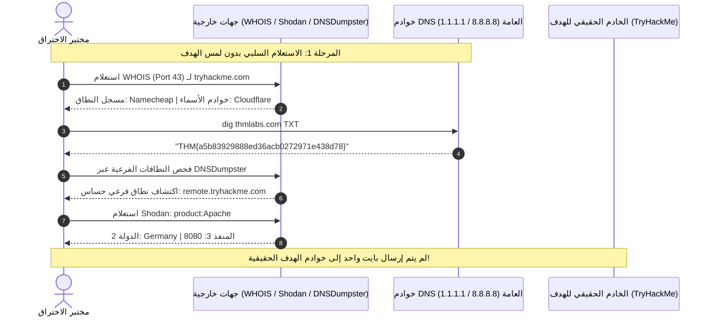

# التوثيق التخصصي الشامل: الاستطلاع السلبي (Passive Reconnaissance)

---

## 01. نظرة عامة على الغرفة (Room Overview)
* **عنوان الغرفة الأصلي:** Passive Reconnaissance
* **رابط الغرفة الرسمي:** [https://tryhackme.com/room/passiverecon](https://tryhackme.com/room/passiverecon)
* **الوحدة التابعة:** الوحدة 03 — استطلاع واستكشاف الشبكات (Network Reconnaissance)
* **مستوى الصعوبة:** سهل (مفاهيمي وعملي تأسيسي)
* **الوقت التقديري للإنجاز:** 40 إلى 50 دقيقة
* **المتطلبات المسبقة:** المعرفة الأساسية بسطر أوامر لينكس، مفاهيم أسماء النطاقات (DNS) وعناوين الـ IP.
* **الأهمية الميدانية والمهنية:** يمثل الاستطلاع السلبي الخطوة الصفرية في أي عملية اختبار اختراق حقيقية. يتيح الاستطلاع السلبي للمختبر رسم خريطة كاملة للبنية التحتية للهدف، ومعرفة موفري الخدمات السحابية، وخوادم البريد، والنطاقات الفرعية الحساسة دون إرسال حزمة بيانات واحدة مباشرة إلى خوادم الهدف، مما يحفظ التخفي التشغيلي التام (Stealth) ويمنع إثارة أنظمة كشف التسلل (IDS/IPS).

---

## 02. الأهداف التعليمية (Learning Objectives)

### أهداف نظرية ومفاهيمية (Theoretical Objectives)
* التمييز الصارم بين الاستطلاع السلبي (استعلام أطراف ثالثة) والاستطلاع النشط (إرسال حزم مباشرة أو تفاعل بشري).
* استيعاب البنية المعمارية لبروتوكول WHOIS والجهات المسؤولة عن تسجيل النطاقات (Registrars و ICANN).
* فهم الهيكل الهرمي لنظام أسماء النطاقات (DNS) ودلالات سجلاته المختلفة (A, AAAA, MX, TXT, NS, CNAME, SOA).
* فهم طريقة عمل محركات مسح الإنترنت العالمية (Shodan) في أرشفة الترويسات والمنافذ المفتوحة.

### أهداف عملية وتطبيقية (Practical Objectives)
* تشغيل واستعلام سجلات WHOIS عبر سطر الأوامر واستخراج تواريخ التسجيل وخوادم الأسماء.
* استعلام خوادم وسجلات الـ DNS المختلفة باستخدام أداتي `nslookup` و `dig`.
* استخراج الرايات والبيانات الحساسة المخزنة داخل سجلات النصوص (`TXT records`).
* استكشاف النطاقات الفرعية ورسم الخريطة الطوبولوجية للهدف باستخدام منصة `DNSDumpster`.
* كتابة استعلامات بحث متقدمة في محرك `Shodan.io` لاستخراج إحصائيات الخوادم والمنافذ البديلة (`product:Apache`).

### أهداف تحليلية ومهنية (Analytical & Professional Skills)
* تتبع مسار حماية الـ WAF والـ CDN (مثل Cloudflare) والتخطيط السلبي لكشف عنوان الـ IP الأصلي (Origin IP).
* تصنيف الأصول الرقمية المكتشفة وتحديد بوابات الوصول عن بُعد الأكثر عرضة للخطر (مثل نطاقات `remote` و `vpn`).

---

## 03. الأسس المفاهيمية (Conceptual Foundations)

### 1. معيار التمييز بين الاستطلاع السلبي والنشط
* **الاستطلاع السلبي (Passive Recon):**
  جمع المعلومات المتاحة علناً دون أي تفاعل مباشر مع أنظمة أو موظفي الهدف. إذا انقطعت شبكة الهدف أو توقفت خوادمه بالكامل، تظل قادراً على جمع هذه المعلومات لأنها مستضافة لدى أطراف ثالثة (مثل استعلام سجلات WHOIS، فحص أرشيف Google، أو استعراض صفحات LinkedIn).
* **الاستطلاع النشط (Active Recon):**
  يتطلب إرسال حزم بيانات تلامس جدران حماية الهدف (مثل إرسال Ping أو مسح المنافذ بـ Nmap) أو إجراء اتصال بشري مباشر عبر الهندسة الاجتماعية مع موظفي الهدف.

### 2. بروتوكول WHOIS وسجلات الملكية
بروتوكول قديم (RFC 3912 يعمل على المنفذ `43/TCP`) يستعلم خوادم المسجلين المعتمدين لدى منظمة ICANN لمعرفة:
* متى أُنشئ النطاق وتاريخ انتهائه.
* مسجل النطاق التجاري (Registrar: مثل Namecheap).
* خوادم الأسماء المسؤولة (Name Servers: مثل Cloudflare).

### 3. سجلات الـ DNS ودورها الأمني
* **A / AAAA:** ربط اسم النطاق بعنوان IPv4 أو IPv6.
* **MX (Mail Exchange):** توجيه رسائل البريد الإلكتروني (يكشف مزود البريد مثل Google Workspace أو Microsoft 365).
* **TXT (Text):** نصوص عادية تُستخدم لتخزين سجلات التحقق من ملكية النطاق، وسجلات حماية البريد من التزوير (SPF, DKIM, DMARC)، وتستخدم في المعامل أحياناً لإخفاء الرايات.
* **NS (Name Server):** الخوادم الموثقة التي تدير سجلات النطاق.

---

## 04. الغوص التقني والتشريحي (Technical Deep Dive)

### مخطط تدفق الاستعلامات السلبية (Passive Query Sequence)



---

## 05. الأدوات والتقنيات (Tools and Technologies)

| الأداة / الخدمة | الوظيفة التقنية | أمر التشغيل / الرابط |
|---|---|---|
| **whois** | استعلام بيانات تسجيل النطاق والمسجل وخوادم الأسماء | `whois tryhackme.com` |
| **dig** | أداة متقدمة لاستعلام خوادم وسجلات الـ DNS بتفصيل عالي | `dig thmlabs.com TXT +short` |
| **nslookup** | أداة كلاسيكية مشتركة بين ويندوز ولينكس لاستعلام الـ DNS | `nslookup -type=TXT thmlabs.com` |
| **DNSDumpster** | منصة ويب مجانية لاستكشاف النطاقات الفرعية ورسم الخرائط | [https://dnsdumpster.com/](https://dnsdumpster.com/) |
| **Shodan.io** | محرك بحث أجهزة وإنترنت الأشياء والخدمات المفتوحة عالمياً | [https://www.shodan.io/](https://www.shodan.io/) |

---

## 06. منهجية اختبار الاختراق (Penetration Testing Methodology)

في مرحلة الاستطلاع السلبي، يتبع المختبر الخطوات الميدانية التالية:
1. **تحديد مساحة الملكية الإدارية:** فحص سجلات WHOIS لمعرفة المسجل وتواريخ الصلاحية.
2. **استكشاف البنية التحتية وخوادم الأسماء:** معرفة ما إذا كان النطاق يستخدم حماية CDN (مثل Cloudflare) أم يرتبط بـ IP مباشر.
3. **توسيع مساحة الهجوم (Attack Surface Expansion):** استخدام DNSDumpster و Certificate Transparency لكشف النطاقات الفرعية الحساسة (`remote`, `vpn`, `admin`).
4. **استعلام الأجهزة المفتوحة عبر Shodan:** فحص المنافذ والخدمات دون مسح نشط لتفادي كشف العملية.

---

## 07. السير العملي المفصل (Practical Walkthrough)

### المهمة 02: التمييز العملي
* زيارة صفحة فيسبوك للشركة ⟶ استطلاع سلبي (`P`).
* إرسال Ping لخادم الويب ⟶ استطلاع نشط (`A`).
* استدراج مسؤول النظام بالهندسة الاجتماعية في حفلة ⟶ استطلاع نشط (`A`).

### المهمة 03: استعلام WHOIS لنطاق TryHackMe
بتنفيذ الأمر في الطرفية:
```bash
whois tryhackme.com
```
* **تاريخ التسجيل:** يظهر `Creation Date: 2018-07-05` ⟶ الإجابة: `20180705`.
* **مسجل النطاق (Registrar):** يظهر `Registrar: NameCheap, Inc.` ⟶ الإجابة: `namecheap.com`.
* **خوادم الأسماء (Name Servers):** تظهر `ARCHER.NS.CLOUDFLARE.COM` ⟶ الإجابة: `cloudflare.com`.

### المهمة 04: استعلام سجلات TXT عبر dig
لاستخراج الراية من نطاق المعمل `thmlabs.com`:
```bash
dig thmlabs.com TXT +short
```
المخرجات:
`"THM{a5b83929888ed36acb0272971e438d78}"`

### المهمة 05: استكشاف النطاقات الفرعية عبر DNSDumpster
بالبحث عن `tryhackme.com` في موقع `dnsdumpster.com`، نجد بين النتائج نطاقاً إدارياً مخصصاً للدخول عن بعد:
`remote` (`remote.tryhackme.com`)

### المهمة 06: استعلام إحصائيات Shodan لخوادم Apache
عند البحث عن خوادم أباتشي في شريط بحث Shodan:
`product:Apache`
* في قائمة **Top Countries**: تحتل الولايات المتحدة المرتبة الأولى، تليها في المرتبة الثانية: `Germany`.
* في قائمة **Top Ports**: يحتل المنفذ 80 المرتبة الأولى، والمنفذ 443 الثانية، والمنفذ الثالث هو: `8080`.

---

## 08. ملخص المهام والحلول (Tasks and Solutions Summary)

| رقم المهمة | السؤال الأصلي | الإجابة النموذجية المعتمدة |
|---|---|---|
| **Task 01** | *Read the above.* | `No answer needed` |
| **Task 02** | *You visit the Facebook page of the target company...* | `P` |
| **Task 02** | *You ping the IP address of the company webserver...* | `A` |
| **Task 02** | *You happen to meet the IT administrator...* | `A` |
| **Task 03** | *When was TryHackMe.com registered?* | `20180705` |
| **Task 03** | *What is the registrar of TryHackMe.com?* | `namecheap.com` |
| **Task 03** | *Which company is TryHackMe.com using for name servers?* | `cloudflare.com` |
| **Task 04** | *Check the TXT records of thmlabs.com. What is the flag there?* | `THM{a5b83929888ed36acb0272971e438d78}` |
| **Task 05** | *Lookup tryhackme.com on DNSDumpster...* | `remote` |
| **Task 06** | *According to Shodan.io, what is the 2nd country in the world...* | `Germany` |
| **Task 06** | *Based on Shodan.io, what is the 3rd most common port used for Apache?* | `8080` |
| **Task 07** | *No answer needed.* | `No answer needed` |

---

## 09. الأخطاء الشائعة واستكشاف الأخطاء (Common Errors & Troubleshooting)

* **الخطأ 1: كتابة تاريخ التسجيل في Task 03 بوجود فواصل:**
  * *التوضيح:* يتطلب نموذج الإدخال كتابة الأرقام متصلة: `20180705` بدلاً من `2018-07-05`.
* **الخطأ 2: عدم تحديد نوع السجل في أمر dig أو nslookup:**
  * *التوضيح:* أمر `dig thmlabs.com` الافتراضي يستعلم سجلات `A` فقط؛ لذا يجب كتابة نوع السجل صراحة: `dig thmlabs.com TXT`.
* **الخطأ 3: كتابة اسم النطاق الفرعي كاملاً في Task 05:**
  * *التوضيح:* المطلوب اسم النطاق الفرعي فقط `remote` وليس `remote.tryhackme.com`.

---

## 10. التداعيات الأمنية وإجراءات التحصين (Security Implications & Defensive Hardening)

1. **حماية خصوصية النطاقات (WHOIS Privacy):**
   * تفعيل خدمات حجب بيانات التسجيل (WHOIS Privacy / Privacy Protection) لإخفاء الأسماء وعناوين البريد وأرقام الهواتف الشخصية للمسؤولين عن العامة.
2. **إدارة سجلات الـ DNS بحذر:**
   * منع عمليات نقل النطاق غير المصرح بها (Disabling Zone Transfers - AXFR) في خوادم الأسماء.
   * مراجعة سجلات الـ TXT دورياً وحذف الرموز القديمة أو مفاتيح التحقق غير المستخدمة.
3. **تقليص الظهور على محركات الفحص (Minimizing Shodan Exposure):**
   * إخفاء ترويسات الخوادم الترحيبية وتغيير المنفذ الافتراضي للخدمات الإدارية.
   * حظر مساحات IP الخاصة بماسحات Shodan على الجدران النارية الخارجية إن لم تكن هناك حاجة عامة لها.

---

## 11. التطبيقات الواقعية والربط المهني (Real-World Applications)

* **عمليات الفريق الأحمر المتقدمة (Red Team Engagements):**
  يقضي المهاجمون المحترفون ما يصل إلى 60% من وقت العملية في مرحلة الاستطلاع السلبي، حيث يجمعون كافة التفاصيل عن النطاقات الفرعية والموظفين والخدمات السحابية ليحددوا أضعف نقطة دخول قبل إرسال أول بايت من الهجوم.
* **إدارة مساحة الهجوم للشركات (External Attack Surface Management - EASM):**
  تستخدم فرق الدفاع نفس أدوات الاستطلاع السلبي (DNSDumpster, Shodan, Censys) لمراقبة أصول الشركة المنسية واكتشاف الخوادم التجريبية المعرضة للخطر وسحبها فوراً.

---

## 12. الدروس المستفادة والخلاصة (Key Takeaways and Summary)

1. **الاستطلاع السلبي غير مرئي:** يمنحك معلومات حيوية دون ترك أي أثر في سجلات الهدف.
2. **سجلات الـ DNS كنز استخباري:** تكشف النطاقات الفرعية، خوادم البريد، وبيانات التحقق.
3. **محركات الفحص العالمية توفر الوقت:** Shodan يمنحك مخرجات فحص مسبقة للمنافذ والخدمات حول العالم.

---

## 13. المرجع السريع وبطاقة الأوامر (Quick Reference and Cheat Sheet)

```bash
# 1. استعلام بيانات WHOIS
whois <DOMAIN>

# 2. استعلام سجلات DNS عبر dig
dig <DOMAIN> A
dig <DOMAIN> MX
dig <DOMAIN> TXT +short
dig <DOMAIN> +trace

# 3. استعلام سجلات DNS عبر nslookup
nslookup -type=TXT <DOMAIN>
nslookup -type=MX <DOMAIN>

# 4. محاولة نقل النطاق الكامل (Zone Transfer)
dig @<NAMESERVER> <DOMAIN> AXFR
```

---

## 14. التقييم الذاتي وبنك الأسئلة التفاعلي ومفتاح الإجابات (Self-Assessment & Knowledge Check)

### أسئلة الاختبار الذاتي (Self-Assessment Questions)
1. ما هو الفرق التقني الجوهري بين بروتوكول WHOIS وبروتوكول RDAP الحديث؟
2. لماذا يعتبر استخدام أداة DNSDumpster أفضل من إرسال طلبات فحص DNS تخمينية مكثفة (DNS Brute-forcing) في بداية الاختبار؟
3. كيف يمكن لمختبر الاختراق اكتشاف خوادم ونطاقات فرعية جديدة عبر سجلات شفافية الشهادات (Certificate Transparency)؟
4. إذا كان خادم الويب للشركة محجوباً خلف خوادم Cloudflare، فما هي الأساليب السلبية التي قد تكشف عنوان الـ IP الأصلي (Origin IP)؟

---

### مفتاح الإجابات النموذجي (Answer Key)
* **إجابة السؤال 1:** بروتوكول WHOIS يرسل نصاً خاماً غير منظم عبر المنفذ 43/TCP بدون تشفير وبدون مصادقة، بينما بروتوكول RDAP يعمل عبر HTTPS ويقدم البيانات بصيغة JSON مهيكلة ويدعم تشفير البيانات وحمايتها وفق معايير GDPR.
* **إجابة السؤال 2:** لأن DNSDumpster يستعلم قواعد بيانات مجمعة مسبقاً (استطلاع سلبي)، بينما التخمين المكثف (Brute-forcing) يرسل آلاف الطلبات النشطة التي قد ترصدها خوادم الـ DNS التابعة للهدف.
* **إجابة السؤال 3:** من خلال زيارة مواقع مثل `crt.sh` واستعلام اسم النطاق، حيث تسجل جهات إصدار الشهادات الرقمية (CAs) كل شهادة SSL تم إصدارها لأي نطاق فرعي في سجلات عامة مفهرسة.
* **إجابة السؤال 4:** فحص سجلات الـ MX (خوادم البريد التي غالباً ما تقع في نفس النطاق الشبكي)، فحص سجلات الـ DNS التاريخية قبل تفعيل Cloudflare، أو البحث في محركات مثل Censys و Shodan عن شهادات SSL المسجلة لاسم النطاق على خوادم ويب عامة.
