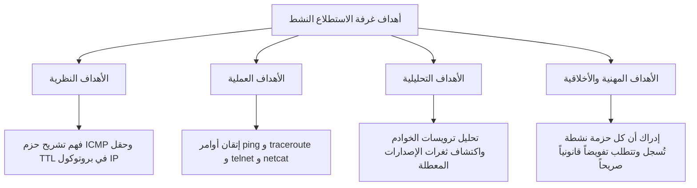
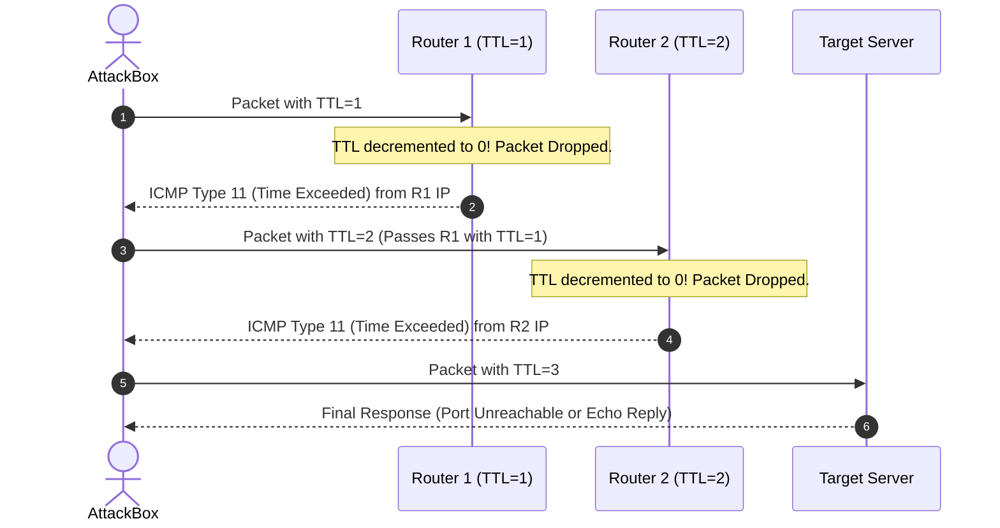

# Room 02: Active Reconnaissance
## الغرفة 02: الاستطلاع النشط وفحص الشبكات المباشر

* **المسار التعليمي:** TryHackMe — Jr Penetration Tester
* **الموديول الأب:** Module 03: Network Reconnaissance
* **رابط الغرفة الرسمي:** [https://tryhackme.com/room/activerecon](https://tryhackme.com/room/activerecon)
* **المستوى التقني:** مبتدئ إلى متوسط (Foundational Active Recon)
* **الوقت التقديري للإنجاز:** 40 دقيقة
* **إجمالي المهام الموثقة:** 7 مهام (Tasks 01 – 07)

---

## 01. Room Overview | نظرة عامة على الغرفة
تمثل غرفة **Active Reconnaissance** نقطة التحول المفصلية في منهجية اختبار الاختراق؛ حيث ينتقل الباحث الأمني من مرحلة جمع المعلومات السلبية وغير المرئية (Passive OSINT) إلى مرحلة **التفاعل الشبكي المباشر (Direct Active Probing)** مع البنية التحتية للهدف.

تغطي هذه الغرفة خمس أدوات أساسية تشكل العمود الفقري لكل ماسحات الشبكات المتطورة:
1. **أدوات مطور الويب (Developer Tools):** لفحص عناصر الواجهة وتصيير أكواد العميل وتجاوز قيود الواجهة.
2. **بروتوكول ICMP وأداة Ping:** للتحقق من اتصال الخوادم المضيفة، وقياس زمن الرحلة الذهاب والإياب (RTT)، وفهم سلوك جدران الحماية تجاه حزم الصدى.
3. **أداة Traceroute:** لتتبع المسار الجغرافي والشبكي للحزم، واستغلال حقل مدة البقاء (TTL) ورسائل انتهاء الصلاحية لرسم طبولوجيا الشبكة.
4. **عميل Telnet:** لفتح مقابس اتصال نصية صريحة مع الخوادم واستخراج ترويسات الويب والخدمات (Banner Grabbing).
5. **أداة Netcat:** للاتصال المباشر بمنافذ TCP/UDP، وبصم إصدارات الخدمات غير المحمية (مثل بروتوكول FTP).

---

## 02. Learning Objectives | الأهداف التعليمية



---

## 03. Conceptual Foundations | الأسس المفاهيمية
* **التعريف المعياري للاستطلاع النشط:** هو أي نشاط يقوم فيه جهاز الفاحص بتوليد وإرسال حزم بيانات (Packets) تصل مباشرة إلى واجهات الشبكة التابعة للهدف وتستلزم رداً منه.
* **البصمة الشبكية (Network Footprinting):** لا يمكن إرسال حزمة TCP أو ICMP دون تضمين عنوان IP المصدر (Source IP)، مما يجعل هوية الفاحص مكشوفة بالكامل لمسؤولي النظام وأنظمة الحماية في الطرف الآخر.
* **منهجية التدرج من السلبي إلى النشط:**
  ```text
  [1. الاستطلاع السلبي] ⟶ [2. البصم النشط الخفيف (Ping/Traceroute)] ⟶ [3. فحص المنافذ والخدمات (Nmap)] ⟶ [4. استغلال الثغرات]
  ```

---

## 04. Technical Deep Dive | التعمق التقني وهندسة البروتوكولات

### 1. تشريح بروتوكول رسائل التحكم في الإنترنت (ICMP Anatomy)
يعمل بروتوكول ICMP فوق طبقة الشبكة مباشرة برقم بروتوكول `1` في ترويسة IPv4. تتكون ترويسة الـ ICMP من 8 بايتات ثابتة:
```text
 0                   1                   2                   3
 0 1 2 3 4 5 6 7 8 9 0 1 2 3 4 5 6 7 8 9 0 1 2 3 4 5 6 7 8 9 0 1
+-+-+-+-+-+-+-+-+-+-+-+-+-+-+-+-+-+-+-+-+-+-+-+-+-+-+-+-+-+-+-+-+
|   Type (8)    |   Code (0)    |          Checksum             |
+-+-+-+-+-+-+-+-+-+-+-+-+-+-+-+-+-+-+-+-+-+-+-+-+-+-+-+-+-+-+-+-+
|         Identifier            |        Sequence Number        |
+-+-+-+-+-+-+-+-+-+-+-+-+-+-+-+-+-+-+-+-+-+-+-+-+-+-+-+-+-+-+-+-+
|                   Payload Data (Default: 56 B)                |
+-+-+-+-+-+-+-+-+-+-+-+-+-+-+-+-+-+-+-+-+-+-+-+-+-+-+-+-+-+-+-+-+
```
* **Type 8:** طلب صدى (Echo Request).
* **Type 0:** رد صدى (Echo Reply).
* **Type 11:** انتهاء وقت الحزمة أثناء الانتقال (Time Exceeded in Transit) - وهو سر عمل أداة Traceroute.

### 2. الآلية الرياضية والبروتوكولية لأداة Traceroute
تعتمد الأداة على حقل الـ **TTL** (Time To Live) في ترويسة IPv4 المكون من 8 بت (قيمة من 0 إلى 255):


---

## 05. Tools and Technologies | الأدوات والتقنيات العملية

| الأداة | البروتوكول المستهدف | صيغة الأمر المعيارية | الاستخدام الميداني الأمني |
|---|---|---|---|
| **DevTools** | HTTP / DOM / JS | `F12` في المتصفح | فحص الأكواد المخفية وتتبع طلبات الشبكة |
| **Ping** | ICMP (Type 8/0) | `ping -c 5 -s 64 <IP>` | التحقق السريع من بقاء الهدف وقياس زمن الرحلة |
| **Traceroute** | UDP / ICMP / TCP | `traceroute -n -T -p 80 <IP>` | كشف موجهات المسار وتجاوز الفلاتر عبر منافذ الويب |
| **Telnet** | TCP (Raw Socket) | `telnet <IP> 80` | استخراج ترويسات خوادم الويب عبر طلبات HTTP يدوية |
| **Netcat** | TCP / UDP (Raw Socket) | `nc -vn <IP> <PORT>` | بصم الخدمات الصامتة (FTP, SMTP) ونقل البيانات الخام |

---

## 06. Environment and Lab Setup | بيئة المعمل والهدف الافتراضي
* **نظام المهاجم (AttackBox):** بيئة Linux مجهزة بأدوات الشبكات القياسية (`ping`, `traceroute`, `telnet`, `nc`, المتصفح).
* **الهدف الافتراضي:** خادم Linux يعمل في شبكة TryHackMe السحابية:
  * المنفذ 21: خادم FTP (`Netkit-ftp 0.17`).
  * المنفذ 80: خادم ويب Apache (`Apache 2.4.61`).
  * بروتوكول ICMP: مهيأ للرد على طلبات الصدى بنسبة 100%.

---

## 07. Step-by-Step Practical Walkthrough | التنفيذ العملي خطوة بخطوة

### الخطوة 1: فحص الـ DOM وتطبيقات الويب (Task 2)
1. فتح الرابط: `https://static-labs.tryhackme.cloud/sites/networking-tcp/`.
2. الضغط على `F12` لفتح أدوات المطور (DevTools).
3. فحص مصفوفة الأسئلة المضمنة في الجافاسكريبت:
   * عدد الأسئلة الإجمالي: **`8`**.

### الخطوة 2: فحص الاتصال وبروتوكول ICMP عبر Ping (Task 3)
1. خيار تحديد حجم البيانات: **`-s`**.
2. حجم ترويسة ICMP الثابت: **`8` بايت**.
3. سلوك جدار حماية ويندوز: يحظر حزم الـ Ping افتراضياً (**`Y`**).
4. إرسال 10 حزم إلى الهدف:
   ```bash
   ping -c 10 MACHINE_IP
   ```
   * عدد الردود المستلمة: **`10`**.

### الخطوة 3: تتبع المسار ورسم طبولوجيا القفزات (Task 4)
1. في Traceroute A: عنوان الموجه الأخير قبل الهدف هو: **`100.92.9.83`**.
2. في Traceroute B: عنوان الموجه الأخير في السطر 25 هو: **`99.83.89.19`**.
3. عدد الموجهات الوسيطة في Traceroute B: يقع الهدف في السطر 26، وبالتالي عدد الموجهات هو: **`25`** موجه ($26 - 1 = 25$).

### الخطوة 4: استخراج ترويسة خادم الويب عبر Telnet (Task 5)
1. الاتصال بالهدف على المنفذ 80:
   ```bash
   telnet MACHINE_IP 80
   ```
2. كتابة طلب الـ HTTP اليدوي:
   ```text
   GET / HTTP/1.1
   Host: MACHINE_IP

   ```
3. قراءة استجابة الخادم:
   * اسم الخادم: **`Apache`**.
   * إصدار الخادم الدقيق: **`2.4.61`**.

### الخطوة 5: استخراج راية خادم FTP عبر Netcat (Task 6)
1. الاتصال بمنفذ الـ FTP 21:
   ```bash
   nc MACHINE_IP 21
   ```
2. قراءة الرسالة الترحيبية الصادرة تلقائياً:
   * تظهر ترويسة `Netkit-ftp 0.17`.
   * رقم إصدار الخادم: **`0.17`**.

---

## 08. Output Analysis and Interpretation | تحليل وتفسير المخرجات التقنية
```text
================================================================================
TELNET RAW BANNER EXTRACTION
================================================================================
Connected to MACHINE_IP.
Escape character is '^]'.
HTTP/1.1 200 OK
Date: Wed, 18 Nov 2026 23:04:12 GMT
Server: Apache/2.4.61 (Ubuntu)
Content-Type: text/html; charset=UTF-8
--------------------------------------------------------------------------------
[ANALYSIS]:
1. Service Daemon: Apache Web Server
2. Accurate Version: 2.4.61
3. Target OS Fingerprint: Ubuntu Linux
================================================================================
```

---

## 09. Vulnerabilities and Exploitation | الثغرات والاستغلال الميداني
* **خطر تسريب الترويسات (Information Disclosure via Banners):**
  كشف إصدار الخادم مثل `Apache/2.4.61` أو `Netkit-ftp 0.17` يمكن المهاجم من البحث المباشر في قواعد بيانات CVE (NVD, Exploit-DB, Searchsploit) عن الثغرات الخاصة بهذا الإصدار تحديداً، مما يلغي الحاجة للتخمين العشوائي ويقلل الضجيج على الشبكة.

---

## 10. Remediation and Mitigation | سبل المعالجة والدفاع المؤسسي
1. **إخفاء الترويسات (Banner Suppression):**
   * في خوادم Apache: تعديل ملف التكوين الرئيسي (`apache2.conf` أو `httpd.conf`):
     ```apache
     ServerTokens Prod
     ServerSignature Off
     ```
     هذا الإجراء يجعل الخادم يكتفي بالرد بكلمة `Apache` دون ذكر رقم الإصدار أو نظام التشغيل.
2. **ضبط استجابات ICMP:**
   * تكوين جدران الحماية الخارجية لمنع حزم `ICMP Type 11` الصادرة من الموجهات الداخلية لمنع رسم طبولوجيا الشبكة عبر أدوات Traceroute.
   * تقييد معدل استجابات ICMP Rate-Limiting لمنع هجمات حجب الخدمة (Ping of Death / ICMP Flood).

---

## 11. Real-World Penetration Testing Context | السياق الميداني والمهني
* في اختبارات الاختراق المعتمدة (Black-Box Engagements)، يُحظر تشغيل أداة Nmap بفحوصاتها المكثفة كأول خطوة؛ لأنها تولد آلاف الحزم وتفعل أنظمة الـ IPS فوراً.
* يبدأ المختبر المحترف دائماً بـ **الاستطلاع النشط الهادئ**:
  1. التحقق من الهدف بحزمة ICMP واحدة.
  2. تشغيل تتبع مسار واحد عبر TCP Port 80 (`traceroute -T -p 80`).
  3. استخراج ترويسات المنافذ الرئيسية يدوياً بـ Netcat لتقييم الـ WAF وإصدارات الخوادم بهدوء تام.

---

## 12. Cross-Topic Synthesis and Next Steps | الروابط والتكامل مع الموضوعات القادمة
* البيانات المستخرجة في هذه الغرفة (معرفة أن الهدف يشغل Apache على المنفذ 80 و FTP على المنفذ 21) تمهد مباشرة للغرفتين القادمتين:
  * **Protocols and Servers (الغرفة 03):** دراسة كيفية عمل هذه البروتوكولات داخلياً وعيوب التصميم فيها.
  * **Nmap Module (الموديول 04):** أتمتة هذه العمليات عبر الفحص الشامل لملايين المنافذ والكشف المتقدم للخدمات.

---

## 13. Summary Reference and Cheat Sheet | ملخص سريع وقائمة الأوامر

```bash
# 1. إرسال 4 حزم ping بحجم 32 بايت
ping -c 4 -s 32 <TARGET_IP>

# 2. تتبع المسار باستخدام بروتوكول TCP عبر المنفذ 80 (تجاوز جدران الحماية)
traceroute -T -p 80 <TARGET_IP>

# 3. استخراج ترويسة خادم الويب يدوياً عبر Telnet
telnet <TARGET_IP> 80
# اكتب: GET / HTTP/1.1 ثم Host: <TARGET_IP> ثم Enter مرتين

# 4. الاتصال المباشر بمنفذ الـ FTP عبر Netcat
nc -vn <TARGET_IP> 21
```

---

## 14. Verification and Review Questions | مراجعة الفهم والتحقق

| # | سؤال المراجعة والتأكيد | الإجابة المعتمدة |
|---|---|:---:|
| 1 | كم عدد الأسئلة الإجمالي المكتشفة في كود الجافاسكريبت عبر DevTools؟ | **`8`** |
| 2 | ما هو الخيار المستخدم في أداة ping لتحديد حجم حمولة البيانات؟ | **`-s`** |
| 3 | ما هو الحجم الثابت لترويسة بروتوكول ICMP بالبايت؟ | **`8`** |
| 4 | هل يحظر جدار حماية ويندوز حزم الـ Ping افتراضياً؟ | **`Y`** |
| 5 | ما هو عنوان IP للموجه الأخير في Traceroute A قبل tryhackme.com؟ | **`100.92.9.83`** |
| 6 | ما هو عنوان IP للموجه الأخير في Traceroute B قبل tryhackme.com؟ | **`99.83.89.19`** |
| 7 | كم عدد الموجهات التي تقف بين جهاز الفاحص والهدف في Traceroute B؟ | **`25`** |
| 8 | ما هو اسم وإصدار خادم الويب المكتشف على المنفذ 80 عبر Telnet؟ | **`Apache`** / **`2.4.61`** |
| 9 | ما هو إصدار خادم الـ FTP المكتشف على المنفذ 21 عبر Netcat؟ | **`0.17`** |
