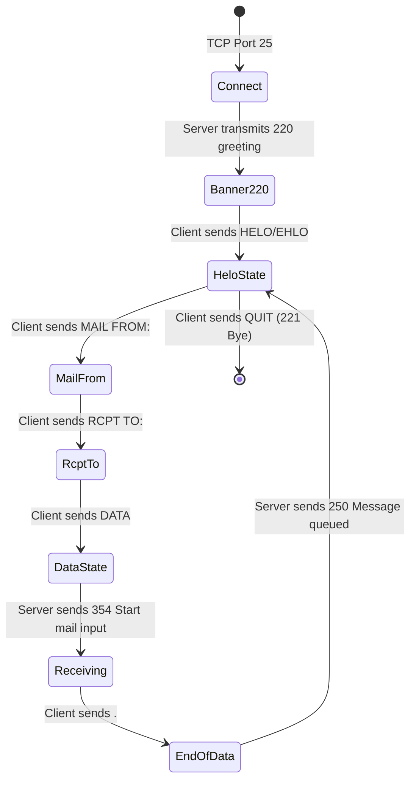

# Additional Technical Notes: Protocols and Servers
## ملاحظات تقنية متقدمة: تشريح البروتوكولات النصية وآلات الحالة

---

## 1. آلة الحالة لبروتوكول SMTP (RFC 5321 State Machine)
يعمل خادم بروتوكول SMTP وفق آلة حالة صارمة (Finite State Machine). أي انحراف في ترتيب الأوامر يؤدي إلى رفض الخادم للرسالة:

### الأهمية في اختبار الاختراق:
* **تعداد المستخدمين (User Enumeration):** أوامر مثل `VRFY <username>` أو `EXPN <mailing-list>` تتيح للمهاجم التحقق مما إذا كان اسم المستخدم موجوداً على الخادم قبل شن هجمات التخمين.
* **الترحيل المفتوح (Open Relay Testing):** إذا قبل الخادم إرسال بريد من نطاق خارجي (`MAIL FROM:<attacker@gmail.com>`) إلى نطاق خارجي آخر (`RCPT TO:<victim@yahoo.com>`)، فهذا يعني أن الخادم Open Relay ويمكن استغلاله في حملات التصيد ورسائل الـ SPAM المنسوبة للشركة.

---

## 2. آلة الحالة لبروتوكول POP3 (RFC 1939 State Machine)
ينقسم الحوار في بروتوكول POP3 إلى ثلاث حالات أساسية:
1. **حالة المصادقة (Authorization State):**
   * العميل يرسل `USER frank` متبوعاً بـ `PASS D2xc9CgD`.
   * الخادم يرد بـ `+OK` في حالة النجاح أو `-ERR` عند الفشل.
2. **حالة المعاملات (Transaction State):**
   * بمجرد قبول المستخدم، يستطيع العميل الاستعلام عن صندوقه:
     * `STAT`: لمعرفة عدد الرسائل والحجم الكلي (`+OK 0 0`).
     * `LIST`: لعرض أرقام الرسائل وحجم كل رسالة منفردة.
     * `RETR <msg#>`: لجلب محتوى رسالة معينة.
     * `DELE <msg#>`: لوضع علامة حذف على الرسالة.
3. **حالة التحديث (Update State):**
   * عند إرسال أمر `QUIT`، يقوم الخادم بحذف الرسائل الموسومة بـ DELE نهائياً من القرص وإغلاق المقبس.

---

## 3. معمارية القناتين في بروتوكول FTP: Active مقابل Passive
* **الوضع النشط (Active Mode):**
  * العميل يتصل بخادم FTP على المنفذ 21، ويفتح منفذاً عشوائياً لديه (مثلاً 50000)، ويرسل أمر `PORT IP,p1,p2`.
  * **يقوم الخادم بالاتصال بالعميل** من المنفذ 20 إلى المنفذ 50000.
  * **المشكلة:** جدار حماية العميل (Client Firewall) غالباً ما يسقط هذا الاتصال الوارد من الخادم.
* **الوضع الخامل (Passive Mode):**
  * العميل يرسل أمر `PASV`.
  * يرد الخادم بمنفذ عشوائي عالي تم فتحه على الخادم.
  * **يقوم العميل بالاتصال بالخادم** على ذلك المنفذ لنقل البيانات، وهو الوضع المعتمد عالمياً لتجاوز جدران الحماية (NAT/Firewalls).

---

## 4. تقييم المخاطر الميداني للبروتوكولات النصية
* في بيئات الشركات الحديثة، تشير رؤية المنافذ 21، 23، 80، 110، 143 إلى وجود بنية تحتية قديمة (Legacy Systems) أو طابعات وأجهزة شبكية لم يتم تحديث إعداداتها الافتراضية، مما يمنح مختبر الاختراق أهدافاً سهلة لسرقة بيانات الاعتماد.
