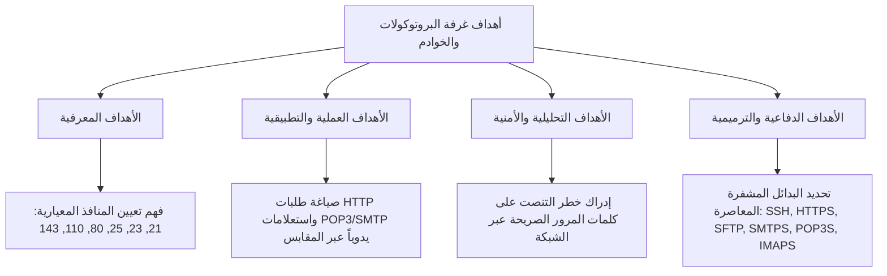
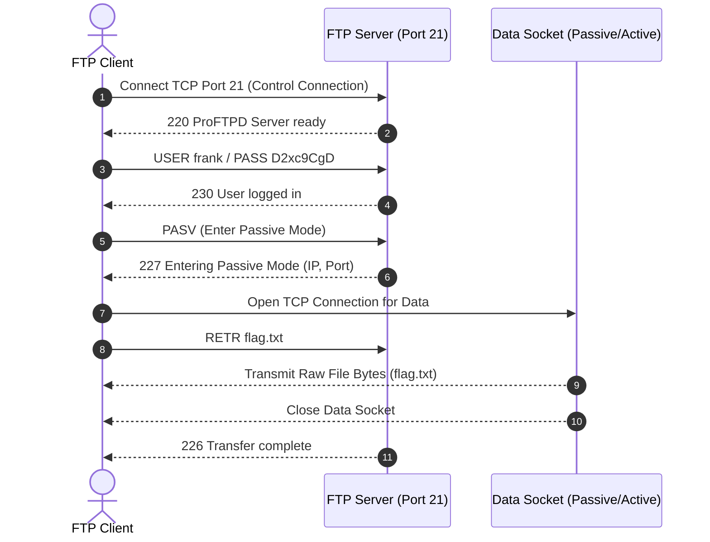

# Room 03: Protocols and Servers
## الغرفة 03: بروتوكولات وخوادم الشبكة الأساسية

* **المسار التعليمي:** TryHackMe — Jr Penetration Tester
* **الموديول الأب:** Module 03: Network Reconnaissance
* **رابط الغرفة الرسمي:** [https://tryhackme.com/room/protocolsandservers](https://tryhackme.com/room/protocolsandservers)
* **المستوى التقني:** تأسيسي إلى متوسط (Network Protocols & Cleartext Services)
* **الوقت التقديري للإنجاز:** 45 دقيقة
* **إجمالي المهام الموثقة:** 8 مهام (Tasks 01 – 08)

---

## 01. Room Overview | نظرة عامة على الغرفة
في هذه الغرفة المنهجية، يغوص مختبر الاختراق في تشريح **بروتوكولات طبقة التطبيقات الأساسية (Core Application Layer Protocols)** التي بنيت عليها شبكة الإنترنت:
* **Telnet (المنفذ 23):** بروتوكول التحكم والطرفيات النصي القديم.
* **HTTP (المنفذ 80):** بروتوكول نقل النص الفائق وتكوين طلبات الـ GET يدوياً.
* **FTP (المنفذ 21):** بروتوكول نقل الملفات ومعمارية القناتين (Control vs Data).
* **SMTP (المنفذ 25):** بروتوكول إرسال وتوجيه رسائل البريد الإلكتروني ورموز الحالة.
* **POP3 (المنفذ 110):** بروتوكول تنزيل وسحب البريد الإلكتروني للعميل واستعلام الحسابات.
* **IMAP (المنفذ 143):** بروتوكول مزامنة صناديق البريد على الخادم المركزي.

يتعلم الدارس كيفية الاتصال المباشر بهذه الخدمات عبر مقابس TCP الخام، وصياغة الأوامر يدوياً بلغتها الأصلية (RFC Specifications) دون الاعتماد على واجهات المستخدم الرسومية، وفهم الآثار الأمنية المترتبة على نقل البيانات الحساسة وكلمات المرور كنص صريح (Cleartext).

---

## 02. Learning Objectives | الأهداف التعليمية



---

## 03. Conceptual Foundations | الأسس المفاهيمية
* **نموذج الثقة التاريخي (The High-Trust Model):**
  صُممت بروتوكولات Telnet و FTP و HTTP و SMTP في سبعينيات وثمانينيات القرن الماضي عندما كانت شبكة ARPANET والإنترنت المبكر بيئة أكاديمية وبحثية مغلقة. لم يكن هناك مفهوم للخصومة السيبرانية أو التنصت؛ لذا كُتبت كافة المعايير لتنقل البيانات بنصوص واضحة غير مشفرة (Cleartext).
* **بنية العميل والخادم (Client-Server Architecture):**
  تعتمد كافة هذه البروتوكولات على نموذج طلب واستجابة:
  1. الخادم يستمع دائماً على منفذ TCP معياري محدد ومفتوح.
  2. العميل يبدأ مصافحة الـ TCP الثلاثية (SYN ⟶ SYN-ACK ⟶ ACK).
  3. يتم تبادل أوامر نصية محددة تنتهي دائماً بـ CRLF (`\r\n`).
  4. يرد الخادم بأكواد حالة رقمية محددة دولياً (مثلاً: `200` في HTTP، و `220` في SMTP/FTP، و `+OK` في POP3).

---

## 04. Technical Deep Dive | التعمق التقني وهندسة البروتوكولات

### 1. معمارية القناتين في بروتوكول FTP (RFC 959 Dual-Channel)
يختلف FTP عن باقي البروتوكولات في أنه يفصل الأوامر عن البيانات:


### 2. آلة الحالة لبروتوكول SMTP والتحقق من المستخدمين
يعمل خادم البريد وفق مسار تدفق متسلسل:
1. الترحيب: يبث الخادم راية `220 mail.domain.com ESMTP Postfix`.
2. المصافحة: يرسل العميل `HELO domain` أو `EHLO domain`.
3. التحقق من المرسل: `MAIL FROM:<user@domain>`.
4. تحديد المستلم: `RCPT TO:<target@domain>`.
5. محتوى الرسالة: يبدأ العميل بأمر `DATA` وينتهي بسطر يحتوي على نقطة وحيدة `.` لإنهاء الرسالة.

---

## 05. Tools and Technologies | مصفوفة الأدوات والبروتوكولات

| البروتوكول | المنفذ المعياري | أمر الاتصال السريع | رمز الحالة الإيجابي | الوظيفة التقنية |
|---|:---:|---|:---:|---|
| **Telnet** | **23** | `telnet <IP> 23` | N/A | طرفية إدارة نصية مباشرة |
| **HTTP** | **80** | `telnet <IP> 80` | `200 OK` | طلب وتصفح صفحات الويب |
| **FTP** | **21** | `ftp <IP>` | `230 Logged in` | نقل وإدارة الملفات عن بعد |
| **SMTP** | **25** | `nc <IP> 25` | `220 Banner / 250 OK` | إرسال وتوجيه رسائل البريد |
| **POP3** | **110** | `telnet <IP> 110` | `+OK` | تنزيل وحذف الرسائل من الخادم |
| **IMAP** | **143** | `telnet <IP> 143` | `* OK` | مزامنة وإدارة صناديق البريد |

---

## 06. Environment and Lab Setup | بيئة المعمل والهدف الافتراضي
* **نظام الفاحص:** بيئة AttackBox المزودة بعملاء `telnet`, `nc`, `ftp`.
* **الهدف الافتراضي:** خادم Linux يعمل في سحابة TryHackMe ويشغل باقة الخدمات التالية:
  * خادم ويب Apache على المنفذ 80 (يحتوي على ملف `flag.thm`).
  * خادم FTP على المنفذ 21 (حساب: `frank` / `D2xc9CgD`).
  * خادم بريد Postfix على المنفذ 25 (يبث الراية في كود 220).
  * خادم Dovecot POP3 على المنفذ 110 و IMAP على المنفذ 143.

---

## 07. Step-by-Step Practical Walkthrough | التنفيذ العملي خطوة بخطوة

### الخطوة 1: بروتوكول Telnet (Task 2)
* المنفذ الافتراضي المعياري الذي يتصل به أمر telnet تلقائياً: **`23`**.

### الخطوة 2: استرجاع ملف عبر HTTP باستخدام مقبس خام (Task 3)
1. فتح المقبس:
   ```bash
   telnet MACHINE_IP 80
   ```
2. كتابة الطلب اليدوي:
   ```text
   GET /flag.thm HTTP/1.1
   Host: MACHINE_IP

   ```
3. قراءة الراية المسترجعة:
   * **الراية:** `THM{e3eb0a1df437f3f97a64aca5952c8ea0}`.

### الخطوة 3: المصادقة واسترجاع ملف الراية عبر FTP (Task 4)
1. الاتصال بعميل الـ FTP:
   ```bash
   ftp MACHINE_IP
   ```
2. تسجيل الدخول:
   * اسم المستخدم: `frank`
   * كلمة المرور: `D2xc9CgD`
3. استعراض وتنزيل الملف:
   ```text
   ftp> ls
   ftp> get flag.txt
   ftp> quit
   ```
4. قراءة الراية:
   ```bash
   cat flag.txt
   ```
   * **الراية:** `THM{364db6ad0e3ddfe7bf0b1870fb06fbdf}`.

### الخطوة 4: فحص راية خادم البريد SMTP (Task 5)
1. الاتصال بالمنفذ 25:
   ```bash
   nc MACHINE_IP 25
   ```
2. قراءة الرسالة الترحيبية الصادرة بكود 220:
   * **الراية المضمنة:** `THM{5b31ddfc0c11d81eba776e983c35e9b5}`.

### الخطوة 5: استعلام صندوق البريد عبر POP3 (Task 6)
1. الاتصال بالمنفذ 110:
   ```bash
   telnet MACHINE_IP 110
   ```
2. المصادقة:
   ```text
   USER frank
   PASS D2xc9CgD
   ```
3. إرسال أمر الإحصائيات:
   ```text
   STAT
   ```
   * الرد المستلم على أمر STAT: **`+OK 0 0`**.
   * عدد الرسائل المتاحة للتنزيل: **`0`**.

### الخطوة 6: منفذ بروتوكول IMAP (Task 7)
* المنفذ الافتراضي المعياري لبروتوكول IMAP: **`143`**.

---

## 08. Output Analysis and Interpretation | تحليل وتفسير المخرجات التقنية
```text
================================================================================
POP3 RAW PROTOCOL DIALOG LOG
================================================================================
Connected to MACHINE_IP.
+OK Dovecot ready.
USER frank
+OK
PASS D2xc9CgD
+OK Logged in.
STAT
+OK 0 0
--------------------------------------------------------------------------------
[DEEP ANALYSIS]:
1. Server Daemon: Dovecot Mail Server
2. Auth Mechanism: Plaintext USER/PASS transmission over TCP 110
3. Mailbox State: 0 messages stored, 0 total octets
================================================================================
```

---

## 09. Vulnerabilities and Exploitation | الثغرات والمخاطر الهجومية
1. **التنصت على كلمات المرور (Cleartext Password Sniffing):**
   كل من بروتوكولات Telnet و FTP و POP3 و IMAP يرسل كلمات المرور صراحة. أي جهاز متصل بنفس شبكة الـ Wi-Fi أو شبكة الـ LAN يستطيع تشغيل Wireshark أو `tcpdump` وقراءة بيانات الاعتماد عبر تصفية:
   ```text
   ftp contains "PASS" or pop3 contains "PASS"
   ```
2. **هجمات الرجل في المنتصف (Man-in-the-Middle - MitM):**
   غياب التشفير يسمح بحقن أوامر وتعديل الملفات المنقولة عبر FTP أو تعديل نصوص صفحات الويب المنقولة عبر HTTP.

---

## 10. Remediation and Mitigation | سبل المعالجة والدفاع المؤسسي
* **إغلاق المنافذ النصية فوراً:** تعطيل المنافذ 21، 23، 80، 110، 143 على واجهات الخوادم العامة.
* **الترقية إلى البروتوكولات المشفرة:**
  * استبدال Telnet بـ **SSH (Port 22)**.
  * استبدال HTTP بـ **HTTPS (Port 443)** عبر شهادات SSL/TLS.
  * استبدال FTP بـ **SFTP (Port 22)** أو **FTPS (Port 990)**.
  * استبدال POP3 بـ **POP3S (Port 995)**.
  * استبدال IMAP بـ **IMAPS (Port 993)**.
  * تفعيل ميزة **STARTTLS** في خوادم SMTP على المنفذ 587.

---

## 11. Real-World Penetration Testing Context | السياق الميداني والمهني
* في اختبارات الاختراق الداخلية (Internal Network Pentests)، يمثل اكتشاف منفذ FTP أو Telnet مفتوح على نظام قديم "جائزة ذهبية" للمختبر. غالباً ما تكون حسابات هذه الخدمات تشارك نفس كلمة المرور مع حسابات الدومين الرئيسية (Active Directory Domain Accounts)، مما يؤدي إلى تصعيد الصلاحيات فوراً في المؤسسة.

---

## 12. Cross-Topic Synthesis and Next Steps | الروابط والتكامل مع الموضوعات القادمة
* هذه الغرفة هي الأساس النظري والعملي للغرفة القادمة:
  * **Protocols and Servers 2 (الغرفة 04):** حيث سنقوم بتنفيذ هجمات اعتراض كلمات المرور عملياً، واستعراض بروتوكول SSH، ودراسة معمارية التشفير بـ SSL/TLS.

---

## 13. Summary Reference and Cheat Sheet | ملخص سريع وقائمة الأوامر

```bash
# جلب صفحة ويب يدوياً عبر Telnet
telnet <IP> 80
GET /file.html HTTP/1.1
Host: <IP>
[Enter مرتين]

# فحص واستعراض راية بريد SMTP
nc -vn <IP> 25
HELO test.thm
QUIT

# الاتصال بصندوق POP3
telnet <IP> 110
USER <USERNAME>
PASS <PASSWORD>
STAT
QUIT
```

---

## 14. Verification and Review Questions | مراجعة الفهم والتحقق

| # | سؤال المراجعة والتأكيد | الإجابة المعتمدة |
|---|---|:---:|
| 1 | ما هو المنفذ الافتراضي الذي يتصل به أمر telnet تلقائياً؟ | **`23`** |
| 2 | ما هي الراية المستخرجة من ملف flag.thm عبر HTTP على المنفذ 80؟ | **`THM{e3eb0a1df437f3f97a64aca5952c8ea0}`** |
| 3 | ما هي الراية المستخرجة عبر عميل FTP باستخدام حساب frank؟ | **`THM{364db6ad0e3ddfe7bf0b1870fb06fbdf}`** |
| 4 | ما هي الراية المضمنة في رسالة الترحيب لخادم SMTP على المنفذ 25؟ | **`THM{5b31ddfc0c11d81eba776e983c35e9b5}`** |
| 5 | ما هو الرد الدقيق الذي يعيده خادم POP3 عند إرسال أمر STAT بحساب frank؟ | **`+OK 0 0`** |
| 6 | كم عدد الرسائل المتاحة للتنزيل عبر POP3؟ | **`0`** |
| 7 | ما هو المنفذ الافتراضي المعياري لبروتوكول IMAP؟ | **`143`** |
