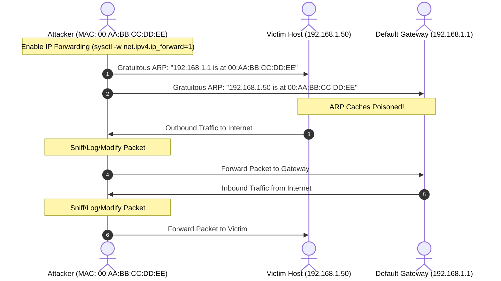

# Additional Technical Notes: Protocols and Servers 2
## ملاحظات تقنية متقدمة: هجمات التنصت وتسميم الـ ARP وتشفير TLS

---

## 1. التشريح العميق لهجوم تسميم الـ ARP (ARP Cache Poisoning Mechanics)
يعمل بروتوكول ARP (Address Resolution Protocol) في الطبقة الثانية (Data Link Layer). ونظراً لغياب المصادقة، يستغل المهاجم رسائل **Gratuitous ARP** غير المطلوبة لإعادة توجيه حركة المرور:



---

## 2. المقارنة المعمارية بين أدوات الـ MITM: Ettercap مقابل Bettercap

| المعيار | Ettercap | Bettercap |
|---|---|---|
| **لغة البرمجة** | C (كلاسيكية وتاريخية) | Go (معاصرة، عالية الكفاءة متعددة الخيوط) |
| **واجهات التشغيل** | 3 واجهات (GUI عبر `-G`, NCurses عبر `-C`, Text عبر `-T`) | 3 طرق (Interactive CLI, Caplets عبر `-caplet`, Web UI) |
| **دعم البروتوكولات الحديثة** | محدود ببروتوكولات الـ IPv4 التقليدية | يدعم بالكامل BLE (Bluetooth), WiFi, HID, DNS, HTTP/HTTPS |
| **التوسعية والأتمتة** | عبر مرشحات Etterfilter المترجمة | عبر سكريبتات Caplets وسهولة كتابة الوحدات البرمجية |

---

## 3. تشريح مصافحة TLS 1.3 مقابل TLS 1.2
في البروتوكولات المشفرة الحديثة، حدث تحول نوعي من TLS 1.2 إلى TLS 1.3 لتقليل زمن الاستجابة (Latency) وزيادة الأمان:

```text
TLS 1.2 (2 Round-Trips):
Client ──[ ClientHello ]──────────────> Server
Client <─[ ServerHello, Certificate ]── Server
Client ──[ KeyExchange, Finished ]────> Server
Client <─[ Finished ]────────────────── Server
[ Encrypted Application Data Flows ]

TLS 1.3 (1 Round-Trip - 1-RTT):
Client ──[ ClientHello + Key Share ]──> Server
Client <─[ ServerHello + Key Share + Encrypted Cert + Finished ]─ Server
[ Encrypted Application Data Flows Immediately! ]
```
* **الميزة الأمنية لـ TLS 1.3:** ألغت خوارزميات التشفير والمفاتيح القديمة الضعيفة (مثل RSA Key Exchange و RC4 و 3DES و MD5 و SHA-1)، وفرضت خوارزميات السرية الأمامية التامة (**Perfect Forward Secrecy - PFS**) افتراضياً مثل ECDHE.

---

## 4. التحليل الرياضي والتكتيكي لهجمات القوة الغاشمة بـ Hydra
عند مهاجمة خوادم الشبكة (Online Brute-force):
* **عدد المسارات (Tasks / Threads):** خيار `-t` في Hydra يحدد عدد الاتصالات المتزامنة.
  * في بروتوكول IMAP، قد يسبب رفع الرقم إلى `-t 16` انهيار الخدمة أو تفعيل آليات حظر الـ IP (Denial of Service / Rate Limiting).
  * الرقم الآمن الموصى به في اختبارات الشبكة الحقيقية هو `-t 4` لتفادي كشف الهجوم من قبل أنظمة الـ IDS.
