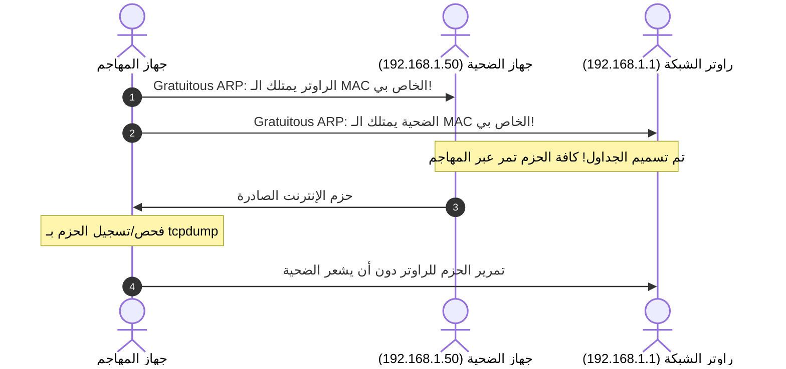

# Room 04: Protocols and Servers 2
## الغرفة 04: هجمات البروتوعولات النصية وحلول التشفير المعاصرة

* **المسار التعليمي:** TryHackMe — Jr Penetration Tester
* **الموديول الأب:** Module 03: Network Reconnaissance
* **رابط الغرفة الرسمي:** [https://tryhackme.com/room/protocolsandservers2](https://tryhackme.com/room/protocolsandservers2)
* **المستوى التقني:** متوسط (Protocol Exploitation, MITM & Cryptographic Defenses)
* **الوقت التقديري للإنجاز:** 45 دقيقة
* **إجمالي المهام الموثقة:** 7 مهام (Tasks 01 – 07)

---

## 01. Room Overview | نظرة عامة على الغرفة
في هذه الغرفة المتقدمة، ينتقل مختبر الاختراق من مجرد الاستكشاف السلبي للبروتوعولات النصية إلى **مرحلة الاستغلال الميداني النشط وتأمين الشبكات المعاصرة**:
1. **هجمات التنصت واعتراض الحزم (Sniffing Attacks):** استخدام `tcpdump` وفلاتر BPF و `Wireshark` لالتقاط كلمات المرور المرسلة صراحة عبر بروتوكولات Telnet و IMAP.
2. **هجمات الرجل في المنتصف (Man-in-the-Middle - MITM):** تفكيك هندسة تسميم جدول الـ ARP (ARP Spoofing) ومقارنة واجهات أداتي `Ettercap` و `Bettercap`.
3. **أمان طبقة النقل (TLS):** دراسة التشفير المتماثل وغير المتماثل، وشهادات X.509، وتأمين استعلامات الـ DNS عبر بروتوكول `DoT`.
4. **بروتوكول الشل الآمن (SSH):** تسجيل الدخول المشفر بحساب `mark`، واستخراج إصدار النواة (`5.15.0-119-generic`)، ونقل الملفات بأمان عبر أداة `scp`.
5. **هجمات كسر كلمات المرور (Password Attacks):** تنفيذ هجوم قاموسي متصل عبر الشبكة باستخدام أداة `THC Hydra` ضد خادم IMAP واستخراج كلمة مرور الحساب `lazie` (`butterfly`).

---

## 02. Learning Objectives | الأهداف التعليمية

```mermaid
graph TD
    A[أهداف غرفة البروتوكولات والخوادم 2] --> B[هجمات التنصت و MITM]
    A --> C[هجمات القوة الغاشمة بالمقابس]
    A --> D[بروتوكولات الإدارة المشفرة]
    A --> E[تأمين طبقة النقل و DNS]

    B --> B1[إتقان فلاتر tcpdump (port 23) و Wireshark (imap) وتسميم الـ ARP]
    C --> C1[استخدام THC Hydra وقاموس rockyou لكسر كلمات مرور خوادم البريد]
    D --> D1[استخدام SSH و scp للتحكم الآمن واستخراج مؤشرات النواة uname -r]
    E --> E1[فهم معايير TLS 1.3 وبروتوكول DoT لتأمين حركة أسماء النطاقات]
```

---

## 03. Conceptual Foundations | الأسس المفاهيمية
* **سطح الهجوم على البروتوكولات النصية (Cleartext Attack Surface):**
  عندما تُرسل البيانات دون تشفير، لا يحتاج المهاجم إلى كسر أي ثغرة برمجية في الكود؛ بل يكفيه التواجد في نفس وسيط الشبكة الفيزيائي أو المنطقي لالتقاط البيانات صراحة.
* **هجوم الرجل في المنتصف (MITM):**
  يهدف المهاجم إلى تحويل مسار الحزم الشبكية بين الضحية وبوابة الخروج (Default Gateway) لتمر عبر جهازه أولاً. بمجرد نجاح الهجوم، يصبح المهاجم قادراً على التنصت (Sniffing)، وحقن البيانات (Packet Injection)، وإسقاط الاتصالات (DoS).
* **الانتقال إلى التشفير الهجين (Hybrid Cryptography):**
  البروتوكولات المعاصرة (SSH و TLS) لا تعتمد على خوارزمية واحدة؛ بل تدمج بين التشفير غير المتماثل (Asymmetric) للمصادقة وتبادل المفاتيح، والتشفير المتماثل (Symmetric) فائق السرعة لتشفير تدفق البيانات.

---

## 04. Technical Deep Dive | التعمق التقني

### 1. تشريح هجوم تسميم الـ ARP (ARP Poisoning Mechanics)
في شبكات الإيثرنت، تستخدم الأجهزة جداول ARP لتخزين الاقتران بين الـ IP والـ MAC:


### 2. معمارية التشفير في بروتوكول DNS over TLS (DoT)
* بروتوكول DNS التقليدي (UDP 53) يرسل أسماء النطاقات بنص صريح.
* بروتوكول **DoT (RFC 7858)** يغلف استعلامات الـ DNS داخل نفق TLS مشفر على المنفذ **`853 TCP`**، مما يمنع مزودي الخدمة والمتنصتين من معرفة المواقع التي يزورها المستخدم.

---

## 05. Tools and Technologies | الأدوات والتقنيات العملية

| الأداة | البروتوكول المستهدف | صيغة الأمر المعيارية | الاستخدام الميداني الأمني |
|---|---|---|---|
| **tcpdump** | Layer 2/3/4 | `sudo tcpdump -i eth0 port 23` | اعتراض وتسجيل الحزم في الطرفية بفلاتر BPF |
| **Wireshark** | Packet Dissector | شريط الفلترة: `imap` | تحليل الحزم برمجياً وقراءة المحتوى الصريح |
| **Ettercap** | ARP / DNS Spoofing | `sudo ettercap -G` (3 واجهات: GUI, Curses, Text) | تنفيذ هجمات الرجل في المنتصف واعتراض الجلسات |
| **Bettercap** | Full MITM Framework | `sudo bettercap -eval "net.sniff on"` (3 أوضاع) | الإطار العصري لاختراق الشبكات والوايرلس و BLE |
| **SSH & SCP** | TCP Port 22 | `ssh mark@IP` / `scp mark@IP:file .` | الإدارة الآمنة عن بعد ونقل الملفات المشفر |
| **THC Hydra** | Online Brute-force | `hydra -l lazie -P rockyou.txt IP imap` | كسر كلمات مرور الخدمات المتصلة بالشبكة |

---

## 06. Environment and Lab Setup | بيئة المعمل والهدف الافتراضي
* **نظام الفاحص:** بيئة AttackBox المزودة بقاموس `rockyou.txt` وأدوات `hydra`, `tcpdump`, `ssh`, `scp`.
* **الهدف الافتراضي:** خادم Linux يشغل الخدمات التالية:
  * خادم SSH على المنفذ 22 (مستخدم: `mark` / كلمة مرور: `XBtc49AB`).
  * نواة لينكس: `5.15.0-119-generic`.
  * ملف مخزن على الخادم: `book.txt` بحجم 415 كيلوبايت.
  * خادم بريد IMAP على المنفذ 143 (حساب: `lazie` / كلمة مرور ضعيفة: `butterfly`).

---

## 07. Step-by-Step Practical Walkthrough | التنفيذ العملي خطوة بخطوة

### الخطوة 1: فلاتر التنصت على الشبكة (Task 2)
1. فلتر أداة `tcpdump` لحصر التقاط حركة Telnet فقط: **`port 23`**.
2. أبسط فلتر عرض في `Wireshark` لحصر حركة بروتوكول IMAP: **`imap`**.

### الخطوة 2: أطر هجمات الرجل في المنتصف (Task 3)
1. عدد واجهات التشغيل التي توفرها أداة Ettercap (الرسومية، النصية، وسطر الأوامر): **`3`**.
2. عدد طرق استدعاء وتشغيل أداة Bettercap (الطرفية التفاعلية، ملفات Caplets، وواجهة الويب): **`3`**.

### الخطوة 3: أمان طبقة النقل وتشفير DNS (Task 4)
* الاختصار المكون من ثلاثة أحرف لبروتوكول تشفير الـ DNS عبر TLS: **`DoT`** (DNS over TLS على المنفذ 853).

### الخطوة 4: الإدارة الآمنة وفحص النواة ونقل الملفات عبر SSH (Task 5)
1. الاتصال بالخادم عبر SSH ببيانات الاعتماد المعطاة:
   ```bash
   ssh mark@MACHINE_IP
   # كلمة المرور: XBtc49AB
   ```
2. استخراج إصدار النواة:
   ```bash
   uname -r
   ```
   * **إصدار النواة المستخرج:** `5.15.0-119-generic`.
3. تنزيل الملف المشفر عبر أداة `scp`:
   ```bash
   scp mark@MACHINE_IP:book.txt .
   ```
   * الحجم المعروض بالكيلوبايت في شريط التحميل: **`415`** KB.

### الخطوة 5: كسر كلمة مرور IMAP عبر THC Hydra (Task 6)
1. إطلاق هجوم القاموس على خدمة IMAP للمستخدم `lazie`:
   ```bash
   hydra -l lazie -P /usr/share/wordlists/rockyou.txt MACHINE_IP imap
   ```
2. رصد نجاح المصادقة واستخراج كلمة المرور:
   * **كلمة المرور المسترجعة:** `butterfly`.

---

## 08. Output Analysis and Interpretation | تحليل وتفسير المخرجات التقنية
```text
================================================================================
THC HYDRA IMAP BRUTE-FORCE LOG
================================================================================
Hydra v9.3 (c) 2022 by van Hauser / THC - www.thc.org
[DATA] max 16 tasks per 1 server, overall 16 tasks, 14344399 login tries
[143][imap] host: MACHINE_IP   login: lazie   password: butterfly
1 of 1 target successfully completed, 1 valid password found
--------------------------------------------------------------------------------
[SECURITY ANALYSIS]:
1. Attack Target: IMAP Daemon (Port 143)
2. Target Principal: lazie
3. Recovered Secret: butterfly
4. Vulnerability: Weak dictionary password, absence of rate limiting or account lockout.
================================================================================
```

---

## 09. Vulnerabilities and Exploitation | الثغرات والمخاطر الهجومية
1. **ضعف كلمات المرور (Weak Dictionary Passwords):**
   استخدام كلمات شائعة مثل `butterfly` يسمح للمهاجم باختراق الحسابات خلال دقائق معدودة باستخدام قواميس مثل `rockyou.txt`.
2. **غياب آليات حظر التخمين (No Rate Limiting / Lockout):**
   سماح الخادم بمئات محاولات تسجيل الدخول المتتالية عبر Hydra دون حظر عنوان IP يمثل إخفاقاً أمنياً جسيماً.

---

## 10. Remediation and Mitigation | سبل المعالجة والدفاع المؤسسي
1. **الدفاع ضد هجمات الـ MITM على السويتشات:**
   * تفعيل خاصية **Dynamic ARP Inspection (DAI)** لمطابقة رسائل الـ ARP مع جدول الـ DHCP Snooping وإسقاط حزم التسميم.
2. **الدفاع ضد هجمات Hydra على الخوادم:**
   * تفعيل أداة مثل **Fail2ban** لرصد محاولات الفشل المتتالية وحظر عنوان IP تلقائياً على الجدار الناري لمدة محددة.
   * تطبيق سياسات كلمات مرور معقدة وفق معايير **NIST SP 800-63B** وفرض المصادقة متعددة العوامل (**MFA**).
3. **الدفاع التشفيري:**
   * فرض استخدام TLS 1.3 وحظر استخدام بروتوكولات Telnet و FTP النصية.

---

## 11. Real-World Penetration Testing Context | السياق الميداني والمهني
* في اختبارات الاختراق الداخلية، بمجرد أن يحصل المختبر على صلاحيات وصول فيزيائية أو شبكية للـ LAN، يُعتبر تنفيذ ARP Spoofing السلاح الأكثر حسماً لاعتراض جلسات الموظفين ومديري الأنظمة وسحب جلسات الدخول وكلمات المرور المشفرة بهشات NTLMv2 عبر أداة Responder.

---

## 12. Cross-Topic Synthesis and Next Steps | الروابط والتكامل مع الموضوعات القادمة
* بمجرد إتمام هذه الغرفة، يكون الدارس قد استوعب خطورة البروتوكولات النصية وآليات التشفير والكسر، مما يمهد لغرفة مراجعة الموديول:
  * **Topic Transition Recap (الغرفة 05):** المراجعة الشاملة لأسئلة الموديول 03.
  * **Nmap Module (الموديول 04):** دراسة علم فحص المنافذ المتقدم وبناء حزم الـ SYN والـ FIN والـ Xmas scans.

---

## 13. Summary Reference and Cheat Sheet | ملخص سريع وقائمة الأوامر

```bash
# التقاط حزم المنفذ 23 بنص صريح
sudo tcpdump -i eth0 -A -n port 23

# كسر كلمة مرور IMAP عبر Hydra
hydra -l <USER> -P /usr/share/wordlists/rockyou.txt <TARGET_IP> imap

# الاتصال المشفر عبر SSH
ssh mark@<TARGET_IP>

# تنزيل ملف مشفر عبر نفق SSH
scp mark@<TARGET_IP>:book.txt .
```

---

## 14. Verification and Review Questions | مراجعة الفهم والتحقق

| # | سؤال المراجعة والتأكيد | الإجابة المعتمدة |
|---|---|:---:|
| 1 | ما الذي تضيفه لأمر tcpdump لحصر التقاط حركة Telnet فقط؟ | **`port 23`** |
| 2 | ما هو أبسط فلتر عرض في Wireshark لإظهار حركة IMAP فقط؟ | **`imap`** |
| 3 | كم عدد الواجهات المختلفة التي تقدمها أداة Ettercap؟ | **`3`** |
| 4 | كم عدد الطرق المختلفة التي يمكن بها استدعاء وتشغيل أداة Bettercap؟ | **`3`** |
| 5 | ما هو الاختصار المكون من 3 أحرف لبروتوكول DNS الذي يستخدم تشفير TLS؟ | **`DoT`** |
| 6 | ما هو إصدار النواة (Kernel release) المستخرج بأمر uname -r؟ | **`5.15.0-119-generic`** |
| 7 | كم كيلوبايت عرضتها أداة scp كحجم تنزيل لملف book.txt؟ | **`415`** |
| 8 | ما هي كلمة المرور المستخرجة لحساب lazie على خادم IMAP عبر Hydra؟ | **`butterfly`** |
