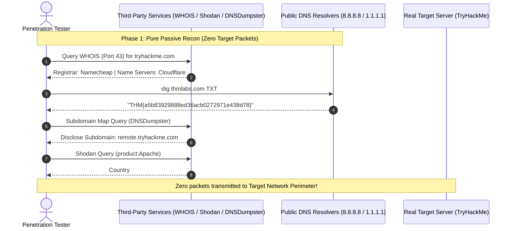

# Comprehensive Technical Documentation: Passive Reconnaissance

---

## 01. Room Overview
* **Original Room Title:** Passive Reconnaissance
* **Original Title Slug:** `passiverecon`
* **Official Room URL:** [https://tryhackme.com/room/passiverecon](https://tryhackme.com/room/passiverecon)
* **Parent Module:** Module 03 — Network Reconnaissance
* **Difficulty Level:** Easy (Foundational / Practical)
* **Estimated Completion Time:** 40 to 50 minutes
* **Prerequisites:** Basic familiarity with Linux command-line operations, networking fundamentals (IP addressing and Domain Name System concepts).
* **Field Relevance & Operational Context:** Passive reconnaissance represents "Step Zero" in any professional penetration test or adversary emulation campaign. It enables practitioners to map organizational attack surfaces, locate cloud infrastructures, enumerate mail services, and discover sensitive subdomains without transmitting a single packet directly to target firewalls. This preserves operational security (OpSec) and avoids triggering Security Information and Event Management (SIEM) alerts or Intrusion Detection/Prevention Systems (IDS/IPS).

---

## 02. Learning Objectives

### Theoretical & Conceptual Objectives
* Differentiate rigorously between passive reconnaissance (querying third-party public repositories) and active reconnaissance (direct network packet transmission or human interaction).
* Master the architecture of the WHOIS protocol and understand Domain Name Registrars, Regional Internet Registries (RIRs), and ICANN governance.
* Dissect the Domain Name System (DNS) record hierarchy: A, AAAA, MX, TXT, NS, CNAME, and SOA.
* Understand internet-wide port and service scanners (Shodan.io) and their role in banner aggregation.

### Practical & Hands-On Objectives
* Execute command-line queries using the `whois` client to extract registrar information, registration timestamps, and name servers.
* Leverage DNS query utilities (`nslookup` and `dig`) to extract specific records and uncover hidden verification flags embedded within `TXT` records.
* Discover hidden or remote access subdomains via public mapping engines like `DNSDumpster`.
* Construct targeted search filters within `Shodan.io` (`product:Apache`) to evaluate global server distributions and top listening ports.

### Analytical & Professional Objectives
* Analyze third-party CDN/WAF infrastructures (such as Cloudflare) and formulate passive techniques to identify Origin IP addresses.
* Categorize discovered subdomains based on security exposure and operational risk (e.g., isolating administrative and remote-access portals).

---

## 03. Conceptual Foundations

### 1. Active vs. Passive Classification Criteria
* **Passive Reconnaissance:** Gathering publicly accessible intelligence without directly transmitting packets to the target network or engaging target personnel. If the target organization suffered a total network outage, passive data collection would remain operational because the information resides with third parties (WHOIS databases, public recursive DNS resolvers, search engine caches).
* **Active Reconnaissance:** Sending direct transport or network layer probes (e.g., ICMP Echo requests, TCP SYN packets, HTTP requests) to target assets, or conducting direct social engineering interactions with employees.

### 2. The WHOIS Protocol
A legacy protocol (RFC 3912, TCP port 43) designed to query authoritative domain registrars to retrieve:
* Domain registration and expiration dates.
* Accredited registrar identities (e.g., Namecheap).
* Authoritative name servers delegated to manage the domain (e.g., Cloudflare).

### 3. DNS Records & Security Relevance
* **A / AAAA:** Direct host-to-IP mappings (IPv4 and IPv6).
* **MX (Mail Exchange):** Mail routing endpoints, disclosing corporate email providers (e.g., Google Workspace, Microsoft 365).
* **TXT (Text):** Freeform text records utilized for domain ownership validation, email security policies (SPF, DKIM, DMARC), and challenge verification flags.
* **NS (Name Server):** Authoritative DNS servers responsible for resolving the target zone.

---

## 04. Technical Deep Dive

### Passive Reconnaissance Information Flow



---

## 05. Tools and Technologies

| Tool / Platform | Technical Function | Standard Invocation Syntax |
|---|---|---|
| **whois** | Domain registry interrogator (Port 43/TCP) | `whois tryhackme.com` |
| **dig** | Advanced, scriptable DNS query utility | `dig thmlabs.com TXT +short` |
| **nslookup** | Cross-platform DNS lookup tool | `nslookup -type=TXT thmlabs.com` |
| **DNSDumpster** | Subdomain discovery and visual topology mapper | [https://dnsdumpster.com/](https://dnsdumpster.com/) |
| **Shodan.io** | Global search engine for connected devices and service banners | [https://www.shodan.io/](https://www.shodan.io/) |

---

## 06. Penetration Testing Methodology

During passive reconnaissance, security assessors execute the following workflow:
1. **Administrative Footprinting:** Inspect WHOIS records to identify domain longevity, registrar integrity, and nameserver delegation.
2. **Infrastructure Identification:** Determine whether the target utilizes edge protection (WAF/CDN) or exposes direct network routes.
3. **Attack Surface Expansion:** Enumerate subdomains via passive intelligence (DNSDumpster, Certificate Transparency logs) to locate high-risk management endpoints (`remote`, `vpn`, `dev`).
4. **Service Exposure Probing:** Interrogate Shodan for open ports, web banners, and software versions without initiating active scans.

---

## 07. Practical Walkthrough

### Task 02: Classification Exercise
* Visiting the corporate Facebook page ⟶ Passive (`P`).
* Transmitting a ping probe to verify ICMP reachability ⟶ Active (`A`).
* Social engineering the IT administrator at a social gathering ⟶ Active (`A`).

### Task 03: Querying WHOIS for TryHackMe.com
Executing the query from the terminal:
```bash
whois tryhackme.com
```
* **Creation Date:** `Creation Date: 2018-07-05` ⟶ Format required: `20180705`.
* **Registrar:** `Registrar: NameCheap, Inc.` ⟶ `namecheap.com`.
* **Name Server Provider:** `ARCHER.NS.CLOUDFLARE.COM` ⟶ `cloudflare.com`.

### Task 04: Interrogating DNS TXT Records with dig
Querying the laboratory target `thmlabs.com`:
```bash
dig thmlabs.com TXT +short
```
Output:
`"THM{a5b83929888ed36acb0272971e438d78}"`

### Task 05: Subdomain Mapping via DNSDumpster
Querying `tryhackme.com` on `dnsdumpster.com` isolates an administrative remote access entry:
`remote` (`remote.tryhackme.com`)

### Task 06: Shodan Analytics for Apache Web Servers
Executing the search query in Shodan:
`product:Apache`
* Inspecting **Top Countries**: United States holds #1, followed by #2: `Germany`.
* Inspecting **Top Ports**: Port 80 (#1), Port 443 (#2), followed by #3: `8080`.

---

## 08. Tasks and Solutions Summary

| Task Index | Original Question | Verified Answer |
|---|---|---|
| **Task 01** | *Read the above.* | `No answer needed` |
| **Task 02** | *You visit the Facebook page of the target company...* | `P` |
| **Task 02** | *You ping the IP address of the company webserver...* | `A` |
| **Task 02** | *You happen to meet the IT administrator...* | `A` |
| **Task 03** | *When was TryHackMe.com registered?* | `20180705` |
| **Task 03** | *What is the registrar of TryHackMe.com?* | `namecheap.com` |
| **Task 03** | *Which company is TryHackMe.com using for name servers?* | `cloudflare.com` |
| **Task 04** | *Check the TXT records of thmlabs.com. What is the flag there?* | `THM{a5b83929888ed36acb0272971e438d78}` |
| **Task 05** | *Lookup tryhackme.com on DNSDumpster...* | `remote` |
| **Task 06** | *According to Shodan.io, what is the 2nd country in the world...* | `Germany` |
| **Task 06** | *Based on Shodan.io, what is the 3rd most common port used for Apache?* | `8080` |
| **Task 07** | *No answer needed.* | `No answer needed` |

---

## 09. Common Errors, Pitfalls & Troubleshooting

* **Pitfall 1: Formatting Date Input with Hyphens in Task 03:**
  * *Correction:* Input must be entered as a continuous numeric string: `20180705` instead of `2018-07-05`.
* **Pitfall 2: Omitting the Record Type in dig:**
  * *Correction:* Running `dig thmlabs.com` queries `A` records by default; explicitly declare `dig thmlabs.com TXT` to display text records.
* **Pitfall 3: Entering the Full FQDN in Task 05:**
  * *Correction:* Submit solely the bare subdomain identifier: `remote` rather than `remote.tryhackme.com`.

---

## 10. Security Implications and Defensive Hardening

1. **Privacy Shielding for Domain Registrations:**
   * Enforce WHOIS privacy protection (PrivacyGuard) to mask administrative contact details, reducing spear-phishing vulnerability.
2. **Defensive DNS Zone Hardening:**
   * Restrict Authoritative DNS zone transfers (`AXFR`) to authorized internal secondary servers only.
   * Periodically audit public TXT records to remove abandoned verification tokens.
3. **Minimizing Public Search Footprint (Shodan Mitigation):**
   * Suppress descriptive server banners (`ServerTokens Prod` in Apache; `server_tokens off` in Nginx).
   * Restrict non-public administrative services to VPN gateways and whitelist trusted source IP blocks.

---

## 11. Real-World Applications and Mapping

* **Red Team Engagement Staging:**
  Assessors utilize passive reconnaissance to gather intelligence undetected, evaluating employee registries on LinkedIn and mapping shadow IT infrastructure before designing intrusion scenarios.
* **External Attack Surface Management (EASM):**
  Defensive teams monitor third-party intelligence engines (Shodan, Censys, DNSDumpster) to discover unpatched staging servers or forgotten cloud instances exposed to the internet.

---

## 12. Key Takeaways and Summary

1. **Zero Footprint Equals Stealth:** Passive reconnaissance gathers extensive operational data without alerting defensive monitoring.
2. **DNS Records Are Prime Intelligence Assets:** DNS queries uncover corporate mail servers, public APIs, and administrative routing records.
3. **Public Repositories Expose Global Trends:** Shodan provides comprehensive visibility into exposed listening ports across the globe.

---

## 13. Quick Reference and Cheat Sheet

```bash
# 1. Query domain ownership
whois <DOMAIN>

# 2. Interrogate DNS with dig
dig <DOMAIN> A
dig <DOMAIN> MX
dig <DOMAIN> TXT +short
dig <DOMAIN> +trace

# 3. Interrogate DNS with nslookup
nslookup -type=TXT <DOMAIN>
nslookup -type=MX <DOMAIN>

# 4. Attempt DNS Zone Transfer (Active check against NS)
dig @<NAMESERVER> <DOMAIN> AXFR
```

---

## 14. Comprehensive Self-Assessment & Knowledge Check

### Self-Assessment Questions
1. What technical distinctions exist between the legacy WHOIS protocol and the modern RDAP standard?
2. Why is querying DNSDumpster or Certificate Transparency logs preferable to running aggressive active DNS brute-forcing at the beginning of an engagement?
3. How can security assessors leverage Certificate Transparency (CT) logs via `crt.sh` to uncover obscure staging subdomains?
4. If a corporate web application is behind Cloudflare, what passive techniques can be used to uncover the real Origin IP?

---

### Answer Key
* **Answer 1:** WHOIS (TCP port 43) returns unstandardized plaintext without authentication or encryption; RDAP operates over HTTPS, returns structured JSON objects, and supports granular access control compliant with GDPR.
* **Answer 2:** Querying DNSDumpster or CT logs inspects pre-aggregated third-party records (purely passive), whereas DNS brute-forcing transmits thousands of requests directly to authoritative nameservers, generating obvious intrusion detection alerts.
* **Answer 3:** By querying public CT monitors (such as `crt.sh/?q=%.domain.com`), assessors can inspect publicly logged TLS certificates issued by trusted CAs for development, testing, or internal domains.
* **Answer 4:** Inspecting public MX records (which frequently point to origin mail servers sharing the same network CIDR block), querying historical DNS archives prior to Cloudflare activation, or searching Censys/Shodan for SSL certificates matching the domain on unproxied servers.
