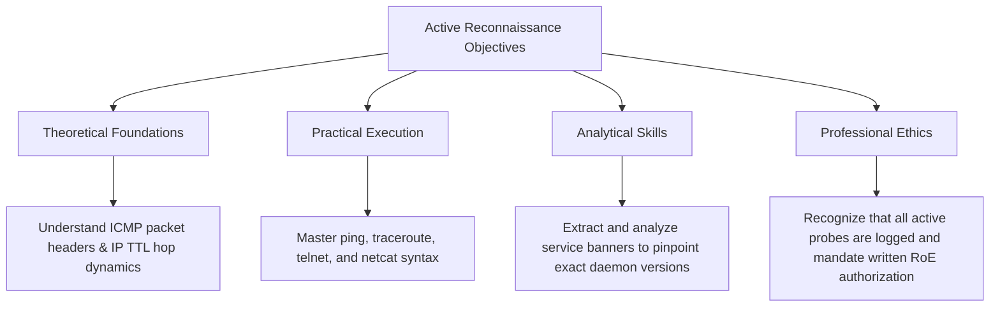
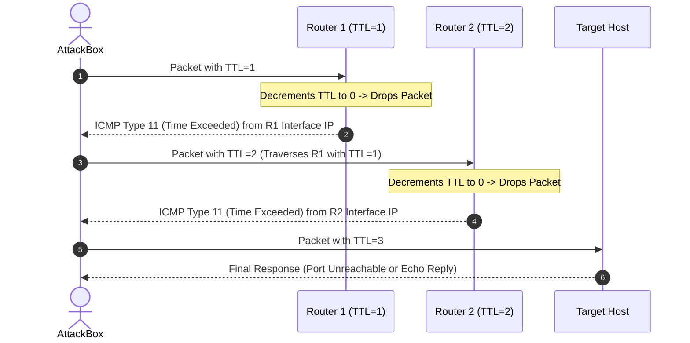

# Room 02: Active Reconnaissance
## Comprehensive Technical Documentation (English Version)

* **Learning Path:** TryHackMe — Jr Penetration Tester
* **Parent Module:** Module 03: Network Reconnaissance
* **Official Room URL:** [https://tryhackme.com/room/activerecon](https://tryhackme.com/room/activerecon)
* **Technical Depth:** Foundational to Intermediate Active Reconnaissance
* **Estimated Duration:** 40 Minutes
* **Total Documented Tasks:** 7 Tasks (Tasks 01 – 07)

---

## 01. Room Overview
The **Active Reconnaissance** room marks the pivotal methodology transition from passive OSINT collection to **direct network packet transmission**. The tester directly interacts with the target's network interfaces, probing listening daemons, evaluating network latency, and mapping intermediate routing topology.

This room covers five foundational network intelligence capabilities:
1. **Web Browser & Developer Tools:** Inspecting client-side DOM, JavaScript execution, and hidden HTML elements.
2. **ICMP & Ping Utility:** Evaluating host reachability, round-trip time (RTT), ICMP packet structures, and Windows Firewall ingress blocking behavior.
3. **Traceroute Utility:** Exploiting IPv4 Time-To-Live (TTL) header mechanics and ICMP Time Exceeded (Type 11) messages to map intermediate network hops and topology.
4. **Telnet Client:** Opening raw TCP sockets to manually craft HTTP requests and extract web server response banners.
5. **Netcat (`nc`):** Direct socket interaction with plaintext daemons (e.g. FTP port 21) to capture service banners without protocol negotiation overhead.

---

## 02. Learning Objectives



---

## 03. Conceptual Foundations
* **Definition of Active Reconnaissance:** Any phase of information gathering where the testing host transmits synthetic IP packets directly to the client's network infrastructure, expecting responsive traffic.
* **The Logging Reality:** Unlike passive OSINT, every active probe stamps the tester's public IP address into target firewall states, intrusion detection system (IDS) event logs, and web daemon access logs.
* **The Reconnaissance Continuum:**
  ```text
  [Passive OSINT] ⟶ [Light Active Footprinting (Ping/Traceroute)] ⟶ [Full Port & Service Scans (Nmap)] ⟶ [Targeted Exploitation]
  ```

---

## 04. Technical Deep Dive & Protocol Mechanics

### 1. ICMP Protocol Anatomy (RFC 792)
Operating as IP Protocol `1` directly above the network layer, ICMP utilizes an immutable 8-byte header:
```text
 0                   1                   2                   3
 0 1 2 3 4 5 6 7 8 9 0 1 2 3 4 5 6 7 8 9 0 1 2 3 4 5 6 7 8 9 0 1
+-+-+-+-+-+-+-+-+-+-+-+-+-+-+-+-+-+-+-+-+-+-+-+-+-+-+-+-+-+-+-+-+
|   Type (8)    |   Code (0)    |          Checksum             |
+-+-+-+-+-+-+-+-+-+-+-+-+-+-+-+-+-+-+-+-+-+-+-+-+-+-+-+-+-+-+-+-+
|         Identifier            |        Sequence Number        |
+-+-+-+-+-+-+-+-+-+-+-+-+-+-+-+-+-+-+-+-+-+-+-+-+-+-+-+-+-+-+-+-+
|                   Payload Data (Default: 56 B)                |
+-+-+-+-+-+-+-+-+-+-+-+-+-+-+-+-+-+-+-+-+-+-+-+-+-+-+-+-+-+-+-+-+
```
* **Type 8:** Echo Request (outbound probe generated by `ping`).
* **Type 0:** Echo Reply (inbound verification from a live responsive host).
* **Type 11:** Time-to-Live Exceeded (the protocol primitive powering `traceroute`).

### 2. Traceroute Hop-by-Hop Discovery Mechanics
Traceroute exploits the 8-bit TTL field in the IPv4 header to prevent routing loops:


---

## 05. Tools & Technologies Matrix

| Tool | Protocol Used | Primary Syntax | Security Purpose |
|---|---|---|---|
| **DevTools** | HTTP / DOM / JS | `F12` in Browser | Inspect hidden client-side logic, comments, and elements |
| **Ping** | ICMP (Echo 8/0) | `ping -c 5 -s 64 <IP>` | Verify live host reachability and round-trip time |
| **Traceroute** | UDP / ICMP / TCP | `traceroute -n -T -p 80 <IP>` | Map intermediate router topology and egress filtering |
| **Telnet** | TCP (Raw Socket) | `telnet <IP> 80` | Manual HTTP banner grabbing and interactive debugging |
| **Netcat** | TCP / UDP (Raw) | `nc -vn <IP> <PORT>` | Banner extraction on raw daemons (FTP, SMTP) |

---

## 06. Environment & Lab Setup
* **Attack Platform:** Linux AttackBox equipped with standard networking utilities (`ping`, `traceroute`, `telnet`, `nc`, Firefox).
* **Target Environment:** Cloud-hosted Linux server running:
  * Port 21: FTP daemon (`Netkit-ftp 0.17`).
  * Port 80: HTTP web daemon (`Apache 2.4.61`).
  * ICMP Ingress: Enabled and responsive.

---

## 07. Step-by-Step Practical Walkthrough

### Step 1: Client-Side DOM Inspection via DevTools (Task 2)
1. Navigate to target URL: `https://static-labs.tryhackme.cloud/sites/networking-tcp/`.
2. Press `F12` to open Developer Tools.
3. Inspect the embedded JavaScript array containing TCP questions:
   * Total question count: **`8`**.

### Step 2: Host Reachability & ICMP Probing via Ping (Task 3)
1. ICMP payload size option: **`-s`**.
2. Immutable ICMP header length: **`8` bytes**.
3. Windows Firewall ingress policy: Ping is blocked by default (**`Y`**).
4. Transmit 10 echo requests:
   ```bash
   ping -c 10 MACHINE_IP
   ```
   * Total received replies: **`10`**.

### Step 3: Network Path Tracing & Hop Analysis (Task 4)
1. Traceroute A: Pre-destination router IP: **`100.92.9.83`**.
2. Traceroute B: Pre-destination router IP on line 25: **`99.83.89.19`**.
3. Intermediate router count in Traceroute B: Target on line 26 minus destination: **`25`** routers ($26 - 1 = 25$).

### Step 4: Web Server Banner Grabbing via Telnet (Task 5)
1. Open raw TCP connection on port 80:
   ```bash
   telnet MACHINE_IP 80
   ```
2. Manually issue HTTP request:
   ```text
   GET / HTTP/1.1
   Host: MACHINE_IP

   ```
3. Analyze response headers:
   * Daemon Name: **`Apache`**.
   * Exact Version: **`2.4.61`**.

### Step 5: Plaintext Daemon Banner Grabbing via Netcat (Task 6)
1. Connect to FTP daemon on port 21:
   ```bash
   nc MACHINE_IP 21
   ```
2. Inspect the pre-auth banner (`220` code):
   * Banner shows `Netkit-ftp 0.17 Server ready.`
   * Daemon Version: **`0.17`**.

---

## 08. Output Analysis & Interpretation
```text
================================================================================
TELNET RAW BANNER EXTRACTION
================================================================================
Connected to MACHINE_IP.
Escape character is '^]'.
HTTP/1.1 200 OK
Date: Wed, 18 Nov 2026 23:04:12 GMT
Server: Apache/2.4.61 (Ubuntu)
Content-Type: text/html; charset=UTF-8
--------------------------------------------------------------------------------
[ANALYSIS]:
1. Service Daemon: Apache Web Server
2. Accurate Version: 2.4.61
3. Target OS Fingerprint: Ubuntu Linux
================================================================================
```

---

## 09. Vulnerabilities & Exploitation Vectors
* **Information Disclosure via Verbose Banners:**
  Exposing exact release numbers (`Apache/2.4.61` or `Netkit-ftp 0.17`) drastically accelerates adversary reconnaissance. Instead of blind fuzzing, an attacker conducts precision CVE lookups to match publicly available exploits against that specific software build.

---

## 10. Remediation & Enterprise Defense
1. **Server Header Suppression:**
   * In Apache configurations (`apache2.conf` / `httpd.conf`):
     ```apache
     ServerTokens Prod
     ServerSignature Off
     ```
     This enforces minimal banner emission (`Apache`) without exposing granular version numbers or OS tags.
2. **ICMP Topology Concealment:**
   * Configure internal routers to drop `ICMP Type 11 (Time Exceeded)` messages to prevent external actors from mapping internal network routing topology via Traceroute.

---

## 11. Real-World Penetration Testing Context
In commercial red team and black-box penetration tests, launching full-spectrum Nmap scans on day one is poor tradecraft that triggers enterprise SIEM and EDR alerts. Professional operators begin with **quiet active reconnaissance**: single-packet ICMP probes, TCP-based traceroutes on permitted web ports (`traceroute -T -p 80`), and manual socket banner grabbing via Netcat to map defense perimeters undetected.

---

## 12. Cross-Topic Synthesis
The manual reconnaissance primitives mastered in this room form the direct foundation for:
* **Protocols and Servers (Room 03):** Deep architectural breakdown of HTTP, FTP, POP3, SMTP, and IMAP vulnerabilities.
* **Nmap Module (Module 04):** Automating socket discovery, banner grabbing, and host enumeration across enterprise subnets.

---

## 13. Summary Reference & Command Cheat Sheet

```bash
# 1. Transmit 4 ICMP echo requests with 32 bytes of custom payload
ping -c 4 -s 32 <TARGET_IP>

# 2. Perform TCP SYN traceroute on port 80 to bypass UDP/ICMP firewalls
traceroute -T -p 80 <TARGET_IP>

# 3. Manual HTTP banner grabbing via raw Telnet socket
telnet <TARGET_IP> 80
# Send: GET / HTTP/1.1 -> Host: <TARGET_IP> -> [Enter twice]

# 4. Immediate service banner grabbing on FTP port 21 via Netcat
nc -vn <TARGET_IP> 21
```

---

## 14. Verification & Review Questions

| # | Question | Verified Ground Truth |
|---|---|:---:|
| 1 | Total questions found in JavaScript code via DevTools? | **`8`** |
| 2 | Ping option used to set custom ICMP data payload size? | **`-s`** |
| 3 | Immutable length of ICMP header in bytes? | **`8`** |
| 4 | Does Microsoft Windows Firewall block ICMP Echo by default? | **`Y`** |
| 5 | IP address of last router in Traceroute A before tryhackme.com? | **`100.92.9.83`** |
| 6 | IP address of last router in Traceroute B before tryhackme.com? | **`99.83.89.19`** |
| 7 | Number of intermediate routers in Traceroute B? | **`25`** |
| 8 | Web daemon name and version on port 80 via Telnet? | **`Apache`** / **`2.4.61`** |
| 9 | FTP server version identified on port 21 via Netcat? | **`0.17`** |
