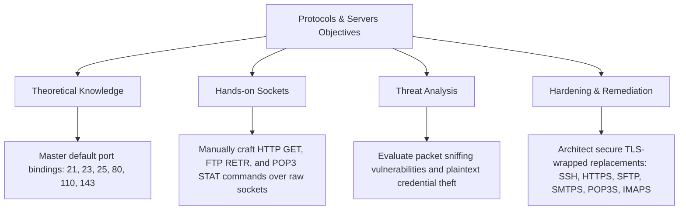
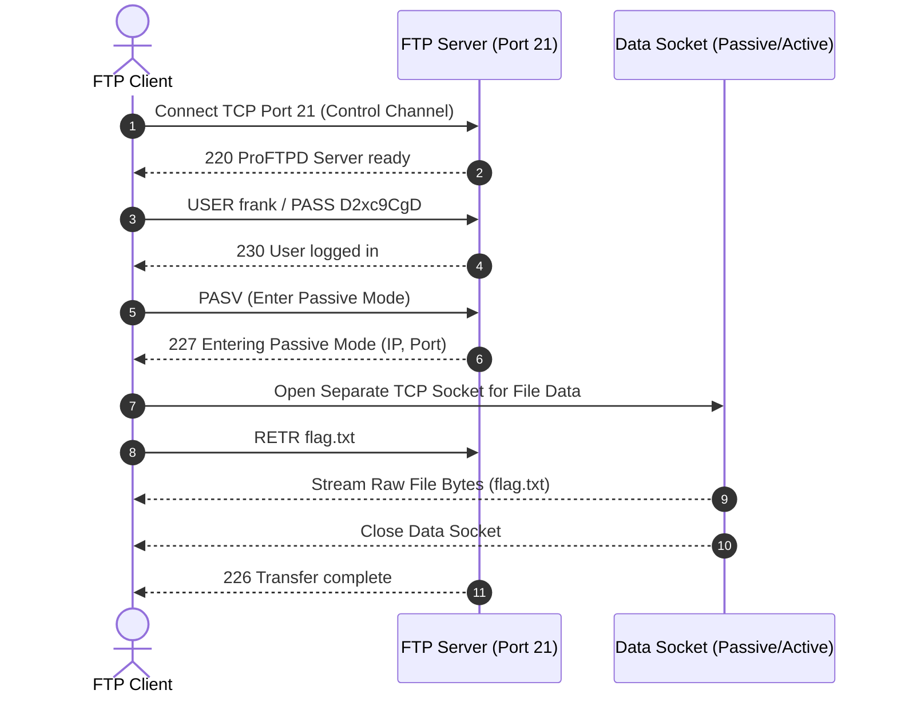

# Room 03: Protocols and Servers
## Comprehensive Technical Documentation (English Version)

* **Learning Path:** TryHackMe — Jr Penetration Tester
* **Parent Module:** Module 03: Network Reconnaissance
* **Official Room URL:** [https://tryhackme.com/room/protocolsandservers](https://tryhackme.com/room/protocolsandservers)
* **Technical Depth:** Foundational to Intermediate Network Protocol Analysis
* **Estimated Duration:** 45 Minutes
* **Total Documented Tasks:** 8 Tasks (Tasks 01 – 08)

---

## 01. Room Overview
The **Protocols and Servers** room provides an in-depth architectural examination of the legacy application-layer protocols underpinning the Internet:
* **Telnet (Port 23):** Cleartext terminal management.
* **HTTP (Port 80):** Stateless web resource transfer and manual HTTP verb construction.
* **FTP (Port 21):** Dual-channel file transfer architecture (Control vs. Data).
* **SMTP (Port 25):** Inter-server mail routing and transaction state machines.
* **POP3 (Port 110):** Mailbox interrogation and download-and-delete retrieval.
* **IMAP (Port 143):** Server-side mail synchronization across distributed clients.

Penetration testers learn how to interface directly with these network daemons using raw TCP sockets, issue RFC-compliant commands manually without GUI client abstractions, and assess the severe operational risks associated with cleartext credential transmission.

---

## 02. Learning Objectives



---

## 03. Conceptual Foundations
* **The Historical High-Trust Model:**
  Telnet, FTP, HTTP, and SMTP were conceived in an era when the Internet was an academic, highly trusted environment. Cryptographic confidentiality was omitted from initial RFC standards, mandating that commands, credentials, and data payloads traverse the wire as unencrypted ASCII text.
* **Client-Server Dialog Paradigm:**
  Each protocol establishes a stateful or stateless TCP connection:
  1. Server listens continuously on a designated IANA port.
  2. Client initiates a standard TCP 3-way handshake.
  3. Commands terminate with standard CRLF delimiters (`\r\n`).
  4. Server responds with standardized status codes (e.g. `200` in HTTP, `220` in SMTP/FTP, `+OK` in POP3).

---

## 04. Technical Deep Dive & State Machines

### 1. Dual-Channel Architecture of FTP (RFC 959)
FTP bifurcates control signals from actual data transfer:


### 2. SMTP Protocol State Machine (RFC 5321)
The mail server enforces a strict transactional sequence:
1. Banner Emission: `220 mail.domain.com ESMTP Postfix`.
2. Handshake: `HELO domain` / `EHLO domain`.
3. Envelope Sender: `MAIL FROM:<user@domain.com>`.
4. Envelope Recipient: `RCPT TO:<target@domain.com>`.
5. Body Transmission: `DATA` initiated, ending with single period CRLF (`.`).

---

## 05. Protocols & Ports Reference Matrix

| Protocol | Default Port | Quick CLI Probe | Success Indicator | Core Function |
|---|:---:|---|:---:|---|
| **Telnet** | **23** | `telnet <IP> 23` | Connected banner | Cleartext remote terminal |
| **HTTP** | **80** | `telnet <IP> 80` | `HTTP/1.1 200 OK` | Web resource retrieval |
| **FTP** | **21** | `ftp <IP>` | `230 Logged in` | Remote file management |
| **SMTP** | **25** | `nc <IP> 25` | `220 Service Ready` | Inter-server mail relay |
| **POP3** | **110** | `telnet <IP> 110` | `+OK` | Mailbox download & deletion |
| **IMAP** | **143** | `telnet <IP> 143` | `* OK` | Distributed mailbox sync |

---

## 06. Environment & Lab Setup
* **Testing Machine:** AttackBox with `telnet`, `nc`, and `ftp` CLI tools.
* **Target Host:** Cloud Linux VM hosting:
  * Port 80: Apache HTTP server hosting `/flag.thm`.
  * Port 21: ProFTPD service (Credentials: `frank` : `D2xc9CgD`).
  * Port 25: Postfix SMTP service emitting verification flag in code 220 banner.
  * Port 110: Dovecot POP3 service & Port 143 IMAP service.

---

## 07. Step-by-Step Practical Walkthrough

### Step 1: Telnet Protocol Default Port (Task 2)
* The default TCP port bound by the `telnet` client: **`23`**.

### Step 2: Manual HTTP GET via Raw Socket (Task 3)
1. Open raw socket connection:
   ```bash
   telnet MACHINE_IP 80
   ```
2. Manually format and transmit HTTP/1.1 request:
   ```text
   GET /flag.thm HTTP/1.1
   Host: MACHINE_IP

   ```
3. Read the payload body:
   * **Flag:** `THM{e3eb0a1df437f3f97a64aca5952c8ea0}`.

### Step 3: Authenticated FTP File Recovery (Task 4)
1. Connect via FTP client:
   ```bash
   ftp MACHINE_IP
   ```
2. Supply credentials: Username `frank`, Password `D2xc9CgD`.
3. Recover the flag file:
   ```text
   ftp> ls
   ftp> get flag.txt
   ftp> quit
   ```
4. Read the file contents:
   ```bash
   cat flag.txt
   ```
   * **Flag:** `THM{364db6ad0e3ddfe7bf0b1870fb06fbdf}`.

### Step 4: SMTP Banner Extraction (Task 5)
1. Connect to mail port 25:
   ```bash
   nc MACHINE_IP 25
   ```
2. Inspect the pre-auth greeting banner (`220` code):
   * **Flag:** `THM{5b31ddfc0c11d81eba776e983c35e9b5}`.

### Step 5: POP3 Mailbox Interrogation (Task 6)
1. Connect to port 110:
   ```bash
   telnet MACHINE_IP 110
   ```
2. Authenticate:
   ```text
   USER frank
   PASS D2xc9CgD
   ```
3. Issue status interrogation command:
   ```text
   STAT
   ```
   * Raw Server Response: **`+OK 0 0`**.
   * Number of available messages: **`0`**.

### Step 6: IMAP Standard Port Identification (Task 7)
* Standard default TCP port for IMAP: **`143`**.

---

## 08. Output Analysis & Interpretation
```text
================================================================================
RAW POP3 PROTOCOL LOG
================================================================================
Connected to MACHINE_IP.
+OK Dovecot ready.
USER frank
+OK
PASS D2xc9CgD
+OK Logged in.
STAT
+OK 0 0
--------------------------------------------------------------------------------
[ANALYSIS]:
1. Server Software: Dovecot POP3 Daemon
2. Authentication State: Cleartext credentials accepted over unencrypted port 110
3. Mailbox Statistics: Exactly 0 messages present, 0 octets total volume
================================================================================
```

---

## 09. Vulnerabilities & Exploitation Vectors
1. **Network Sniffing & Credential Harvesting:**
   Telnet, FTP, POP3, and IMAP transmit user passwords in plaintext. Anyone on the local network or tapping transit links can intercept valid domain credentials with Wireshark.
2. **Session Hijacking & Cleartext Tampering:**
   Unencrypted HTTP and FTP channels allow on-path attackers to manipulate data payloads in transit, injecting malicious JavaScript or modifying downloaded binaries.

---

## 10. Remediation & Enterprise Defense
* **Decommission Cleartext Endpoints:** Permanently disable ports 21, 23, 80, 110, and 143 on external perimeters.
* **Migrate to Cryptographic Protocols:**
  * Telnet ⟶ **SSH (Port 22)**
  * HTTP ⟶ **HTTPS (Port 443)**
  * FTP ⟶ **SFTP (Port 22)** or **FTPS (Port 990)**
  * POP3 ⟶ **POP3S (Port 995)**
  * IMAP ⟶ **IMAPS (Port 993)**
  * Enforce **STARTTLS** on mail relays (Port 587).

---

## 11. Real-World Penetration Testing Context
In corporate network penetration tests, legacy protocols like FTP and Telnet frequently point to embedded devices (IP cameras, legacy NAS devices, network switches) running default or shared administrative credentials. Compromising these peripheral devices frequently yields credentials that allow lateral movement into the Active Directory domain.

---

## 12. Cross-Topic Synthesis
This room provides the direct technical baseline for:
* **Protocols and Servers 2 (Room 04):** Hands-on exploitation of cleartext protocols, packet sniffing, password cracking, and SSL/TLS cryptographic hardening.

---

## 13. Summary Reference & Command Cheat Sheet

```bash
# 1. Manual HTTP request over socket
telnet <IP> 80
GET /path HTTP/1.1
Host: <IP>
[Enter twice]

# 2. Authenticated FTP retrieval
ftp <IP>
# Supply user/pass -> get file -> quit

# 3. SMTP banner capture
nc -vn <IP> 25
HELO client.thm
QUIT

# 4. POP3 status check
telnet <IP> 110
USER <USER>
PASS <PASS>
STAT
QUIT
```

---

## 14. Verification & Review Questions

| # | Question | Verified Ground Truth |
|---|---|:---:|
| 1 | Default port bound automatically by the telnet command? | **`23`** |
| 2 | Flag retrieved from flag.thm over HTTP on port 80? | **`THM{e3eb0a1df437f3f97a64aca5952c8ea0}`** |
| 3 | Flag recovered via authenticated FTP client? | **`THM{364db6ad0e3ddfe7bf0b1870fb06fbdf}`** |
| 4 | Flag embedded inside the SMTP port 25 greeting banner? | **`THM{5b31ddfc0c11d81eba776e983c35e9b5}`** |
| 5 | Exact server response returned to the POP3 STAT command? | **`+OK 0 0`** |
| 6 | Total email messages available for download via POP3? | **`0`** |
| 7 | Standard default network port utilized by IMAP? | **`143`** |
