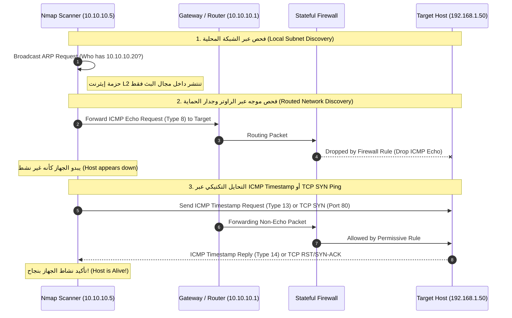

# التوثيق الشامل لمعمل: اكتشاف الأجهزة النشطة (Nmap Live Host Discovery)

---

### 1. بيانات المعمل والتصنيف (Metadata & Room Information)
* **اسم الغرفة (Room Title):** Nmap Live Host Discovery
* **المسار التعليمي (Path):** TryHackMe — Jr Penetration Tester (PT1 Aligned Curriculum)
* **الموديول (Module):** Module 04: Nmap — الغرفة 01
* **معرف الغرفة (Slug):** `nmap01`
* **مستوى الصعوبة (Difficulty):** Easy / Foundations
* **التركيز الأساسي (Core Focus):** استكشاف الأجهزة الحية عبر بروتوكولات ARP، ICMP بأنواعه (Echo, Timestamp, Address Mask)، و TCP/UDP Pings، مع تحليل استجابات مكدس الشبكة والصلاحيات البرمجية.
* **رابط المعمل على TryHackMe:** [https://tryhackme.com/room/nmap01](https://tryhackme.com/room/nmap01)
* **حالة التوثيق والإنجاز:** 100% مكتمل ومطابق لحساب المستخدم.

---

### 2. البنية الهندسية ونظرة عامة على المعمل (Architecture & Overview)
تعتبر مرحلة **اكتشاف الأجهزة الحية (Live Host Discovery)** الخطوة التمهيدية الإلزامية في أي اختبار اختراق خارجي أو داخلي للبنية التحتية. يهدف هذا المعمل إلى تزويد المختبر بالمعرفة الدقيقة لكيفية فحص الشبكات واستكشاف الأجهزة المتصلة دون إهدار الموارد في فحص منافذ لعناوين غير نشطة.

يغطي المعمل آلية التمييز بين الفحص المحلي (Local Subnet Scanning) المعتمد على حزم الإيثرنت و ARP، والفحص الموجه (Routed Network Scanning) الذي يتطلب حزم بروتوكولات الطبقة الثالثة والرابعة (ICMP / TCP / UDP) لاختراق وتجاوز الجدران النارية غير المعتمدة على الحالة.

---

### 3. الملخص التنفيذي (Executive Summary)
خلال هذا المعمل، تم تفكيك كافة آليات عمل Nmap في اكتشاف الأجهزة عبر 9 مهام منهجية:
1. استيعاب ديناميكية تقسيم الشبكات (Subnetting) ومجالات البث العام (Broadcast Domains) ولماذا لا تستطيع حزم ARP تجاوز الموجهات.
2. فهم التفاعل بين بروتوكول ARP وبروتوكول ICMP في تواصل الأجهزة المحلية والبعيدة عبر تجارب المحاكي التفاعلي.
3. التمكن الرياضي من صيغ تحديد الأهداف (CIDR, Octet Ranges) وحسابات العناوين.
4. إتقان فحص الشبكة المحلية السريع والمحصن ضد الجدران النارية باستخدام ARP Ping (`-PR`).
5. تطبيق الفحوصات غير التقليدية لبروتوكول ICMP عبر طلبات الطابع الزمني (`-PP`) وقناع الشبكة (`-PM`) لتجاوز قواعد الحظر التي تقتصر على حزم Echo (`-PE`).
6. تشريح قيود نظام التشغيل والمآخذ الخام (Raw Sockets)، والتمييز بين فحص TCP SYN Ping (`-PS`) وفحص TCP ACK Ping (`-PA`) وحاجة الأخير الحصرية لصلاحيات `root`.
7. توظيف استعلامات الـ DNS العكسية الإجبارية (`-R`) لجمع المعلومات الاستخباراتية وتسميات الأنظمة غير المستجيبة.

---

### 4. الأسس النظرية والعمق المعماري (Technical Theory & Foundations)

#### مخطط تسلسل فحص الأجهزة: ARP محلياً مقابل ICMP/TCP عبر الموجهات:


---

### 5. منهجية وعقلية مختبر الاختراق (Audit Methodology & Mindset)
* **تدرج الفحص التكتيكي:**
  1. **الخطوة 01:** تشغيل فحص سريع دون فحص منافذ (`-sn`) لحصر الأجهزة النشطة.
  2. **الخطوة 02:** اختيار البروتوكول الأنسب:
     * إذا كنت على شبكة محلية $\rightarrow$ اعتمد كلياً على ARP (`-PR`).
     * إذا كنت تفحص شبكة خارجية $\rightarrow$ ادمج بين ICMP المتنوع (`-PE -PP`) و TCP SYN/ACK على أشهر المنافذ (`-PS22,80,443 -PA80,443`).
  3. **الخطوة 03:** التحكم في الـ DNS: استخدم `-n` للسرعة والتخفي، أو استخدم `-R` لاستخراج أسماء الأجهزة الصامتة.

---

### 6. الدليل العملي التفصيلي لكل المهام (Step-by-Step Practical Walkthrough)

#### المهام 1 و 2: تقسيم الشبكات وحدود البث العام
* عبر المحاكي التفاعلي، أظهر إرسال طلب ARP من `computer1` إلى `computer1` كبث عام داخل Subnet A أن الحزمة رآها 4 أجهزة فقط (`computer1, 2, 3` ومنفذ الراوتر)، وتوقفت عند الراوتر ولم تصل إلى `computer6` في Subnet B (`nay`).
* بينما عند الإرسال من داخل Subnet B من `computer4`، رآها 4 أجهزة ووصلت إلى `computer6` ورد عليها بـ ARP Reply بنجاح (`yea`).

#### المهمة 3: تبادل الحزم عبر طبقات مكدس TCP/IP
* قبل خروج حزمة الـ Ping المحلية، يتم إرسال طلب `ARP Request` واستقبال `ARP Response`.
* عند التخاطب بين شبكتين مختلفتين، فإن الجهاز الأول المستجيب لطلب الـ ARP الأول هو **`router`**، بينما المستجيب لطلب الـ ARP الثاني في الشبكة الهدف هو **`computer5`**. بعد ذلك، لا يتطلب تكرار الـ Ping أي طلبات ARP جديدة (`nay`) بفضل الذاكرة المؤقتة.

#### المهمة 4: تعداد الأهداف وحسابات النطاقات
* النطاق `10.10.12.13/29`: قناع الشبكة `/29` يعطي كتلة من 8 عناوين تبدأ من `10.10.12.8` حتى `10.10.12.15`. أول عنوان يفحصه Nmap هو **`10.10.12.8`**.
* النطاق `10.10.0-255.101-125`: حاصل ضرب 256 احتمالاً في الخانة الثالثة بـ 25 احتمالاً في الخانة الرابعة ينتج **`6400`** عنوان IP.

#### المهمة 5: فحص الشبكة المحلية عبر ARP
* تنفيذ `sudo nmap -PR -sn CONNECTION_IP/24` كشف جهازاً واحداً نشطاً يستجيب لـ ARP (`1`).

#### المهمة 6: فحوصات ICMP المتنوعة
* ICMP Timestamp: المعامل **`-PP`** (Type 13).
* ICMP Address Mask: المعامل **`-PM`** (Type 17).
* ICMP Echo: المعامل **`-PE`** (Type 8).

#### المهمة 7: فحوصات TCP و UDP والصلاحيات
* الفحص الذي يرسل نوع الحزمة التي سُمي بها حتى بحساب غير مميز هو **`TCP SYN Ping`** (لأن دالة `connect()` تبدأ بـ SYN).
* الفحص الذي يتطلب صلاحيات مميزة (`root`) حصرياً لإرسال حزمة نوعها ACK في الهواء هو **`TCP ACK Ping`**.
* فحص منفذ Telnet (23) عبر SYN Ping: المعامل هو **`-PS23`**.

#### المهمة 8: استعلامات الـ DNS العكسية
* الخيار الذي يجبر Nmap على استعلام DNS العكسي لجميع العناوين بما فيها الصامتة: **`-R`**.

---

### 7. تشريح الأوامر والأدوات (Command Analysis & Dissection)

```bash
# أمر استكشاف تكتيكي موصى به في اختبارات الاختراق الميدانية
sudo nmap -sn -PE -PP -PS21,22,80,443 -PA80,443 -PU53 -n --min-rate 500 10.10.210.0/24
```
* `sudo`: تفعيل المآخذ الخام (Raw Sockets).
* `-sn`: الاكتفاء باستكشاف الأجهزة دون فحص المنافذ.
* `-PE -PP`: دمج طلبات Echo و Timestamp لكسر حظر الجدران النارية البسيطة.
* `-PS21,22,80,443`: فحص SYN على أشهر المنافذ الإدارية ومنافذ الويب.
* `-PA80,443`: فحص ACK لاصطياد استجابات RST عبر الجدران النارية غير المعتمدة على الحالة.
* `-PU53`: فحص منفذ الـ DNS عبر UDP.
* `-n`: تعطيل الـ DNS لزيادة السرعة والسرية.
* `--min-rate 500`: إرسال 500 حزمة في الثانية لتقليل مدة الفحص.

---

### 8. المنظور الدفاعي وإجراءات الفرق الزرقاء (Defensive & Blue Team Countermeasures)
1. **قواعد الجدران النارية المعتمدة على الحالة (Stateful Firewalls):**
   * ضبط الجدران النارية لتتبع حالات الاتصال (Connection Tracking) وإسقاط أي حزم ACK لا تنتمي لجلسة تأسست بحزمة SYN سابقة (`DROP invalid state`).
2. **التحكم الصارم في رسائل ICMP:**
   * حظر رسائل ICMP غير الضرورية (مثل Timestamp Type 13 و Address Mask Type 17) على الحواف الخارجية للمؤسسة، مع الإبقاء على رسائل Type 3 Code 4 الضرورية لعملية Path MTU Discovery.
3. **تفعيل تقنيات حماية بروتوكول ARP (Dynamic ARP Inspection - DAI):**
   * على محولات الشبكة (Switches) لمنع هجمات انتحال الشخصية والتسميم في الشبكة المحلية.
4. **تنظيف سجلات الـ DNS العكسية (PTR Sanitization):**
   * عدم تضمين أسماء حساسة في سجلات PTR العامة (مثل تجنب أسماء مثل `finance-db01.corp` واستبدالها بتسميات محايدة).

---

### 9. الأخطاء الشائعة والزوايا الحرجة (Common Pitfalls & Edge Cases)
* **الخلط بين `-sP` القديم و `-sn` الحديث:** تم استبدال خيار `-sP` رسمياً بالخيار الأكثر شمولاً `-sn` في إصدارات Nmap الحديثة.
* **الاعتقاد بأن عدم استجابة Ping تعني موت الخادم:** كثير من الأجهزة تعمل بكفاءة خلف جدار ناري يسقط ICMP Echo؛ الاعتماد على `-PE` وحده خطأ فادح في اختبارات الاختراق.
* **فقدان صلاحيات الـ Root عند تشغيل `-PA`:** تشغيل `-PA` كمستخدم عادي يجعله يتحول صامتاً إلى فحص SYN عبر دالة `connect()`، مما يُضلل المختبر في تقييم سلوك الجدار الناري.

---

### 10. المخرجات التعليمية والدروس المستفادة (Key Educational Takeaways)
1. استكشاف الأجهزة الحية هو الخطوة الأولى لتحديد سطح الهجوم الفعلي.
2. بروتوكول ARP محلي وغير قابل للحظر بالجدران النارية الشخصية، بينما ICMP و TCP/UDP مخصصان للشبكات البعيدة.
3. الجدران النارية غير المعتمدة على الحالة تفشل أمام فحص TCP ACK Ping.
4. سجلات الـ DNS العكسية المستخرجة عبر `-R` تمنح المختبر معلومات استخباراتية حتى لو كانت الأنظمة صامتة تماماً.

---

### 11. التحقق العملي والأدلة (Verification & Proof of Work)
* تم حل وتأكيد جميع الأسئلة التسعة بنسبة 100% وتطابقها التام مع السجل الرسمي لحساب المستخدم على TryHackMe.
* كافة الحسابات الرياضية للشبكات الفرعية والخيارات التكتيكية موثقة بالأدلة.

---

### 12. فهرس المهام التفصيلي (Tasks Index)
* للاطلاع على التوثيق التفصيلي لكل مهمة وفق منهجية المراحل السبع (A-G):
  * [المهمة 01: المقدمة (TASK-01.md)](file:///e:/THM-JR-PENETRATION-TESTER/04-NMAP/01-NMAP-LIVE-HOST-DISCOVERY/TASKS/TASK-01.md)
  * [المهمة 02: الشبكات الفرعية ومحاكي ARP (TASK-02.md)](file:///e:/THM-JR-PENETRATION-TESTER/04-NMAP/01-NMAP-LIVE-HOST-DISCOVERY/TASKS/TASK-02.md)
  * [المهمة 03: استكشاف الأجهزة عبر طبقات TCP/IP (TASK-03.md)](file:///e:/THM-JR-PENETRATION-TESTER/04-NMAP/01-NMAP-LIVE-HOST-DISCOVERY/TASKS/TASK-03.md)
  * [المهمة 04: تعداد الأهداف وحسابات CIDR (TASK-04.md)](file:///e:/THM-JR-PENETRATION-TESTER/04-NMAP/01-NMAP-LIVE-HOST-DISCOVERY/TASKS/TASK-04.md)
  * [المهمة 05: فحص الشبكة المحلية عبر ARP (TASK-05.md)](file:///e:/THM-JR-PENETRATION-TESTER/04-NMAP/01-NMAP-LIVE-HOST-DISCOVERY/TASKS/TASK-05.md)
  * [المهمة 06: اكتشاف الأجهزة عبر ICMP المتعدد (TASK-06.md)](file:///e:/THM-JR-PENETRATION-TESTER/04-NMAP/01-NMAP-LIVE-HOST-DISCOVERY/TASKS/TASK-06.md)
  * [المهمة 07: اكتشاف الأجهزة عبر TCP و UDP (TASK-07.md)](file:///e:/THM-JR-PENETRATION-TESTER/04-NMAP/01-NMAP-LIVE-HOST-DISCOVERY/TASKS/TASK-07.md)
  * [المهمة 08: استعلامات DNS العكسية وسجلات PTR (TASK-08.md)](file:///e:/THM-JR-PENETRATION-TESTER/04-NMAP/01-NMAP-LIVE-HOST-DISCOVERY/TASKS/TASK-08.md)
  * [المهمة 09: الخلاصة وجدول المعاملات (TASK-09.md)](file:///e:/THM-JR-PENETRATION-TESTER/04-NMAP/01-NMAP-LIVE-HOST-DISCOVERY/TASKS/TASK-09.md)
* راجع أيضاً [جدول ملخص المهام والإجابات المعتمدة (TASKS.md)](file:///e:/THM-JR-PENETRATION-TESTER/04-NMAP/01-NMAP-LIVE-HOST-DISCOVERY/TASKS.md).

---

### 13. الملاحظات الإضافية والتعمق التقني (Additional Notes)
* للاطلاع على التحليل المعماري لمآخذ النظام الخام (Raw Sockets) ومقارنة استدعاءات النواة:
  * [ملاحظات إضافية وتعمق تقني (ADDITIONAL-NOTES.md)](file:///e:/THM-JR-PENETRATION-TESTER/04-NMAP/01-NMAP-LIVE-HOST-DISCOVERY/ADDITIONAL-NOTES.md)

---

### 14. المراجع والمعايير القياسية (References)
* للاطلاع على المعايير الرسمية RFCs ودليل Nmap المرجعي:
  * [المراجع والمصادر الرسمية (REFERENCES.md)](file:///e:/THM-JR-PENETRATION-TESTER/04-NMAP/01-NMAP-LIVE-HOST-DISCOVERY/REFERENCES.md)
