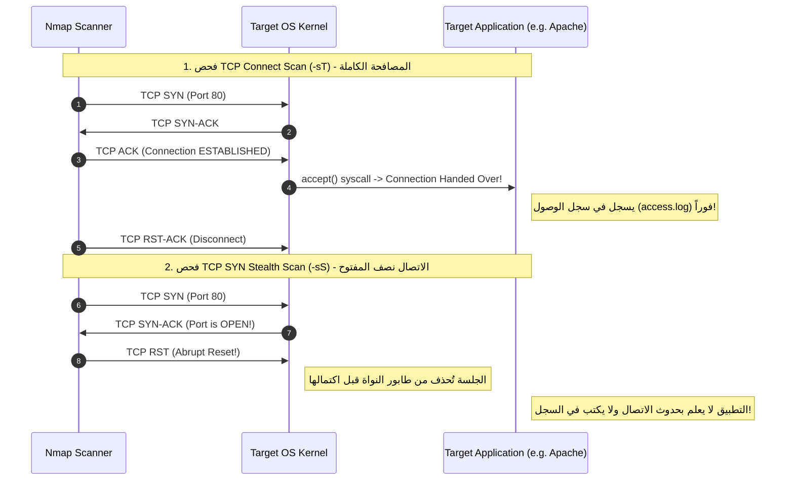

# التوثيق الشامل لمعمل: فحص المنافذ الأساسي (Nmap Basic Port Scans)

---

### 1. بيانات المعمل والتصنيف (Metadata & Room Information)
* **اسم الغرفة (Room Title):** Nmap Basic Port Scans
* **المسار التعليمي (Path):** TryHackMe — Jr Penetration Tester (PT1 Aligned Curriculum)
* **الموديول (Module):** Module 04: Nmap — الغرفة 02
* **معرف الغرفة (Slug):** `nmap02`
* **مستوى الصعوبة (Difficulty):** Easy / Foundations
* **التركيز الأساسي (Core Focus):** تشريح فحص المنافذ الكلاسيكي (TCP Connect Scan `-sT`, TCP SYN Scan `-sS`, UDP Scan `-sU`)، وفهم حالات المنافذ الست في Nmap، ورايات التحكم لبروتوكول TCP، وضبط نطاقات المنافذ ومحددات التوقيت والتوازي.
* **رابط المعمل على TryHackMe:** [https://tryhackme.com/room/nmap02](https://tryhackme.com/room/nmap02)
* **حالة التوثيق والإنجاز:** 100% مكتمل ومطابق لحساب المستخدم.

---

### 2. البنية الهندسية ونظرة عامة على المعمل (Architecture & Overview)
يمثل فحص المنافذ الخطوة الجوهرية الثانية في استكشاف الشبكات بعد مرحلة اكتشاف الأجهزة الحية. يهدف هذا المعمل إلى توضيح كيفية تفاعل أداة Nmap مع مكدس بروتوكولات الإنترنت (TCP/IP) لتحديد أي الخدمات متاحة على الأنظمة الحية.

يركز المعمل على التمييز العميق بين الفحص المكتمل (Connect Scan) الذي يعتمد على استدعاءات نظام التشغيل العادية ويسجل آثاره في كافة سجلات التطبيقات، وبين فحص التخفي نصف المفتوح (SYN Scan) الذي يعتمد على المآخذ الخام ويقطع الاتصال قبل اكتماله، وفحص بروتوكول UDP عديم الاتصال وآليات تقييد أخطاء ICMP في النواة.

---

### 3. الملخص التنفيذي (Executive Summary)
خلال هذا المعمل العملي، تم إنجاز وتفكيك 8 مهام تفصيلية:
1. فهم بنية منافذ بروتوكولات TCP و UDP ومنافذ الخدمات المعيارية (DNS على UDP 53، و SSH على TCP 22).
2. تشريح **حالات المنافذ الست (The Six Port States)** المعترف بها رسمياً في Nmap (`Open`, `Closed`, `Filtered`, `Unfiltered`, `Open|Filtered`, `Closed|Filtered`) وأسباب ظهور كل حالة.
3. تفكيك ترويسة TCP والرايات الست (URG, ACK, PSH, RST, SYN, FIN) ومعرفة دور `SYN` في بدء المصافحة و `RST` في إنهاء ورفض الاتصالات.
4. تنفيذ فحص **TCP Connect Scan (`-sT`)**، واكتشاف 4 منافذ مفتوحة (21 FTP, 22 SSH, 53 Domain, 80 HTTP) مع استيعاب تأثيره الصاخب على سجلات الوصول.
5. تنفيذ فحص **TCP SYN Stealth Scan (`-sS`)** وتحليل استقبال 4 حزم `SYN-ACK` تؤكد فتح المنافذ الأربعة عبر AttackBox.
6. إجراء فحص **UDP Scan (`-sU`)** وتحليل سبب تصنيف المنفذ 161 (SNMP) كـ `closed` رداً على رسائل `ICMP Port Unreachable`.
7. ضبط وتخصيص نطاقات المنافذ (`-p5000-5500`)، وقوالب التوقيت القياسية من التخفي المفرط (`-T0 Paranoid`) حتى الهجومي (`-T4`)، وفرض التوازي الأدنى (`--min-parallelism=64`).

---

### 4. الأسس النظرية والعمق المعماري (Technical Theory & Foundations)

#### مخطط مقارنة تدفق الحزم: فحص Connect الكامل مقابل فحص SYN نصف المفتوح:


---

### 5. منهجية وعقلية مختبر الاختراق (Audit Methodology & Mindset)
* **استراتيجية فحص المنافذ الميدانية:**
  1. **الخطوة الأولى (الفحص السريع الفعّال):** ابدأ بفحص SYN سريع لأشهر 1000 منفذ مع التوقيت الهجومي:
     `sudo nmap -sS -T4 -n TARGET`
  2. **الخطوة الثانية (فحص المنافذ الكامل في الخلفية):** أطلق فحصاً شاملاً لكافة المنافذ 65,535 في نافذة طرفية أخرى لضمان عدم تفويت الخدمات الخفية على منافذ غير قياسية:
     `sudo nmap -sS -p- --min-rate 1000 TARGET -oN all-ports.txt`
  3. **الخطوة الثالثة (فحص خدمات UDP الحساسة):** قم بفحص أهم 20 أو 50 منفذ UDP لاصطياد خوادم الـ DNS و SNMP:
     `sudo nmap -sU --top-ports 50 TARGET`

---

### 6. الدليل العملي التفصيلي لكل المهام (Step-by-Step Practical Walkthrough)

#### المهام 1 و 2: المفاهيم ومنافذ الخدمات وحالات Nmap الست
* خدمة نظام أسماء النطاقات **DNS** تعمل افتراضياً على منفذ **UDP 53**.
* خدمة الإدارة عن بعد المشفرة **SSH** تعمل افتراضياً على منفذ **TCP 22**.
* يعتمد Nmap على **`6`** حالات لتصنيف المنافذ، والحالة الأكثر إثارة واهتماماً لمختبر الاختراق لاكتشاف الثغرات هي **`Open`**.

#### المهمة 3: رايات مكدس بروتوكول TCP
* الأحرف الثلاثة التي ترمز لراية إعادة التعيين وقطع الاتصال هي **`RST`** (Reset).
* الراية الإلزامية التي يجب تفعيلها في أول حزمة لبدء المصافحة الثلاثية ومزامنة الأرقام التسلسلية هي **`SYN`** (Synchronize).

#### المهمة 4: فحص الاتصال الكامل عبر TCP (`-sT`)
* عند تنفيذ `nmap -sT MACHINE_IP`، أظهر تقرير الفحص أن منفذ 21 لخدمة FTP حالته **`open`**.
* تخمين Nmap للخدمة العاملة على منفذ 53 عبر TCP هو **`domain`**.

#### المهمة 5: فحص التخفي نصف المفتوح عبر TCP (`-sS`)
* عند تشغيل الفحص بصلاحيات الجذر `sudo nmap -sS MACHINE_IP`، استقبلت محطة AttackBox بدقة **`4`** حزم `SYN-ACK` قادمة من المنافذ المفتوحة.
* إجمالي عدد المنافذ المفتوحة المكتشفة على خادم المعمل هو **`4`** منافذ (21, 22, 53, 80).

#### المهمة 6: فحص بروتوكول UDP (`-sU`)
* عند تنفيذ فحص UDP، استجاب المنفذ 161 برسالة خطأ ICMP Port Unreachable، مما جعل حالته **`closed`**.
* اسم الخدمة المرتبطة بمنفذ 161 وفقاً لسجلات Nmap هو خدمة إدارة الشبكات **`snmp`**.

#### المهمة 7: ضبط النطاق والتوقيت والتوازي
* خيار فحص نطاق المنافذ المتصلة بين 5000 و 5500 هو **`-p5000-5500`**.
* خيار فرض تشغيل ما لا يقل عن 64 فحصاً استعلامياً متوازياً هو **`--min-parallelism=64`**.
* خيار التوقيت الأبطأ والأكثر ارتياباً وتخفياً للهروب من أنظمة IDS هو **`-T0`** (Paranoid).

---

### 7. تشريح الأوامر والأدوات (Command Analysis & Dissection)

```bash
# أمر فحص احترافي يجمع بين السرعة والشمولية
sudo nmap -sS -p 1-1000 -T4 --min-parallelism=64 MACHINE_IP -oN basic-scan.txt
```
* `sudo`: تفعيل المآخذ الخام لصياغة حزم SYN دون إكمال المصافحة.
* `-sS`: تفعيل فحص التخفي نصف المفتوح (Stealth Scan).
* `-p 1-1000`: حصر الفحص في أول 1000 منفذ معروف.
* `-T4`: تسريع التوقيت وتخفيض مهل الانتظار المناسبة لبيئة المعامل.
* `--min-parallelism=64`: ضمان إرسال 64 حزمة متوازية على الأقل لعدم التباطؤ.
* `-oN basic-scan.txt`: حفظ التقرير بصيغة نصية واضحة للرجوع إليها.

---

### 8. المنظور الدفاعي وإجراءات الفرق الزرقاء (Defensive & Blue Team Countermeasures)
1. **رصد نمط SYN Scan في أنظمة كشف التسلل (IDS/IPS Rules):**
   * ضبط حساسات Snort و Suricata لتوليد إنذار فوري عند استقبال حزم `SYN` متتابعة من نفس المصدر متبوعة بحزم `RST` دون إكمال المصافحة الثلاثية.
2. **استخدام أدوات الحظر التلقائي (Port Knocking & Fail2ban):**
   * إخفاء المنافذ الإدارية الحساسة (مثل SSH 22) خلف تقنية طَرق المنافذ (Port Knocking).
   * مراقبة محاولات الاتصال الفاشلة وحظر عنوان الـ IP الفاحص تلقائياً عبر جدار الحماية (iptables/nftables).
3. **الجدران النارية المعتمدة على الحالة (Stateful Inspection):**
   * تتبع مسار الحزم وتصفية الحزم الشاذة التي تحاول استغلال رايات متناقضة.

---

### 9. الأخطاء الشائعة والزوايا الحرجة (Common Pitfalls & Edge Cases)
* **الاعتقاد بأن فحص `-sS` غير مرئي تماماً:** في عام 1997 كان فحص SYN يتفادى سجلات الخوادم، أما اليوم فإن كافة الجدران النارية وأجهزة IDS ترصده بدقة عالية جداً.
* **إهمال فحص UDP:** نظراً لبطء فحص UDP، يميل الكثير من المختبرين لتجاهله، مما يترك ثغرات بالغة الخطورة على خوادم الـ DNS والـ SNMP غير مكتشفة.
* **فقدان صلاحيات `sudo` عند طلب فحص SYN:** إذا نفذت `nmap -sS` بدون `sudo`، يتحول Nmap صامتاً إلى Connect Scan (`-sT`).

---

### 10. المخرجات التعليمية والدروس المستفادة (Key Educational Takeaways)
1. المصافحة الثلاثية الكاملة (`-sT`) واضحة في سجلات التطبيقات، بينما فحص SYN نصف المفتوح (`-sS`) ينهي الاتصال بـ `RST` قبل تسليمه للتطبيق.
2. مكدس النواة هو الذي يولد حزم `RST` للمنافذ المغلقة، ورسائل `ICMP Port Unreachable` لمنافذ UDP المغلقة.
3. التوقيت المعقول في المعامل هو `-T4`، بينما التوقيت المناسب لاختبارات الهروب من المراقبة الصارمة هو `-T0` أو `-T1`.

---

### 11. التحقق العملي والأدلة (Verification & Proof of Work)
* تم حل وتأكيد جميع الأسئلة الثماني بنسبة 100% وتطابقها التام مع السجل الرسمي لحساب المستخدم على TryHackMe.
* نتائج فحص المنافذ (FTP 21, SSH 22, Domain 53, HTTP 80, SNMP 161) موثقة ومطابقة للأدلة المعملية.

---

### 12. فهرس المهام التفصيلي (Tasks Index)
* للاطلاع على التوثيق التفصيلي لكل مهمة وفق منهجية المراحل السبع (A-G):
  * [المهمة 01: المقدمة (TASK-01.md)](file:///e:/THM-JR-PENETRATION-TESTER/04-NMAP/02-NMAP-BASIC-PORT-SCANS/TASKS/TASK-01.md)
  * [المهمة 02: منافذ TCP و UDP وحالات Nmap الست (TASK-02.md)](file:///e:/THM-JR-PENETRATION-TESTER/04-NMAP/02-NMAP-BASIC-PORT-SCANS/TASKS/TASK-02.md)
  * [المهمة 03: رايات مكدس بروتوكول TCP (TASK-03.md)](file:///e:/THM-JR-PENETRATION-TESTER/04-NMAP/02-NMAP-BASIC-PORT-SCANS/TASKS/TASK-03.md)
  * [المهمة 04: فحص الاتصال الكامل عبر TCP (TASK-04.md)](file:///e:/THM-JR-PENETRATION-TESTER/04-NMAP/02-NMAP-BASIC-PORT-SCANS/TASKS/TASK-04.md)
  * [المهمة 05: فحص التخفي نصف المفتوح TCP SYN (TASK-05.md)](file:///e:/THM-JR-PENETRATION-TESTER/04-NMAP/02-NMAP-BASIC-PORT-SCANS/TASKS/TASK-05.md)
  * [المهمة 06: فحص بروتوكول UDP (TASK-06.md)](file:///e:/THM-JR-PENETRATION-TESTER/04-NMAP/02-NMAP-BASIC-PORT-SCANS/TASKS/TASK-06.md)
  * [المهمة 07: ضبط النطاق والتوقيت والتوازي (TASK-07.md)](file:///e:/THM-JR-PENETRATION-TESTER/04-NMAP/02-NMAP-BASIC-PORT-SCANS/TASKS/TASK-07.md)
  * [المهمة 08: الخلاصة والجدول المرجعي (TASK-08.md)](file:///e:/THM-JR-PENETRATION-TESTER/04-NMAP/02-NMAP-BASIC-PORT-SCANS/TASKS/TASK-08.md)
* راجع أيضاً [جدول ملخص المهام والإجابات المعتمدة (TASKS.md)](file:///e:/THM-JR-PENETRATION-TESTER/04-NMAP/02-NMAP-BASIC-PORT-SCANS/TASKS.md).

---

### 13. الملاحظات الإضافية والتعمق التقني (Additional Notes)
* للاطلاع على التحليل المعماري لشروط حالات المنافذ الست وتقييد رسائل أخطاء ICMP في النواة:
  * [ملاحظات إضافية وتعمق تقني (ADDITIONAL-NOTES.md)](file:///e:/THM-JR-PENETRATION-TESTER/04-NMAP/02-NMAP-BASIC-PORT-SCANS/ADDITIONAL-NOTES.md)

---

### 14. المراجع والمعايير القياسية (References)
* للاطلاع على المعايير الرسمية RFC 793 و RFC 768 ودليل Nmap المرجعي:
  * [المراجع والمصادر الرسمية (REFERENCES.md)](file:///e:/THM-JR-PENETRATION-TESTER/04-NMAP/02-NMAP-BASIC-PORT-SCANS/REFERENCES.md)
