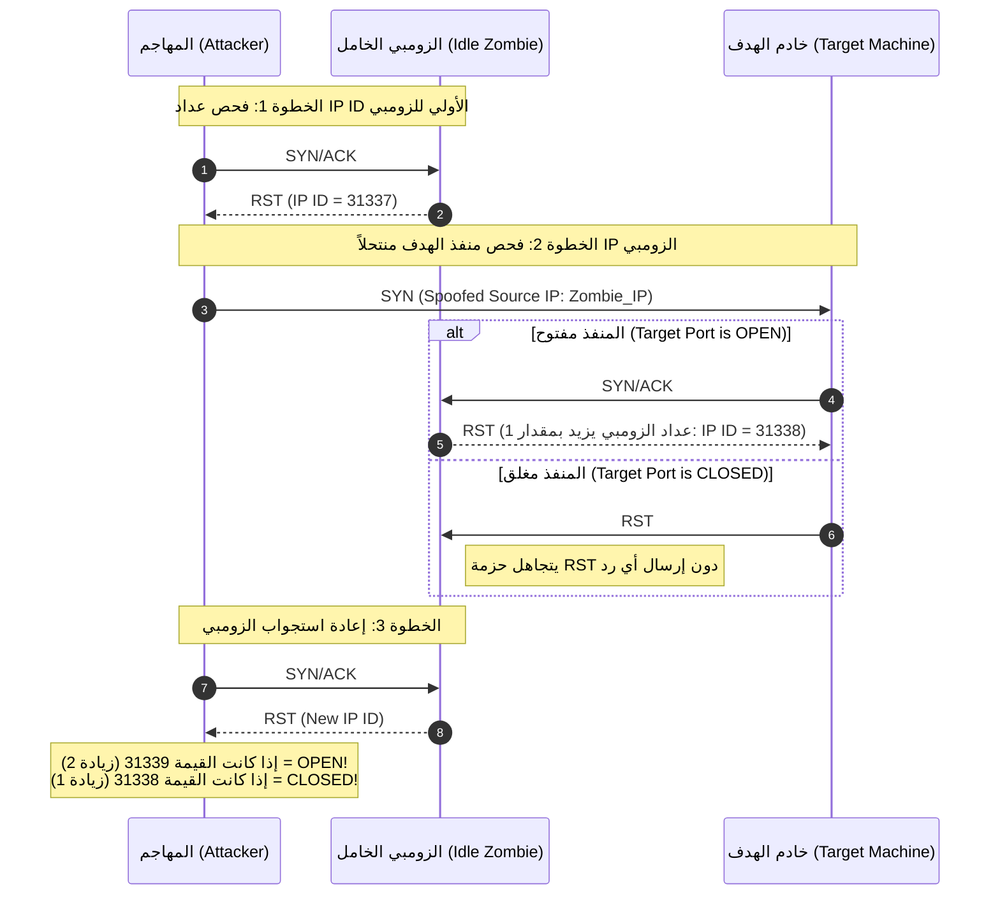

# ملاحظات إضافية وتعمق تقني: فحص المنافذ المتقدم والتخفي (ADDITIONAL-NOTES.md)

---

### 1. التشريح البروتوكولي لثغرة التوافق في مكدس ويندوز (RFC 793 Anomaly vs. Windows Implementation)
* **المعيار الصارم RFC 793:**
  * يفرض معيار TCP الأصلي أنه في حالة عدم وجود رايات `SYN` أو `RST` أو `ACK` في الحزمة الواردة، فإن المنفذ المفتوح (في حالة `LISTEN`) يجب أن **يسقط الحزمة بصمت تام (Discard)**.
* **سلوك مكدس شبكة مايكروسوفت ويندوز (The Windows Non-Compliant Stack):**
  * قرر مهندسو مايكروسوفت عند برمجة مكدس TCP/IP في نظام ويندوز أن أي حزمة لا تنتمي لاتصال قائم ولا تبدأ بمصافحة شرعية (SYN) يجب أن يتم رفضها فوراً بإرسال حزمة **`RST, ACK`**، سواء كان المنفذ مفتوحاً أو مغلقاً!
  * **الأثر الميداني:** عندما ينفذ مختبر الاختراق فحص Null (`-sN`) أو FIN (`-sF`) أو Xmas (`-sX`) ضد خادم ويندوز، سيرد الخادم بـ `RST` على كافة المنافذ، ويخلص Nmap خطأً إلى أن جميع منافذ الجهاز مغلقة (`closed`)!
  * **استخدام هذا الشذوذ في تحديد البصمة (OS Fingerprinting):** يستغل Nmap هذا التباين كدليل قطعي على أن نظام تشغيل الهدف ينتمي لعائلة Windows إذا رد بـ RST على حزم Xmas، بينما إذا صمتت المنافذ المفتوحة فهو نظام ينتمي لعائلة Unix/Linux!

---

### 2. آلة الحالة التفصيلية لفحص الخمول (TCP Idle Scan Sequence & IP ID Heuristics)

* **أنماط توليد الـ IP ID في أنظمة التشغيل:**
  1. **Incremental (تصاعدي خطي عالمي):** يزيد بمقدار 1 مع كل حزمة ترسلها النواة (الشرط الوحيد لصلاحية الجهاز كزومبي).
  2. **Random (عشوائي):** تعتمده أنظمة لينكس وويندوز الحديثة (مما يجعلها غير صالحة كزومبي).
  3. **All Zeros (أصفار دائماً):** تستخدمه بعض حزم الشبكات لتوفير الموارد.

---

### 3. ميكانيكية حقول تجزئة بروتوكول الإنترنت (IP Fragmentation Header Fields)
في ترويسة حزمة IPv4 (حجم 20 بايت):
* **حقل المعرف (Identification - 16 bits):** يربط جميع الأجزاء التابعة لنفس الحزمة الأصلية ببعضها البعض.
* **حقل الرايات (Flags - 3 bits):**
  * بت 0: محجوز (Reserved / Zero).
  * بت 1: `DF` (Don't Fragment) - إذا كان 1 يمنع الراوتر من تجزئة الحزمة.
  * بت 2: `MF` (More Fragments) - إذا كان 1 يعني أن هناك أجزاء إضافية قادمة؛ وإذا كان 0 يعني أن هذا هو الجزء الأخير.
* **حقل إزاحة التجزئة (Fragment Offset - 13 bits):**
  * يحدد موقع بيانات هذا الجزء نسبة إلى بداية الحزمة الأصلية، بوحدات تبلغ **8 بايت**.
  * لذلك يجب أن يكون حجم أي جزء تجزئة في شبكات IP مضاعفاً للرقم 8 ($8, 16, 24, 32 \dots$).

---

### 4. التمويه بالعناوين الوهمية وحسابات الارتباط الزمني (Decoys & Statistical Correlation)
* عندما تستخدم المعامل `-D 10.10.10.1,10.10.10.2,ME`:
  * ترسل حزم متطابقة تماماً من العناوين الثلاثة.
  * لا تستطيع أجهزة IDS التي تفحص الحزم بشكل فردي تمييز الفاحص.
  * **كيف يكشف المدافعون المتقدمون (Tier 3 SOC Analysts) العنوان الحقيقي؟**
    * عبر **تحليل زمن الوصول ذهاباً وإياباً (RTT / Path Latency Correlation):** فالحزم القادمة من المهاجم الفعلي ستتبع زمن استجابة متناسق مع مسار التوجيه الحقيقي، بينما العناوين الوهمية قد تكون غير موجودة (لا يرجع منها RST) أو في قارات بعيدة بزمن استجابة مغاير تماماً.
