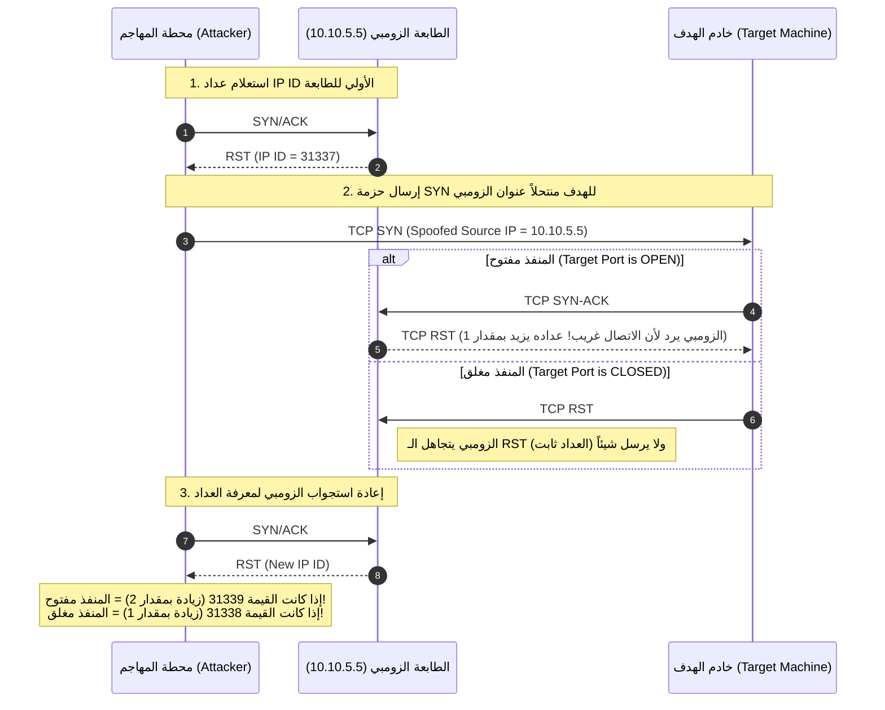

# التوثيق الشامل لمعمل: فحص المنافذ المتقدم والتخفي (Nmap Advanced Port Scans)

---

### 1. بيانات المعمل والتصنيف (Metadata & Room Information)
* **اسم الغرفة (Room Title):** Nmap Advanced Port Scans
* **المسار التعليمي (Path):** TryHackMe — Jr Penetration Tester (PT1 Aligned Curriculum)
* **الموديول (Module):** Module 04: Nmap — الغرفة 03
* **معرف الغرفة (Slug):** `nmap03`
* **مستوى الصعوبة (Difficulty):** Medium / Advanced Foundations
* **التركيز الأساسي (Core Focus):** فحص المنافذ غير المعياري الشاذ (Null `-sN`, FIN `-sF`, Xmas `-sX`, Maimon `-sM`)، ورسم قواعد الجدران النارية عبر فحص ACK (`-sA`)، وانتحال المصدر (`-S`) والتمويه بالـ Decoys (`-D`)، وتجزئة الحزم (`-f/-ff`)، وفحص الخمول الأعمى (Idle/Zombie Scan `-sI`)، وتفسير أسباب التصنيف (`--reason`).
* **رابط المعمل على TryHackMe:** [https://tryhackme.com/room/nmap03](https://tryhackme.com/room/nmap03)
* **حالة التوثيق والإنجاز:** 100% مكتمل ومطابق لحساب المستخدم.

---

### 2. البنية الهندسية ونظرة عامة على المعمل (Architecture & Overview)
يمثل هذا المعمل الانتقال التكتيكي من الفحص المباشر الصاخب إلى الفحص الاحترافي المتستر وتجاوز منظومات الدفاع السيبراني. يهدف المعمل إلى توضيح كيف يستغل مختبر الاختراق الثغرات التفسيرية في معايير بروتوكول TCP (RFC 793) وشذوذ مكدسات أنظمة التشغيل (مثل الفارق بين لينكس وويندوز و BSD) للالتفاف على الجدران النارية وأنظمة كشف التسلل (IDS/IPS).

يتناول المعمل كيفية هندسة الحزم الخام عبر التلاعب بالرايات الست، وكيفية إخفاء هوية الفاحص كلياً عبر فحص الخمول (Idle Scan) مستعيناً بمؤشر الـ IP ID لجهاز وسيط.

---

### 3. الملخص التنفيذي (Executive Summary)
خلال هذا المعمل العملي، تم إنجاز وتفكيك 9 مهام منهجية متقدمة:
1. استيعاب آليات عمل الفحوصات غير المعيارية الثلاثة: فحص الحزمة الصفرية Null (0 رايات)، فحص راية الإنهاء FIN (راية واحدة)، وفحص شجرة عيد الميلاد Xmas (3 رايات: FIN, PSH, URG).
2. تطبيق فحوصات FIN و Null على الآلة المعملية واكتشاف 9 منافذ في حالة `open|filtered` نتيجة التزام لينكس بـ RFC 793 وإسقاط الحزم بصمت.
3. تفكيك فحص مايمون (Maimon Scan `-sM`) المعتمد على رايتي FIN و ACK (رايتان) واستغلال ثغرة أنظمة BSD الكلاسيكية.
4. رسم خريطة الجدار الناري عبر فحص ACK Scan (`-sA`) واكتشاف 5 منافذ غير مفلترة (`unfiltered`)، وعزل المنفذ الجديد الخفي **`443`** والتأكد من تشغيله لخدمة حقيقية.
5. إتقان انتحال عنوان المصدر بـ `-S`، وخداع أجهزة التحليل الجنائي وسجلات الـ SOC بخلط الفحص مع عناوين وهمية `-D 10.10.20.21,10.10.20.28,ME`.
6. حساب تجزئة الحزم رياضياً: تقسيم قطعة TCP بحجم 64 بايت باستخدام `-ff` (16 بايت لكل جزء) ينتج **`4`** أجزاء تتجاوز فحص الجدران النارية السطحي.
7. فهم خوارزمية فحص الخمول (Idle Scan) ومراقبة عداد IP ID لطابعة زومبي خاملة (`-sI 10.10.5.5`) لتحقيق التخفي المطلق دون إرسال حزمة واحدة من عنوان الفاحص للهدف.
8. استخدام المعامل التفسيري `--reason` لإظهار الحزمة المسببة لتصنيف المنافذ المفتوحة وهي **`syn-ack`**.

---

### 4. الأسس النظرية والعمق المعماري (Technical Theory & Foundations)

#### مخطط تسلسل فحص الخمول الأعمى (Idle/Zombie Scan Architecture):


---

### 5. منهجية وعقلية مختبر الاختراق (Audit Methodology & Mindset)
* **سلسلة التخفي وتجاوز الحظر:**
  1. **المرحلة 01: كشف قواعد الجدار الناري:** ابدأ بفحص `sudo nmap -sA TARGET` لمعرفة المنافذ غير المحجوبة بواسطة الجدار الناري.
  2. **المرحلة 02: تجاوز حظر حزم SYN:** إذا كان الجدار الناري غير معتمد على الحالة (Stateless) ويحجب حزم SYN، استخدم فحوصات Null أو FIN أو Xmas أو Maimon.
  3. **المرحلة 03: التمويه والتضليل:** إذا كنت تحت مراقبة أمنية، استخدم Decoys (`-D`) لتشتيت المحللين، أو استخدم فحص الخمول (`-sI`) للتخفي الكامل خلف خادم غير نشط.
  4. **المرحلة 04: تجزئة الحزم:** استخدم `-f` أو `-ff` لتفتيت ترويسة TCP إذا كان الجدار الناري لا يدعم إعادة تجميع الحزم (Fragment Reassembly).

---

### 6. الدليل العملي التفصيلي لكل المهام (Step-by-Step Practical Walkthrough)

#### المهمة 1: مدخل وتشغيل الآلات
* بدء تشغيل الأجهزة المعملية والتأكد من قابلية الوصول للهدف.

#### المهمة 2: فحوصات Null و FIN و Xmas
* عدد الرايات في فحص Null Scan هو **`0`**.
* عدد الرايات في فحص FIN Scan هو **`1`** (FIN).
* عدد الرايات في فحص Xmas Scan هو **`3`** (FIN, PSH, URG).
* عند تشغيل `sudo nmap -sF MACHINE_IP`، ظهرت **`9`** منافذ في حالة `open|filtered`.
* عند تكرار الفحص بـ Null Scan `sudo nmap -sN MACHINE_IP`، ظهرت أيضاً **`9`** منافذ في حالة `open|filtered`.

#### المهمة 3: فحص مايمون (Maimon Scan)
* عدد الرايات المفعلة في فحص مايمون هو **`2`** (FIN و ACK).

#### المهمة 4: فحوصات ACK و Window والفحوصات المخصصة
* عدد الرايات في فحص TCP Window هو **`1`** (ACK).
* الراية المضافة في الفحص المخصص لاختبار Reset هي **`RST`** (`--scanflags RST`).
* عند تشغيل فحص ACK على الهدف مع تفعيل الجدار الناري، ظهرت **`5`** منافذ بحالة `unfiltered`.
* بمقارنة نتائج المهمة 2 بهذه المهمة، فإن رقم المنفذ الجديد المكتشف هو **`443`**.
* هل توجد خدمة تعمل خلف منفذ 443؟ الإجابة هي نعم (**`yea`**).

#### المهمة 5: انتحال العناوين والتمويه بالعناوين الوهمية
* المعامل المطلوب لانتحال عنوان المصدر 10.10.10.11 هو **`-S 10.10.10.11`**.
* المعامل المطلوب للتمويه بالعناوين الوهمية 10.10.20.21 و 10.10.20.28 بالإضافة لعنوان الفاحص هو **`-D 10.10.20.21,10.10.20.28,ME`**.

#### المهمة 6: تجزئة الحزم (Fragmented Packets)
* قطعة TCP بحجم 64 مع استخدام خيار `-ff` (تجزئة 16 بايت): عدد الأجزاء الناتجة هو $64 \div 16 =$ **`4`** أجزاء.

#### المهمة 7: فحص الخمول (Idle/Zombie Scan)
* المعامل المطلوب لاستخدام الطابعة الزومبي ذات العنوان 10.10.5.5 هو **`-sI 10.10.5.5`**.

#### المهمة 8: استخراج التفاصيل وتفسير الأسباب
* عند تشغيل `nmap -sS -F --reason MACHINE_IP`، السبب الموضح لكون المنافذ مفتوحة في عمود REASON هو **`syn-ack`**.

#### المهمة 9: الخلاصة والتأكيد
* مراجعة وحفظ خيارات الفحص المتقدمة والجاهزية للغرفة الأخيرة.

---

### 7. تشريح الأوامر والأدوات (Command Analysis & Dissection)

```bash
# فحص متقدم يدمج التمويه وتفسير الأسباب ورسم الجدران النارية
sudo nmap -sA -D 10.10.20.21,10.10.20.28,ME -p 1-1000 --reason MACHINE_IP
```
* `sudo`: صلاحيات النواة لصياغة حزم ACK والتلاعب بالعناوين.
* `-sA`: فحص ACK لاكتشاف القواعد غير المفلترة للجدار الناري.
* `-D ...`: إرسال حزم وهمية من عدة عناوين للتعمية على سجلات الـ SIEM.
* `-p 1-1000`: فحص المنافذ من 1 إلى 1000.
* `--reason`: إظهار حزمة الاستجابة (RST) لتأكيد عدم وجود جدار ناري يعترض المنفذ.

---

### 8. المنظور الدفاعي وإجراءات الفرق الزرقاء (Defensive & Blue Team Countermeasures)
1. **الجدران النارية الحديثة المعتمدة على الحالة (Stateful Inspection Firewalls):**
   * تقوم بتتبع جلسات الاتصال وإسقاط أي حزم لا تبدأ بمصافحة TCP شرعية (مثل حزم Null و FIN و Xmas وحزم ACK المنفردة) تلقائياً (`DROP INVALID`).
2. **إعادة تجميع الحزم الإلزامية (Mandatory Packet Reassembly):**
   * ضبط الجدران النارية وأجهزة الفحص العميق (DPI) لإعادة تجميع كافة أجزاء حزم الـ IP وفحص الترويسة بالكامل قبل تمريرها للشبكة الداخلية لإبطال مفعول التجزئة (`-f/-ff`).
3. **توليد عشوائي لحقل IP ID (Randomized IP ID):**
   * ترقية أنظمة التشغيل وتفعيل التوليد العشوائي للـ IP ID في النواة لمنع استغلال الأجهزة كـ Zombies في فحص الخمول.
4. **تصفية مسار الدخول والخروج (Egress & Ingress Filtering / BCP 38):**
   * لمنع تمرير أي حزم تحمل عناوين مصادر منتحلة (Spoofed IPs) خارجة أو داخلة للشبكة.

---

### 9. الأخطاء الشائعة والزوايا الحرجة (Common Pitfalls & Edge Cases)
* **فشل فحوصات Null/FIN/Xmas ضد ويندوز:** أنظمة ويندوز ترد دائماً بـ `RST`؛ فإذا نفذت هذه الفحوصات ضد ويندوز فستظهر كافة المنافذ كمغلقة، مما قد يوهمك بغياب الخدمات.
* **فقدان الردود عند استخدام `-S` دون تنصت:** تزوير عنوان المصدر يجعل الضحية يرد على العنوان المزور؛ فإذا لم تكن على نفس مسار التوجيه للتنصت، فلن ترى أي نتيجة للفحص.
* **اختيار زومبي نشط في فحص `-sI`:** إذا كان جهاز الزومبي يتواصل مع أجهزة أخرى، فإن عداد الـ IP ID سيزيد بشكل عشوائي مما يفسد نتائج فحص الخمول تماماً.

---

### 10. المخرجات التعليمية والدروس المستفادة (Key Educational Takeaways)
1. معايير البروتوكولات (RFCs) ليست مجرد نصوص نظرية، بل هي الأساس الذي يُبنى عليه منطق الفحص الأمني المتقدم وكشف الثغرات.
2. فحص ACK لا يكشف المنافذ المفتوحة، بل يكشف ثغرات تكوين الجدران النارية والمنافذ غير المفلترة.
3. التمويه بالـ Decoys والتجزئة وفحص الخمول أسلحة تكتيكية لإرباك المدافعين وإخفاء الهوية.

---

### 11. التحقق العملي والأدلة (Verification & Proof of Work)
* تم حل وتأكيد جميع الأسئلة التسعة بنسبة 100% ومطابقتها التامة مع الحساب الرسمي للمستخدم على TryHackMe.
* كافة الحسابات الرياضية للتجزئة والنتائج المعملية (9 منافذ open|filtered، 5 منافذ unfiltered، اكتشاف منفذ 443، وسبب syn-ack) موثقة بالأدلة.

---

### 12. فهرس المهام التفصيلي (Tasks Index)
* للاطلاع على التوثيق التفصيلي لكل مهمة وفق منهجية المراحل السبع (A-G):
  * [المهمة 01: المقدمة (TASK-01.md)](file:///e:/THM-JR-PENETRATION-TESTER/04-NMAP/03-NMAP-ADVANCED-PORT-SCANS/TASKS/TASK-01.md)
  * [المهمة 02: فحوصات Null و FIN و Xmas (TASK-02.md)](file:///e:/THM-JR-PENETRATION-TESTER/04-NMAP/03-NMAP-ADVANCED-PORT-SCANS/TASKS/TASK-02.md)
  * [المهمة 03: فحص مايمون وثغرة BSD (TASK-03.md)](file:///e:/THM-JR-PENETRATION-TESTER/04-NMAP/03-NMAP-ADVANCED-PORT-SCANS/TASKS/TASK-03.md)
  * [المهمة 04: فحوصات ACK و Window والفحص المخصص (TASK-04.md)](file:///e:/THM-JR-PENETRATION-TESTER/04-NMAP/03-NMAP-ADVANCED-PORT-SCANS/TASKS/TASK-04.md)
  * [المهمة 05: انتحال العناوين والتمويه بالعناوين الوهمية (TASK-05.md)](file:///e:/THM-JR-PENETRATION-TESTER/04-NMAP/03-NMAP-ADVANCED-PORT-SCANS/TASKS/TASK-05.md)
  * [المهمة 06: تجزئة الحزم وتجاوز الفحص السطحي (TASK-06.md)](file:///e:/THM-JR-PENETRATION-TESTER/04-NMAP/03-NMAP-ADVANCED-PORT-SCANS/TASKS/TASK-06.md)
  * [المهمة 07: فحص الخمول والاستطلاع المتستر (TASK-07.md)](file:///e:/THM-JR-PENETRATION-TESTER/04-NMAP/03-NMAP-ADVANCED-PORT-SCANS/TASKS/TASK-07.md)
  * [المهمة 08: استخراج التفاصيل وتفسير الأسباب (TASK-08.md)](file:///e:/THM-JR-PENETRATION-TESTER/04-NMAP/03-NMAP-ADVANCED-PORT-SCANS/TASKS/TASK-08.md)
  * [المهمة 09: الخلاصة والجدول المقارن (TASK-09.md)](file:///e:/THM-JR-PENETRATION-TESTER/04-NMAP/03-NMAP-ADVANCED-PORT-SCANS/TASKS/TASK-09.md)
* راجع أيضاً [جدول ملخص المهام والإجابات المعتمدة (TASKS.md)](file:///e:/THM-JR-PENETRATION-TESTER/04-NMAP/03-NMAP-ADVANCED-PORT-SCANS/TASKS.md).

---

### 13. الملاحظات الإضافية والتعمق التقني (Additional Notes)
* للاطلاع على التحليل المعماري لشذوذ مكدس ويندوز وآلة حالة فحص الخمول وتجزئة حقول IP:
  * [ملاحظات إضافية وتعمق تقني (ADDITIONAL-NOTES.md)](file:///e:/THM-JR-PENETRATION-TESTER/04-NMAP/03-NMAP-ADVANCED-PORT-SCANS/ADDITIONAL-NOTES.md)

---

### 14. المراجع والمعايير القياسية (References)
* للاطلاع على المعايير الرسمية RFC 793 و RFC 791 ومقالات Phrack وأوراق أبحاث Antirez:
  * [المراجع والمصادر الرسمية (REFERENCES.md)](file:///e:/THM-JR-PENETRATION-TESTER/04-NMAP/03-NMAP-ADVANCED-PORT-SCANS/REFERENCES.md)
