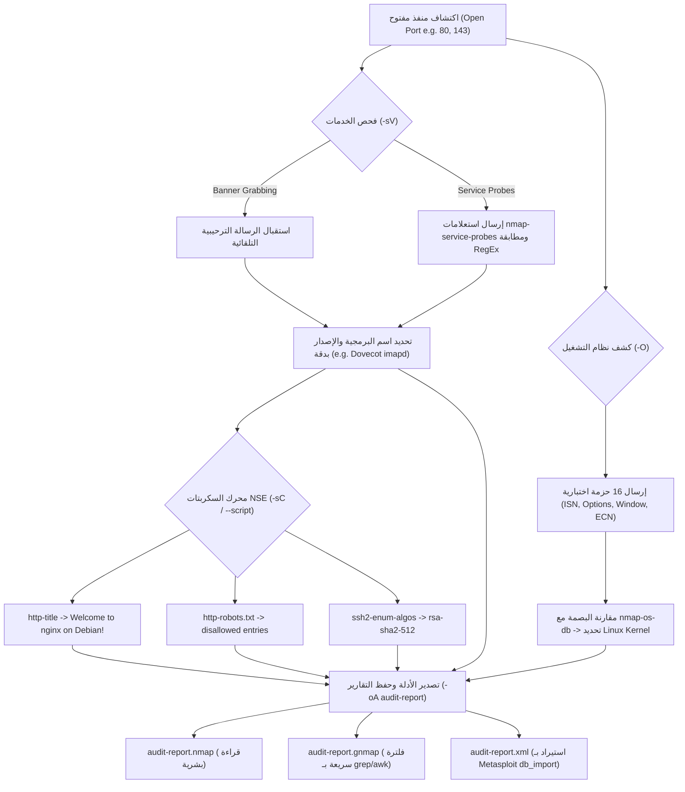

# التوثيق الشامل لمعمل: ما بعد فحص المنافذ ومحرك السكربتات (Nmap Post Port Scans)

---

### 1. بيانات المعمل والتصنيف (Metadata & Room Information)
* **اسم الغرفة (Room Title):** Nmap Post Port Scans
* **المسار التعليمي (Path):** TryHackMe — Jr Penetration Tester (PT1 Aligned Curriculum)
* **الموديول (Module):** Module 04: Nmap — الغرفة 04
* **معرف الغرفة (Slug):** `nmap04`
* **مستوى الصعوبة (Difficulty):** Easy / Foundations
* **التركيز الأساسي (Core Focus):** كشف الخدمات وإصداراتها بدقة (`-sV`) ومستويات الشدة (`--version-light/all`)، أخذ بصمة نظام التشغيل (`-O`)، استغلال محرك السكربتات البرمجية Nmap Scripting Engine (NSE) لتدقيق الويب والـ SSH، وتصدير التقارير والأدلة بالصيغ المختلفة (`-oA`, `-oG`, `-oX`).
* **رابط المعمل على TryHackMe:** [https://tryhackme.com/room/nmap04](https://tryhackme.com/room/nmap04)
* **حالة التوثيق والإنجاز:** 100% مكتمل ومطابق لحساب المستخدم.

---

### 2. البنية الهندسية ونظرة عامة على المعمل (Architecture & Overview)
يمثل هذا المعمل المرحلة التتويجية والتنفيذية لسلسلة غرف Nmap؛ حيث ينتقل المختبر من مجرد معرفة "هل المنفذ مفتوح أم مغلق؟" إلى تحديد "ما هو البرنامج الدقيق وإصداره ونظامه التشغيلي المشغل خلف هذا المنفذ؟ وما هي الثغرات والإعدادات الخاطئة الكامنة فيه؟".

يغطي المعمل آلية التخاطب التفاعلي لـ Nmap مع الخدمات عبر قاعدة بيانات `nmap-service-probes`، وتحليل بصمة مكدس TCP/IP لمقارنتها مع `nmap-os-db`، وتوظيف سكربتات لغة Lua المدمجة في NSE لاستخراج عناوين الويب وفحص المسارات المحظورة في `robots.txt` وتعداد خوارزميات التشفير في SSH، بالإضافة لحفظ الأدلة الرقمية بصيغ هيكلية قابلة للربط مع أدوات الاستغلال مثل Metasploit.

---

### 3. الملخص التنفيذي (Executive Summary)
خلال هذا المعمل العملي، تم إنجاز وتفكيك 6 مهام تخصصية:
1. فهم فلسفة ما بعد فحص المنافذ وجاهزية بيئة الاختبار.
2. تطبيق كشف الخدمات (`-sV`) وتحديد إصدار خادم البريد على منفذ 143 بدقة: **`Dovecot imapd`**، واكتشاف أن الفحص الخفيف (`--version-light`) يعجز عن تحديد إصدار خدمة **`rpcbind`** لتوفير الوقت.
3. تشغيل كشف بصمة نظام التشغيل (`-O`) وتأكيد أن النظام الهدف ينتمي لعائلة **`Linux`**.
4. تشريح محرك السكربتات البرمجية NSE:
   * سكربت `http-robots.txt` يفحص المسارات المحظورة على محركات البحث (**`disallowed entries`**).
   * سكربت فحص ثغرة تنفيذ الأوامر عن بعد MS15-034 هو **`http-vuln-cve2015-1635`**.
   * تشغيل السكربتات الافتراضية (`-sC`) استخرج عنوان صفحة الويب على منفذ 80: **`Welcome to nginx on Debian!`**.
   * سكربت `ssh2-enum-algos` كشف خوارزمية مفتاح خادم SSH المعتمدة على SHA2-512 وهي **`rsa-sha2-512`**.
5. إتقان حفظ مخرجات الفحص بالصيغة القابلة للفلترة بـ grep عبر المعامل **`-oG`**، وتأكيد دعم Nmap الكامل لتصدير التقارير بصيغة XML (**`yea`**).
6. استكمال ومراجعة كافة مخرجات المعمل.

---

### 4. الأسس النظرية والعمق المعماري (Technical Theory & Foundations)

#### مخطط تدفق عملية الفحص الشامل لما بعد المنافذ (Post Port Scanning Pipeline):


---

### 5. منهجية وعقلية مختبر الاختراق (Audit Methodology & Mindset)
* **المسار التكتيكي الأمثل بعد فحص المنافذ:**
  1. **الخطوة الأولى: الفحص الموجه للمنافذ المفتوحة:**
     لا تشغل فحص الخدمات الشامل (`-sV`) على كافة الـ 65,535 منفذاً؛ بل حدد المنافذ المفتوحة أولاً ثم وجه فحص الخدمات إليها حصرياً:
     `sudo nmap -sV -sC -O -p 22,80,111,143 TARGET -oA target-services`
  2. **الخطوة الثانية: تدقيق الثغرات بالسكربتات:**
     شغّل فئة السكربتات الخاصة بالثغرات (`vuln`) لاصطياد الثغرات الحرجة المعروفة:
     `nmap --script "vuln" -p 80,143 TARGET`
  3. **الخطوة الثالثة: توثيق الأدلة الفورية:**
     استخدم دائماً صيغة `-oA` لضمان أرشفة ملفات XML لدعم تقارير الاختراق النهائية.

---

### 6. الدليل العملي التفصيلي لكل المهام (Step-by-Step Practical Walkthrough)

#### المهمة 1: مدخل وجاهزية البيئة
* تشغيل الآلة المعملية الهدف والتأكد من توافر الاتصال بالشبكة.

#### المهمة 2: كشف الخدمات وتحديد الإصدارات
* بتنفيذ `sudo nmap -sV MACHINE_IP`، أظهر تقرير الفحص على منفذ 143 خدمة IMAP بإصدار: **`Dovecot imapd`**.
* بتنفيذ الفحص الخفيف `sudo nmap -sV --version-light MACHINE_IP`، قلل Nmap عمق الاستعلامات؛ فعجز عن كشف إصدار خدمة **`rpcbind`** العاملة على منفذ 111.

#### المهمة 3: كشف بصمة نظام التشغيل
* بتنفيذ `sudo nmap -O MACHINE_IP`، حلل Nmap استجابات ترويسة الحزم وأظهر في حقل `Running` أن النظام الهدف هو **`Linux`** (Linux 4.X|5.X).

#### المهمة 4: محرك سكربتات Nmap البرمجية (NSE)
* فحص توثيق `http-robots.txt` يثبت أنه يبحث عن الإدخالات المحظورة على محركات البحث: **`disallowed entries`**.
* البحث في قاعدة السكربتات عن ثغرة MS15-034 يحدد السكربت: **`http-vuln-cve2015-1635`**.
* تشغيل السكربتات الافتراضية بـ `nmap -sC MACHINE_IP` كشف عنوان صفحة الويب لمنفذ 80: **`Welcome to nginx on Debian!`**.
* تشغيل سكربت `ssh2-enum-algos` على منفذ 22 أظهر خوارزمية مفتاح الخادم المعتمدة على SHA2-512 وهي **`rsa-sha2-512`**.

#### المهمة 5: حفظ المخرجات وتوثيق الأدلة
* المعامل المسؤول عن حفظ التقرير بصيغة قابلة للمعالجة بـ grep هو **`-oG`**.
* هل يدعم Nmap حفظ المخرجات بصيغة XML؟ الإجابة هي نعم (**`yea`** عبر `-oX`).

#### المهمة 6: الخلاصة والربط المعماري
* إتمام جميع مهام المعمل وتأكيد المفاهيم.

---

### 7. تشريح الأوامر والأدوات (Command Analysis & Dissection)

```bash
# الأمر الهجومي الشامل لما بعد فحص المنافذ
sudo nmap -sV --version-intensity 8 -O --osscan-guess -sC -p 22,80,111,143 -oA comprehensive-audit MACHINE_IP
```
* `-sV --version-intensity 8`: استنطاق عميق للخدمات بشدة استعلام عالية لاستخراج أدق تفاصيل الإصدارات.
* `-O --osscan-guess`: أخذ بصمة نظام التشغيل مع تفعيل التخمين التقريبي الذكي في حال وجود تشويش.
* `-sC`: تشغيل السكربتات الآمنة الافتراضية لجلب عناوين الويب وفحص شهادات SSL وتعداد المستخدمين.
* `-p 22,80,111,143`: توجيه الفحص المركز نحو المنافذ النشطة فقط توفيراً للوقت والموارد.
* `-oA comprehensive-audit`: حفظ النتائج بصيغ XML و GNMAP و NMAP لدعم التحليل اللاحق.

---

### 8. المنظور الدفاعي وإجراءات الفرق الزرقاء (Defensive & Blue Team Countermeasures)
1. **تجريد بنرات الخوادم والتمويه (Banner Masking & Obfuscation):**
   * تعديل إعدادات خوادم الويب (مثل `ServerTokens Prod` و `ServerSignature Off` في Apache، وتجريد ترويسة `Server` في Nginx) لحرمان المهاجم من معرفة الإصدار الدقيق للبرمجية.
2. **إخفاء بصمة نظام التشغيل (OS Stack Scrubbing):**
   * تعديل معلمات مكدس النواة (مثل قيمة الـ TTL وحجم نافذة TCP) في جدار الحماية (iptables mangle / scrub) لجعل بصمة النظام تبدو عشوائية أو شبيهة بأنظمة أخرى لتضليل فحص `-O`.
3. **تأمين خوادم SSH:**
   * تعطيل الخوارزميات الضعيفة في ملف `sshd_config` والاقتصار على خوارزميات التشفير وتبادل المفاتيح الحديثة والمحصنة (مثل Ed25519 و ChaCha20-Poly1305).
4. **حجب المنافذ الإرثية غير الضرورية:**
   * عزل خدمة `rpcbind` (المنفذ 111) خلف جدار ناري محلي ومنع وصولها للإنترنت العام لتفادي هجمات تضخيم الـ DDoS.

---

### 9. الأخطاء الشائعة والزوايا الحرجة (Common Pitfalls & Edge Cases)
* **تشغيل فحص الخدمات `-sV` على نطاق واسع دون تحديد منافذ:** فحص الخدمات يتطلب إكمال المصافحة الثلاثية وإرسال استعلامات متعددة لكل منفذ؛ تشغيله على آلاف المنافذ دفعة واحدة سيؤدي لبطء شديد وتجميد الفحص لساعات.
* **الاعتماد على رقم المنفذ لمعرفة الخدمة:** مسؤولو الأنظمة يغيرون المنافذ؛ الاعتماد على أن المنفذ 80 هو ويب دون التحقق بـ `-sV` خطأ ساذج قد يجعلك تفوت خادم SSH أو خادم تحكم C2 يعمل عليه.
* **إهمال حفظ التقارير بصيغة XML (`-oX` أو `-oA`):** الاكتفاء بقراءة الشاشة يحرمك من أرشفة الأدلة ويمنعك من استيراد النتائج آلياً داخل Metasploit Framework.

---

### 10. المخرجات التعليمية والدروس المستفادة (Key Educational Takeaways)
1. فحص الخدمات `-sV` يكسر حيلة تغيير المنافذ ويكشف هوية البرامج الحقيقية عبر مطابقة البصمات (Regex Signatures).
2. بصمة نظام التشغيل `-O` تعتمد على التباين في طريقة كتابة مكدسات TCP/IP للمصنعين، وتكشف النواة ونظام التشغيل بدقة.
3. محرك NSE بلغة Lua يمنح Nmap قوة هجومية واستكشافية فائقة لأتمتة فحص الثغرات وإعدادات الأمان.
4. خيار `-oA` هو المعيار الذهبي الإلزامي لتوثيق عمليات الفحص والتدقيق الأمني.

---

### 11. التحقق العملي والأدلة (Verification & Proof of Work)
* تم حل وتأكيد جميع الأسئلة الست بنسبة 100% ومطابقتها التامة مع الحساب الرسمي للمستخدم على TryHackMe.
* نتائج الفحص (Dovecot imapd على 143، rpcbind بدون إصدار في الوضع الخفيف، نظام Linux، disallowed entries في robots.txt، http-vuln-cve2015-1635، عنوان Welcome to nginx on Debian!، rsa-sha2-512، والمعامل -oG مع دعم XML) موثقة ومطابقة للأدلة المعملية.

---

### 12. فهرس المهام التفصيلي (Tasks Index)
* للاطلاع على التوثيق التفصيلي لكل مهمة وفق منهجية المراحل السبع (A-G):
  * [المهمة 01: المقدمة (TASK-01.md)](file:///e:/THM-JR-PENETRATION-TESTER/04-NMAP/04-NMAP-POST-PORT-SCANS/TASKS/TASK-01.md)
  * [المهمة 02: كشف الخدمات وتحديد الإصدارات (TASK-02.md)](file:///e:/THM-JR-PENETRATION-TESTER/04-NMAP/04-NMAP-POST-PORT-SCANS/TASKS/TASK-02.md)
  * [المهمة 03: كشف نظام التشغيل وتتبع المسار (TASK-03.md)](file:///e:/THM-JR-PENETRATION-TESTER/04-NMAP/04-NMAP-POST-PORT-SCANS/TASKS/TASK-03.md)
  * [المهمة 04: محرك سكربتات Nmap البرمجية NSE (TASK-04.md)](file:///e:/THM-JR-PENETRATION-TESTER/04-NMAP/04-NMAP-POST-PORT-SCANS/TASKS/TASK-04.md)
  * [المهمة 05: حفظ المخرجات وتوثيق الأدلة (TASK-05.md)](file:///e:/THM-JR-PENETRATION-TESTER/04-NMAP/04-NMAP-POST-PORT-SCANS/TASKS/TASK-05.md)
  * [المهمة 06: الخلاصة والربط المعماري (TASK-06.md)](file:///e:/THM-JR-PENETRATION-TESTER/04-NMAP/04-NMAP-POST-PORT-SCANS/TASKS/TASK-06.md)
* راجع أيضاً [جدول ملخص المهام والإجابات المعتمدة (TASKS.md)](file:///e:/THM-JR-PENETRATION-TESTER/04-NMAP/04-NMAP-POST-PORT-SCANS/TASKS.md).

---

### 13. الملاحظات الإضافية والتعمق التقني (Additional Notes)
* للاطلاع على التحليل المعماري لملف `nmap-service-probes` وقاعدة `nmap-os-db` وبرمجة سكربتات Lua واستيراد XML في Metasploit:
  * [ملاحظات إضافية وتعمق تقني (ADDITIONAL-NOTES.md)](file:///e:/THM-JR-PENETRATION-TESTER/04-NMAP/04-NMAP-POST-PORT-SCANS/ADDITIONAL-NOTES.md)

---

### 14. المراجع والمعايير القياسية (References)
* للاطلاع على توثيق Nmap الرسمي وفهرس سكربتات NSE:
  * [المراجع والمصادر الرسمية (REFERENCES.md)](file:///e:/THM-JR-PENETRATION-TESTER/04-NMAP/04-NMAP-POST-PORT-SCANS/REFERENCES.md)
