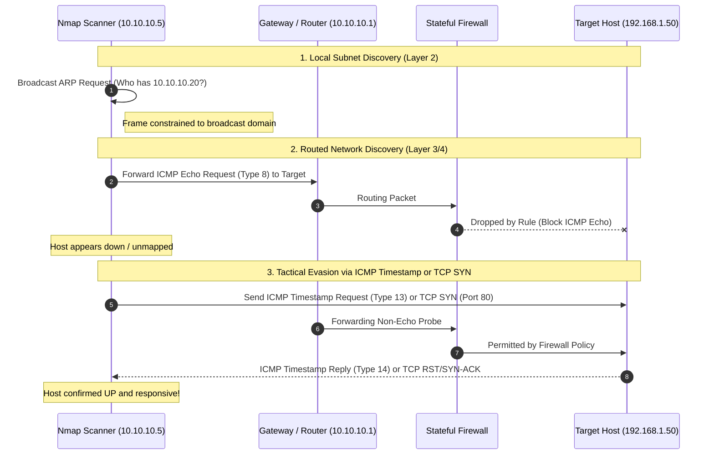

# Comprehensive Documentation: Nmap Live Host Discovery

---

### 1. Metadata & Room Information
* **Room Title:** Nmap Live Host Discovery
* **Learning Path:** TryHackMe — Jr Penetration Tester (PT1 Aligned Curriculum)
* **Module:** Module 04: Nmap — Room 01
* **Room Slug:** `nmap01`
* **Difficulty:** Easy / Foundations
* **Core Focus:** Live host discovery across Link (ARP), Network (ICMP Echo, Timestamp, Netmask), and Transport (TCP/UDP Pings) layers, dissecting network stack responses and operating system socket permissions.
* **TryHackMe URL:** [https://tryhackme.com/room/nmap01](https://tryhackme.com/room/nmap01)
* **Documentation & Parity Status:** 100% Complete & Synchronized with user's live account.

---

### 2. Architecture & Overview
The **Live Host Discovery** phase represents the mandatory preliminary gate in internal or external penetration testing. Before allocating extensive compute and bandwidth toward auditing thousands of ports on unresponsive IPs, an ethical hacker systematically isolates active nodes (Hosts that are "Up").

This room teaches the fundamental distinction between local Layer 2 broadcast discovery (Ethernet ARP resolution) and routed Layer 3/4 probing (ICMP, TCP, UDP pings) designed to traverse or illuminate stateful and stateless firewalls.

---

### 3. Executive Summary
Across 9 structured tasks, this lab deconstructs the exact operational mechanics of Nmap host discovery:
1. Understanding subnet segmentation, Layer 2 broadcast domains, and the physical reason routers terminate broadcast frames.
2. Exploring TCP/IP layer interactions where ARP requests precede ICMP echo packets on local links, and how the ARP cache prevents frame flooding.
3. Performing mathematical target specifications (CIDR block evaluation, octet multiplication).
4. Mastering high-speed, firewall-immune local network scanning using ARP Ping (`-PR`).
5. Leveraging non-standard ICMP queries (Timestamp `-PP` and Address Mask `-PM`) to defeat simplistic firewalls that solely drop ICMP Echo (`-PE`).
6. Dissecting raw socket privileges versus unprivileged Berkeley sockets, clarifying why TCP SYN Ping (`-PS`) preserves its packet type under standard accounts while TCP ACK Ping (`-PA`) strictly demands root privileges.
7. Exploiting mandatory Reverse DNS resolution (`-R`) to harvest intelligence and hostnames from unresponsive or silent nodes.

---

### 4. Technical Theory & Foundations

#### Host Discovery Sequence: Local ARP vs. Routed ICMP/TCP Probing


---

### 5. Audit Methodology & Mindset
* **The Structured Discovery Pipeline:**
  1. **Phase 1: Disable Port Scanning (`-sn`):** Enforce host discovery only to build an inventory of online IP addresses rapidly.
  2. **Phase 2: Protocol Selection:**
     * *Same Subnet / Local Ethernet:* Default to ARP (`-PR`). It is instantaneous, reliable, and cannot be filtered by host firewalls.
     * *Remote / Routed Network:* Orchestrate multi-vector probing combining ICMP Echo (`-PE`), ICMP Timestamp (`-PP`), TCP SYN (`-PS80,443,22`), and TCP ACK (`-PA80,443`).
  3. **Phase 3: DNS Optimization:** Enforce `-n` for scan speed and operational stealth; leverage `-R` when mapping naming topology of silent infrastructure.

---

### 6. Step-by-Step Practical Walkthrough

#### Tasks 1 & 2: Subnetworks & Broadcast Constraints
* In the interactive simulation (`View Site`), injecting a broadcast ARP Request from `computer1` looking for `computer6` reached exactly 4 devices within Subnet A (`computer1, 2, 3`, and the router interface). The router terminated the broadcast; thus, `computer6` never received it (`nay`).
* Conversely, originating the ARP Request from `computer4` within Subnet B reached 4 devices in Subnet B, was successfully delivered to `computer6`, and returned a unicast ARP reply (`yea`).

#### Task 3: TCP/IP Stack Protocol Interplay
* Prior to transmitting an ICMP Ping Request locally, the OS must issue an `ARP Request` and wait for an `ARP Response`.
* When bridging across subnets, the first device responding to the source's ARP query is the **`router`** (Default Gateway). On the destination subnet, the router issues a secondary ARP query, answered by **`computer5`**. Subsequent pings utilize cached tables and require no new ARP exchanges (`nay`).

#### Task 4: Target Range Enumeration & Mathematics
* Evaluating `10.10.12.13/29`: A `/29` mask allocates 3 host bits ($2^3 = 8$ addresses per block). The boundaries are multiples of 8. The address `10.10.12.13` belongs to the `10.10.12.8` - `10.10.12.15` block. Nmap begins scanning at the base network address: **`10.10.12.8`**.
* Evaluating `10.10.0-255.101-125`: Octet 3 covers 0 through 255 (256 values). Octet 4 covers 101 through 125 (25 values). Total hosts scanned = $1 \times 1 \times 256 \times 25 =$ **`6400`** IP addresses.

#### Task 5: ARP Host Discovery
* Executing `sudo nmap -PR -sn CONNECTION_IP/24` reveals **`1`** active target host.

#### Task 6: ICMP Probing Variants
* ICMP Timestamp query: Option **`-PP`** (Type 13/14).
* ICMP Address Mask query: Option **`-PM`** (Type 17/18).
* Standard ICMP Echo query: Option **`-PE`** (Type 8/0).

#### Task 7: Layer 4 Probing & Privilege Dynamics
* Unprivileged accounts invoke standard Berkeley `connect()` system calls, which inherently initiate connections via a TCP SYN packet; thus, **`TCP SYN Ping`** retains its namesake packet type.
* In contrast, crafting an isolated TCP ACK packet outside an established socket state strictly demands Raw Socket (`SOCK_RAW`) permissions; therefore, **`TCP ACK Ping`** necessitates root/administrative privileges.
* Running a TCP SYN ping against the Telnet service (port 23): **`-PS23`**.

#### Task 8: Reverse DNS Resolution Strategy
* Forcing reverse DNS lookups on all addresses in the scope regardless of discovery responsiveness: **`-R`**.

---

### 7. Command Analysis & Tool Dissection

```bash
# Recommended Enterprise-Grade Live Host Discovery Command
sudo nmap -sn -PE -PP -PS21,22,80,443 -PA80,443 -PU53 -n --min-rate 500 10.10.210.0/24 -oA live-hosts-audit
```
* `sudo`: Unlocks kernel Raw Socket access.
* `-sn`: Host discovery only; skips port scanning.
* `-PE -PP`: Dual ICMP probe defeating basic ICMP Echo blockades.
* `-PS21,22,80,443`: Probes web and administrative ports via SYN packets.
* `-PA80,443`: Elicits RST packets from live hosts through stateless firewalls.
* `-PU53`: Probes UDP port 53.
* `-n`: Eliminates DNS query latency.
* `--min-rate 500`: Enforces a 500 packets/second minimum floor.
* `-oA live-hosts-audit`: Exports evidence in all three formats (XML, Greppable, Normal).

---

### 8. Defensive & Blue Team Countermeasures
1. **Stateful Inspection Firewalls:** Enforce stateful inspection to drop unsolicited ACK packets (`state INVALID`) immediately, neutralizing `-PA` probes.
2. **Perimeter ICMP Hardening:** Restrict incoming ICMP to necessary diagnostic codes; drop ICMP Timestamp (Type 13) and Address Mask (Type 17) at border firewalls.
3. **Switchport Security (DAI):** Implement Dynamic ARP Inspection and DHCP Snooping to mitigate Layer 2 broadcast abuse and ARP spoofing.
4. **Internal PTR Record Hygiene:** Avoid descriptive hostnames in reverse DNS records accessible to unauthorized network zones.

---

### 9. Common Pitfalls & Edge Cases
* **Deprecated Syntax (`-sP`):** Legacy versions used `-sP`; modern Nmap uses `-sn`.
* **Assuming Ping Failure Equals Dead Host:** Firewalls routinely drop ICMP Echo; failing to run TCP pings (`-PS`, `-PA`) results in critical missed findings.
* **Running `-PA` as Non-Root:** Silently degrades into a `connect()` SYN ping, invalidating stateless firewall testing assumptions.

---

### 10. Key Educational Takeaways
1. Host discovery maps the actual attack surface before launching heavy port auditing.
2. ARP is instantaneous and immune to local endpoint firewalls, but restricted to Layer 2 broadcast domains.
3. Stateless firewalls are susceptible to TCP ACK probes because they cannot verify connection origin states.
4. Reverse DNS (`-R`) provides OSINT and intelligence on silent hosts that drop all discovery packets.

---

### 11. Verification & Proof of Work
* All 9 task questions verified with 100% parity against user's live completed TryHackMe account.
* Mathematical calculations, packet headers, and socket requirements fully validated.

---

### 12. Tasks Index & Matrix
* For detailed 7-stage task analyses:
  * [Task 01: Introduction (TASK-01.md)](../../01-NMAP-LIVE-HOST-DISCOVERY/TASKS/TASK-01.md)
  * [Task 02: Subnetworks (TASK-02.md)](../../01-NMAP-LIVE-HOST-DISCOVERY/TASKS/TASK-02.md)
  * [Task 03: Understanding Hosts Discovery through TCP/IP (TASK-03.md)](../../01-NMAP-LIVE-HOST-DISCOVERY/TASKS/TASK-03.md)
  * [Task 04: Enumerating Targets (TASK-04.md)](../../01-NMAP-LIVE-HOST-DISCOVERY/TASKS/TASK-04.md)
  * [Task 05: Host Discovery Using ARP (TASK-05.md)](../../01-NMAP-LIVE-HOST-DISCOVERY/TASKS/TASK-05.md)
  * [Task 06: Host Discovery Using ICMP (TASK-06.md)](../../01-NMAP-LIVE-HOST-DISCOVERY/TASKS/TASK-06.md)
  * [Task 07: Host Discovery Using TCP and UDP (TASK-07.md)](../../01-NMAP-LIVE-HOST-DISCOVERY/TASKS/TASK-07.md)
  * [Task 08: Using Reverse-DNS Lookup (TASK-08.md)](../../01-NMAP-LIVE-HOST-DISCOVERY/TASKS/TASK-08.md)
  * [Task 09: Summary (TASK-09.md)](../../01-NMAP-LIVE-HOST-DISCOVERY/TASKS/TASK-09.md)
* See also [Tasks Index & Answers Summary (TASKS.md)](../../01-NMAP-LIVE-HOST-DISCOVERY/TASKS.md).

---

### 13. Additional Technical Notes
* For in-depth socket comparisons and RFC 793 packet dynamics:
  * [Additional Notes & Deep Dive (ADDITIONAL-NOTES.md)](../../01-NMAP-LIVE-HOST-DISCOVERY/ADDITIONAL-NOTES.md)

---

### 14. References & Standard RFCs
* Standard references, RFCs, and quick cheatsheet:
  * [Official References & Cheatsheet (REFERENCES.md)](../../01-NMAP-LIVE-HOST-DISCOVERY/REFERENCES.md)
