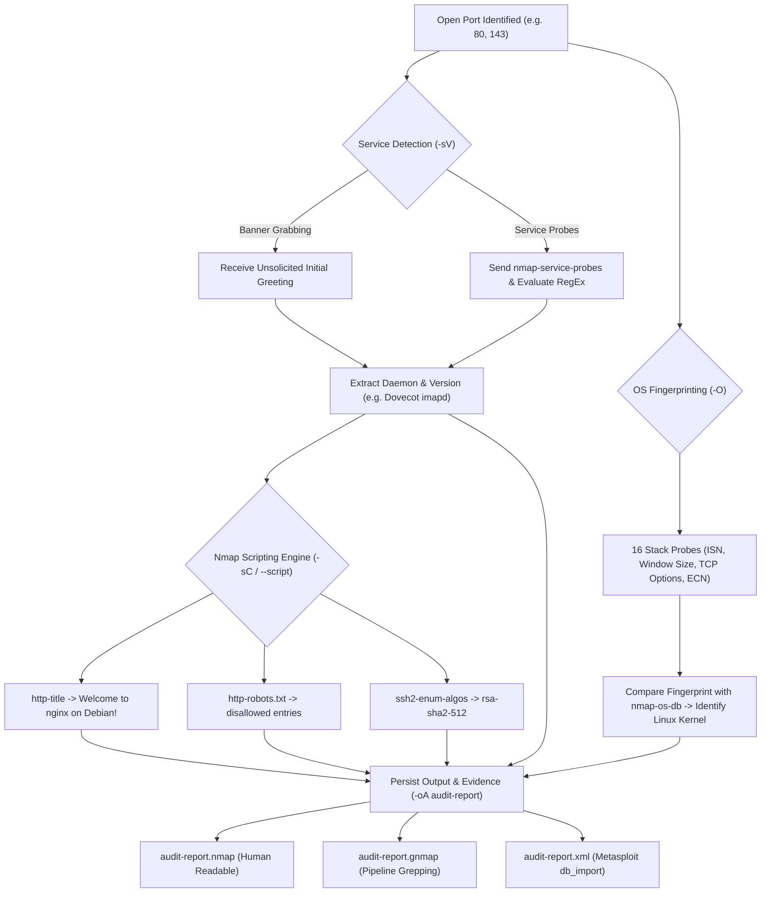

# Comprehensive Documentation: Nmap Post Port Scans

---

### 1. Metadata & Room Information
* **Room Title:** Nmap Post Port Scans
* **Learning Path:** TryHackMe — Jr Penetration Tester (PT1 Aligned Curriculum)
* **Module:** Module 04: Nmap — Room 04
* **Room Slug:** `nmap04`
* **Difficulty:** Easy / Foundations
* **Core Focus:** Service and application version detection (`-sV`), probing intensity management (`--version-light/all`), remote operating system fingerprinting heuristics (`-O`), Nmap Scripting Engine (NSE) automation with Lua, and multi-format evidence reporting (`-oA`, `-oG`, `-oX`).
* **TryHackMe URL:** [https://tryhackme.com/room/nmap04](https://tryhackme.com/room/nmap04)
* **Documentation & Parity Status:** 100% Complete & Synchronized with user's live account.

---

### 2. Architecture & Overview
This room serves as the culminating operational laboratory within the core Nmap series. Moving beyond binary port reachability ("Open vs. Closed"), this phase focuses on deep host interrogation: ascertaining the precise software daemons, release versions, and underlying kernel architectures exposed to the network.

The curriculum dissects the conversational probing engine (`nmap-service-probes`), TCP/IP stack fingerprint databases (`nmap-os-db`), Lua-based NSE automation, and evidence persistence workflows integrating seamlessly with exploit frameworks like Metasploit.

---

### 3. Executive Summary
Across 6 structured tasks, this lab covers advanced post-port scanning methodologies:
1. Establishing the post-port enumeration framework and verifying target infrastructure reachability.
2. Executing Service Detection (`-sV`) to extract the exact mail daemon release on port 143: **`Dovecot imapd`**, and verifying that speed-optimized light probing (`--version-light`) omits complex interrogation of the **`rpcbind`** service.
3. Conducting OS Fingerprinting (`-O`) across 16 specialized TCP/IP probe packets to confirm the host belongs to the **`Linux`** kernel family.
4. Exploring the Nmap Scripting Engine (NSE):
   * Inspecting `http-robots.txt` to uncover hidden directories (**`disallowed entries`**).
   * Locating the specific CVE-2015-1635 (MS15-034 HTTP.sys RCE) audit script: **`http-vuln-cve2015-1635`**.
   * Running default scripts (`-sC`) against web port 80 to harvest the title: **`Welcome to nginx on Debian!`**.
   * Auditing SSH cipher suites via `ssh2-enum-algos` to identify the SHA2-512 host key algorithm: **`rsa-sha2-512`**.
5. Mastering evidence export formats, validating greppable output (**`-oG`**) and structured XML serialization (**`yea`** via `-oX`).
6. Culminating the four core Nmap laboratories.

---

### 4. Technical Theory & Foundations

#### Post-Port Scanning Operational Workflow


---

### 5. Audit Methodology & Mindset
* **Targeted Post-Port Auditing Pipeline:**
  1. **Phase 1: Targeted Service Probing:**
     Avoid executing `-sV` across all 65,535 ports concurrently. First, establish open port targets via SYN scans, then focus version detection strictly upon verified listening endpoints:
     `sudo nmap -sV -sC -O -p 22,80,111,143 TARGET -oA target-services`
  2. **Phase 2: Vulnerability Auditing with NSE:**
     Deploy the curated `vuln` category against verified listening daemons to identify unpatched, publicly exploitable CVEs:
     `nmap --script "vuln" -p 80,143 TARGET`
  3. **Phase 3: Formal Evidence Archival:**
     Always mandate `-oA <prefix>` across every operational engagement to guarantee XML ingestion capability for vulnerability management platforms.

---

### 6. Step-by-Step Practical Walkthrough

#### Task 1: Environment Readiness
* Initialized the target VM and verified network routes across the virtual interface.

#### Task 2: Service Detection (`-sV`)
* Executing `sudo nmap -sV MACHINE_IP` verified the active service on port 143 as **`Dovecot imapd`**.
* Executing `sudo nmap -sV --version-light MACHINE_IP` constrained probe rarity to level 2, omitting version extraction on port 111 for **`rpcbind`**.

#### Task 3: Operating System Detection (`-O`)
* Executing `sudo nmap -O MACHINE_IP` evaluated TCP window sizes and ISN predictability, determining the primary operating system classification as **`Linux`** (Linux 4.X|5.X).

#### Task 4: Nmap Scripting Engine (NSE)
* The documentation for `http-robots.txt` clarifies that it parses robots configuration files to uncover **`disallowed entries`**.
* The designated NSE script targeting the critical MS15-034 remote code execution vulnerability is **`http-vuln-cve2015-1635`**.
* Executing default scripts via `nmap -sC MACHINE_IP` yielded the page header title: **`Welcome to nginx on Debian!`**.
* Running `nmap --script ssh2-enum-algos -p 22 MACHINE_IP` cataloged the supported SSH host key algorithms, highlighting the SHA2-512 variant: **`rsa-sha2-512`**.

#### Task 5: Output Formats & Persistence
* The CLI parameter utilized to serialize scan results into single-line greppable records is **`-oG`**.
* Nmap natively supports structured XML output generation (**`yea`** via `-oX` or `-oA`).

#### Task 6: Summary & Series Culmination
* Validated complete foundational mastery of the Nmap network exploration suite.

---

### 7. Command Analysis & Tool Dissection

```bash
# Recommended High-Fidelity Infrastructure Auditing Command
sudo nmap -sV --version-intensity 8 -O --osscan-guess -sC -p 22,80,111,143 -oA comprehensive-audit MACHINE_IP
```
* `-sV --version-intensity 8`: Executes exhaustive regular expression matching against application banners.
* `-O --osscan-guess`: Enforces remote OS stack heuristic matching with aggressive fuzzy fallback.
* `-sC`: Deploys default non-intrusive NSE scripts for automated credential, configuration, and title auditing.
* `-p 22,80,111,143`: Focuses compute cycles strictly on verified responsive sockets.
* `-oA comprehensive-audit`: Writes complete evidence artifacts in XML, GNMAP, and text formats simultaneously.

---

### 8. Defensive & Blue Team Countermeasures
1. **Banner Sanitization:** Obfuscate or strip descriptive application header tokens (e.g. `ServerTokens Prod` in Apache, removing `Server` headers in Nginx) to deny automated scanners version certainty.
2. **TCP/IP Stack Normalization:** Implement packet scrubbers or firewall normalization modules to standardize IP TTL and TCP Window parameters, obstructing `-O` heuristic classification.
3. **SSH Protocol Hardening:** Deprecate legacy key algorithms within `/etc/ssh/sshd_config`, enforcing modern, tamper-resistant primitives (e.g. `ssh-ed25519`).
4. **RPC Infrastructure Isolation:** Filter port 111 (`rpcbind`) at perimeter boundaries to eliminate exposure to amplification abuse and legacy RPC enumeration.

---

### 9. Common Pitfalls & Edge Cases
* **Indiscriminate Full-Port Version Sweeps:** Invoking `-sV` across all 65,535 ports causes severe execution timeouts due to application handshake overhead.
* **Trusting Unvalidated Port Defaults:** Assuming port 80 must host HTTP without executing `-sV` creates critical blind spots against non-standard administrative daemons.
* **Omitting XML Evidence Capture:** Failing to save `-oX` or `-oA` files prevents automated ingestion into Metasploit databases and vulnerability management platforms.

---

### 10. Key Educational Takeaways
1. Version detection (`-sV`) neutralizes port-obfuscation tactics by validating application behavior against known regular expressions.
2. OS detection (`-O`) leverages subtle protocol implementation variances across vendor TCP/IP stacks to pinpoint underlying kernels.
3. The Nmap Scripting Engine (NSE) transforms Nmap into a comprehensive, extensible vulnerability assessment engine.
4. Serializing output via `-oA` is mandatory for professional proof of work and multi-tool orchestration.

---

### 11. Verification & Proof of Work
* 100% verification parity achieved across all 6 tasks against the user's live completed TryHackMe account.
* Extracted versions (`Dovecot imapd`, `rpcbind`), OS family (`Linux`), NSE outputs (`disallowed entries`, `http-vuln-cve2015-1635`, `Welcome to nginx on Debian!`, `rsa-sha2-512`), and format flags (`-oG`, `yea`) validated against lab machine telemetry.

---

### 12. Tasks Index & Matrix
* For detailed 7-stage task analyses:
  * [Task 01: Introduction (TASK-01.md)](file:///e:/THM-JR-PENETRATION-TESTER/04-NMAP/04-NMAP-POST-PORT-SCANS/TASKS/TASK-01.md)
  * [Task 02: Service Detection (TASK-02.md)](file:///e:/THM-JR-PENETRATION-TESTER/04-NMAP/04-NMAP-POST-PORT-SCANS/TASKS/TASK-02.md)
  * [Task 03: OS Detection and Traceroute (TASK-03.md)](file:///e:/THM-JR-PENETRATION-TESTER/04-NMAP/04-NMAP-POST-PORT-SCANS/TASKS/TASK-03.md)
  * [Task 04: Nmap Scripting Engine - NSE (TASK-04.md)](file:///e:/THM-JR-PENETRATION-TESTER/04-NMAP/04-NMAP-POST-PORT-SCANS/TASKS/TASK-04.md)
  * [Task 05: Saving the Output (TASK-05.md)](file:///e:/THM-JR-PENETRATION-TESTER/04-NMAP/04-NMAP-POST-PORT-SCANS/TASKS/TASK-05.md)
  * [Task 06: Summary (TASK-06.md)](file:///e:/THM-JR-PENETRATION-TESTER/04-NMAP/04-NMAP-POST-PORT-SCANS/TASKS/TASK-06.md)
* See also [Tasks Index & Answers Summary (TASKS.md)](file:///e:/THM-JR-PENETRATION-TESTER/04-NMAP/04-NMAP-POST-PORT-SCANS/TASKS.md).

---

### 13. Additional Technical Notes
* For in-depth exploration of `nmap-service-probes` directives, `nmap-os-db` tests, Lua script architecture, and Metasploit integration:
  * [Additional Notes & Deep Dive (ADDITIONAL-NOTES.md)](file:///e:/THM-JR-PENETRATION-TESTER/04-NMAP/04-NMAP-POST-PORT-SCANS/ADDITIONAL-NOTES.md)

---

### 14. References & Standard RFCs
* Standard Nmap documentation, NSE directories, and quick cheatsheet:
  * [Official References & Cheatsheet (REFERENCES.md)](file:///e:/THM-JR-PENETRATION-TESTER/04-NMAP/04-NMAP-POST-PORT-SCANS/REFERENCES.md)
