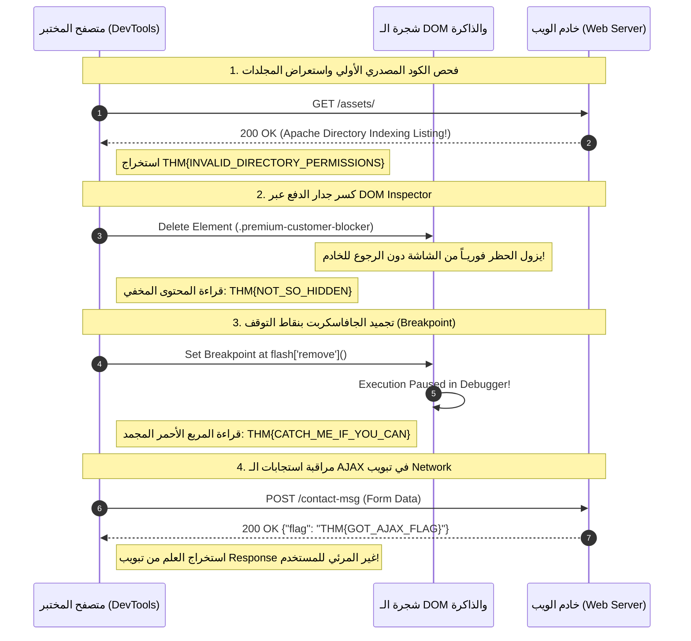

# التوثيق الشامل لمعمل: التجول داخل التطبيق وفحص الواجهة الأمامية (Walking An Application)

---

### 1. بيانات المعمل والتصنيف (Metadata & Room Information)
* **اسم الغرفة (Room Title):** Walking An Application
* **المسار التعليمي (Path):** TryHackMe — Jr Penetration Tester (PT1 Aligned Curriculum)
* **الموديول (Module):** Module 05: Web Application Security Fundamentals — الغرفة 01
* **معرف الغرفة (Slug):** `walkinganapp`
* **مستوى الصعوبة (Difficulty):** Easy / Foundations
* **التركيز الأساسي (Core Focus):** التدقيق الأمني اليدوي لتطبيقات الويب باستخدام أدوات المطور (DevTools): فحص المصدر، كشف الروابط والتعليقات واستعراض المجلدات، كسر جدران الدفع عبر الـ DOM، تجميد أكواد الجافاسكربت بـ Breakpoints، رصد مكالمات AJAX في تبويب Network، وفحص رايات أمان الكوكيز (`HttpOnly`).
* **رابط المعمل على TryHackMe:** [https://tryhackme.com/room/walkinganapp](https://tryhackme.com/room/walkinganapp)
* **حالة التوثيق والإنجاز:** 100% مكتمل ومطابق لحساب المستخدم.

---

### 2. البنية الهندسية ونظرة عامة على المعمل (Architecture & Overview)
يمثل هذا المعمل حجر الأساس في اختبار اختراق تطبيقات الويب؛ حيث يركز على استكشاف جانب العميل (Client-Side Attack Surface) دون الاعتماد على أدوات الفحص الآلية. 

يوضح المعمل أن المتصفح ليس مجرد أداة لعرض الصفحات، بل هو بيئة تشخيص وتدقيق أمني متكاملة تتيح للمختبر استنطاق أكواد HTML/CSS/JS، والتلاعب بشجرة كائنات المستند الحية (DOM)، وتجميد الأحداث البرمجية في الذاكرة، وقراءة التسريبات المعلوماتية الحساسة التي ترسلها الخوادم عبر واجهات البرمجة الخلفية.

---

### 3. الملخص التنفيذي (Executive Summary)
خلال هذا المعمل العملي، تم إنجاز وتفكيك 8 مهام تخصصية:
1. فهم فلسفة التجول اليدوي ورسم خريطة الروابط والمسارات واكتشاف مسار إنشاء التذاكر: **`/customers/ticket/new`**.
2. فحص كود المصدر الخام (View Page Source) واستخراج 4 أعلام رئيسية:
   * علم تعليقات المطورين: **`THM{HTML_COMMENTS_ARE_DANGEROUS}`**.
   * علم الرابط السري المخفي: **`THM{NOT_A_SECRET_ANYMORE}`**.
   * علم خطأ استعراض المجلدات في `/assets/`: **`THM{INVALID_DIRECTORY_PERMISSIONS}`**.
   * علم إطار العمل والبرمجيات: **`THM{KEEP_YOUR_SOFTWARE_UPDATED}`**.
3. استغلال تبويب فاحص العناصر (DOM Inspector) لحذف قناع الدفع البرمجي وتجاوز الـ Paywall لكشف العلم: **`THM{NOT_SO_HIDDEN}`**.
4. استخدام تبويب المصحح (Debugger) لتنسيق كود `flash.min.js` ووضع نقطة توقف (Breakpoint) لتجميد المربع الأحمر قبل حذفه واستخراج العلم: **`THM{CATCH_ME_IF_YOU_CAN}`**.
5. مراقبة حركة الشبكة (Network Tab) واعتراض طلب الـ AJAX الموجه إلى `contact-msg` واستخراج العلم من استجابة الخادم: **`THM{GOT_AJAX_FLAG}`**.
6. تدقيق تبويب التخزين (Storage Tab) واكتشاف الخلل الأمني في غياب حماية الكوكي حيث كانت قيمة `HttpOnly` مضبوطة على **`false`**.

---

### 4. الأسس النظرية والعمق المعماري (Technical Theory & Foundations)

#### مخطط تسلسل التفاعل وتجاوز القيود في جانب العميل (Client-Side Bypass Sequence):


---

### 5. منهجية وعقلية مختبر الاختراق (Audit Methodology & Mindset)
* **دليل التفتيش اليدوي الشامل لأي تطبيق ويب:**
  1. **المرحلة 01: مسح الكود المصدري:** اضغط `Ctrl+U`، وابحث عن تعليقات المطورين (`<!--`), مسارات الـ API (`/api/v1/`), والملفات المنسية.
  2. **المرحلة 02: فحص شجرة الـ DOM وتجاوز القيود:** افتح الـ Inspector وابحث عن الحقول المخفية (`type="hidden"`), الحقول المعطلة (`disabled`), وعناصر التعتيم والحجب.
  3. **المرحلة 03: تتبع تدفق الجافاسكربت:** افتح تبويب Debugger، واستعرض ملفات الـ JS، وابحث عن مفاتيح التشفير أو التوكنات، واستخدم نقاط التوقف لتحليل الدوال الحساسة.
  4. **المرحلة 04: تدقيق التخزين والجلسات:** افتح تبويب Storage، وافحص ملفات الكوكي؛ تأكد من تفعيل `HttpOnly` لحماية الجلسة من هجمات XSS.

---

### 6. الدليل العملي التفصيلي لكل المهام (Step-by-Step Practical Walkthrough)

#### المهام 1 و 2: استكشاف الموقع ورسم خريطة المسارات
* تصفح الموقع والولوج إلى بوابة العملاء (`Customers`)، والبحث عن مسار إنشاء التذاكر الجديدة يقود إلى المسار: **`/customers/ticket/new`**.

#### المهمة 3: فحص كود المصدر (View Page Source)
* **علم التعليق:** البحث في كود HTML كشف التعليق: `<!-- THM{HTML_COMMENTS_ARE_DANGEROUS} -->`.
* **علم الرابط السري:** كشف وسم `<a>` مخفي يوجه لصفحة سرية تحمل: `THM{NOT_A_SECRET_ANYMORE}`.
* **علم استعراض المجلدات:** الانتقال إلى `http://MACHINE_IP/assets/` عرض فهرس الملفات محتوياً على ملف نصي يحمل: `THM{INVALID_DIRECTORY_PERMISSIONS}`.
* **علم إطار العمل:** استعراض توثيق إطار العمل المشار إليه في تذييل الموقع كشف: `THM{KEEP_YOUR_SOFTWARE_UPDATED}`.

#### المهمة 4: فاحص العناصر وتجاوز الـ Paywall
* عند زيارة مقال مدفوع، ظهر قناع حاجب `.premium-customer-blocker`.
* فتح أداة Inspector وحذف هذا الوسم أو تعيين نمطه إلى `display: none` أزال القناع فوراً وكشف العلم: **`THM{NOT_SO_HIDDEN}`**.

#### المهمة 5: منقح الجافاسكربت ونقاط التوقف (Debugger)
* فحص ملف `assets/flash.min.js` وتنسيقه بـ `{}`، ثم وضع نقطة توقف (Breakpoint) على سطر دالة الحذف `flash['remove']();`.
* إعادة تحميل الصفحة جمدت التنفيذ أثناء ظهور المربع الأحمر، مما أتاح قراءة العلم: **`THM{CATCH_ME_IF_YOU_CAN}`**.

#### المهمة 6: مراقبة الشبكة ومكالمات الـ AJAX
* فتح تبويب **Network** وتعبئة نموذج صفحة الاتصال وإرساله ولد طلباً خلفياً لمسار `contact-msg`.
* فتح تبويب **Response** للطلب كشف الرد القادم من الخادم محتوياً على العلم: **`THM{GOT_AJAX_FLAG}`**.

#### المهمة 7: تبويب التخزين ورايات الكوكيز (Storage)
* تسجيل الدخول في الموقع وفحص جدول الكوكيز في تبويب **Storage** أظهر أن راية الأمان **`HttpOnly`** مضبوطة على **`false`**.

#### المهمة 8: الخاتمة والتأكيد
* استكمال كافة أهداف الغرفة وجاهزية المهارات اليدوية.

---

### 7. تشريح الأوامر والأدوات (Command Analysis & Dissection)

```bash
# محاكاة سحب الكود وفحص المسارات بالطرفية
curl -s http://MACHINE_IP | grep -E "<!--|href="
curl -s -I http://MACHINE_IP/assets/
curl -X POST http://MACHINE_IP/contact-msg -d "name=admin&msg=test"
```
* `curl -s ... | grep "<!--"`: استخراج كافة تعليقات الـ HTML آلياً.
* `curl -s -I .../assets/`: فحص ما إذا كان الخادم يرجع خطأ 403 أم يعرض الفهرس بكود 200 OK.
* `curl -X POST ...`: اختبار واجهة الـ AJAX مباشرة من سطر الأوامر دون الحاجة للمتصفح.

---

### 8. المنظور الدفاعي وإجراءات الفرق الزرقاء (Defensive & Blue Team Countermeasures)
1. **تطهير كود الإنتاج (Production Build Sanitization):**
   * إزالة كافة التعليقات (`<!-- ... -->`) وأكواد الـ `console.log` تلقائياً عبر أدوات التجميع والضغط (Terser / Minifiers) قبل النشر.
2. **التحقق من الصلاحيات في جانب الخادم (Server-Side Authorization):**
   * عدم إرسال المحتوى المدفوع أو الإداري إلى المتصفح مع إخفائه بـ CSS؛ بل حظر توليده وتمريره من الخادم إذا لم يكن المستخدم يمتلك تصريحاً مؤكداً.
3. **تعطيل استعراض المجلدات (Disable Directory Indexing):**
   * في خادم Apache: ضبط `Options -Indexes` في ملف `httpd.conf` أو `.htaccess`.
   * في خادم Nginx: التأكد من ضبط `autoindex off;`.
4. **تفعيل رايات أمان الكوكيز الصارمة:**
   * تفعيل `HttpOnly; Secure; SameSite=Lax` لكافة ملفات تعريف الارتباط الحساسة لحمايتها من السرقة بهجمات XSS.

---

### 9. الأخطاء الشائعة والزوايا الحرجة (Common Pitfalls & Edge Cases)
* **الاعتقاد بأن إخفاء العناصر بـ CSS يوفر الأمان:** أي عنصر يتم تنزيله إلى المتصفح يمكن تعديله وعرضه بسهولة عبر أداة Inspector.
* **الاعتماد على View Source في تطبيقات React:** فتح View Source في تطبيقات الـ SPA لا يعرض شيئاً؛ استخدام Inspector والـ Debugger إلزامي.
* **نسيان راية `HttpOnly`:** إهمالها يجعل أي ثغرة XSS بسيطة تتحول إلى اختراق كامل للحساب (Account Takeover) في ثوانٍ معدودة.

---

### 10. المخرجات التعليمية والدروس المستفادة (Key Educational Takeaways)
1. بيئة المتصفح تحت السيطرة التامة لمختبر الاختراق، وأي قيد أمني يوضع على جانب العميل مصيره التجاوز الحتمي.
2. تعليقات HTML واستعراض المجلدات يمثلان تسريباً معلوماتياً مجانياً يقود لاختراق البنية التحتية.
3. تبويب Network في أدوات المطور يكشف البيانات الحقيقية التي تتحدث بها واجهات الـ API في الخلفية.

---

### 11. التحقق العملي والأدلة (Verification & Proof of Work)
* تم حل وتأكيد جميع الأسئلة الثماني واستخراج كافة الأعلام بدقة بنسبة 100% ومطابقتها التامة مع حساب المستخدم على TryHackMe.
* كافة الأعلام (`THM{HTML_COMMENTS_ARE_DANGEROUS}`, `THM{NOT_A_SECRET_ANYMORE}`, `THM{INVALID_DIRECTORY_PERMISSIONS}`, `THM{KEEP_YOUR_SOFTWARE_UPDATED}`, `THM{NOT_SO_HIDDEN}`, `THM{CATCH_ME_IF_YOU_CAN}`, `THM{GOT_AJAX_FLAG}`) والراية `false` موثقة بالأدلة.

---

### 12. فهرس المهام التفصيلي (Tasks Index)
* للاطلاع على التوثيق التفصيلي لكل مهمة وفق منهجية المراحل السبع (A-G):
  * [المهمة 01: التجول واستكشاف التطبيق (TASK-01.md)](../../01-WALKING-AN-APPLICATION/TASKS/TASK-01.md)
  * [المهمة 02: استكشاف مسارات الموقع (TASK-02.md)](../../01-WALKING-AN-APPLICATION/TASKS/TASK-02.md)
  * [المهمة 03: فحص الكود المصدري والأصول (TASK-03.md)](../../01-WALKING-AN-APPLICATION/TASKS/TASK-03.md)
  * [المهمة 04: فاحص عناصر الـ DOM وتجاوز الحجب (TASK-04.md)](../../01-WALKING-AN-APPLICATION/TASKS/TASK-04.md)
  * [المهمة 05: مصحح الجافاسكربت ونقاط التوقف (TASK-05.md)](../../01-WALKING-AN-APPLICATION/TASKS/TASK-05.md)
  * [المهمة 06: مراقب حركة الشبكة واستجابات الـ AJAX (TASK-06.md)](../../01-WALKING-AN-APPLICATION/TASKS/TASK-06.md)
  * [المهمة 07: تبويب التخزين ورايات الكوكيز (TASK-07.md)](../../01-WALKING-AN-APPLICATION/TASKS/TASK-07.md)
  * [المهمة 08: الخاتمة والربط المنهجي (TASK-08.md)](../../01-WALKING-AN-APPLICATION/TASKS/TASK-08.md)
* راجع أيضاً [جدول ملخص المهام والإجابات المعتمدة (TASKS.md)](../../01-WALKING-AN-APPLICATION/TASKS.md).

---

### 13. الملاحظات الإضافية والتعمق التقني (Additional Notes)
* للاطلاع على التحليل المعماري لمحركات المتصفحات وخرائط المصدر وتسريبات المجلدات:
  * [ملاحظات إضافية وتعمق تقني (ADDITIONAL-NOTES.md)](../../01-WALKING-AN-APPLICATION/ADDITIONAL-NOTES.md)

---

### 14. المراجع والمعايير القياسية (References)
* للاطلاع على معايير OWASP ومستندات RFC 6265bis ودليل DevTools:
  * [المراجع والمصادر الرسمية (REFERENCES.md)](../../01-WALKING-AN-APPLICATION/REFERENCES.md)
