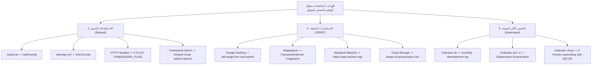

# التوثيق الشامل لمعمل: استكشاف المحتوى والمسارات المخفية (Content Discovery)

---

### 1. بيانات المعمل والتصنيف (Metadata & Room Information)
* **اسم الغرفة (Room Title):** Content Discovery
* **المسار التعليمي (Path):** TryHackMe — Jr Penetration Tester (PT1 Aligned Curriculum)
* **الموديول (Module):** Module 05: Web Application Security Fundamentals — الغرفة 02
* **معرف الغرفة (Slug):** `contentdiscoveryx`
* **مستوى الصعوبة (Difficulty):** Easy / Foundations
* **التركيز الأساسي (Core Focus):** كشف المسارات والمحتوى غير المرتبط عبر الطرق اليدوية (`robots.txt`, `sitemap.xml`, ترويسات HTTP)، الاستخبارات مفتوحة المصدر (Google Dorking, Wappalyzer, Wayback Machine, AWS S3)، والتخمين الآلي الموجه للقواميس عبر أداة Gobuster لمسارات المجلدات والنطاقات الفرعية والمجالات الافتراضية (VHosts).
* **رابط المعمل على TryHackMe:** [https://tryhackme.com/room/contentdiscoveryx](https://tryhackme.com/room/contentdiscoveryx)
* **حالة التوثيق والإنجاز:** 100% مكتمل ومطابق لحساب المستخدم.

---

### 2. البنية الهندسية ونظرة عامة على المعمل (Architecture & Overview)
يمثل استكشاف المحتوى الخطوة التكتيكية الحاسمة في توسيع سطح الهجوم (Attack Surface Expansion)؛ فالكثير من أضعف نقاط الدخول وأخطر الثغرات (مثل لوحات التحكم الإدارية غير المحمية، وملفات النسخ الاحتياطي لقواعد البيانات، وملفات السجلات) لا تظهر في قوائم الموقع الرئيسية بل تترك مهملة في مسارات مخفية.

يغطي المعمل المنهجية الثلاثية لاستكشاف المحتوى: بدءاً من قراءة الملفات القياسية وفحص الترويسات، مروراً بالاستخبارات السلبية والأرشيفات الرقمية، وصولاً إلى التخمين الآلي عالي السرعة للمسارات والمجالات الافتراضية عبر Gobuster.

---

### 3. الملخص التنفيذي (Executive Summary)
خلال هذا المعمل العملي، تم إنجاز وتفكيك 8 مهام تخصصية:
1. فهم فلسفة استكشاف المحتوى ومخاطر الأمان عبر الغموض (Security through Obscurity).
2. فحص الملفات القياسية يدوياً واكتشاف المسار الإداري المحظور في `robots.txt`: **`/staff-portal`**، والمنطقة السرية المكشوفة في `sitemap.xml`: **`/s3cr3t-area`**.
3. استخراج علم الترويسة المخصصة **`THM{HEADER_FLAG}`** من ترويسة `X-FLAG`، والولوج إلى لوحة إدارة إطار العمل ببيانات الدخول الافتراضية (`admin:admin`) لاستخراج علم: **`THM{CHANGE_DEFAULT_CREDENTIALS}`**.
4. استيعاب أدوات الاستخبارات السلبية؛ تحديد معامل حصر النطاق في بحث جوجل **`site:`**، وتحديد أداة كشف البصمة التقنية **`Wappalyzer`**.
5. استخدام أرشيف الإنترنت عبر موقع **`https://web.archive.org/`**، ومعرفة صيغة نطاقات حاويات التخزين السحابي **`.s3.amazonaws.com`**.
6. تنفيذ التخمين الآلي بـ `gobuster dir` واكتشاف المجلد **`/monthly`** وملف السجلات التنموي **`/development.log`**.
7. إتقان فحص النطاقات الفرعية بالمعامل المختصر **`-d`** في وضع DNS، واكتشاف **`3`** مجالات افتراضية نشطة (VHosts) تستجيب بكود 200 على خادم `acmeitsupport.thm`.
8. استكمال ومراجعة كافة نتائج ومخرجات المعمل.

---

### 4. الأسس النظرية والعمق المعماري (Technical Theory & Foundations)

#### مخطط تدفق المنهجية الثلاثية لاستكشاف محتوى الويب (Content Discovery Methodology):


---

### 5. منهجية وعقلية مختبر الاختراق (Audit Methodology & Mindset)
* **المسار التكتيكي لاستكشاف المحتوى في اختبار الاختراق الميداني:**
  1. **الخطوة الأولى (الفحص الصامت 0% Noise):** ابدأ بـ `robots.txt` و `sitemap.xml` وترويسات HTTP و Google Dorks وأرشيف Wayback Machine؛ فهذه الخطوات تمنحك 50% من خريطة الموقع دون إرسال طلب فحص واحد يثير أنظمة كشف التسلل.
  2. **الخطوة الثانية (التخمين السريع بالقواميس الشائعة):** أطلق أداة Gobuster باستخدام قاموس سريع مثل `common.txt` وامتدادات الملفات الشائعة (`-x php,txt,html,log,bak`) مع ترويسة User-Agent مخصصة.
  3. **الخطوة الثالثة (فحص المجالات الافتراضية):** إذا كان عنوان الـ IP يستضيف عدة مواقع، استخدم `gobuster vhost` لاكتشاف مواقع التطوير والاختبار الداخلية.

---

### 6. الدليل العملي التفصيلي لكل المهام (Step-by-Step Practical Walkthrough)

#### المهمة 1: مدخل وجاهزية البيئة
* تشغيل الآلة المعملية الهدف والتأكد من الاتصال بالخادم.

#### المهمة 2: الاستكشاف اليدوي للملفات الشائعة
* فتح `http://MACHINE_IP/robots.txt` أظهر مسار الموظفين المحظور: **`/staff-portal`**.
* فتح `http://MACHINE_IP/sitemap.xml` كشف مسار المنطقة السرية المسربة: **`/s3cr3t-area`**.

#### المهمة 3: ترويسات الاستجابة وبوابة الإطار
* تنفيذ `curl -I http://MACHINE_IP` كشف ترويسة الرد `X-FLAG` وبداخلها العلم: **`THM{HEADER_FLAG}`**.
* التوجه إلى بوابة إدارة إطار العمل في الموقع وتسجيل الدخول بالبيانات الافتراضية `admin:admin` أتاح الدخول للوحة التحكم واستخراج العلم: **`THM{CHANGE_DEFAULT_CREDENTIALS}`**.

#### المهمة 4: الاستخبارات ومحركات البحث
* معامل البحث في جوجل لحصر النتائج في نطاق معين هو **`site:`**.
* الأداة وإضافة المتصفح القياسية لكشف مكونات الموقع البرمجية هي **`Wappalyzer`**.

#### المهمة 5: الأرشيف الرقمي والمستودعات السحابية
* الرابط الرسمي لموقع آلة الزمن الرقمية لأرشيف الإنترنت هو **`https://web.archive.org/`**.
* صيغة الروابط القياسية التي تنتهي بها حاويات التخزين السحابي في أمازون هي **`.s3.amazonaws.com`**.

#### المهمة 6: التخمين الآلي بـ Gobuster للمسارات
* عند تشغيل `gobuster dir -u http://MACHINE_IP -w .../common.txt -x log,txt`، تم اكتشاف:
  * المجلد الذي يبدأ بـ `/mo`: **`/monthly`**.
  * ملف السجلات الحساس: **`/development.log`**.

#### المهمة 7: النطاقات الفرعية والمجالات الافتراضية
* المعامل المختصر الإلزامي لتحديد اسم النطاق في وضع `gobuster dns` هو **`-d`**.
* عند تشغيل فحص الـ VHost على النطاق `acmeitsupport.thm`، تم اكتشاف **`3`** مجالات افتراضية تستجيب بنجاح بكود الحالة 200.

#### المهمة 8: الخاتمة والمنهجية
* مراجعة وتأكيد كافة الأهداف بنجاح.

---

### 7. تشريح الأوامر والأدوات (Command Analysis & Dissection)

```bash
# أوامر Gobuster الميدانية الاحترافية
# 1. تخمين المسارات مع استبعاد الرموز الخاطئة وتحديد الامتدادات
gobuster dir -u http://target.thm -w /usr/share/wordlists/seclists/Discovery/Web-Content/common.txt -x php,txt,html,log -t 25 -o dirs.txt

# 2. تخمين المجالات الافتراضية مع حجب الأحجام المكررة لمنع الإنذارات الكاذبة
gobuster vhost -u http://target.thm -w /usr/share/wordlists/seclists/Discovery/DNS/subdomains-top1million-5000.txt --append-domain --exclude-length 1542
```

---

### 8. المنظور الدفاعي وإجراءات الفرق الزرقاء (Defensive & Blue Team Countermeasures)
1. **تأمين المسارات الحساسة بالمصادقة الصارمة (Server-Side Auth & MFA):**
   * لا تعتمد على إخفاء الروابط في `robots.txt`؛ بل احمِ كافة البوابات الإدارية بمصادقة متعددة العوامل (MFA) واقصر الوصول إليها على شبكات VPN الداخلية (IP Whitelisting).
2. **تطهير الترويسات وتغيير بيانات الاعتماد الافتراضية:**
   * حذف الترويسات التجريبية وتجريد ترويسات `Server` و `X-Powered-By`.
   * إجبار مدراء الأنظمة على تغيير كلمات المرور الافتراضية عند أول تشغيل للمنصة.
3. **تأمين حاويات التخزين السحابي (S3 Bucket Hardening):**
   * حظر الوصول العام كلياً (Block Public Access) ومراجعة سياسات الحاويات (Bucket Policies) لمنع تسريب النسخ الاحتياطية.
4. **مراقبة التخمين العنيف (WAF Rate Limiting & Anti-Automation):**
   * ضبط جدران حماية تطبيقات الويب (WAF مثل Cloudflare أو ModSecurity) لرصد وحظر عناوين IP التي ترسل معدلات طلبات غير طبيعية (أكثر من 20 طلباً في الثانية) ومطابقة تواقيع أدوات التخمين مثل Gobuster.

---

### 9. الأخطاء الشائعة والزوايا الحرجة (Common Pitfalls & Edge Cases)
* **تضمين المسارات السرية في `robots.txt`:** خطأ بدائي يرتكبه المطورون ويمنح المهاجم قائمة بالأهداف الحساسة فوراً.
* **الخلط بين فحص DNS وفحص VHost:** إذا لم يكن النطاق مسجلاً في خادم DNS العام، فلن يكتشفه `gobuster dns` مطلقاً، بينما فحص `gobuster vhost` سيكتشفه بسهولة عبر ترويسة `Host:`.
* **إهمال امتدادات الملفات (`-x`):** تشغيل Gobuster بدون امتدادات سيكتشف المجلدات فقط وسيفوت ملفات خطيرة مثل `.env` أو `development.log` أو `backup.sql`.

---

### 10. المخرجات التعليمية والدروس المستفادة (Key Educational Takeaways)
1. "الأمان عبر الغموض ليس أماناً"؛ إخفاء الروابط لا يحميها من قواميس التخمين الآلية.
2. ترويسات الردود وملفات الأرشيف التاريخي تكشف أسرار التطبيقات القديمة والجديدة.
3. التخمين الموجه لترويسة `Host:` عبر VHost يفتح أبواباً خلفية لخوادم التطوير المعزولة داخل نفس البنية التحتية.

---

### 11. التحقق العملي والأدلة (Verification & Proof of Work)
* تم حل وتأكيد جميع الأسئلة الثماني واستخراج الأعلام بدقة بنسبة 100% ومطابقتها التامة مع حساب المستخدم على TryHackMe.
* كافة المسارات المكتشفة (`/staff-portal`, `/s3cr3t-area`, `THM{HEADER_FLAG}`, `THM{CHANGE_DEFAULT_CREDENTIALS}`, `site:`, `Wappalyzer`, `https://web.archive.org/`, `.s3.amazonaws.com`, `/monthly`, `/development.log`, `-d`, و 3 مجالات افتراضية) موثقة بالأدلة.

---

### 12. فهرس المهام التفصيلي (Tasks Index)
* للاطلاع على التوثيق التفصيلي لكل مهمة وفق منهجية المراحل السبع (A-G):
  * [المهمة 01: المقدمة واستكشاف المحتوى (TASK-01.md)](../../02-CONTENT-DISCOVERY/TASKS/TASK-01.md)
  * [المهمة 02: الاستكشاف اليدوي للملفات الشائعة (TASK-02.md)](../../02-CONTENT-DISCOVERY/TASKS/TASK-02.md)
  * [المهمة 03: ترويسات HTTP وبصمة أطر العمل (TASK-03.md)](../../02-CONTENT-DISCOVERY/TASKS/TASK-03.md)
  * [المهمة 04: محركات البحث وأدوات الويب OSINT (TASK-04.md)](../../02-CONTENT-DISCOVERY/TASKS/TASK-04.md)
  * [المهمة 05: الأرشيف الرقمي والمستودعات السحابية (TASK-05.md)](../../02-CONTENT-DISCOVERY/TASKS/TASK-05.md)
  * [المهمة 06: أساسيات أداة Gobuster للتخمين (TASK-06.md)](../../02-CONTENT-DISCOVERY/TASKS/TASK-06.md)
  * [المهمة 07: النطاقات الفرعية والمجالات الافتراضية (TASK-07.md)](../../02-CONTENT-DISCOVERY/TASKS/TASK-07.md)
  * [المهمة 08: الخاتمة والمنهجية التوليفية (TASK-08.md)](../../02-CONTENT-DISCOVERY/TASKS/TASK-08.md)
* راجع أيضاً [جدول ملخص المهام والإجابات المعتمدة (TASKS.md)](../../02-CONTENT-DISCOVERY/TASKS.md).

---

### 13. الملاحظات الإضافية والتعمق التقني (Additional Notes)
* للاطلاع على مقارنة أدوات التخمين وهندسة قواميس SecLists وبصمة Favicon وتوجيه الـ VHosts:
  * [ملاحظات إضافية وتعمق تقني (ADDITIONAL-NOTES.md)](../../02-CONTENT-DISCOVERY/ADDITIONAL-NOTES.md)

---

### 14. المراجع والمعايير القياسية (References)
* للاطلاع على توثيق Gobuster ومستودع SecLists ومعايير OWASP:
  * [المراجع والمصادر الرسمية (REFERENCES.md)](../../02-CONTENT-DISCOVERY/REFERENCES.md)
