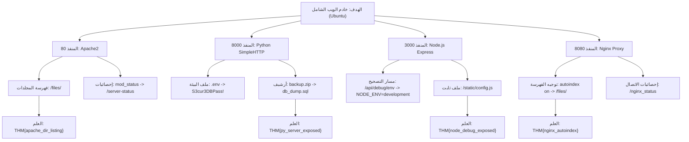

# التوثيق الشامل لمعمل: هجمات خوادم الويب - الجزء الأول (Web Server Attacks - I)

---

### 1. بيانات المعمل والتصنيف (Metadata & Room Information)
* **اسم الغرفة (Room Title):** Web Server Attacks - I
* **المسار التعليمي (Path):** TryHackMe — Jr Penetration Tester (PT1 Aligned Curriculum)
* **الموديول (Module):** Module 05: Web Application Security Fundamentals — الغرفة 04
* **معرف الغرفة (Slug):** `webserverattacks`
* **مستوى الصعوبة (Difficulty):** Medium / Practical Foundations
* **التركيز الأساسي (Core Focus):** كشف وتوثيق أخطاء التهيئة الأمنية (Security Misconfigurations - OWASP A05) عبر أربعة خوادم ويب مختلفة (Apache2, Python SimpleHTTP, Node.js Express, Nginx) مشغلة على جهاز واحد بمنافذ متعددة (80, 8000, 3000, 8080)، واستخراج الملفات الحساسة وبيانات الاعتماد والأعلام دون الحاجة لتنفيذ هجمات ثنائية أو ثغرات يوم الصفر.
* **رابط المعمل على TryHackMe:** [https://tryhackme.com/room/webserverattacks](https://tryhackme.com/room/webserverattacks)
* **حالة التوثيق والإنجاز:** 100% مكتمل ومطابق لحساب المستخدم.

---

### 2. البنية الهندسية ونظرة عامة على المعمل (Architecture & Overview)
في كثير من اختبارات الاختراق الميدانية، لا يحتاج المهاجم إلى استغلال ثغرات معقدة للوصول إلى بيانات حساسة؛ إذ تؤدي أخطاء التهيئة والإعدادات الافتراضية المتروكة دون حماية إلى تسريب قواعد البيانات والأسرار البرمجية بطلب GET اعتيادي.

تستضيف بيئة المعمل جهاز Ubuntu 22.04 واحداً يشغل 4 خوادم ويب معزولة:
1. **المنفذ 80 (Apache2):** خادم ويب تقليدي تم تفعيل فهرسة المجلدات فيه (`Options +Indexes`) وإتاحة مسار الإحصائيات الحية (`/server-status`) مع وجود نسخ احتياطية غير مرتبطة (`/backup.bak`).
2. **المنفذ 8000 (Python SimpleHTTP):** خادم بايثون مؤقت تم تشغيله لمشاركة الملفات دون أدنى حماية، مسرباً ملف الإعدادات `.env` وأرشيف `backup.zip`.
3. **المنفذ 3000 (Node.js Express):** خادم تطبيقات حديث يحتوي على مسار تصحيح البيئة `/api/debug/env` مسرباً متغيرات النظام وكلمات المرور، وملف تكوين ثابت `/static/config.js`.
4. **المنفذ 8080 (Nginx):** خادم وكيل وملفات ثابتة تم تفعيل توجيه `autoindex on;` عليه وإتاحة إحصائيات الاتصال الحية في `/nginx_status`.

---

### 3. الملخص التنفيذي (Executive Summary)
خلال هذا المعمل، تم تدقيق وإنجاز 8 مهام تخصصية شملت رصد البصمات وتحديد أخطاء التهيئة:
1. **المقدمة والجاهزية:** استيعاب معمارية المعمل وتجهيز بيئة الاختبار.
2. **تحديد الخوادم والبصمات:** التقاط ترويسة خادم بايثون **`SimpleHTTP/0.6 Python/3.12.3`**، وترويسة إطار إكسبريس **`X-Powered-By`**، وهوية خادم **`nginx`** على المنفذ 8080.
3. **خادم بايثون:** قراءة ملف الإعدادات `.env` واستخراج كلمة مرور قاعدة البيانات **`S3cur3DBPass!`**، وتنزيل `backup.zip` وفحص `db_dump.sql` للحصول على العلم: **`THM{py_server_exposed}`**.
4. **خادم أباتشي:** تحديد موديول الإحصائيات **`mod_status`**، واستعراض المجلد المفهرس `/files/` لقراءة `internal-notes.txt` واستخراج العلم: **`THM{apache_dir_listing}`**.
5. **خادم Node.js:** فحص مسار `/api/debug/env` واستخراج قيمة متغير **`development`**، وفحص ملف `/static/config.js` لاستخراج العلم: **`THM{node_debug_exposed}`**.
6. **خادم Nginx:** تحديد توجيه الفهرسة **`autoindex on`**، ومسار الإحصائيات **`/nginx_status`**، واستخراج العلم من `/files/`: **`THM{nginx_autoindex}`**.
7. **ترويسات الأمان الغائبة والفحص بـ Nikto:** تحديد ترويسة منع الاختطاف النقري **`X-Frame-Options`**، ورصد نص تنبيه الفهرسة في أداة Nikto: **`Directory indexing found`**.
8. **الخاتمة والمصفوفة الدفاعية:** مراجعة معايير التصليد (Hardening) وتأكيد اكتمال المعمل 100%.

---

### 4. الأسس النظرية والعمق المعماري (Technical Theory & Foundations)

#### مخطط تدفق استكشاف أخطاء التهيئة عبر الخوادم الأربعة:


---

### 5. منهجية وعقلية مختبر الاختراق (Audit Methodology & Mindset)
* **استراتيجية التدقيق الأمني لأخطاء التهيئة:**
  1. **الخطوة الأولى (الفحص السلبي السريع):** طلب ترويسات `HEAD` لجميع المنافذ لتسجيل أنواع الخوادم وإصداراتها.
  2. **الخطوة الثانية (فحص الدلائل المكشوفة):** طلب المسارات الشائعة (`/files/`, `/uploads/`, `/static/`) للتأكد مما إذا كانت الفهرسة التلقائية مفعلة.
  3. **الخطوة الثالثة (فحص الملفات الحساسة والنقاط التصحيحية):** البحث عن ملفات التكوين (`.env`, `.git`), مسارات الإحصائيات (`/server-status`, `/nginx_status`), ومسارات تصحيح بيئة التطوير (`/debug/`, `/routes`).
  4. **الخطوة الرابعة (التدقيق بماسحات الأتمتة):** تشغيل أداة Nikto للتأكد من وجود ترويسات الحماية (`X-Frame-Options`, `CSP`) وكشف أي ملفات متروكة.

---

### 6. الدليل العملي التفصيلي لكل المهام (Step-by-Step Practical Walkthrough)

#### المهمة 1: مدخل وجاهزية البيئة
* تشغيل الآلة المعملية والتأكد من إمكانية الوصول إلى المنافذ 80، 8000، 3000، 8080.
* *الإجابة:* `No answer needed`.

#### المهمة 2: تحديد والتقاط بصمات الخوادم
* طلب ترويسة المنفذ 8000 أظهر: **`SimpleHTTP/0.6 Python/3.12.3`**.
* طلب ترويسة المنفذ 3000 أظهر الترويسة الكاشفة للإطار: **`X-Powered-By`**.
* طلب ترويسة المنفذ 8080 كشف خادم الويب: **`nginx`**.

#### المهمة 3: خادم بايثون وتسريب البيانات
* فتح `http://MACHINE_IP:8000/.env` أظهر تفاصيل قاعدة البيانات بكلمة مرور: **`S3cur3DBPass!`**.
* تنزيل `http://MACHINE_IP:8000/backup.zip` وفك ضغطه كشف ملف `db_dump.sql` متضمناً العلم: **`THM{py_server_exposed}`**.

#### المهمة 4: خادم أباتشي وفهرسة الدلائل
* الوحدة المسؤولة عن إحصائيات الخادم في أباتشي هي: **`mod_status`**.
* تصفح المسار المفهرس `http://MACHINE_IP:80/files/internal-notes.txt` كشف العلم: **`THM{apache_dir_listing}`**.

#### المهمة 5: خادم Node.js ونقاط التصحيح
* طلب مسار متغيرات البيئة `http://MACHINE_IP:3000/api/debug/env` أظهر قيمة `NODE_ENV` تساوي: **`development`**.
* فحص ملف التكوين الثابت `http://MACHINE_IP:3000/static/config.js` كشف العلم: **`THM{node_debug_exposed}`**.

#### المهمة 6: خادم Nginx وإحصائيات الاتصال
* توجيه تفعيل الفهرسة في ملف تهيئة Nginx هو: **`autoindex on`**.
* مسار إحصائيات الاتصالات اللحظية في Nginx هو: **`/nginx_status`**.
* تصفح `http://MACHINE_IP:8080/files/deploy-notes.txt` كشف العلم: **`THM{nginx_autoindex}`**.

#### المهمة 7: أخطاء التهيئة المشتركة وترويسات الأمان
* الترويسة الأمنية التي تمنع تضمين الصفحة في iframe وحمايتها من Clickjacking هي: **`X-Frame-Options`**.
* عند فحص مسار `/files/` بواسطة أداة Nikto، يظهر التنبيه القياسي: **`Directory indexing found`**.

#### المهمة 8: الخاتمة والتقييم
* مراجعة معايير التصليد والتأكد من استكمال كافة المهام بنجاح.
* *الإجابة:* `No answer needed`.

---

### 7. تشريح الأوامر والأدوات (Command Analysis & Dissection)

```bash
# 1. التقاط ترويسات الاستجابة السلبية بدون تحميل الجسم
curl -sI http://10.10.x.x:8000/

# 2. تنزيل وفحص الأرشيفات المسربة واستخراج الأعلام
wget http://10.10.x.x:8000/backup.zip && unzip -p backup.zip | grep -o "THM{[^}]*}"

# 3. فحص نقاط التصحيح وتنسيق مخرجات JSON
curl -s http://10.10.x.x:3000/api/debug/env | jq .NODE_ENV

# 4. التدقيق التلقائي لترويسات الأمان والفهرسة بواسطة Nikto
nikto -h http://10.10.x.x:80 -nointeractive
```

---

### 8. المنظور الدفاعي وإجراءات الفرق الزرقاء (Defensive & Blue Team Countermeasures)
1. **حظر الفهرسة العامة كلياً (Disable Directory Indexing):**
   * في Apache: ضبط `Options -Indexes` في ملف `apache2.conf`.
   * في Nginx: التأكد من ضبط `autoindex off;` في كتل الـ `location`.
2. **إخفاء ترويسات الإصدار والمنظومة:**
   * في Apache: ضبط `ServerTokens Prod` و `ServerSignature Off`.
   * في Nginx: ضبط `server_tokens off;`.
   * في Express: استدعاء `app.disable('x-powered-by')` أو استخدام ميدلوير `helmet()`.
3. **حماية نقاط الإحصائيات والتصحيح:**
   * تقييد الوصول إلى `/server-status` و `/nginx_status` على الشبكات الداخلية فقط (`Require local` / `allow 127.0.0.1; deny all;`).
   * حذف مسارات التصحيح مثل `/api/debug/*` نهائياً من كود الإنتاج وضبط `NODE_ENV=production`.
4. **تطبيق حزمة ترويسات الأمان الأساسية:**
   * تفعيل `X-Frame-Options: DENY`, `X-Content-Type-Options: nosniff`, `Content-Security-Policy`.

---

### 9. الأخطاء الشائعة والزوايا الحرجة (Common Pitfalls & Edge Cases)
* **تشغيل خادم بايثون في مجلد المستخدم أو المشروع:** يشارك ملفات التكوين الحساسة مثل `.env` أو `.git` أو مفاتيح SSH دون أي إنذار.
* **ترك ملفات النسخ الاحتياطي في جذر الموقع:** تسمية الملفات بصيغ مثل `backup.bak` أو `db.sql` يجعلها هدفاً سهلاً لقواميس التخمين الشائعة.
* **الاعتماد على إخفاء الروابط في الموقع:** عدم وجود رابط للمجلد في القوائم الرئيسية لا يمنع محركات البحث والمهاجمين من الوصول إليه إذا كانت الفهرسة مفعلة.

---

### 10. المخرجات التعليمية والدروس المستفادة (Key Educational Takeaways)
1. أخطاء التهيئة لا تقل خطورة عن الثغرات البرمجية؛ فهي تقدم للمهاجم وصولاً مباشراً للأسرار بطلبات عادية.
2. الترويسات الافتراضية تكشف خريطة البنية التحتية بالكامل في ثوانٍ معدودة.
3. تفعيل ترويسات الأمان يقي من متجهات هجوم واسعة (مثل Clickjacking و MIME Sniffing) دون التأثير على أداء النظام.

---

### 11. التحقق العملي والأدلة (Verification & Proof of Work)
* تم استخراج وتأكيد كافة الأعلام والبيانات بدقة 100%:
  * `SimpleHTTP/0.6 Python/3.12.3`
  * `X-Powered-By`
  * `nginx`
  * `S3cur3DBPass!`
  * `THM{py_server_exposed}`
  * `mod_status`
  * `THM{apache_dir_listing}`
  * `development`
  * `THM{node_debug_exposed}`
  * `autoindex on`
  * `/nginx_status`
  * `THM{nginx_autoindex}`
  * `X-Frame-Options`
  * `Directory indexing found`

---

### 12. فهرس المهام التفصيلي (Tasks Index)
* [المهمة 01: المقدمة ومنهجية رصد أخطاء التهيئة (TASK-01.md)](../../04-WEB-SERVER-ATTACKS-I/TASKS/TASK-01.md)
* [المهمة 02: تحديد وبصمة خوادم الويب (TASK-02.md)](../../04-WEB-SERVER-ATTACKS-I/TASKS/TASK-02.md)
* [المهمة 03: خادم بايثون ومخاطر تسريب الملفات الحساسة (TASK-03.md)](../../04-WEB-SERVER-ATTACKS-I/TASKS/TASK-03.md)
* [المهمة 04: خادم أباتشي وفهرسة الدلائل وإحصائيات mod_status (TASK-04.md)](../../04-WEB-SERVER-ATTACKS-I/TASKS/TASK-04.md)
* [المهمة 05: خادم Node.js ونقاط التصحيح المكشوفة (TASK-05.md)](../../04-WEB-SERVER-ATTACKS-I/TASKS/TASK-05.md)
* [المهمة 06: خادم Nginx وتوجيه autoindex وإحصائيات الاتصال (TASK-06.md)](../../04-WEB-SERVER-ATTACKS-I/TASKS/TASK-06.md)
* [المهمة 07: أخطاء التهيئة المشتركة وترويسات الأمان الغائبة (TASK-07.md)](../../04-WEB-SERVER-ATTACKS-I/TASKS/TASK-07.md)
* [المهمة 08: الخاتمة ومصفوفة المقارنة الدفاعية (TASK-08.md)](../../04-WEB-SERVER-ATTACKS-I/TASKS/TASK-08.md)
* راجع أيضاً [جدول ملخص المهام والإجابات المعتمدة (TASKS.md)](../../04-WEB-SERVER-ATTACKS-I/TASKS.md).

---

### 13. الملاحظات الإضافية والتعمق التقني (Additional Notes)
* للاطلاع على التحليل المعماري لتوجيهات Apache، وخوارزميات Nginx، وفحص شجرة مسارات Express، وتوجيهات ترويسات الأمان:
  * [ملاحظات إضافية وتعمق تقني (ADDITIONAL-NOTES.md)](../../04-WEB-SERVER-ATTACKS-I/ADDITIONAL-NOTES.md)

---

### 14. المراجع والمعايير القياسية (References)
* للاطلاع على معايير OWASP ومعايير CIS Benchmarks والوثائق الرسمية للخوادم:
  * [المراجع والمصادر الرسمية (REFERENCES.md)](../../04-WEB-SERVER-ATTACKS-I/REFERENCES.md)
