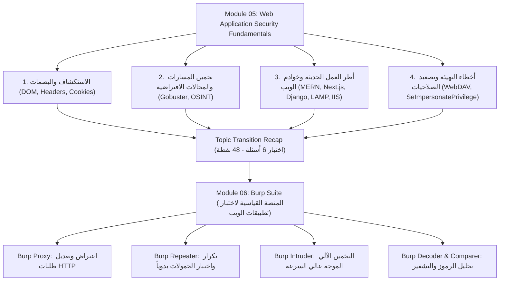

# التوثيق الشامل لمعمل: المراجعة التقييمية والانتقال المعرفي لموديول أساسيات أمان تطبيقات الويب (Module 05 Recap)

---

### 1. بيانات المعمل والتصنيف (Metadata & Room Information)
* **اسم الغرفة (Room Title):** Topic Transition Recap — Web Application Security Fundamentals
* **المسار التعليمي (Path):** TryHackMe — Jr Penetration Tester (PT1 Aligned Curriculum)
* **الموديول (Module):** Module 05: Web Application Security Fundamentals — الغرفة 06 (الختام والمراجعة)
* **معرف المراجعة على المنصة (Slug):** `6afe01d5f306fc3f65927f41` (رابط: [https://tryhackme.com/recap/6afe01d5f306fc3f65927f41](https://tryhackme.com/recap/6afe01d5f306fc3f65927f41))
* **مستوى الصعوبة (Difficulty):** Intermediate / Assessment & Knowledge Verification
* **التركيز الأساسي (Core Focus):** اختبار وتقييم الفهم المعماري والتكتيكي الشامل لكافة مفاهيم موديول أساسيات أمان تطبيقات الويب: من تسوية مسارات curl، وحقيقة ترويسات الأمان الافتراضية، وتوجيهات Nginx، وأكواد استجابة WebDAV، وبصمات كعكات Express، إلى الترتيب التسلسلي المحكم لسلسلة استغلال Apache RCE.
* **حالة التوثيق والإنجاز:** 100% مكتمل ومطابق لحساب المستخدم بنقاط كاملة (48/48).

---

### 2. البنية الهندسية ونظرة عامة على المعمل (Architecture & Overview)
يمثل التقييم الانتقالي (Topic Transition Recap) الجسر التوليفي الحاسم الذي يختبر استيعاب الباحث لمجموع الغرف الخمس التخصصية في الموديول:
1. `01-WALKING-AN-APPLICATION`: استكشاف كود العميل (DOM, Debugger, Storage, AJAX).
2. `02-CONTENT-DISCOVERY`: التخمين اليدوي والآلي للمسارات والنطاقات الافتراضية (Gobuster, OSINT).
3. `03-MODERN-WEB-STACKS`: تفكيك وبصمات أطر العمل الحديثة (MERN, Next.js, Django, LAMP) واستغلال ثغراتها (CVE-2025-29927, CVE-2021-35042, CVE-2021-41773).
4. `04-WEB-SERVER-ATTACKS-I`: تدقيق أخطاء التهيئة في خوادم Apache و Nginx و Python و Node.js.
5. `05-WEB-SERVER-ATTACKS-II`: استهداف خوادم مايكروسوفت IIS، وتخمين 8.3 SFN، ورفع صدفات ASPX عبر WebDAV، وانتحال رموز `SeImpersonatePrivilege`.

يتحقق هذا التقييم من قدرة المختبر على ربط هذه المفاهيم في تسلسل عملي منهجي ومنطقي قبل الانتقال للتحكم اليدوي المتقدم في حركة المرور عبر أداة Burp Suite في الموديول القادم.

---

### 3. الملخص التنفيذي (Executive Summary)
خلال هذا التقييم، تم حل واعتماد الأسئلة الستة بنجاح بنقاط كاملة (48 نقطة):
1. **معامل curl لمنع تسوية المسارات:** تأكيد دور **`--path-as-is`** في إرسال محارف التخطي المشفرة `.%2e/` دون تحويلها محلياً.
2. **ترويسات الأمان الافتراضية:** إثبات خطأ (`False`) افتراض أن الخوادم ترسل ترويسات حماية قوية تلقائياً.
3. **توجيه `server_tokens` في Nginx:** تأكيد تحكمه في **`Version string in the Server header and error pages`**.
4. **كود استجابة رفع الملفات عبر PUT:** تأكيد استلام كود النجاح المعياري **`201`** (Created).
5. **كعكة جلسة إطار عمل Express:** تحديد كعكة **`connect.sid`** الافتراضية لميدلوير `express-session`.
6. **سلسلة استغلال Apache RCE:** ترتيب الخطوات الأربعة بدقة متناهية (فحص الإصدار ⟶ تأكيد معالج CGI ⟶ إرسال POST وتشغيل id ⟶ قراءة ملف العلم).

---

### 4. الأسس النظرية والعمق المعماري (Technical Theory & Foundations)

#### مخطط الجسر المعرفي والانتقال من الموديول 05 إلى الموديول 06:


---

### 5. منهجية وعقلية مختبر الاختراق (Audit Methodology & Mindset)
* **الفهم الشمولي للبيئة المستهدفة (Holistic Web Target Profiling):**
  * قبل إطلاق أداة Burp Suite أو محاولة تنفيذ هجمات الحقن المعقدة (مثل SQLi أو XSS)، يجب أن يمتلك المختبر رؤية واضحة حول:
    1. ما هو الخادم المضيف؟ (Apache أم Nginx أم IIS أم Python).
    2. ما هي بيئة التشغيل الخلفية؟ (Node.js أم .NET أم Python Django أم PHP).
    3. ما هي آليات الجلسات والتوجيه المستخدمة؟ (`connect.sid` أم `csrftoken` أم JWT).
    4. ما هي ترويسات الأمان المفعلة وما هي الثغرات السطحية الناتجة عن غيابها؟
  * هذا الفهم المعماري يوجه هجمات Burp Suite لاحقاً لتكون هجمات دقيقة وفعالة بدلاً من إرسال آلاف الحمولات العشوائية.

---

### 6. الدليل العملي لحلول الأسئلة التقييمية (Recap Questions Walkthrough)

#### السؤال 1: معامل تصحيح المسار في curl
* **السؤال:** ما هو معامل curl الذي يمنعها من تسوية متواليات التخطي المرمزة في الـ URL قبل إرسال الطلب؟
* **الإجابة:** `--path-as-is`.
* **السبب الفني:** يمنع curl من اختصار وحذف `.%2e/` محلياً، مما يضمن وصول التسلسل المرمز لخادم Apache 2.4.49 لاستغلال ثغرة CVE-2021-41773.

#### السؤال 2: افتراض ترويسات الأمان في الخوادم
* **السؤال:** معظم خوادم الويب الشائعة ترسل حزمة ترويسات أمان قوية افتراضياً دون الحاجة لأي تهيئة إضافية؟
* **الإجابة:** `False` (خطأ).
* **السبب الفني:** الخوادم تشحن بإعدادات متساهلة تفتقر تماماً لترويسات `X-Frame-Options` و `CSP` و `HSTS` لتسهيل التطوير.

#### السؤال 3: وظيفة توجيه `server_tokens` في Nginx
* **السؤال:** ماذا يتحكم توجيه `server_tokens` في Nginx؟
* **الإجابة:** `Version string in the Server header and error pages`.
* **السبب الفني:** ضبطه على `off` يحذف رقم الإصدار من ترويسة الاستجابة ومن ذيل صفحات الخطأ الافتراضية.

#### السؤال 4: كود استجابة إنشاء المورد عبر PUT
* **السؤال:** ما هو كود حالة HTTP الذي يشير لنجاح رفع ملف عبر طلب PUT؟
* **الإجابة:** `201`.
* **السبب الفني:** كود `201 Created` هو المعيار الرسمي في RFC 7231 الدال على إنشاء وتخزين مورد جديد على الخادم.

#### السؤال 5: كعكة الجلسة الافتراضية في Express
* **السؤال:** ما هو اسم الكعكة الافتراضية التي يولدها ميدلوير `express-session`؟
* **الإجابة:** `connect.sid`.
* **السبب الفني:** التسمية الافتراضية لميدلوير الجلسات في إطار Express.js وتمثل بصمة مميزة لإطار العمل.

#### السؤال 6: الترتيب المنطقي لسلسلة استغلال Apache RCE
* **السؤال:** رتب خطوات سلسلة استغلال Apache path-traversal-to-RCE بحيث تستهلك كل خطوة نتيجة ما قبلها.
* **الترتيب الصحيح:**
  1. `Read the Server header to confirm the Apache version`
  2. `Request /cgi-bin/ and see 403, confirming a CGI handler`
  3. `POST to the traversal path ending in /bin/sh and run id`
  4. `Reuse the working shell path to cat the flag file`

---

### 7. تشريح الأوامر الميدانية (Command Analysis & Dissection)

```bash
# 1. منع تسوية المسار لإرسال متوالية تخطي أباتشي
curl -s --path-as-is "http://target.thm/cgi-bin/.%2e/.%2e/.%2e/.%2e/bin/sh" --data 'echo; id'

# 2. فحص ترويسات الاستجابة للتحقق من غياب ترويسات الأمان
curl -sI http://target.thm/ | grep -Ei "x-frame|content-security|server"

# 3. التحقق من كعكات الجلسة واستخراج connect.sid
curl -sI http://target.thm:3000/ | grep -i "set-cookie"
```

---

### 8. المنظور الدفاعي وإجراءات الفرق الزرقاء (Defensive Countermeasures)
1. **تصليد الخوادم بإخفاء الإصدارات:**
   * ضبط `ServerTokens Prod` في Apache، و `server_tokens off;` في Nginx.
2. **إلزامية ترويسات الحماية:**
   * فرض `X-Frame-Options: DENY` و `X-Content-Type-Options: nosniff` و `Content-Security-Policy` على مستوى خادم الويب أو الوكيل العكسي.
3. **حظر وحدات CGI غير الضرورية:**
   * إلغاء تفعيل `mod_cgi` وترقية أباتشي لتفادي ثغرات تخطي المسار وتنفيذ الأوامر.

---

### 9. الأخطاء الشائعة والزوايا الحرجة (Common Pitfalls & Edge Cases)
* **نسيان `--path-as-is` عند اختبار LFI/Path Traversal:** يؤدي لفشل التحقق من وجود الثغرة بسبب معالجة curl المحلية للمسار.
* **إهمال ترويسة `Set-Cookie` في الاستطلاع السلبي:** كعكة مثل `connect.sid` تكشف هوية إطار العمل فوراً حتى مع إخفاء ترويسة `X-Powered-By`.
* **القفز العشوائي في خطوات الاستغلال:** محاولة تشغيل أوامر النظام قبل تأكيد وجود معالج تنفيذي (مثل `cgi-bin`) يهدر وقتاً كبيراً ويفشل الهجوم.

---

### 10. المخرجات التعليمية والدروس المستفادة (Key Educational Takeaways)
1. سلاسل الاستغلال الناجحة تعتمد على الاستهلاك المنهجي والمتدرج للمعلومات المستكشفة.
2. ترويسات الأمان الافتراضية غائبة دائماً، وتدقيقها يمثل ركيزة تقارير اختبار الاختراق.
3. الإشارات السلبية (الترويسات، الكعكات، صفحات الأخطاء) تكشف البنية التحتية بدقة 100% دون الحاجة لإطلاق أدوات هجومية صاخبة.

---

### 11. التحقق العملي والأدلة (Verification & Proof of Work)
* تم حل وتأكيد جميع الأسئلة الستة بنسبة نجاح 100% وإحراز 48 نقطة كاملة.
* تم توثيق وشرح كافة الأسئلة والخيارات والتعليلات الفنية في [ملف مراجعة وتفكيك الأسئلة التفصيلي (RECAP-QUESTIONS.md)](../../06-TOPIC-TRANSITION-RECAP/RECAP-QUESTIONS.md).

---

### 12. فهرس المهام والأسئلة (Tasks & Questions Index)
* [التحليل المفصل لكافة أسئلة المراجعة (RECAP-QUESTIONS.md)](../../06-TOPIC-TRANSITION-RECAP/RECAP-QUESTIONS.md)
* راجع أيضاً الغرف السابقة في الموديول:
  * [الغرفة 01: استكشاف التطبيقات (Walking An Application)](../../01-WALKING-AN-APPLICATION/README_AR.md)
  * [الغرفة 02: استكشاف المحتوى (Content Discovery)](../../02-CONTENT-DISCOVERY/README_AR.md)
  * [الغرفة 03: أطر الويب الحديثة (Modern Web Stacks)](../../03-MODERN-WEB-STACKS/README_AR.md)
  * [الغرفة 04: هجمات خوادم الويب - الجزء الأول (Web Server Attacks - I)](../../04-WEB-SERVER-ATTACKS-I/README_AR.md)
  * [الغرفة 05: هجمات خوادم الويب - الجزء الثاني (Web Server Attacks - II)](../../05-WEB-SERVER-ATTACKS-II/README_AR.md)

---

### 13. الملاحظات الإضافية والتعمق التقني (Additional Notes)
* للاطلاع على مقارنة معايير RFC لـ HTTP وركائز حزمة ترويسات الأمان:
  * [ملف الأسئلة والتعليق الفني المتقدم (RECAP-QUESTIONS.md)](../../06-TOPIC-TRANSITION-RECAP/RECAP-QUESTIONS.md)

---

### 14. المراجع والمعايير القياسية (References)
* معايير RFC 7231 و RFC 3986 الخاصة ببروتوكول HTTP وتسوية المسارات.
* معايير OWASP WSTG v4.2 لأمان تطبيقات الويب وإرشادات ترويسات الأمان.
* توثيق أداة curl الرسمي لمعامل `--path-as-is`.
