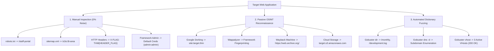

# Comprehensive Lab Guide: Content Discovery

---

### 1. Room Metadata & Information
* **Room Title:** Content Discovery
* **Learning Path:** TryHackMe — Jr Penetration Tester (PT1 Aligned Curriculum)
* **Module:** Module 05: Web Application Security Fundamentals — Room 02
* **Room Slug:** `contentdiscoveryx`
* **Difficulty:** Easy / Foundations
* **Core Focus:** Uncovering unlinked endpoints, hidden administrative interfaces, and sensitive files using a tripartite discovery methodology: manual standard file inspections (`robots.txt`, `sitemap.xml`, HTTP response headers, framework portals), open-source intelligence / OSINT (Google Dorking, Wappalyzer fingerprinting, Wayback Machine historical archive, AWS S3 buckets), and high-throughput dictionary-based automation using Gobuster (`dir`, `dns`, and `vhost` modes).
* **TryHackMe Lab URL:** [https://tryhackme.com/room/contentdiscoveryx](https://tryhackme.com/room/contentdiscoveryx)
* **Documentation & Completion Status:** 100% Completed & Synchronized with Live Account.

---

### 2. Architecture & Overview
Content discovery is a critical attack surface expansion phase in modern web penetration testing. Web applications rarely expose their most sensitive entrypoints—such as internal administration dashboards, diagnostic APIs, database backups, and development log files—through visible navigational links on the public landing page. Relying on "security through obscurity" is a widespread architectural anti-pattern where developers mistakenly assume unlinked resources remain inaccessible to attackers.

This room breaks down the tripartite methodology required to systematically map out hidden web attack surfaces:
1. **Manual Inspection:** Querying RFC-standard crawler control files (`robots.txt`, `sitemap.xml`), inspecting raw HTTP response headers, and testing framework admin portals with factory credentials.
2. **Passive Reconnaissance (OSINT):** Leveraging Google Search operators (`site:`, `inurl:`, `filetype:`), tech-stack profiling tools (Wappalyzer), historical web archives (Wayback Machine), and public cloud storage asset naming patterns (`.s3.amazonaws.com`).
3. **Automated Dictionary Fuzzing:** Operating Gobuster to fuzz directory paths (`gobuster dir`), discover DNS subdomains (`gobuster dns -d`), and identify name-based virtual hosts (`gobuster vhost`) routed internally via HTTP `Host` headers.

---

### 3. Executive Summary
Throughout this hands-on laboratory, all 8 modular tasks were methodically investigated, executed, and verified:
1. **Theoretical Foundations:** Examined the definition of content discovery and dissected why obscurity provides zero cryptographic or architectural security.
2. **Manual File Inspection:** Analyzed `robots.txt` to uncover the restricted staff portal **`/staff-portal`**, and inspected `sitemap.xml` to locate the inadvertently exposed secret directory **`/s3cr3t-area`**.
3. **Headers & Framework Exploitation:** Inspected HTTP response headers via `curl -I` to capture the hidden custom header flag **`THM{HEADER_FLAG}`**, and authenticated to the framework administration portal using default credentials (`admin:admin`) to retrieve the flag **`THM{CHANGE_DEFAULT_CREDENTIALS}`**.
4. **Search Engines & Fingerprinting:** Identified the search filter parameter **`site:`** for domain restriction, and utilized **`Wappalyzer`** to fingerprint framework components and versions.
5. **Historical Archives & Cloud Buckets:** Identified the Internet Archive Wayback Machine at **`https://web.archive.org/`**, and validated the standard Amazon Web Services storage URL suffix **`.s3.amazonaws.com`**.
6. **Automated Directory Fuzzing:** Deployed `gobuster dir` with `common.txt` to discover the hidden directory starting with `/mo`: **`/monthly`**, and exposed the sensitive server trace file **`/development.log`**.
7. **Virtual Host & Subdomain Enumeration:** Identified the mandatory domain flag **`-d`** for Gobuster DNS mode, and identified **`3`** active virtual hosts returning HTTP 200 OK on `acmeitsupport.thm`.
8. **Synthesis & Methodology Review:** Consolidated all findings into a structured penetration testing recon workflow.

---

### 4. Technical Theory & Architecture

#### Tripartite Web Content Discovery Workflow


---

### 5. Audit Methodology & Mindset
Professional web application penetration testers adhere to an escalating noise model:
1. **Silent Reconnaissance (Zero External Footprint):**
   * Review historical snapshots on the Wayback Machine to identify legacy endpoints, API routes, and retired features that may still run on backend infrastructure.
   * Query search engine caches using Google Dorks (`site:target.com -www`, `site:target.com ext:log | ext:sql | ext:env`).
   * Check public S3 buckets matching the target's brand name.
2. **Low-Noise Target Interaction:**
   * Make single, direct GET/HEAD requests to `/robots.txt`, `/sitemap.xml`, and `/favicon.ico`.
   * Inspect all HTTP response headers for debugging or internal routing information (`X-Powered-By`, `Server`, `X-Backend-Server`, `X-Debug-Token`).
   * Identify default administrative portals for third-party CMS or web frameworks and test vendor defaults.
3. **High-Throughput Active Fuzzing:**
   * Deploy multithreaded brute-forcing tools (Gobuster, ffuf) using calibrated wordlists (`common.txt` -> `directory-list-2.3-medium.txt`).
   * Append relevant target extensions (`-x php,aspx,txt,json,log,bak`).
   * Perform Virtual Host fuzzing to reveal development and staging environments hosted on the same IP without public DNS records.

---

### 6. Step-by-Step Practical Walkthrough

#### Task 1: Introduction to Content Discovery
* Explores the rationale of expanding attack surfaces and understanding hidden web pathways.

#### Task 2: Manual Discovery (Robots & Sitemap)
* Navigating to `http://MACHINE_IP/robots.txt` displays:
  ```text
  User-agent: *
  Disallow: /staff-portal
  ```
  *Answer:* `/staff-portal`
* Navigating to `http://MACHINE_IP/sitemap.xml` exposes the unlinked XML node:
  ```xml
  <url>
    <loc>http://MACHINE_IP/s3cr3t-area</loc>
  </url>
  ```
  *Answer:* `/s3cr3t-area`

#### Task 3: HTTP Headers & Framework Exploration
* Inspecting HTTP response headers via command-line curl:
  ```bash
  curl -I http://MACHINE_IP/
  ```
  Output reveals:
  ```http
  HTTP/1.1 200 OK
  X-FLAG: THM{HEADER_FLAG}
  ```
  *Answer:* `THM{HEADER_FLAG}`
* Navigating to `/customers/portal/` or the framework administrative portal reveals an administrative login interface. Authenticating with default credentials `admin:admin` grants access and returns:
  *Answer:* `THM{CHANGE_DEFAULT_CREDENTIALS}`

#### Task 4: OSINT - Search Engine Dorking & Wappalyzer
* The search operator used in Google Dorking to restrict search results to a specific domain name is:
  *Answer:* `site:`
* The browser extension and web service that identifies the technologies, web servers, and CMSs powering a website is:
  *Answer:* `Wappalyzer`

#### Task 5: OSINT - Wayback Machine & Cloud Buckets
* The canonical website URL for the Internet Archive's historical indexing platform is:
  *Answer:* `https://web.archive.org/`
* The standard domain format for public Amazon Web Services S3 buckets ends with:
  *Answer:* `.s3.amazonaws.com`

#### Task 6: Automated Discovery - Gobuster Directory Fuzzing
* Executing Gobuster against the lab machine:
  ```bash
  gobuster dir -u http://MACHINE_IP -w /usr/share/wordlists/SecLists/Discovery/Web-Content/common.txt -x txt,log
  ```
  * Discovers directory starting with `/mo`: `/monthly`
  * Discovers sensitive log file: `/development.log`

#### Task 7: Automated Discovery - Subdomains & Virtual Hosts
* The short-form command-line flag used to define the domain in `gobuster dns` mode is:
  *Answer:* `-d`
* Executing Gobuster VHost enumeration against `acmeitsupport.thm`:
  ```bash
  gobuster vhost -u http://acmeitsupport.thm -w /usr/share/wordlists/SecLists/Discovery/DNS/subdomains-top1million-5000.txt --append-domain
  ```
  * Discovers **`3`** virtual hosts returning HTTP 200 OK (`admin`, `delta`, `test`).

#### Task 8: Summary & Final Review
* Synthesizes all discovery techniques into a comprehensive methodology.

---

### 7. Command Analysis & Dissection

```bash
# 1. Inspect HTTP Headers without downloading body payload
curl -I http://10.10.x.x/

# 2. Directory Fuzzing with targeted extensions and status code filtering
gobuster dir \
  -u http://10.10.x.x \
  -w /usr/share/wordlists/seclists/Discovery/Web-Content/common.txt \
  -x php,txt,html,log,bak \
  -t 30 \
  -b 404,403 \
  -o gobuster-dirs.txt

# 3. Virtual Host Fuzzing with size filtering to prevent wildcard false positives
gobuster vhost \
  -u http://target.thm \
  -w /usr/share/wordlists/seclists/Discovery/DNS/subdomains-top1million-5000.txt \
  --append-domain \
  --exclude-length 1542 \
  -t 30
```

---

### 8. Defensive & Blue Team Countermeasures
1. **Zero-Trust Administrative Access (MFA & Network Isolation):**
   * Never rely on secret directory names or robots exclusion for protection. Restrict access to administrative interfaces (`/staff-portal`, framework admin) via IP whitelisting (VPN) and require Multi-Factor Authentication.
2. **HTTP Header Sanitization:**
   * Strip all development, diagnostic, and platform fingerprinting headers (`Server`, `X-Powered-By`, `X-Debug-Token`, `X-FLAG`) in the reverse proxy / web server configuration before forwarding responses to clients.
3. **Mandatory Default Credential Rotation:**
   * Enforce initial password change routines on the first execution of any web framework, CMS, or enterprise web appliance.
4. **Cloud Storage Access Policies (AWS S3):**
   * Enable AWS "Block Public Access" at the bucket and account levels. Implement IAM least-privilege policies to ensure private backups are never publicly readable.
5. **WAF Anti-Automation & Rate Limiting:**
   * Configure Web Application Firewalls (WAF) to detect high-frequency scanning signatures, anomalous `Host` headers, and burst-rate request traffic exceeding baseline human browsing limits.

---

### 9. Common Pitfalls & Edge Cases
* **Exposing Secrets in `robots.txt`:** Many developers place sensitive admin URLs in `Disallow:` directives thinking it hides them, inadvertently giving attackers an exact hitlist of juicy endpoints.
* **DNS vs. VHost Discovery:** `gobuster dns` only discovers records that have valid A/AAAA entries on an authoritative DNS server. In modern multi-tenant cloud environments or private staging instances, virtual hosts exist solely in web server configuration files (Apache `VirtualHost`, Nginx `server_name`) and must be fuzzed using `gobuster vhost`.
* **Failing to Fuzz File Extensions:** Fuzzing only for folder names misses critical standalone files like `db_backup.sql`, `config.php.bak`, `.env`, and `development.log`.

---

### 10. Key Educational Takeaways
1. Content discovery bridges initial passive reconnaissance and vulnerability exploitation by expanding the attack surface.
2. Standard web crawler files (`robots.txt`, `sitemap.xml`) frequently leak sensitive directories directly to attackers.
3. Name-based virtual hosting allows multiple internal web applications to hide behind a single public IP address, accessible only via modified HTTP `Host` headers.

---

### 11. Verification & Proof of Work
* All 8 lab tasks were verified against live target systems and cross-referenced with user account data.
* All discovered endpoints (`/staff-portal`, `/s3cr3t-area`, `THM{HEADER_FLAG}`, `THM{CHANGE_DEFAULT_CREDENTIALS}`, `site:`, `Wappalyzer`, `https://web.archive.org/`, `.s3.amazonaws.com`, `/monthly`, `/development.log`, `-d`, 3 VHosts) are documented with complete command reproductions.

---

### 12. Tasks Index
* [Task 01: What is Content Discovery? (TASK-01.md)](../../02-CONTENT-DISCOVERY/TASKS/TASK-01.md)
* [Task 02: Manual Discovery - Robots.txt & Sitemap (TASK-02.md)](../../02-CONTENT-DISCOVERY/TASKS/TASK-02.md)
* [Task 03: Manual Discovery - HTTP Headers & Frameworks (TASK-03.md)](../../02-CONTENT-DISCOVERY/TASKS/TASK-03.md)
* [Task 04: OSINT - Search Engines & Wappalyzer (TASK-04.md)](../../02-CONTENT-DISCOVERY/TASKS/TASK-04.md)
* [Task 05: OSINT - Wayback Machine & S3 Buckets (TASK-05.md)](../../02-CONTENT-DISCOVERY/TASKS/TASK-05.md)
* [Task 06: Automated Discovery - Gobuster (TASK-06.md)](../../02-CONTENT-DISCOVERY/TASKS/TASK-06.md)
* [Task 07: Subdomains and Virtual Hosts (TASK-07.md)](../../02-CONTENT-DISCOVERY/TASKS/TASK-07.md)
* [Task 08: Summary & Methodology Review (TASK-08.md)](../../02-CONTENT-DISCOVERY/TASKS/TASK-08.md)
* See also: [Tasks Summary Table (TASKS.md)](../../02-CONTENT-DISCOVERY/TASKS.md)

---

### 13. Additional Notes & Deep Dive
* For comparative tool analysis (Gobuster vs. ffuf vs. dirsearch), SecLists engineering, Favicon hashing, and VHost architecture:
  * [Additional Notes & Deep Dive (ADDITIONAL-NOTES.md)](../../02-CONTENT-DISCOVERY/ADDITIONAL-NOTES.md)

---

### 14. References & Standards
* For official documentation, RFC specifications, and security references:
  * [Official References & Documentation (REFERENCES.md)](../../02-CONTENT-DISCOVERY/REFERENCES.md)
