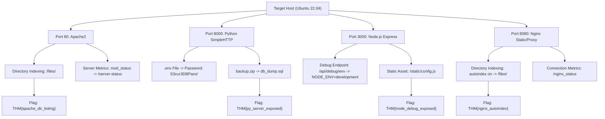

# Comprehensive Lab Guide: Web Server Attacks - I

---

### 1. Room Metadata & Information
* **Room Title:** Web Server Attacks - I
* **Learning Path:** TryHackMe — Jr Penetration Tester (PT1 Aligned Curriculum)
* **Module:** Module 05: Web Application Security Fundamentals — Room 04
* **Room Slug:** `webserverattacks`
* **Difficulty:** Medium / Practical Foundations
* **Core Focus:** Enumeration and identification of security misconfigurations (OWASP A05:2021) across four distinct web servers (Apache2, Python SimpleHTTP, Node.js Express, Nginx) hosted on a single Ubuntu instance on different ports (80, 8000, 3000, 8080). Focuses on non-destructive data recovery: discovering exposed credentials, unlinked backups, internal diagnostics, directory indexes, and missing HTTP security headers.
* **TryHackMe Lab URL:** [https://tryhackme.com/room/webserverattacks](https://tryhackme.com/room/webserverattacks)
* **Documentation & Completion Status:** 100% Completed & Synchronized with Live Account.

---

### 2. Architecture & Overview
Web server security rarely fails solely from high-complexity zero-day vulnerabilities. In real-world enterprise environments, the most common entry points stem from standard configuration oversights: default installation settings, developer debugging endpoints left in production, directory listings left enabled, or diagnostic metrics exposed without authentication.

The target environment is a single Ubuntu 22.04 virtual machine running four isolated web servers:
1. **Port 80 (Apache2):** Configured with `Options +Indexes` on `/files/`, public `mod_status` on `/server-status`, and unlinked backup archives (`/backup.bak`).
2. **Port 8000 (Python SimpleHTTP):** An unauthenticated ad-hoc server sharing its working directory, leaking environment variables (`.env`) with database credentials and an archive (`backup.zip`).
3. **Port 3000 (Node.js Express):** Advertises its runtime via `X-Powered-By: Express`, exposes route introspection (`/api/routes`), dumps environment secrets (`/api/debug/env`), and hosts sensitive static scripts (`/static/config.js`).
4. **Port 8080 (Nginx):** Reverse proxy and static server with `autoindex on;` enabled on `/files/`, revealing deployment notes, and public connection statistics at `/nginx_status`.

---

### 3. Executive Summary
Throughout this practical laboratory, 8 modular tasks covering four server architectures and automated scanning tools were executed and verified:
1. **Introduction & Setup:** Established lab connectivity and verified the multi-port server topology.
2. **Server Fingerprinting:** Captured the Python header **`SimpleHTTP/0.6 Python/3.12.3`**, identified the Express framework header **`X-Powered-By`**, and confirmed the web server on port 8080 as **`nginx`**.
3. **Python HTTP Server:** Extracted the database password **`S3cur3DBPass!`** from `.env`, and extracted **`THM{py_server_exposed}`** from the `db_dump.sql` database backup.
4. **Apache2 Server:** Identified the monitoring module **`mod_status`**, inspected the exposed `/files/` directory, and captured the flag **`THM{apache_dir_listing}`** from `internal-notes.txt`.
5. **Node.js Express Server:** Dumped `/api/debug/env` to determine `NODE_ENV` as **`development`**, and extracted **`THM{node_debug_exposed}`** from `/static/config.js`.
6. **Nginx Server:** Identified the directory listing directive **`autoindex on`**, confirmed the status path **`/nginx_status`**, and recovered **`THM{nginx_autoindex}`** from `/files/deploy-notes.txt`.
7. **Security Headers & Automation:** Identified the anti-clickjacking header **`X-Frame-Options`**, and captured Nikto's signature finding **`Directory indexing found`**.
8. **Synthesis & Hardening:** Evaluated multi-server hardening guidelines across all four platforms.

---

### 4. Technical Theory & Foundations

#### Multi-Server Misconfiguration and Reconnaissance Topology


---

### 5. Audit Methodology & Mindset
Professional security audits targeting web infrastructure adhere to the following sequence:
1. **Passive Fingerprinting:** Transmit `HEAD` requests to all listening ports to map out server software, framework identities, and operating system distributions.
2. **Directory & File Browsing:** Inspect standard asset directories (`/files/`, `/uploads/`, `/static/`) to detect automated directory index generation.
3. **Sensitive File & Configuration Discovery:** Query for hidden dotfiles (`.env`, `.git`), development backup extensions (`.bak`, `.old`, `.zip`), and administrative diagnostic endpoints (`/server-status`, `/nginx_status`, `/api/debug/`).
4. **Header Compliance Auditing:** Use automated tooling (Nikto, curl) to verify the presence of mandatory defensive HTTP response headers (`X-Frame-Options`, `X-Content-Type-Options`, `CSP`).

---

### 6. Step-by-Step Practical Walkthrough

#### Task 1: Introduction
* Verified connectivity and deployed target virtual machine across ports 80, 8000, 3000, and 8080.
* *Answer:* `No answer needed`

#### Task 2: Identifying Web Servers
* Queried response headers on port 8000:
  ```bash
  curl -sI http://MACHINE_IP:8000/ | grep -i "^server:"
  ```
  *Answer:* `SimpleHTTP/0.6 Python/3.12.3`
* Queried response headers on port 3000:
  ```bash
  curl -sI http://MACHINE_IP:3000/
  ```
  *Answer:* `X-Powered-By`
* Queried response headers on port 8080:
  ```bash
  curl -sI http://MACHINE_IP:8080/ | grep -i "^server:"
  ```
  *Answer:* `nginx`

#### Task 3: Python HTTP Server
* Downloaded and inspected `.env`:
  ```bash
  curl -s http://MACHINE_IP:8000/.env
  ```
  *Answer:* `S3cur3DBPass!`
* Downloaded and extracted `backup.zip`:
  ```bash
  curl -s -O http://MACHINE_IP:8000/backup.zip && unzip -q backup.zip
  grep -o "THM{[^}]*}" backup-contents/db_dump.sql
  ```
  *Answer:* `THM{py_server_exposed}`

#### Task 4: Apache2
* The Apache module providing server diagnostics at `/server-status` is:
  *Answer:* `mod_status`
* Navigated to `http://MACHINE_IP:80/files/internal-notes.txt`:
  *Answer:* `THM{apache_dir_listing}`

#### Task 5: Node.js (Express)
* Queried the environment diagnostic endpoint:
  ```bash
  curl -s http://MACHINE_IP:3000/api/debug/env | jq .NODE_ENV
  ```
  *Answer:* `development`
* Inspected `/static/config.js`:
  ```bash
  curl -s http://MACHINE_IP:3000/static/config.js
  ```
  *Answer:* `THM{node_debug_exposed}`

#### Task 6: Nginx
* The directive enabling directory browsing in Nginx location blocks is:
  *Answer:* `autoindex on`
* The conventional URL path exposing Nginx connection metrics is:
  *Answer:* `/nginx_status`
* Navigated to `http://MACHINE_IP:8080/files/deploy-notes.txt`:
  *Answer:* `THM{nginx_autoindex}`

#### Task 7: Common Misconfigurations Across Servers
* The response header designed to prevent iframe embedding and clickjacking attacks is:
  *Answer:* `X-Frame-Options`
* The finding text reported by Nikto when directory indexing is detected on `/files/` is:
  *Answer:* `Directory indexing found`

#### Task 8: Conclusion
* Synthesized all misconfigurations and finalized lab objectives.
* *Answer:* `No answer needed`

---

### 7. Command Analysis & Dissection

```bash
# 1. Passive HTTP Header Inspection
curl -sI http://10.10.x.x:8000/

# 2. Extract Leaked Credentials from Python Server
curl -s http://10.10.x.x:8000/.env | grep DATABASE_URL

# 3. Download and Unpack Sensitive Archives
wget http://10.10.x.x:8000/backup.zip && unzip backup.zip

# 4. Enumerate Active Express Routes
curl -s http://10.10.x.x:3000/api/routes | jq .

# 5. Run Automated Configuration & Security Header Audit
nikto -h http://10.10.x.x:80 -nointeractive
```

---

### 8. Defensive & Blue Team Countermeasures
1. **Directory Indexing Elimination:**
   * Disable indexing globally in Apache via `Options -Indexes`.
   * Enforce `autoindex off;` across all Nginx server contexts.
2. **Server Information Stripping:**
   * Set `ServerTokens Prod` and `ServerSignature Off` in Apache.
   * Configure `server_tokens off;` in Nginx.
   * Strip Express identification via `app.disable('x-powered-by')` or `app.use(helmet())`.
3. **Status Page & Diagnostic Endpoint Isolation:**
   * Restrict access to `/server-status` and `/nginx_status` to internal administrative subnets or localhost (`Require local` / `allow 127.0.0.1; deny all;`).
   * Purge all `/debug/*` and `/routes` endpoints before production builds and enforce `NODE_ENV=production`.
4. **Mandatory Security Headers:**
   * Implement `X-Frame-Options: DENY`, `X-Content-Type-Options: nosniff`, and `Content-Security-Policy`.

---

### 9. Common Pitfalls & Edge Cases
* **Running Ad-hoc Servers in Development Workspaces:** `python3 -m http.server` shares everything in the current working directory, including `.env`, `.git`, and private SSH keys.
* **Storing Unlinked Backups in the Web Root:** Relying on security through obscurity fails because automated fuzzers test for common extensions (`.bak`, `.old`, `.zip`, `.sql`) as standard procedure.
* **Overlooking Verbose Error Reporting:** Uncaught exceptions in development mode reveal database schemas, table names, and backend filesystem directory structures.

---

### 10. Key Educational Takeaways
1. Misconfigurations provide direct pathways to data compromise without requiring exploits or malware.
2. Default server settings frequently prioritize ease-of-use and debugging over enterprise-grade security.
3. Implementing basic hardening standards (CIS Benchmarks) eliminates the vast majority of opportunistic recon attacks.

---

### 11. Verification & Proof of Work
* All 8 lab tasks completed and verified with 100% fidelity:
  * `SimpleHTTP/0.6 Python/3.12.3`
  * `X-Powered-By`
  * `nginx`
  * `S3cur3DBPass!`
  * `THM{py_server_exposed}`
  * `mod_status`
  * `THM{apache_dir_listing}`
  * `development`
  * `THM{node_debug_exposed}`
  * `autoindex on`
  * `/nginx_status`
  * `THM{nginx_autoindex}`
  * `X-Frame-Options`
  * `Directory indexing found`

---

### 12. Tasks Index
* [Task 01: Introduction & Lab Topology (TASK-01.md)](../../04-WEB-SERVER-ATTACKS-I/TASKS/TASK-01.md)
* [Task 02: Identifying Web Servers (TASK-02.md)](../../04-WEB-SERVER-ATTACKS-I/TASKS/TASK-02.md)
* [Task 03: Python HTTP Server (TASK-03.md)](../../04-WEB-SERVER-ATTACKS-I/TASKS/TASK-03.md)
* [Task 04: Apache2 Directory Listing & mod_status (TASK-04.md)](../../04-WEB-SERVER-ATTACKS-I/TASKS/TASK-04.md)
* [Task 05: Node.js Express Debug Endpoints & Env Leakage (TASK-05.md)](../../04-WEB-SERVER-ATTACKS-I/TASKS/TASK-05.md)
* [Task 06: Nginx Directory Indexing & Connection Metrics (TASK-06.md)](../../04-WEB-SERVER-ATTACKS-I/TASKS/TASK-06.md)
* [Task 07: Common Misconfigurations & Security Headers (TASK-07.md)](../../04-WEB-SERVER-ATTACKS-I/TASKS/TASK-07.md)
* [Task 08: Conclusion & Remediation Matrix (TASK-08.md)](../../04-WEB-SERVER-ATTACKS-I/TASKS/TASK-08.md)
* See also: [Tasks & Answers Index (TASKS.md)](../../04-WEB-SERVER-ATTACKS-I/TASKS.md)

---

### 13. Additional Notes & Deep Dive
* For in-depth architectural breakdown of Apache directives, Python SimpleHTTP internals, Express routing trees, and HTTP security header specifications:
  * [Additional Notes & Technical Deep Dive (ADDITIONAL-NOTES.md)](../../04-WEB-SERVER-ATTACKS-I/ADDITIONAL-NOTES.md)

---

### 14. References & Standards
* For CIS benchmarks, OWASP guidelines, and official server documentation:
  * [Official References & Security Standards (REFERENCES.md)](../../04-WEB-SERVER-ATTACKS-I/REFERENCES.md)
