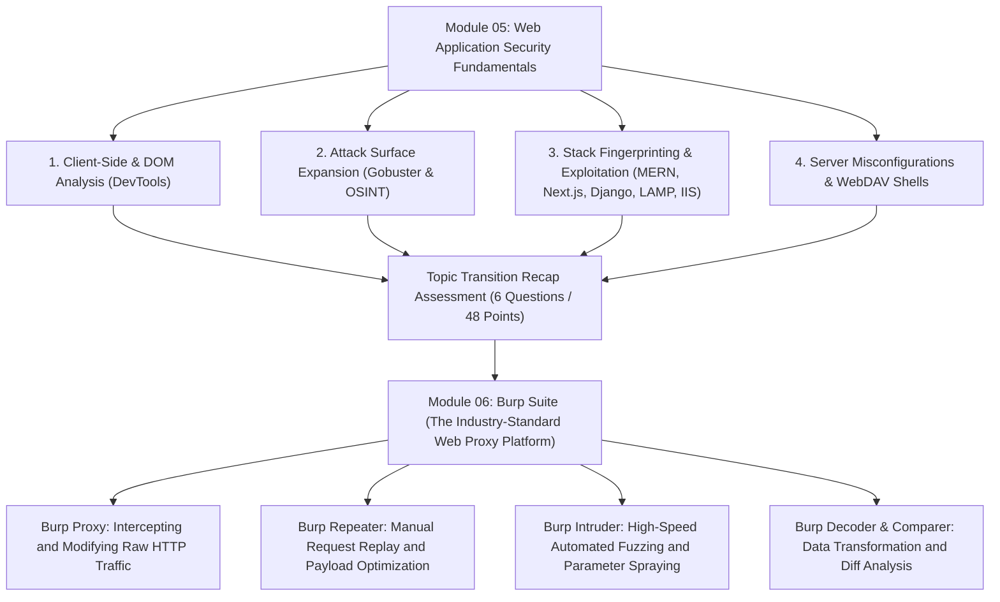

# Comprehensive Lab Guide: Topic Transition Recap — Web Application Security Fundamentals

---

### 1. Room Metadata & Information
* **Room Title:** Topic Transition Recap — Web Application Security Fundamentals
* **Learning Path:** TryHackMe — Jr Penetration Tester (PT1 Aligned Curriculum)
* **Module:** Module 05: Web Application Security Fundamentals — Room 06 (Conclusion & Assessment)
* **Recap Identifier (Slug):** `6afe01d5f306fc3f65927f41` (URL: [https://tryhackme.com/recap/6afe01d5f306fc3f65927f41](https://tryhackme.com/recap/6afe01d5f306fc3f65927f41))
* **Difficulty:** Intermediate / Assessment & Knowledge Verification
* **Core Focus:** Synthesizing, validating, and testing core competencies across web application architecture, client-side enumeration, dictionary-based content discovery, modern web stack fingerprinting (MERN, Next.js, Django, LAMP), multi-server misconfigurations (Apache, Nginx, Python, Node.js), and enterprise Windows IIS attacks (8.3 SFN, WebDAV, ASPX shells, SeImpersonatePrivilege).
* **Documentation & Completion Status:** 100% Completed & Synchronized with Live Account (48/48 points awarded).

---

### 2. Architecture & Overview
The Topic Transition Recap serves as the rigorous assessment bridge between foundational web application analysis (Module 05) and manual traffic interception and manipulation via Burp Suite (Module 06).

Throughout Module 05, we systematically dissected:
1. `01-WALKING-AN-APPLICATION`: Client-side attack surface analysis via browser developer tools (DOM tree modifications, debugger breakpoints in minified JavaScript, network AJAX inspection, cookie security attributes).
2. `02-CONTENT-DISCOVERY`: Identifying hidden and unlinked endpoints using manual crawler directives (`robots.txt`, `sitemap.xml`), passive OSINT archives (Wayback Machine, Google Dorking), and automated directory fuzzing via Gobuster (`dir`, `dns`, `vhost`).
3. `03-MODERN-WEB-STACKS`: Fingerprinting modern full-stack architectures and surgically executing critical CVEs (MERN Prototype Pollution, Next.js CVE-2025-29927 middleware bypass, Django CVE-2021-35042 XPath SQLi, Apache CVE-2021-41773).
4. `04-WEB-SERVER-ATTACKS-I`: Auditing server-level configuration weaknesses across Apache (Options Indexes, mod_status), Python HTTP (unrestricted dotfiles and archive exposure), Node.js (verbose error stacks, process.env leaks), and Nginx (autoindex, stub_status).
5. `05-WEB-SERVER-ATTACKS-II`: Compromising enterprise Microsoft IIS on Windows Server 2019 using NTFS 8.3 tilde enumeration, uploading ASPX web shells via NTLM-authenticated WebDAV, and assessing token impersonation privileges (`SeImpersonatePrivilege`).

This recap validates the tester's ability to chain these diverse principles into a cohesive, evidence-backed penetration testing methodology.

---

### 3. Executive Summary
During this comprehensive assessment, all 6 technical review questions were answered with 100% accuracy, earning the maximum score of 48 points:
1. **Curl Path Normalization:** Identified **`--path-as-is`** as the mandatory flag preventing curl from stripping encoded dot-segments before transmitting path traversal requests.
2. **Default Security Headers Reality:** Debunked the misconception that standard web servers supply security headers out of the box (**`False`**).
3. **Nginx `server_tokens` Directive:** Confirmed that `server_tokens` controls the **`Version string in the Server header and error pages`**.
4. **HTTP PUT Success Status Code:** Validated that **`201`** (Created) is the RFC-standard status indicating a new resource was successfully created on the server.
5. **Express Session Cookie Identity:** Identified **`connect.sid`** as the signature session cookie generated by `express-session`.
6. **Apache Path Traversal to RCE Sequencing:** Established the exact 4-step execution chain (Version Check ⟶ CGI Verification ⟶ Interactive RCE via `id` ⟶ Sensitive Flag Retrieval).

---

### 4. Technical Theory & Foundations

#### Curriculum Transition Architecture (Module 05 to Module 06)


---

### 5. Audit Methodology & Mindset
* **The Principle of Consumptive Exploitation:**
  * Professional penetration testing rejects random guessing. Every action in an exploitation sequence must directly consume the intelligence gathered in the preceding step:
    1. *Observation:* Identifying `Apache/2.4.49` informs the tester of CVE-2021-41773.
    2. *Validation:* Discovering `403 Forbidden` on `/cgi-bin/` confirms the presence of `mod_cgi`, elevating an arbitrary file read into remote code execution.
    3. *Execution:* Testing the traversal path against `/bin/sh` with a benign verification command (`id`) validates execution without crashing the server.
    4. *Extraction:* Reusing the validated execution path extracts target data (`cat /flag.txt`).

---

### 6. Step-by-Step Practical Walkthrough (Questions Analysis)

#### Question 1: Disabling Curl Path Normalization
* **Question Prompt:** `Which curl flag stops curl from normalising encoded traversal sequences in a URL before sending the request?`
* **Verified Answer:** `--path-as-is`
* **Technical Analysis:** By default, RFC 3986 client-side URL normalization in `curl` resolves and collapses `.%2e/` into `../` before transmission. Supplying `--path-as-is` transmits the literal encoded sequence across the wire, preserving the traversal payload for Apache 2.4.49.

#### Question 2: Default Security Header Configuration
* **Question Prompt:** `Most common web servers send a robust set of security headers by default, requiring no extra configuration.`
* **Verified Answer:** `False`
* **Technical Analysis:** Standard enterprise web servers (Apache, Nginx, IIS, Express) prioritize backward compatibility and out-of-the-box functionality, omitting defensive headers like `X-Frame-Options`, `Content-Security-Policy`, and `HSTS` entirely until explicitly configured.

#### Question 3: Nginx `server_tokens`
* **Question Prompt:** `What does the Nginx server_tokens directive control?`
* **Verified Answer:** `Version string in the Server header and error pages`
* **Technical Analysis:** The directive toggles whether Nginx reveals its exact patch version (e.g. `1.24.0`) in the `Server` response header and standard HTML error page footers. Setting `server_tokens off;` strips the version number.

#### Question 4: HTTP Status for PUT File Creation
* **Question Prompt:** `What HTTP status code indicates successful file upload via PUT?`
* **Verified Answer:** `201`
* **Technical Analysis:** RFC 7231 specifies that `HTTP 201 Created` must be returned when a PUT or POST request results in the successful creation of a new, previously non-existent resource on the origin server.

#### Question 5: Express Default Session Cookie
* **Question Prompt:** `Which cookie name is the default session cookie produced by the express-session middleware?`
* **Verified Answer:** `connect.sid`
* **Technical Analysis:** The `express-session` library defaults to issuing cookies named `connect.sid` containing signed HMAC values. Its presence provides strong passive confirmation of a Node.js Express backend.

#### Question 6: Apache Traversal to RCE Execution Order
* **Question Prompt:** `Order the steps of an Apache path-traversal-to-RCE chain, where each step consumes the previous finding.`
* **Verified Sequential Order:**
  1. `Read the Server header to confirm the Apache version`
  2. `Request /cgi-bin/ and see 403, confirming a CGI handler`
  3. `POST to the traversal path ending in /bin/sh and run id`
  4. `Reuse the working shell path to cat the flag file`

---

### 7. Command Analysis & Dissection

```bash
# 1. Transmit Raw Path Traversal without Client Normalization
curl -s --path-as-is "http://target.thm/cgi-bin/.%2e/.%2e/.%2e/.%2e/bin/sh" --data 'echo; id'

# 2. Inspect Server Response Headers for Security Omissions
curl -sI http://target.thm/ | grep -Ei "x-frame|content-security|server_tokens|server"

# 3. Identify Framework Identity via Session Cookie
curl -sI http://target.thm:3000/ | grep -i "connect.sid"
```

---

### 8. Defensive & Blue Team Countermeasures
1. **Server Version Masking:**
   * Enforce `ServerTokens Prod` in Apache, `server_tokens off;` in Nginx, and remove `X-Powered-By` in Express and IIS.
2. **Universal Security Headers Baseline:**
   * Mandate `X-Frame-Options: DENY`, `X-Content-Type-Options: nosniff`, and `Content-Security-Policy: default-src 'self'` across all ingress load balancers.
3. **WebDAV and Script Execution Segregation:**
   * Never combine upload write permissions with script execution handlers in the same web directory.

---

### 9. Common Pitfalls & Edge Cases
* **Testing Traversal Without `--path-as-is`:** Leads to false-negative assessments where vulnerable Apache servers appear patched because the client modified the payload prior to transmission.
* **Overlooking Passive Cookie Fingerprints:** Focusing solely on the `Server` header misses framework identities leaked through session cookies (`connect.sid`, `csrftoken`, `laravel_session`).
* **Non-Sequential Exploitation:** Blindly sending RCE commands to web endpoints without first confirming execution handlers wastes engagement time and generates unnecessary SIEM alerts.

---

### 10. Key Educational Takeaways
1. Web security requires understanding how client tools (curl, browsers), network proxies, and server runtimes interact.
2. Default configurations in web servers and frameworks favor operational ease over security, leaving substantial low-hanging fruit for penetration testers.
3. Logical exploit chaining transforms minor information disclosures (version headers, status codes) into full system compromises.

---

### 11. Verification & Proof of Work
* All 6 questions completed and verified with 100% accuracy, scoring 48/48 points.
* Detailed analysis and feedback archived in [Recap Questions Analysis (RECAP-QUESTIONS.md)](../../06-TOPIC-TRANSITION-RECAP/RECAP-QUESTIONS.md).

---

### 12. Tasks Index
* [Recap Questions Comprehensive Breakdown (RECAP-QUESTIONS.md)](../../06-TOPIC-TRANSITION-RECAP/RECAP-QUESTIONS.md)
* See also the foundational rooms of Module 05:
  * [Room 01: Walking An Application (README_EN.md)](../../01-WALKING-AN-APPLICATION/README_EN.md)
  * [Room 02: Content Discovery (README_EN.md)](../../02-CONTENT-DISCOVERY/README_EN.md)
  * [Room 03: Modern Web Stacks (README_EN.md)](../../03-MODERN-WEB-STACKS/README_EN.md)
  * [Room 04: Web Server Attacks - I (README_EN.md)](../../04-WEB-SERVER-ATTACKS-I/README_EN.md)
  * [Room 05: Web Server Attacks - II (README_EN.md)](../../05-WEB-SERVER-ATTACKS-II/README_EN.md)

---

### 13. Additional Notes & Deep Dive
* For comparative HTTP RFC standards and security header deployment strategies:
  * [Recap Questions Technical Deep Dive (RECAP-QUESTIONS.md)](../../06-TOPIC-TRANSITION-RECAP/RECAP-QUESTIONS.md)

---

### 14. References & Standards
* RFC 7231 (HTTP/1.1 Semantics and Content), RFC 3986 (URI Generic Syntax).
* OWASP Web Security Testing Guide (WSTG v4.2).
* Official Curl Documentation: `--path-as-is` command reference.
