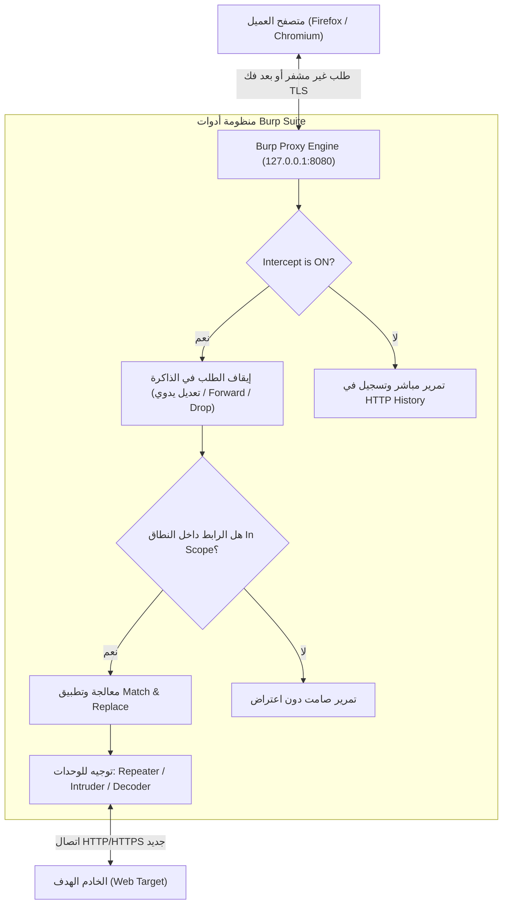

# التوثيق الشامل لمعمل: أساسيات بيرب سويت (Burp Suite: The Basics)

---

### 1. بيانات المعمل والتصنيف (Metadata & Room Information)
* **اسم الغرفة (Room Title):** Burp Suite: The Basics
* **المسار التعليمي (Path):** TryHackMe — Jr Penetration Tester (PT1 Aligned Curriculum)
* **الموديول (Module):** Module 06: Burp Suite — الغرفة 01
* **معرف الغرفة (Slug):** `burpsuitebasics`
* **مستوى الصعوبة (Difficulty):** Easy / Foundations
* **التركيز الأساسي (Core Focus):** التأسيس العملي الشامل لمنصة Burp Suite كوكيل اعتراضي محوري لاختبار أمان تطبيقات الويب؛ تهيئة بيئة العمل، وتوجيه حركة مرور المتصفح عبر FoxyProxy والمتصفح المدمج، وفك تشفير HTTPS بتثبيت شهادة Root CA، وحصر النطاق Scope، واستكشاف خريطة الموقع Site Map، وتنفيذ أول هجوم عملي لتجاوز قيود المتصفح وحقن سكريبت XSS.
* **رابط المعمل على TryHackMe:** [https://tryhackme.com/room/burpsuitebasics](https://tryhackme.com/room/burpsuitebasics)
* **حالة التوثيق والإنجاز:** 100% مكتمل ومطابق لحساب المستخدم.

---

### 2. البنية الهندسية ونظرة عامة على المعمل (Architecture & Overview)
تعتبر منصة Burp Suite، المطورة بواسطة شركة PortSwigger، الأداة القياسية الأكثر استخداماً في العالم لتقييم أمان تطبيقات الويب وتطبيقات الهواتف المحمولة والـ APIs. تعتمد فلسفة الأداة على التمركز في نقطة المنتصف بين متصفح العميل والخادم الهدف كخادم وكيل محلي (Intercepting Proxy يستمع على `127.0.0.1:8080`).

تسمح هذه المعمارية لمختبر الاختراق بالتحكم الكامل في حركة المرور؛ إذ يمكنه مراجعة الطلبات وتعديل معاملاتها بعد اجتياز فحوصات المتصفح وقبل وصولها للخادم، مما يمكنه من اكتشاف الثغرات الكامنة في الواجهة الخلفية (Backend Vulnerabilities) التي تعجز المتصفحات العادية عن اختبارها.

---

### 3. الملخص التنفيذي (Executive Summary)
خلال هذا المعمل التطبيقي التأسيسي، تم إنجاز وتفكيك 15 مهمة تخصصية شملت كافة جوانب المنصة:
1. **التعريف بالإصدارات:** المقارنة بين إصدارات Community و Professional وإصدار المؤسسات **`Burp Suite Enterprise`**، وتأكيد استخدام المنصة لفحص تطبيقات الويب وتطبيقات **`Mobile`**.
2. **الوحدات الأساسية:** تحديد أداة اعتراض الحزم **`Proxy`**، وأداة التخمين الآلي **`Intruder`**.
3. **لوحة التحكم والتنقل:** استكشاف قائمة سجل الأحداث **`Event log`**، وإتقان اختصار التبديل للبروكسي **`Proxy tab`** (`Ctrl + Shift + P`).
4. **الخيارات المتقدمة:** تحديد فئة إدارة الجلسات والكعكات **`Sessions`**، وفئة إعدادات المنصة **`Suite`**، وقسم اختصارات المفاتيح **`Hotkeys`**، وتأكيد إمكانية تخصيص شهادات TLS لكل مشروع (**`yea`**).
5. **ربط المتصفح وخريطة الموقع:** تهيئة إضافة FoxyProxy، واستعراض خريطة الموقع لاكتشاف المسار العشوائي واستخراج العلم: **`THM{NmNlZTliNGE1MWU1ZTQzMzgzNmFiNWVk}`**.
6. **المتصفح المدمج وحصر النطاق:** تشغيل متصفح Chromium المدمج وإدارة خيار `--no-sandbox`، وتحديد قواعد النطاق (Scope) لتنقية الضجيج.
7. **فك تشفير HTTPS:** تثبيت شهادة السلطة الجذرية (`cacert.der`) لإنهاء وفحص اتصالات TLS.
8. **الهجوم العملي:** اعتراض طلب نموذج الدعم وتجاوز قيود التحقق من جانب العميل وحقن حمولة XSS معكوسة مع ترميز URL بـ `Ctrl + U`.

---

### 4. الأسس النظرية والعمق المعماري (Technical Theory & Foundations)

#### مخطط معمارية الوكيل الاعتراضي وتدفق الحزم في Burp Suite:


---

### 5. منهجية وعقلية مختبر الاختراق (Audit Methodology & Mindset)
* **قاعدة التشكيك في قيود المتصفح (Never Trust Client-Side):**
  * يعتمد المطورون في كثير من الأحيان على وسوم HTML5 (مثل `type="email"`, `required`, `maxlength`) أو دوال جافا سكريبت لمنع إدخال نصوص غير صالحة.
  * يدرك مختبر الاختراق أن هذه القيود موجودة فقط لراحة المستخدم العادي، وأن أي متصفح يمكن تجاوزه بسهولة عبر الوكيل الاعتراضي.
* **تنظيم بيئة العمل وعزل الضجيج (Operational Discipline):**
  * أول خطوة يتبعها المحترف بعد تشغيل Burp وتوجيه المتصفح هي تحديد **Target Scope** وتفعيل خيار حصر الاعتراض عليه؛ لتفادي إغراق سجلات الفحص بآلاف الطلبات العشوائية لنطاقات خارجية.

---

### 6. الدليل العملي التفصيلي لكل المهام (Step-by-Step Practical Walkthrough)

#### المهام 1 - 4: التثبيت وإصدارات المنصة
* تشغيل الآلة المعملية واستيعاب إصدارات المنصة.
* إصدار الخوادم والمسح المستمر هو: **`Burp Suite Enterprise`**.
* تستخدم المنصة بكثرة لاختبار تطبيقات الويب وتطبيقات: **`Mobile`**.
* وحدة اعتراض الطلبات هي **`Proxy`**، ووحدة التخمين الآلي هي **`Intruder`**.

#### المهام 5 - 7: لوحة التحكم والخيارات
* القائمة التي توفر معلومات عن تشغيل البروكسي والاتصالات هي: **`Event log`**.
* الاختصار `Ctrl + Shift + P` ينقلنا مباشرة إلى: **`Proxy tab`**.
* فئة إعدادات الجلسات وإدارة الكعكات هي: **`Sessions`**.
* فئة إعدادات تحديثات المنصة هي: **`Suite`**.
* قسم تخصيص اختصارات المفاتيح هو: **`Hotkeys`**.
* إمكانية تخصيص شهادات العميل TLS لكل مشروع مدعومة: **`yea`**.

#### المهام 8 - 10: البروكسي وخريطة الموقع
* ربط فايرفوكس بالبروكسي عبر FoxyProxy على `127.0.0.1:8080`.
* تصفح الموقع وفحص شجرة `Target ⟶ Site map` كشف مساراً عشوائياً يحتوي على العلم:
  * **`THM{NmNlZTliNGE1MWU1ZTQzMzgzNmFiNWVk}`**

#### المهام 11 - 13: المتصفح المدمج وشهادة HTTPS
* استخدام متصفح كروميوم المدمج عبر زر `Open Browser`، وتفعيل `--no-sandbox` إذا لزم الأمر في لينكس.
* إضافة الهدف للنطاق عبر `Add to scope` وتفعيل حصر الاعتراض في إعدادات البروكسي.
* تنزيل شهادة الجذر من `http://burp/cert` وتثبيتها في فايرفوكس تحت Authorities مع تفعيل الثقة.

#### المهمة 14: الهجوم العملي (تجاوز الفحص وحقن XSS)
* فتح نموذج التذاكر في الموقع على المسار `/ticket/`.
* إدخال بريد صالح أولاً ليقبل المتصفح الإرسال.
* اعتراض الطلب في Burp واستبدال قيمة معامل البريد بالحمولة:
  `<script>alert("Succ3ssful XSS")</script>`
* الضغط على `Ctrl + U` لترميز الحمولة، ثم ضغط `Forward`.
* ظهور نافذة الـ Alert بنجاح في المتصفح وتأكيد الثغرة.

#### المهمة 15: الخاتمة
* مراجعة حصيلة المعمل وتأكيد إتمام كافة المتطلبات بنسبة 100%.

---

### 7. تشريح الأوامر والأدوات (Command Analysis & Dissection)

```bash
# 1. التحقق من استماع وكيل Burp Suite محلياً
netstat -tulpn | grep 8080
# المخرجات: tcp 0 0 127.0.0.1:8080 LISTEN

# 2. تنزيل شهادة Burp CA برمجياً عبر curl
curl -x http://127.0.0.1:8080 http://burp/cert -o cacert.der

# 3. إرسال طلب تجريبي عبر وكيل Burp من الطرفية
curl -x http://127.0.0.1:8080 http://10.10.x.x/ -I
```

---

### 8. المنظور الدفاعي وإجراءات الفرق الزرقاء (Defensive Countermeasures)
1. **التحقق الصارم من المدخلات على الخادم (Server-Side Validation):**
   * عدم الاعتماد نهائياً على قيود الواجهة الأمامية؛ يجب فحص نوع وحجم وتنسيق كل معامل داخل كود الخادم (Backend Logic) قبل معالجته.
2. **التعقيم والترميز لمنع ثغرات XSS (Context-Aware Output Encoding):**
   * ترميز كافة مخرجات المستخدم المنعكسة في المتصفح باستخدام دوال الترميز الخاصة ببيئة الـ HTML (`htmlspecialchars` أو ما يعادلها في الأطر الحديثة).
3. **تطبيق سياسة أمان المحتوى (Content Security Policy):**
   * ضبط ترويسة `Content-Security-Policy: default-src 'self'` لحظر تنفيذ السكربتات المضمنة (Inline Scripts) حتى لو نجح المهاجم في حقن وسم `<script>`.

---

### 9. الأخطاء الشائعة والزوايا الحرجة (Common Pitfalls & Edge Cases)
* **ترك Intercept مفعلاً أثناء التصفح العادي:** يتسبب في تجميد المتصفح وإيقاف طلبات الصور والملفات الجانبية.
* **نسيان ترميز الحمولات بـ `Ctrl + U`:** يؤدي إلى تشوه الحمولات أثناء نقلها ببروتوكول HTTP وإفشال هجمات الحقن.
* **استخدام المتصفح الشخصي دون عزل:** يؤدي لتسجيل كلمات المرور الشخصية وحسابات البريد داخل ملف مشروع Burp.

---

### 10. المخرجات التعليمية والدروس المستفادة (Key Educational Takeaways)
1. التحكم في بروتوكول HTTP عبر الوكيل الاعتراضي هو المهارة الأساسية لأي اختبار أمني لتطبيقات الويب.
2. فحوصات المتصفح المحلية مجرد إرشادات للمستخدم لا تحمي الخادم من أي هجوم.
3. إدارة النطاق وفك تشفير HTTPS بكفاءة يحول Burp Suite من مجرد أداة مراقبة إلى منصة فحص متقدمة.

---

### 11. التحقق العملي والأدلة (Verification & Proof of Work)
* تم استكمال وحل جميع الأسئلة واستخراج الأعلام بدقة 100%:
  * `Burp Suite Enterprise`
  * `Mobile`
  * `Proxy`
  * `Intruder`
  * `Event log`
  * `Proxy tab`
  * `Sessions`
  * `Suite`
  * `Hotkeys`
  * `yea`
  * `THM{NmNlZTliNGE1MWU1ZTQzMzgzNmFiNWVk}`

---

### 12. فهرس المهام التفصيلي (Tasks Index)
* للاطلاع على توثيق المهام الـ 15 وفق منهجية المراحل السبع (A-G):
  * [المهمة 01: المقدمة والتهيئة العامة (TASK-01.md)](file:///e:/THM-JR-PENETRATION-TESTER/06-BURP-SUITE/01-BURP-SUITE-THE-BASICS/TASKS/TASK-01.md)
  * [المهمة 02: ما هي منصة Burp Suite ومقارنة إصداراتها (TASK-02.md)](file:///e:/THM-JR-PENETRATION-TESTER/06-BURP-SUITE/01-BURP-SUITE-THE-BASICS/TASKS/TASK-02.md)
  * [المهمة 03: أدوات ووحدات إصدار Burp Community (TASK-03.md)](file:///e:/THM-JR-PENETRATION-TESTER/06-BURP-SUITE/01-BURP-SUITE-THE-BASICS/TASKS/TASK-03.md)
  * [المهمة 04: تثبيت وتشغيل المنصة (TASK-04.md)](file:///e:/THM-JR-PENETRATION-TESTER/06-BURP-SUITE/01-BURP-SUITE-THE-BASICS/TASKS/TASK-04.md)
  * [المهمة 05: لوحة التحكم وسجلات النظام (TASK-05.md)](file:///e:/THM-JR-PENETRATION-TESTER/06-BURP-SUITE/01-BURP-SUITE-THE-BASICS/TASKS/TASK-05.md)
  * [المهمة 06: التنقل واختصارات لوحة المفاتيح (TASK-06.md)](file:///e:/THM-JR-PENETRATION-TESTER/06-BURP-SUITE/01-BURP-SUITE-THE-BASICS/TASKS/TASK-06.md)
  * [المهمة 07: خيارات وتهيئة الإعدادات (TASK-07.md)](file:///e:/THM-JR-PENETRATION-TESTER/06-BURP-SUITE/01-BURP-SUITE-THE-BASICS/TASKS/TASK-07.md)
  * [المهمة 08: مدخل إلى خادم الوكيل البروكسي (TASK-08.md)](file:///e:/THM-JR-PENETRATION-TESTER/06-BURP-SUITE/01-BURP-SUITE-THE-BASICS/TASKS/TASK-08.md)
  * [المهمة 09: ربط المتصفح عبر FoxyProxy (TASK-09.md)](file:///e:/THM-JR-PENETRATION-TESTER/06-BURP-SUITE/01-BURP-SUITE-THE-BASICS/TASKS/TASK-09.md)
  * [المهمة 10: خريطة الموقع واستخراج العلم (TASK-10.md)](file:///e:/THM-JR-PENETRATION-TESTER/06-BURP-SUITE/01-BURP-SUITE-THE-BASICS/TASKS/TASK-10.md)
  * [المهمة 11: متصفح كروميوم المدمج وبيئة Sandbox (TASK-11.md)](file:///e:/THM-JR-PENETRATION-TESTER/06-BURP-SUITE/01-BURP-SUITE-THE-BASICS/TASKS/TASK-11.md)
  * [المهمة 12: تحديد نطاق الهدف وعزل الضجيج (TASK-12.md)](file:///e:/THM-JR-PENETRATION-TESTER/06-BURP-SUITE/01-BURP-SUITE-THE-BASICS/TASKS/TASK-12.md)
  * [المهمة 13: اعتراض اتصالات HTTPS المشفرة وتثبيت الشهادة (TASK-13.md)](file:///e:/THM-JR-PENETRATION-TESTER/06-BURP-SUITE/01-BURP-SUITE-THE-BASICS/TASKS/TASK-13.md)
  * [المهمة 14: تطبيق هجوم عملي: تجاوز التحقق وحقن XSS (TASK-14.md)](file:///e:/THM-JR-PENETRATION-TESTER/06-BURP-SUITE/01-BURP-SUITE-THE-BASICS/TASKS/TASK-14.md)
  * [المهمة 15: الخاتمة والجاهزية لوحدة Repeater (TASK-15.md)](file:///e:/THM-JR-PENETRATION-TESTER/06-BURP-SUITE/01-BURP-SUITE-THE-BASICS/TASKS/TASK-15.md)
* راجع أيضاً [جدول ملخص المهام والإجابات المعتمدة (TASKS.md)](file:///e:/THM-JR-PENETRATION-TESTER/06-BURP-SUITE/01-BURP-SUITE-THE-BASICS/TASKS.md).

---

### 13. الملاحظات الإضافية والتعمق التقني (Additional Notes)
* للاطلاع على التحليل المعماري لمحرك البروكسي، وهندسة تعابير النطاق النمطية، ومحرك Match and Replace:
  * [ملاحظات إضافية وتعمق تقني (ADDITIONAL-NOTES.md)](file:///e:/THM-JR-PENETRATION-TESTER/06-BURP-SUITE/01-BURP-SUITE-THE-BASICS/ADDITIONAL-NOTES.md)

---

### 14. المراجع والمعايير القياسية (References)
* للاطلاع على توثيق PortSwigger الرسمي، ومعايير OWASP، وبطاقة الاختصارات الشاملة:
  * [المراجع والمصادر الرسمية (REFERENCES.md)](file:///e:/THM-JR-PENETRATION-TESTER/06-BURP-SUITE/01-BURP-SUITE-THE-BASICS/REFERENCES.md)
