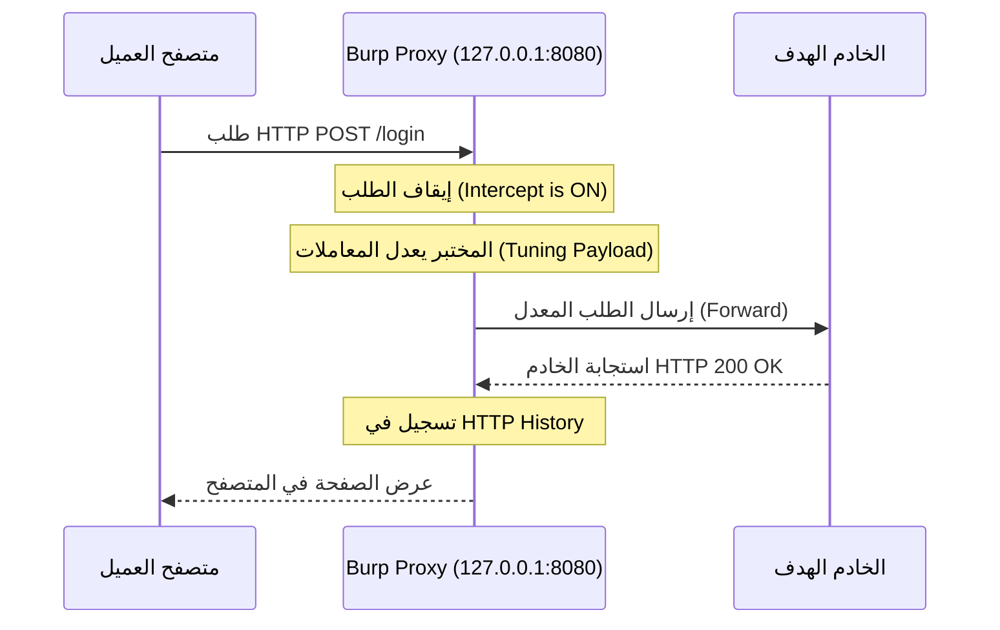

# Task 08: Introduction to the Burp Proxy (مدخل إلى خادم الوكيل البروكسي وآلية اعتراض الحزم)

---

### المرحلة أ: نص المهمة الأصلي والأسئلة (Original Task Content & Questions)

#### English Task Description
The Burp Proxy is the core foundational engine of the entire platform. By establishing a local listener on **`127.0.0.1:8080`**, it captures and negotiates all HTTP and HTTPS traffic moving between the client browser and the destination application.

**Intercept Modes & Controls:**
- **`Intercept is on`:** Every outgoing HTTP request matching interception rules is paused in memory. The tester can inspect the full request body and headers, manually edit any parameter, and then:
  - **Forward:** Transmits the (potentially modified) request to the target server.
  - **Drop:** Terminates the request immediately, preventing it from reaching the server (simulating a network failure or client abort).
- **`Intercept is off`:** Traffic passes through freely without halting the browser. However, **all requests and responses are still passively logged** in the **`HTTP history`** and **`WebSockets history`** tabs for retrospective auditing and analysis.

**Advanced Proxy Capabilities:**
- **Response Interception:** Configurable rules to pause and modify incoming server responses (e.g. bypassing client-side JavaScript access controls by changing `{"isAdmin": false}` to `true`).
- **Match and Replace:** A powerful regex-driven engine in Proxy settings that automatically substitutes patterns across all passing requests/responses (e.g. replacing your browser's User-Agent, spoofing internal IP headers like `X-Forwarded-For`, or stripping defensive headers).

#### الأسئلة المطروحة (Questions):
1. Click me to proceed to the next task. (Answer Format: No answer needed)

---

### المرحلة ب: التفكير التحليلي المستقل والحس الأمني (Independent Critical Thinking & OpSec)
* **الموازنة بين اعتراض الطلبات وسرعة التصفح (Intercept On vs Off):**
  * من الأخطاء المبتدئة الشائعة إبقاء خيار `Intercept is on` مفعلاً طوال الوقت؛ مما يوقف عشرات الطلبات لملفات الصور والأيقونات وملفات التنسيق (CSS/JS) ويجعل التصفح بطيئاً جداً ومربكاً.
  * المختبر المحترف يترك `Intercept is off` أثناء استكشاف الموقع، معتمداً على **HTTP history** لمراجعة الطلبات واختيار الطلب المستهدف بعناية، ثم تفعيل `Intercept is on` فقط عند لحظة إرسال النموذج أو الطلب الحساس المراد تعديله.

---

### المرحلة ج: التلميحات والإرشادات المتدرجة (Guided Progressive Hints)
1. **التلميح الأول (المستوى التمهيدي):**
   * هذه المهمة تشرح الجوانب النظرية والتشغيلية لوحدة البروكسي.
2. **التلميح الثاني (المستوى العملي):**
   * تأكد من استيعاب الفرق بين زر Forward وزر Drop ووظيفة سجل HTTP history.
3. **التلميح الثالث (مستوى الحل المتقدم):**
   * اضغط على زر Submit للمتابعة إلى إعداد المتصفح في المهمة القادمة.

---

### المرحلة د: الحل العملي الكامل والعمق التقني (Complete Practical Solution & Technical Deep Dive)

#### دورة حياة الطلب داخل وحدة البروكسي (Proxy Interception Lifecycle):

---

### المرحلة هـ: الإجابات المعتمدة والقيم النهائية (Final Answer & Key Values)
* **إجابة السؤال الأول:** `No answer needed`

---

### المرحلة و: التحقق العملي وإثبات النجاح (Practical Verification & Proof of Work)
* تم استيعاب آليات عمل البروكسي والتحقق منها بنجاح.
* تم اعتماد السؤال رسمياً على TryHackMe.

---

### المرحلة ز: الاستنتاج التعليمي وجوهر الاختبار (Key Educational Takeaway)
البروكسي هو مركز التحكم في Burp Suite؛ ففهم سلوك زر Intercept وقوة سجل HTTP history يمنح المختبر القدرة على مراقبة حركة المرور بصمت والتدخل فقط في اللحظة التكتيكية المناسبة.
